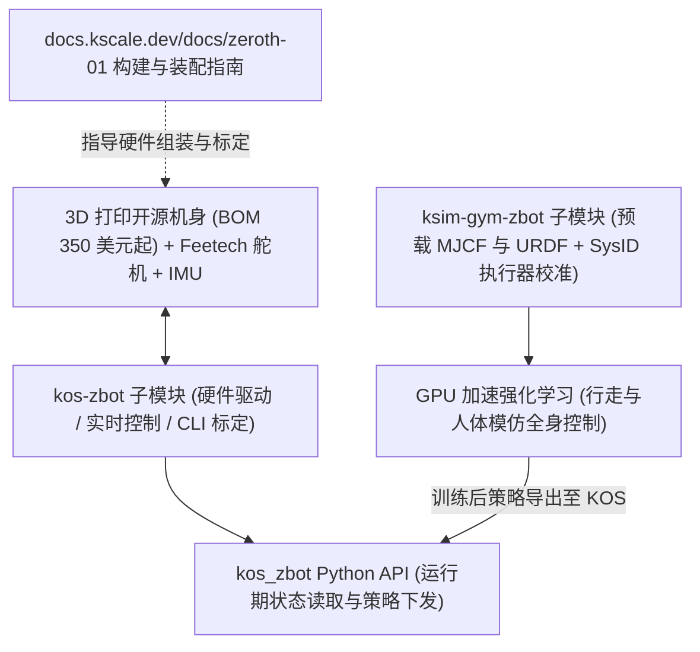

# Zeroth Bot

**[Zeroth Bot（Zeroth-01 Bot）](https://github.com/zeroth-robotics/zeroth-bot)** 收录于 [Robot Learning Paper Notebooks](https://imchong.github.io/Robot_Learning_Paper_Notebooks/index.html)（分类：12_Hardware_Design）。该项目**无对应学术论文或 arXiv 预印本**；本页直接依据官方 GitHub 伞仓（`zeroth-robotics/zeroth-bot`）的 `README.md`、`LICENSE` 与 `.gitmodules` 实读编译。

## 一句话定义

Zeroth-01 Bot 是面向低成本全栈复现（BOM 起价 350 美元）的 3D 打印开源人形机器人平台，由硬件设计、机器人操作系统子模块 `kos-zbot` 与 GPU 强化学习训练子模块 `ksim-gym-zbot` 构成从仿真系统辨识到真机部署的端到端开源链路。

## 英文缩写速查

| 缩写 | 英文全称 | 简要说明 |
|---|---|---|
| BOM | Bill of Materials | 硬件物料清单，官方标定其基础配置物料起价为 350 美元 |
| KOS | K-Scale Operating System (`kos-zbot`) | 机器人操作系统与硬件抽象层子模块，管理舵机、IMU 与 Python API |
| HAL | Hardware Abstraction Layer | 硬件抽象层，隔离底层 Feetech 总线舵机驱动与上层控制策略 |
| SysID | System Identification | 系统辨识，在 `ksim-gym-zbot` 中用于校准仿真执行器物理模型 |
| MJCF / URDF | MuJoCo XML / Unified Robot Description Format | 预载入 `ksim-gym-zbot` 的双格式机器人动力学与运动学模型描述 |

## 为什么重要

- **将人形全栈入门硬件压到百美元级**：相比动辄数万美元的商业双足或上千美元的实验室样机（如 [ToddlerBot](paper-loco-manip-161-141-toddlerbot.md)），BOM 350 美元起的 3D 打印路线显著降低了个人研究者与学生搭建真机 Sim2Real 闭环的财务门槛。
- **硬件-OS-Sim2Real 职责解耦的开源范式**：主仓库只保留说明入口与构建导引，把嵌入式执行器抽象层（`kos-zbot`）与 GPU 并行 RL 训练环境（`ksim-gym-zbot`）拆成独立可复用子模块，便于社区分别演进底层驱动与控制算法。
- **端到端策略直出链路**：`ksim-gym-zbot` 直接内置经过 SysID 校准的执行器模型与 MJCF/URDF 资产，并将训练完成的全身控制策略导出至 KOS 在真机运行，省去个人从零拼装动力学文件与总线通信桥接的高错配率环节。

## 核心机制

Zeroth-01 Bot 采用「伞仓统筹 + 双子模块分工」的技术架构（依据 `README.md` 与 `.gitmodules`）：

1. **硬件本体与可改造底座**：全 3D 打印开源机身，面向入门级双足行走、视觉与语音交互实验设计，采用低成本总线舵机（Feetech）与惯性测量单元（IMU）。
2. **操作系统与硬件抽象层（`kscalelabs/kos-zbot`）**：
   - **硬件驱动与实时控制**：封装 Feetech 舵机通信、IMU 传感器读取与低延迟实时执行器管理环路。
   - **开发者接口与运维工具**：对外暴露高层 `kos_zbot` Python API，同时提供机器人零点标定、系统诊断与配置管理 CLI 工具。
3. **RL 训练与 Sim2Real 管线（`kscalelabs/ksim-gym-zbot`）**：
   - **全身控制训练流**：提供 GPU 加速强化学习环境，覆盖从基础行走（locomotion）到人体动作模仿（human imitation）等任务。
   - **SysID 标定与无缝导出**：将系统辨识（SysID）校准后的执行器动力学参数绑定到预载 MJCF / URDF 模型上训练，所得策略可直接部署至 KOS 实机运行。

图依据：`zeroth-robotics/zeroth-bot` 官方 `README.md` 与 `.gitmodules` 定义的组件边界。

## 系统规格评测与同类平台对比

| 模块层级 | 对应组件 / 仓库 | 核对所得核心特性与状态 |
|---|---|---|
| 伞仓与授权 | `zeroth-robotics/zeroth-bot` | MIT 协议（Copyright 2024 Jingxiang Mo）；发布状态为 **Public Beta**，计划于 2025 年 6 月发布稳定版 V1.0 |
| 硬件平台 | 3D 打印结构 + Feetech 舵机 + IMU | 声明基础物料清单（BOM）起价 **350 美元**；已定位支持基础行走、视觉与语音扩展，详细装配说明托管于 `docs.kscale.dev/docs/zeroth-01` |
| 操作系统与 HAL | 子模块 `kscalelabs/kos-zbot` | 提供 Feetech 舵机/IMU 驱动、低延迟实时控制循环、`kos_zbot` Python API 以及标定/诊断 CLI 工具 |
| 仿真与 RL 训练 | 子模块 `kscalelabs/ksim-gym-zbot` | 提供预校准 SysID 执行器、MJCF & URDF 模型与 GPU 加速全身控制 RL 训练管线，直接对接 KOS 部署 |
| 学术评测状态 | 无公开论文 | 官方尚未发布同行评审论文或系统化的定量消融基准（无成功率/摔倒次数/能耗标准对比表） |

- **与同类开源研究平台对比**：相比定位面向科研并配备同行评审论文与完整基准评测的低成本桌面级开源平台 [ToddlerBot](paper-loco-manip-161-141-toddlerbot.md)（0.56 m、3.4 kg、BOM 低于 6,000 美元），Zeroth-01 Bot 通过 3D 打印机身与 Feetech 总线舵机将基础硬件 BOM 门槛进一步下探至 350 美元，并强调 `kos-zbot` + `ksim-gym-zbot` 社区一体化开发栈，但目前仍处于 Public Beta 阶段且缺乏公开量化性能对照。

## 结论

**Zeroth-01 Bot 是以工程开源与极低成本入门为核心目标的「硬件 + KOS + K-Sim」全栈社区项目——它的一手权威来源是 GitHub 官方仓库与 K-Scale 在线文档（目前没有同行评审学术论文），评估时必须严格区分仓库已承诺的模块化路线与社区 Beta 阶段的实测成熟度边界。**

1. **无论文项目须以仓库与子模块源码为准绳**：本条目最初误置于论文阅读清单但无 arXiv 论文存在；其真实形态是以 MIT 协议发布的开源全栈工程入口，引用或选型时不可假定其拥有经过同行评审的定量对比数据。
2. **「350 美元 BOM + 全栈开源」定位极佳但需先验核子模块**：低成本 Feetech 舵机与 3D 打印本体大大降低了学习 Sim2Real 的试错代价，但顶层 `zeroth-bot` 仓库本身只做说明聚合，所有实操驱动与训练代码均分散在 `kos-zbot` 与 `ksim-gym-zbot` 两个子模块中。
3. **当前版本明确标定为 Public Beta**：官方在 `README.md` 中明确提示「expect breaking changes」，说明控制接口、标定 CLI 与硬件版本仍在快速迭代中，不适合直接用作高可靠性基准实验台。
4. **本地离线克隆边界透明披露**：本次离线仓库中两个 Git 子模块目录均未初始化（为空目录），因此底层的实际控制频率、奖励函数形式与网络结构均以官方 `README.md` 说明为限，不作无根据外推。

## 源码运行时序图

**不适用**：`zeroth-robotics/zeroth-bot` 顶层伞仓本身仅包含项目 `README.md`、`LICENSE`、`public/wave.webp` 与 `.gitmodules`，实际可运行的控制与强化学习代码全部托管在外部 Git 子模块 `kscalelabs/kos-zbot` 与 `kscalelabs/ksim-gym-zbot` 中；本次离线克隆仓库中上述两个子模块目录均未初始化（为空目录），本地无法审阅真实控制入口函数与张量流。按本知识库规范，不以通用模板臆造运行时序图，待后续拉取并通读子模块源码后再行补充。

## 工程实践

| 工程检查项 | 核对事实与复现前置步骤 |
|---|---|
| 克隆方式 | 必须递归拉取子模块（`git clone --recursive` 或同步 `kos-zbot` 与 `ksim-gym-zbot`），否则本地仅拿到顶层文档骨架 |
| 开源协议 | 根目录 `LICENSE` 为 **MIT License**（允许修改与商业衍生活动，注意同步核查两个独立子模块仓库自身的许可文件） |
| 文档与社区入口 | 装配 BOM、打印件与入门流程位于 <https://docs.kscale.dev/docs/zeroth-01>；社区支持见官方 Discord |
| 复现风险门控 | 参考 [开源人形机器人复现可行性门控](../concepts/open-source-humanoid-reproduction-gate.md)：组装采购前先确认子模块近期提交活跃度、具体 Feetech 舵机型号供货与 SysID 标定脚本实测可运行性 |

## 常见误区与局限

- **把伞仓当成完整可运行单仓**：只拉取 `zeroth-bot` 而不初始化 `.gitmodules` 中的 `kos-zbot` 与 `ksim-gym-zbot` 时，仓库内没有任何 Python / RL 训练代码。
- **把「BOM 起价 350 美元」误读为全部完整高配硬件价**：350 美元为官方标注的最低基础 BOM 起点，若包含相机（视觉）、麦克风/算力主板（语音）、电池与备用损坏件，实际搭建预算与调参人力成本通常高于基础标价。
- **缺少学术级定量评测与消融基线**：无已发表论文对步态抗扰边界、舵机寿命衰减、热保护或跨地形成功率给出系统统计学报告，学术对比需谨慎定位。
- **Public Beta 接口破坏性变更风险**：官方明确提醒 Beta 期接口存在不兼容变动，复现时需固定主仓及两个子模块的 commit hash。

## 关联页面

- 分类父节点：[paper-notebook-category-12-hardware-design](../overview/paper-notebook-category-12-hardware-design.md)
- 总索引：[humanoid-paper-notebooks-index.md](../overview/humanoid-paper-notebooks-index.md)
- 硬件与复现门控：[人形机器人硬件选型](../queries/humanoid-hardware-selection.md) · [开源人形复现门控](../concepts/open-source-humanoid-reproduction-gate.md)
- 同类低成本开源双足：[ToddlerBot 硬件与控制实体](paper-loco-manip-161-141-toddlerbot.md)
- 控制与 Sim2Real 基础：[Sim2Real 概念页](../concepts/sim2real.md) · [System Identification](../concepts/system-identification.md)

## 参考来源

- [zeroth_bot_reading.md](../../sources/papers/zeroth_bot_reading.md)（官方仓库与文档梳理归档，无学术论文）
- [humanoid_pnb_zeroth-bot-https-github-com-zeroth-robotics-zero.md](../../sources/papers/humanoid_pnb_zeroth-bot-https-github-com-zeroth-robotics-zero.md)（Robot Learning Paper Notebooks 原条索引归档）
- [zeroth_bot.md](../../sources/repos/zeroth_bot.md)（`zeroth-robotics/zeroth-bot` 仓库文件实读核对归档）
- 官方 GitHub 伞仓：<https://github.com/zeroth-robotics/zeroth-bot>
- 子模块入口：<https://github.com/kscalelabs/kos-zbot> · <https://github.com/kscalelabs/ksim-gym-zbot>
- 官方文档：<https://docs.kscale.dev/docs/zeroth-01>

## 推荐继续阅读

- [Zeroth-01 官方入门与装配文档（K-Scale Docs）](https://docs.kscale.dev/docs/zeroth-01)：核查当前 3D 打印清单、舵机选型与接线图
- [kos-zbot 仓库](https://github.com/kscalelabs/kos-zbot) 与 [ksim-gym-zbot 仓库](https://github.com/kscalelabs/ksim-gym-zbot)：复现前务必核对子模块源码与提交日期
- [开源人形机器人复现可行性门控](../concepts/open-source-humanoid-reproduction-gate.md)：在硬件采买前对开源双足平台做全栈完备度核验
