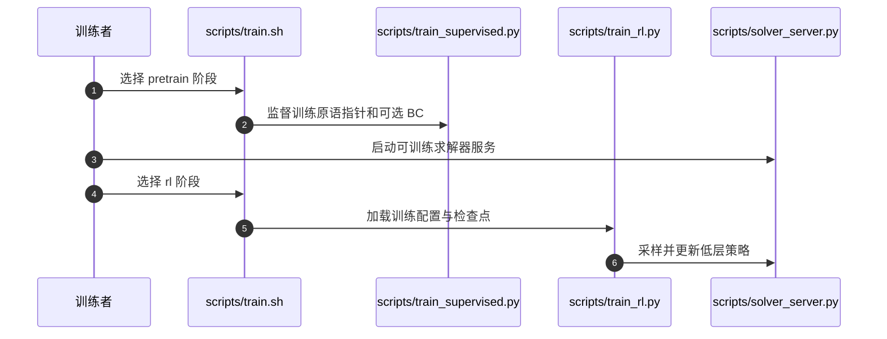

# NS-VLA：神经符号视觉语言动作模型

**英文题名：** NS-VLA: Towards Neuro-Symbolic Vision-Language-Action Models。官方原文：[arXiv:2603.09542v4](https://arxiv.org/abs/2603.09542v4)。当前为**部分原文核验节点**，需补齐实验与附录后才可标 complete。

## 一句话定义
原语计划与分层控制：长程操作需要将指令目标与低层动作块关联，并保留可追踪的任务进度。

## 英文缩写速查
| 缩写 | 英文全称 | 简要说明 |
|---|---|---|
| VLA | Vision-Language-Action | 视觉语言动作 |
| VLM | Vision-Language Model | 视觉语言模型 |
| OOD | Out of Distribution | 分布外评测 |

## 为什么重要
长程操作需要将指令目标与低层动作块关联，并保留可追踪的任务进度。 论文的价值在于将这一失败模式单独建模，而非依靠笼统的端到端指标解释。

## 核心机制
1. **步骤 1：** 视觉语言历史输入。
2. **步骤 2：** 神经符号编码器生成原语计划。
3. **步骤 3：** 单调指针选定当前原语。
4. **步骤 4：** 原语条件化求解器生成动作块。
5. **步骤 5：** H-GRPO 与 AWR 联合优化。

**研究边界：** 数据/动作接口的实际定义与可运行性，须从论文附录及实现进一步确认。

## 流程总览
以下仅概括已核验的论文方法步骤，不意味着所有代码模块均已公开。

## 工程实践
- **任务对象：** 原语计划与分层控制。
- **论文版本：** v4；同一 arXiv ID 的后续版本不重复建页。
- **开源核对：** [官方项目页](https://zuzuzzy.github.io/NS-VLA/) 和 [代码仓库](https://github.com/Zuzuzzy/NS-VLA) 可访问；来源见[仓库归档](../../sources/repos/ns-vla-2603-09542.md)。
- **工程操作：** 先明确输入观测、动作接口、模型训练信号与验证任务；本文的结果不能直接转用到另一种本体。

## 源码运行时序图

根据[官方仓库](../../sources/repos/ns-vla-2603-09542.md)可见入口的静态调用关系整理，并未运行训练或推理。

## 实验与评测
论文在 LIBERO、LIBERO-Plus 和真实机器人操作上报告了成功率与鲁棒性改善，具体数值仍须按 v4 逐表核验。

**完整性说明：** 尚未逐表对照 v4 全文与补充材料，不制造精确数字，也不宣称独立复现。

## 局限与风险
原语分段、边界推进、技能库覆盖及执行噪声影响长时程成功率。

此外，本次未完成论文所有附录及统计协议逐项核对，项目主页/仓库状态可能更新；原文优先级高于二次传播解读。

## 与其他工作对比
- 在[九篇研究趋势地图](../overview/embodied-trends-2026-11-h1.md)中按“技术介入层”定位，不能比较跨论文不同任务、机器人和数据集的绝对指标。
- 相关基础：[VLA](../methods/vla.md)、[机器人操作](../tasks/manipulation.md)。

## 结论
**这篇工作的主要贡献是：原语计划与分层控制。**

- 关键机制：神经符号编码器生成原语计划。
- 主要输出：H-GRPO 与 AWR 联合优化。
- 实证范围：论文在 LIBERO、LIBERO-Plus 和真实机器人操作上报告了成功率与鲁棒性改善，具体数值仍须按 v4 逐表核验。
- 局限与复现前提：原语分段、边界推进、技能库覆盖及执行噪声影响长时程成功率。
- 下一步：核对原文全部表格、附录以及代码依赖，在完成前维持 draft。

## 关联页面
- [VLA](../methods/vla.md)
- [机器人操作](../tasks/manipulation.md)
- [2026.11 上半月九篇论文技术图](../overview/embodied-trends-2026-11-h1.md)
- [VLA 纵深路线](../../roadmap/depth-vla.md)

## 参考来源
- [论文来源核对](../../sources/papers/ns-vla-2603-09542.md)
- [代码来源](../../sources/repos/ns-vla-2603-09542.md)
- [官方项目主页](../../sources/sites/ns-vla-2603-09542.md)
- [策展资料](../../sources/blogs/duomo_embodied_2026_11_first_half.md)
- [arXiv 指定版本](https://arxiv.org/abs/2603.09542v4)

## 推荐继续阅读
- [指定版本 arXiv HTML](https://arxiv.org/html/2603.09542v4)
- [VLA 纵深路线](../../roadmap/depth-vla.md)
