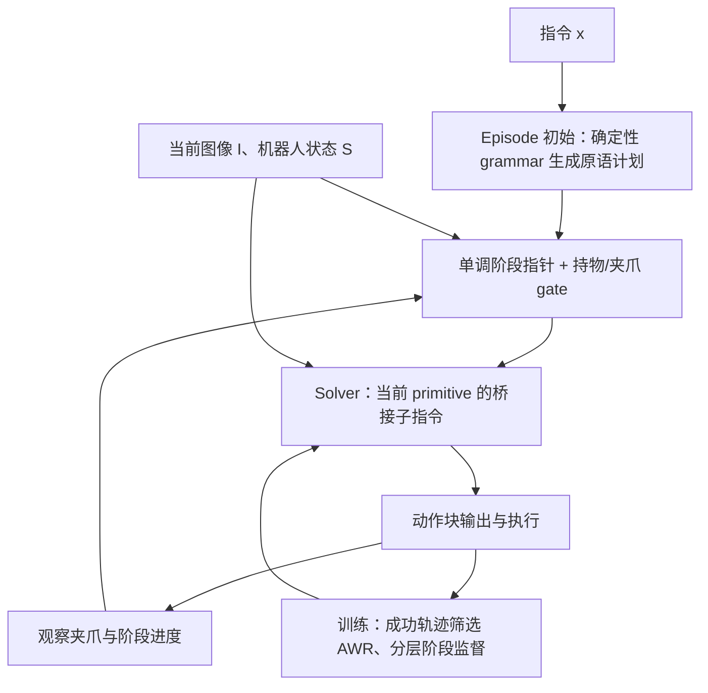
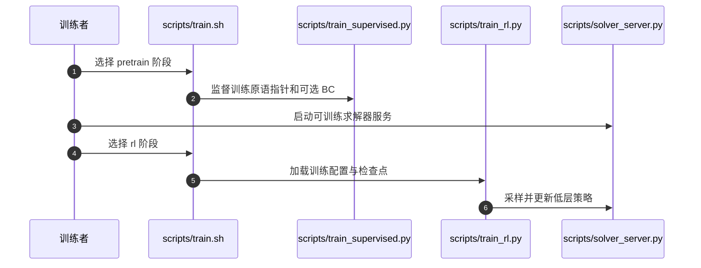

# NS-VLA：神经符号视觉语言动作模型

**英文题名：** NS-VLA: Towards Neuro-Symbolic Vision-Language-Action Models。官方原文：[arXiv:2603.09542v4](https://arxiv.org/abs/2603.09542v4)。已核对 v4 正文与必要附录，**未独立复现训练/真机**。

## 一句话定义
NS-VLA 用确定性计划语法将语言指令变成原语序列，再用单调阶段指针与夹爪状态门控选择当前子指令，由低层 VLA 生成动作块，并通过 HJPO 的层级奖励更新。

## 英文缩写速查
| 缩写 | 英文全称 | 简要说明 |
|---|---|---|
| VLA | Vision-Language-Action | 视觉语言动作策略 |
| HJPO | Hierarchical Joint Policy Optimization | 层级联合策略优化 |
| GRPO | Group Relative Policy Optimization | 组相对策略优化 |
| AWR | Advantage-Weighted Regression | 优势加权回归 |

## 为什么重要
长程操作需要将指令目标与低层动作块关联，并保留可追踪的任务进度。 论文的价值在于将这一失败模式单独建模，而非依靠笼统的端到端指标解释。

## 核心机制
1. **神经符号 Encoder（§4.1）**：对指令只在 episode 开始用确定性语法解析成原语计划；若不在 grammar 覆盖范围内则保留单槽退化形式，**不是任意任务的在线语言规划器**。
2. **阶段选择**：从夹爪开闭及演示事件构造训练时相位标签；运行时单调指针以状态特征、最小驻留、夹爪/持物 gate 和学得二分类器决定前进，不可随意倒退。
3. **Solver（§4.2）**：通用 VLA 主体接当前原语和过渡子指令，输出动作块；动作专家在执行中使用当前观测及物理状态，长任务只在满足相位条件时切换。
4. **HJPO（§4.3、附录 C）**：高层指针基于阶段标签学习，底层使用**成功轨迹筛选的 AWR** 更新；论文称 H-GRPO/HJPO 分层优化组合，成功轨迹使稀疏终局回报可转为底层拟合目标。
5. **部署**：原语库失配时回退单槽 VLA，不承诺未知长任务上的可解释分解；主要研究 LIBERO 的少演示长程操作和 LIBERO-Plus 分布外变化。

## 流程总览
以下为论文原文中的数据/控制流程，不表示本站运行了代码。

## 工程实践
- **代码**：[NS-VLA](https://github.com/Zuzuzzy/NS-VLA) 已公开训练/评测脚本，`scripts/train.sh` 依阶段分发至 `scripts/train_supervised.py` / `scripts/train_rl.py`，`scripts/eval.sh` 分发至 `scripts/run_eval.py`；RL 要求外部 `solver_server.py --trainable`。
- **复现数据边界**：论文 v4 采用 LIBERO 每任务前 5 条演示，合计 200 条，并在 LIBERO-Plus 对固定 1,200 个变体评测；**仓库 README 的 1-shot 结果不是论文 v4 的同一个设置**，不能混抄数值。
- **模型训练**：含 Stage I 监督、指针学习，以及 Stage II 8 轮 success-filtered AWR、验证集选择；未在本次环境实际跑 GPU。

## 源码运行时序图

根据[官方仓库](../../sources/repos/ns-vla-2603-09542.md)可见入口的静态调用关系整理，并未运行训练或推理。

## 实验与评测
- **论文 v4（摘要和表 2）**：报告 LIBERO 平均成功率 **76.5%**、LIBERO-Plus **51.8%**，相比同论文 VLA-Adapter 对照约 71.2% 和 45.4%，不是所有数据集上的持续排名。
- **LIBERO/Plus 协议（附录 E/G）**：四套各 10 任务、每任务 5 示范；LIBERO 官方各 200 回合/套，Plus 固定 1,200 变体来自扰动维度，语言改写另有全量子集分析。
- **随机种子警告**：VLA-Adapter 在 seed 7 的 LIBERO-Long **0.0% 坍塌**，使 Plus-Long 同 seed 表现偏低；论文同时报告多 seed 分析，不能据单次长程崩溃推断所有 backbone 对照都非常弱。
- **实机（附录 G.7）**：myCobot 320pi + 双 D435i 视角，10 个 Pick/Move/Place 任务共 100 次测试，NS-VLA 60/100，对照 VLA-Adapter 40/100；不是任意人形全身操作。
- **运行开销/局限**：指针失步、原语语法覆盖率和夹爪 gate 对没有明确夹爪事件的任务构成部署瓶颈。

**证据边界：** 指标均来自指定版本论文/官方材料，并非本站独立复现；具体基线、统计区间与硬件已按表号区分。

## 局限与风险
固定原语语法、单调指针及夹爪依赖，容易在无显式抓放边界或计划目标发生临时变化时失配；单槽回退避免强制错误分解，但并不能凭空提供长程策略能力。作者的评测范围局限 LIBERO/LIBERO-Plus 与一型 myCobot 机械臂，Plus seed 7 的对照塌陷须在解释泛化时标注。

## 与其他工作对比
- 在[九篇研究趋势地图](../overview/embodied-trends-2026-11-h1.md)中按“技术介入层”定位，不能比较跨论文不同任务、机器人和数据集的绝对指标。
- 相关基础：[VLA](../methods/vla.md)、[机器人操作](../tasks/manipulation.md)。

## 结论
**NS-VLA 提供对长任务可监控的原语分解与分层训练，而不是对任意场景的自由语言规划。**
- 基于固定 grammar 和指针阶段门控，实现低层动作块的稳定子指令接口。
- 稀疏终局奖励通过成功轨迹 AWR 给底层动作专家后训练信号，但仍依赖真实或模拟成功轨迹。
- 论文 v4 的 76.5%/51.8% 与代码 README 的 1-shot 69.1%/49.8% 不属于同一实验协议。
- 实机仅 myCobot 320pi，10 项任务、各 10 次；迁移到其他机器人前须单独验收。

## 关联页面
- [VLA](../methods/vla.md)
- [机器人操作](../tasks/manipulation.md)
- [2026.11 上半月九篇论文技术图](../overview/embodied-trends-2026-11-h1.md)
- [VLA 纵深路线](../../roadmap/depth-vla.md)

## 参考来源
- [论文来源核对](../../sources/papers/ns-vla-2603-09542.md)
- [代码来源](../../sources/repos/ns-vla-2603-09542.md)
- [官方项目主页](../../sources/sites/ns-vla-2603-09542.md)
- [策展资料](../../sources/blogs/duomo_embodied_2026_11_first_half.md)
- [arXiv 指定版本](https://arxiv.org/abs/2603.09542v4)

## 推荐继续阅读
- [指定版本 arXiv HTML](https://arxiv.org/html/2603.09542v4)
- [VLA 纵深路线](../../roadmap/depth-vla.md)
