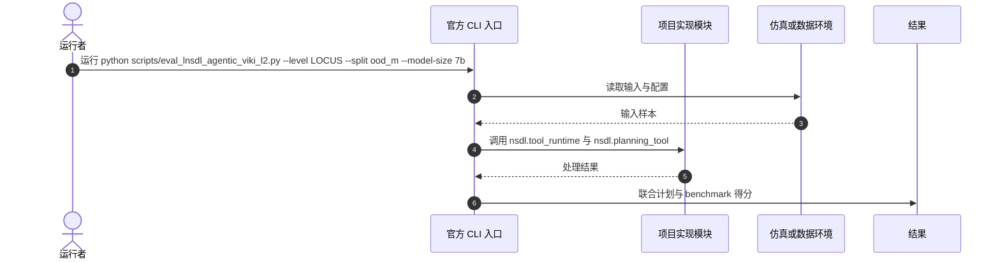

# NSDL: Neuro-Symbolic Division of Labor for Multi-Robot Task Planning｜NSDL：多机器人任务规划的神经符号分工

## 一句话定义

**NSDL：多机器人任务规划的神经符号分工**：VLM 负责现场语义判断和计划草稿，确定性求解器负责补全协作依赖与可执行调度。

## 英文缩写速查

| 缩写 | 英文全称 | 简要说明 |
|---|---|---|
| NSDL | Neuro-Symbolic Division of Labor | 神经符号分工 |
| VLM | Vision-Language Model | 视觉语言模型 |
| OOD | Out-of-Distribution | 分布外评测 |

## 为什么重要

VLM 负责现场语义判断和计划草稿，确定性求解器负责补全协作依赖与可执行调度。 本项目的机制、指标和开放边界需要分开理解，不能把单个结果推广到所有机器人平台。

## 核心信息

| 项 | 一手来源 |
|---|---|
| 论文 | [arXiv:2611.16671v1](https://arxiv.org/abs/2611.16671) |
| 代码 | [官方仓库](https://github.com/Xincheng-Tan/NSDL)；开放范围见源码归档 |

## 核心原理

图像与任务文字进入 VLM，输出 GOAL/ASSIGN/SKETCH；detect 工具查询视觉证据，schedule 调用 Φ 求解器插入依赖与前置关系，validator 拦截不可用联合计划；在符号回放基准上训练并评测工具回合。

### 流程总览

该图表示论文机制的主要数据或控制方向，不表示已经运行作者模型。

## 源码运行时序图

已核对 [官方代码归档](../../sources/repos/nsdl-multirobot-2611-16671.md) 的 README 与公开运行入口（仅说明所发布组件，不代表实机复现）：

## 工程实践

1. 核实数据许可、训练/测试切分、时序观测和动作坐标系，建立与原文一致的对照协议。
2. 参照[官方源码归档](../../sources/repos/nsdl-multirobot-2611-16671.md)核实入口、依赖及模型数据权限。
3. 分别统计训练预算、模拟指标、真机成功率与执行延迟，记录失败模式和软硬件约束。

## 实验与评测

评测 VIKI-L2 与 LOCUS-Bench 的 ID/OOD 及空行动计划，重点是符号回放有效性与结构错误，不等于真机多机器人成功率。

## 结论

**VLM 负责现场语义判断和计划草稿，确定性求解器负责补全协作依赖与可执行调度。**

1. 对照同数据与同测评协议，不混淆不同平台/样本统计口径。
2. 在复现前单列训练数据、预训练、控制接口和硬件依赖。
3. 验证边界是研究结论的必要组成，不能由示例直接推出可量产部署。

## 与其他工作对比

- **对比端到端多机器人规划器（VIKI-L2，Table I）：** 在同一 7B 骨干上，端到端训练基线 `VIKI-R 7B (SFT+GRPO)` 虽在 ID 达 0.952，但 OOD 骤降至 **0.333**（`Ans-SFT 7B` 为 0.256；零样本 `GPT-4o` / `Qwen2.5-VL` 仅 0.004–0.226 ID / 0.000–0.100 OOD）；而 `NSDL 7B (SFT)` 在 ID/OOD 分别达 **0.980 / 0.970**（拒绝率 0.0%），且在 3B 与 Qwen3-VL-8B 上均保持显著抗分布外退化优势。
- **对比形式化翻译基线（Formalize-then-plan）与无求解器消融（Tables I–II）：** 将目标判定完全交给固定规则的 `Prompt-only`（VIKI 0.086 / 0.022）、`Full-translation`（0.513 / 0.674）与 `Trained-translation`（0.637 / 0.406；LOCUS 均分 0.415）均明显落后于 NSDL。在 LOCUS-Bench 上，`NSDL-RL 7B` 均分达 **0.513**（ID 0.839），高于 `NSDL-SFT 7B`（0.472）、原生协议 `VIKI-R 7B`（0.269）与同工具零样本 `gpt-5.6-terra`（0.168）；移除确定性求解器 `Φ`（`w/o Φ`）使 VIKI OOD 下降 9.9 分、LOCUS 均分跌至 0.315 且拒绝率由 0.2%/0.5% 飙升至 23.2%。

## 局限与风险

依赖任务描述语言、工具输出语义和符号评价器；实际机器人感知/控制/通信约束未在该符号回放中完整验证。

## 关联页面

- [2026-11-16 具身研究论文阅读地图](../overview/embodied-frontier-29-papers-2026-11-16.md)
- [ActionCodec2：流式动作编解码](./paper-actioncodec2-streaming-action-tokenizer.md)
- [Agent Planning and Feedback Loops · 智能体规划与反馈执行](../methods/agent-planning-feedback.md)：NSDL 将 VLM 计划草稿、视觉证据查询工具与确定性调度验证器组织为结构化的智能体规划与校验循环。
- [Agent Tool-use Interface · 智能体工具调用接口](../methods/agent-tool-use-interface.md)：NSDL 通过显式的 detect 与 schedule 工具调用接口把符号求解器接入 VLM 推理流程。

## 参考来源

- [论文原文核对归档](../../sources/papers/nsdl-multirobot-2611-16671.md)
- [源代码归档](../../sources/repos/nsdl-multirobot-2611-16671.md)

## 推荐继续阅读

- [arXiv HTML v1](https://arxiv.org/html/2611.16671v1)
- [官方代码](https://github.com/Xincheng-Tan/NSDL)
