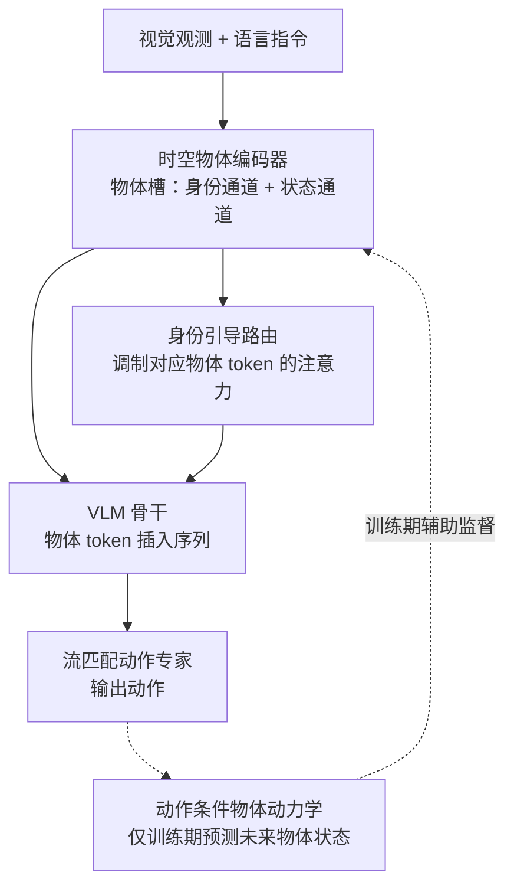

# ObjDream：用物体级理解与未来状态预测引导 VLA

**ObjDream**（论文 *ObjDream: Guiding Vision-Language-Action Models with Object-Level Understanding and Future State Prediction*，[arXiv:2610.20223](https://arxiv.org/abs/2610.20223)，[项目页](https://huailiangma.github.io/objdream/)）由东南大学、上海创智学院、上海交通大学与中科院自动化所的作者提出：把 VLA 的视觉输入从图像级 token 改为 **物体槽**，并用训练期的未来物体状态预测作为辅助监督，提高在布局、杂乱与背景变化下的鲁棒性。

## 一句话定义

**让 VLA 显式地看到「是哪个物体」和「它现在处于什么状态」，并在训练时要求模型预测动作之后的物体状态，推理时不需要这一步预测。**

## 英文缩写速查

| 缩写 | 英文全称 | 简要说明 |
|------|----------|----------|
| VLA | Vision-Language-Action | 视觉、语言与动作统一的机器人策略模型 |
| VLM | Vision-Language Model | 作为 VLA 骨干的视觉语言模型 |
| ObjRel | Object Relation modeling | 论文消融项：物体间关系建模 |
| ObjDyn | Object Dynamics module | 论文消融项：动作条件的物体动力学模块（仅训练期） |
| OOD | Out-of-Distribution | 分布外场景，论文用 LIBERO-Plus 的扰动评估 |
| LIBERO-Plus | LIBERO 扰动评测版 | 零样本评估相机、机器人初始化、布局、语言、光照、背景与噪声扰动 |

## 为什么重要

- **VLA 的视觉表征偏图像级：** 多数 VLA 继承 VLM 的图像 token，物体身份与外观、背景纠缠在一起，分布变化时容易失效。
- **身份与状态要分开：** 论文认为把身份与动态状态放在同一个 token 中会削弱身份线索，因此分两个通道表示。
- **预测要选对目标：** 重建完整图像会学到与控制无关的纹理；预测紧凑的物体状态（几何、可见性）更贴近操作需要。

## 核心信息

| 项 | 内容 |
|----|------|
| **机构** | 东南大学（SEU）；上海创智学院（Shanghai Innovation Institute）；上海交通大学（SJTU）；中国科学院自动化研究所（CASIA） |
| **平台 / 基准** | LIBERO、LIBERO-Plus（零样本）、RoboTwin 2.0（8 任务子集）；真机 4 项任务（按钮、方块抓放、双水果摆放、桌面扫除） |
| **骨干** | 4B 规模预训练 VLM，采用 StarVLA 训练配方；流匹配动作专家 |
| **开源** | **待发布**（截至 2026-10-15）：项目页 Code 标注 "coming soon"；指向 github.com/HuailiangMa/ObjDream，但本次未能核实仓库状态 |

## 核心原理

### 流程总览

### 物体槽与身份引导路由

- 时空物体编码器把视觉观测整理为 **时间上的物体槽**；持久身份与动态状态走两个通道。
- 这些物体 token 映射到 VLM 隐空间后插入序列，**身份引导路由** 根据语言对应的物体身份，调制注意力去关注对应的物体 token。
- 物体编码器通过离线自动标注（由 VLM 生成实例短语）预训练，之后冻结，VLA 训练时不更新。

### 未来物体状态预测（仅训练期）

- 动作条件的物体动力学模块预测紧凑的未来物体状态，作为辅助监督，显式约束物体状态随机器人动作的演化。
- 推理时不做未来预测（论文表述）；推理侧新增的只有物体编码与路由部分。
- 总训练目标结合动作模仿损失、当前物体状态监督与未来物体状态监督。

## 工程实践

| 项 | 建议 |
|----|------|
| 复现入口 | 论文与项目页都未给出可运行代码，复现需按论文自行实现物体编码器与动力学模块 |
| 消融优先级 | 论文中去掉 Fact. Injection 或 Id. Routing 的降幅最大（LIBERO-Plus 约 −1.9 与 −1.8 个点），动力学模块次之 |
| 评测设置 | LIBERO-Plus 为零样本评估，不做微调；RoboTwin 2.0 每任务 50 条 clean 示范 |
| 真机对照 | 与 π0.5 类基线在同一示范下比较 ID / OOD，OOD 才是论文主打的差异来源 |
| 源码运行时序图 | **不适用**（代码待发布，且仓库状态未核实，无可辨识的官方运行入口） |
| 开源状态 | 待发布（2026-10-15 核查：项目页 "coming soon"；仓库本次未能访问） |

## 实验与评测

- **LIBERO：** 平均 98.6%，四个套件中 Spatial 99.2%、Object 99.6%、Goal 98.2%、Long 97.4%。
- **LIBERO-Plus（零样本）：** 总分 84.4%，仅次于 π0.5 的 85.7%；语言、光照、背景扰动分别为 90.6%、98.4%、98.5%，相机视角（66.2%）与机器人初始化（75.8%）仍是主要短板。
- **RoboTwin 2.0（8 任务，50 clean demos/任务）：** Easy 60.25%，Hard 22.75%；相对 StarVLA 分别 +12.87 与 +15.62 个百分点。
- **消融（LIBERO-Plus 总分）：** 骨干基线 81.2 → 完整模型 84.4；去掉 Fact. Injection 为 82.5，去掉 Id. Routing 为 82.6，去掉 ObjDyn 为 83.2，去掉 ObjRel 为 84.1。
- **真机（4 任务平均）：** ID 74%（π0.5 66%，ControlVLA 60%）；OOD 55%（π0.5 53%，ControlVLA 31%）。

## 结论

**VLA 的鲁棒性部分来自「物体级表征」，而未来物体状态监督是比重建图像更有针对性的训练信号。**

1. **身份与状态分通道** — 论文的 Factorized Injection 去掉后 LIBERO-Plus 降到 82.5，是消融中降幅最大的组件之一。
2. **身份引导路由是注意力的关键** — 去掉后降到 82.6，说明仅把物体 token 放进序列不够，还需要按身份选择。
3. **未来物体状态只在训练期用** — ObjDyn 去掉后降到 83.2，说明预测监督有增益，且推理成本不变。
4. **增益主要在扰动下出现** — LIBERO 标准套件上 ObjDream 为 98.6%，与基线差距小；差距主要体现在 LIBERO-Plus 与真机 OOD。
5. **相机视角仍是短板** — 相机视角扰动下得分 66.2%，低于 π0.5（75.4%）与 OA-WAM（80.5%），说明物体级表征并未解决视角变化。
6. **真机结论需谨慎** — 每个真机任务规模小，ID/OOD 分数的样本量与方差未报告。

## 与其他工作对比

| 对照 | 差异读法 |
|------|----------|
| [π0.5（论文基线）](./paper-pi05-open-world-vla.md) | 通用 VLA 强基线；LIBERO-Plus 总分略高，ObjDream 在语言、光照与背景扰动上更强 |
| [StarVLA](../methods/star-vla.md) | ObjDream 的训练配方来源；RoboTwin 上 ObjDream 比它高约 13–16 个点 |
| [OpenVLA](./paper-openvla.md) | 开源 VLA 早期基线；论文中在 LIBERO-Plus 上远低于 ObjDream |
| [World Action Models](../concepts/world-action-models.md) | 同样利用未来预测；ObjDream 只预测紧凑物体状态而非完整观测，且推理不做预测 |

## 局限与风险

- **代码未发布且未核实：** 无法复现论文数字，只能依据论文描述实现。
- **视角扰动仍弱：** 相机视角是论文自陈的主要挑战之一，物体级表征没有解决它。
- **真机规模小：** 4 个任务、每个任务结果是少量试次的百分比，统计意义有限。
- **依赖离线物体标注：** 物体编码器的预训练数据来自自动标注流程，标注质量会影响身份槽。

## 关联页面

- [VLA 方法总览](../methods/vla.md) — 本文所属的范式
- [StarVLA](../methods/star-vla.md) — 训练配方与 RoboTwin 对照基线
- [π0.5（Open World VLA）](./paper-pi05-open-world-vla.md) — 主要真机与仿真对照
- [OpenVLA](./paper-openvla.md) — 开源 VLA 对照
- [World Action Models](../concepts/world-action-models.md) — 未来预测与动作耦合的相关路线
- [分布外泛化](../concepts/out-of-distribution-generalization.md) — 论文主要评测维度

## 参考来源

- [objdream_arxiv_2610_20223.md](../../sources/papers/objdream_arxiv_2610_20223.md) — 论文摘录与开源核查
- [arXiv:2610.20223](https://arxiv.org/abs/2610.20223) — 原文（Submitted 2026-10-14）
- [ObjDream 项目页](https://huailiangma.github.io/objdream/) — 项目页与 Code 按钮状态

## 推荐继续阅读

- [ObjDream 项目页](https://huailiangma.github.io/objdream/)
- [arXiv 全文 PDF](https://arxiv.org/pdf/2610.20223) — Table 1–3 与附录
- [LIBERO 基准（论文主要评测）](https://libero-project.github.io/main.html)
