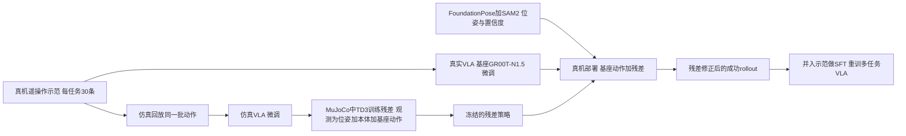

# Object-Centric Residual RL for Zero-Shot Sim-to-Real VLA Enhancement（arXiv:2606.18953）

**Object-Centric Residual RL**（Kinam Kim, Namiko Saito, Heecheol Kim, Katsushi Ikeuchi, Jaegul Choo, Yasuyuki Matsushita；KAIST / Microsoft Research Asia - Tokyo；[arXiv:2606.18953](https://arxiv.org/abs/2606.18953)，v1，2026-06-17）研究的问题是：**只在仿真里训练的 RL 策略，能否零样本提升真机上 VLA 的鲁棒性**（摘要）。归档见 [来源归档](../../sources/papers/object-centric-residual-rl-vla_arxiv_2606_18953.md)，通读范围写在该归档里。

## 一句话定义

在仿真里训练一个只看「物体 6-DoF 位姿 + 本体感觉 + 基座 VLA 当前动作」的小型残差策略（2 层 MLP、TD3），把它的输出叠加到冻结的 VLA 动作上；因为残差不看图像，可零样本搬到真机（第 3 节）。

## 英文缩写速查

| 缩写 | 英文全称 | 简要说明 |
|------|----------|----------|
| VLA | Vision-Language-Action | 视觉-语言-动作模型，本文基座为 GR00T-N1.5（另测 π0.5） |
| RL | Reinforcement Learning | 强化学习 |
| TD3 | Twin Delayed DDPG | 本文训练残差用的离策略算法（第 3.2 节） |
| MLP | Multi-Layer Perceptron | 残差网络结构，2 层（第 4 节） |
| FR3 | Franka Research 3 | 真机平台 |
| 6-DoF | 6 Degrees of Freedom | 物体位置 + 朝向（位姿） |
| SFT | Supervised Fine-Tuning | 用残差修正后的 rollout 重训基座（第 3.4 节） |
| SAM2 | Segment Anything Model 2 | 部署时与 FoundationPose 配合做实例分割 |

## 为什么重要

- **作者的出发点（第 1 节）：** 模仿学习的 VLA 因误差累积在精细物理交互上脆弱；扩散 / 流匹配动作头不易直接做策略梯度，所以用冻结基座加轻量残差；而既有残差 RL 要么需要特权状态蒸馏，要么受视觉域差限制，要么要在真机上训练。
- **作者的主张：** 把残差的观测限定在仿真与现实都能稳定获得的量（位姿、本体感觉、基座动作），即可不蒸馏、不做真机 RL 就零样本迁移（第 1 节贡献、第 3.2 节）。
- **证据强度（我的判断）：** 真机每任务仅 20 次试验、5 个任务、单一机型，且仿真训练还需要为每个任务另训一份仿真 VLA；结论是「在该设置下有效」的初步证据，不宜外推为一般性结论。

## 核心机制

- **阶段 1：成对的仿真 / 真实 VLA（3.1）。** 同一批遥操作动作既用于真实数据训练 π_VLA^real，也在仿真中回放渲染出数据训练 π_VLA^sim；两者监督信号相同，作者称动作分布因此对齐。残差不看图像，所以仿真不必逼真。
- **阶段 2：物体中心残差 RL（3.2）。** 观测 s_t=[s_obj, s_prop, a_base]（式 2）；动作合成 a_t=a_base ⊕ π_res(s_t)，位置、夹爪相加，旋转用四元数乘法（式 1、7）。VLA 每 H=16 步出一个动作块，残差每步都查询（式 6、A.6）。TD3 加截断高斯探索噪声，稠密分阶段奖励（A.1、表 3）。
- **位姿鲁棒化（3.2、A.6）：** 逐步加位置噪声（上限 5 mm）与朝向噪声（上限 0.1 rad），并以 0.1 概率把位姿整体置零（式 4、5）。
- **阶段 3：零样本部署（3.3）。** 真实 VLA 取代仿真 VLA；FoundationPose + SAM2 提供位姿（约 18 ms/帧，异步），跟踪置信度低于 0.5 就把位姿置零触发训练时学到的退化策略；残差前向约 0.06 ms，VLA 推理约 140 ms（第 4 节）。
- **自我改进（3.4）：** 残差修正后的成功 rollout 并入原示范，对基座做 SFT，可跨任务汇总训练单个多任务 VLA。

## 流程总览

## 实验结果（论文自报）

| 任务（真机，20 次试验） | 基座 | +残差 |
|---|---|---|
| Cube Lift | 7 | 17 |
| Pick-and-Place | 9 | 16 |
| Stack Cube | 7 | 15 |
| Close Drawer | 14 | 20 |
| Stand Cup Up | 5 | 8 |
| 平均 | 8.4（42%） | 15.2（76%） |

来源：表 1。仿真侧（3 个 seed 均值）平均 7.6/20→17.2/20。

- **消融（表 2）：** 去掉位姿噪声注入、去掉 dropout、两者都去，真机成绩下降（两者都去时 12/10/9/16/5）；观测空间对比中，蒸馏式（9/4/8/20/5）与图像式（8/10/9/14/6）均不及物体中心设计。图 6(b)：平均真机成功率 76% / 46% / 47%。
- **其他基座（图 6(a)、A.8）：** π0.5 上 Close/Lift/Stand 12→18、6→11、7→13（图读数）；但 Pick-and-Place 的强基座 π0.5 真机 17/20 仍为 17/20，作者解释为基座已正确时残差趋近于零（表 7）。
- **行为分析（5.3）：** 基座动作偏离目标时残差修正更强；成功回合时长缩短 9–22%（图 7）。
- **自我改进（5.4、图 6(c,d)）：** 真机平均成功率 42%→47%（基座 rollout 重训）→59%（残差 rollout 重训），回合长度 275→252→196 步。

## 工程实践

- **复现需要的组件：** 每任务一套真机遥操作示范（30 条）、真机与仿真各一份微调 VLA、按实物尺寸搭的 MuJoCo 简单几何场景（A.2、表 4）、可用的 6-DoF 位姿跟踪（FoundationPose + SAM2）与手工指定的任务相关物体（3.2、第 7 节）。
- **训练超参（A.5）：** actor 512 / critic 1024 隐层，Adam，batch 256，n-step 3，各任务的学习率、L2、折扣、离线样本比例不同。
- **对「残差路线」的实践读法（我的判断）：** 改动集中在一个与基座解耦的小网络上，推理开销可忽略（0.06 ms 对 140 ms，第 4 节），且基座权重不动；但代价是需要位姿感知链路与按任务搭仿真，工程量并未消失，只是转移到感知与仿真对齐上。
- **代码：** 论文正文未给出仓库链接，开源状态未核实。

## 局限

- **作者自述（第 7 节）：** 依赖实时 6-DoF 跟踪，遮挡与杂乱会失败；任务相关物体需手工指定；位姿观测只弥合视觉域差、不弥合动力学域差（摩擦、夹爪柔顺），接触丰富任务可能修正欠佳；残差只能修正轻度偏差，无法从远离基座训练分布的状态恢复；亚毫米精度或极小物体可能超出位姿精度。
- **失败案例（A.11）：** 位姿偏移或漂移、夹爪遮挡丢目标、分割锁定镜面反射，均通过了置信度门限。
- **增益与基座强弱相关（A.8，表 7）：** 强基座上真机无提升；这与残差上限受基座限制的预期一致，但论文未直接论证「上限」。
- **我看到的未验证之处：** 每格仅 20 次真机试验，未报置信区间；真机结果为单次评测而非多 seed；任务难度最高的 Stand Cup Up 仅 5→8；涌现行为（A.9）只有定性关键帧；自我改进只汇报了平均值，未展示是否保持基座的原有泛化能力（论文称「preserving generalist ability」，但正文未给出对应测试）；π0.5 与消融的试验量同为 20 次。
- **残差能否补出新动作：** 论文未检验「基座完全不会的动作」；A.9 称残差产生示范中没有的预旋转等行为，但这些仍是对已有抓取动作的局部修正，是否算「新动作」属于解读，不应过度推断。

## 关联页面

- [残差策略学习（方法页）](../methods/residual-policy-learning.md)
- [Residual RL for Robot Control（ICRA 2019，传统控制器 + TD3 残差）](./paper-residual-rl-robot-control.md)
- [VLA 方法页](../methods/vla.md)
- [GR00T N1.5 论文页](./paper-gr00t-n1-5.md)
- [π0.5 开放世界 VLA](./paper-pi05-open-world-vla.md)
- [RLinf-VLA（VLA+RL 训练平台）](./paper-rlinf-vla.md)
- [TD3](../methods/td3.md)
- [Action Chunking](../methods/action-chunking.md)
- [Sim2Real](../concepts/sim2real.md)
- [域随机化](../concepts/domain-randomization.md)
- [奖励设计](../concepts/reward-design.md)
- [操作任务](../tasks/manipulation.md)
- [Franka Research 3](./franka-research-3.md)
- [MuJoCo](./mujoco.md)

## 参考来源

- [论文来源归档](../../sources/papers/object-centric-residual-rl-vla_arxiv_2606_18953.md)
- [arXiv:2606.18953](https://arxiv.org/abs/2606.18953)
- [项目页](https://www.microsoft.com/en-us/research/articles/object-centric-residual-rl/)

## 继续阅读

- [arXiv PDF](https://arxiv.org/pdf/2606.18953)
- [残差策略学习（方法页）](../methods/residual-policy-learning.md)
- [Residual RL for Robot Control](./paper-residual-rl-robot-control.md)
