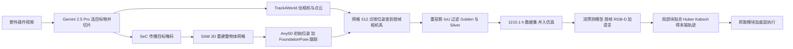

# ObjectWorld：3D 全物体流数据集与以物体为中心的世界模型（arXiv:2611.11085）

**ObjectWorld**（*ObjectWorld: Scaling Object-Centric World Models with A Large-Scale 3D Full-Object Flow Dataset*，[arXiv:2611.11085](https://arxiv.org/abs/2611.11085)，NUS / RoboScience，2026-11-08 v1）。本页依据 v1 PDF 全文与项目页静态页面写成，原文归档见 [sources/papers/objectworld_arxiv_2611_11085.md](../../sources/papers/objectworld_arxiv_2611_11085.md)。

## 一句话定义

**以「完整物体表面上每个点的未来 3D 轨迹」（3D 全物体流）作为世界模型与机器人执行之间的接口：用自动管线把野外操作视频标成这种流并与仿真合并成 1210.1 小时数据集，训练从「首帧 RGB-D + 任务语言」预测 512 点 × 48 步流的模型，再用局部块拟合优化把流变成末端轨迹。**

## 英文缩写速查

| 缩写 | 英文全称 | 简要说明 |
|------|----------|----------|
| EPE | End-Point Error | 预测点与真值点的平均 3D 距离，论文以 cm 或相对物体直径 D 的百分比报告 |
| Acc@5 / Acc@10 | Per-point accuracy at 5 / 10 cm | 误差小于阈值的点占比 |
| CD/D | Chamfer Distance / object Diameter | 重建几何误差，按物体直径归一 |
| DA3 | Depth Anything 3 | Track4World 所用深度骨干 |
| PTv3 | Point Transformer V3 | 点云编码器，联合编码物体与场景 |
| VLM | Vision-Language Model | 标注阶段用 Gemini 2.5 Pro，预测阶段用冻结的 Qwen2.5-VL-7B |
| IRLS | Iteratively Reweighted Least Squares | 解 Huber 鲁棒对齐目标，每步为加权 Kabsch |
| SE(3) / SO(3) | Special Euclidean / Orthogonal group | 刚体位姿 / 旋转群 |
| Golden / Silver | 论文的两档质量子集 | 重投影 IoU 阈值 0.70 / 0.50 |

## 为什么重要

- 动作标注的机器人数据昂贵且与本体相关，视觉数据则多得多（第 I 节，作者自述）；要用视觉数据做世界模型，需要一个既能大规模监督、又能被控制器消费的中间表示。
- 作者对既有表示的判断（第 I 节，作者自述）：像素预测间接；稀疏关键点可能漏掉整体运动；6-DoF 位姿依赖刚体假设；已有流方法多只覆盖可见或被跟踪区域。3D 全物体流的主张是把「不可见面」也放进运动场。
- 本页价值：它把「数据生产」（标注管线加质量门）与「预测」「执行」连成一条可核对的链，且每一环都有自己的数字，便于判断哪一环更可信（见下「核心原理」与「局限」）。

## 核心原理与流程总览

**表示（第 III-A 节）。** 输入首帧 RGB-D 与指令，输出 N=512 个物体点、T=48 步的 3D 位置；训练时写成相对初始表面的位移（第 III-C 节式 1）。执行端解 `τ* = argmin D(Φ(I,τ), P̂) + λR(τ)`，实现中 τ 是末端轨迹。

**标注管线（第 III-B 节、附录 A）。** 只需 RGB 视频，不要机器人动作、深度、标定或预扫描网格。流 = 网格上均匀采样的点按（物体位姿 × 相机到首帧相机的变换）逐帧移动（附录式 8）。

**质量门（第 III-B-2 节、附录 B-B）。** 把重建物体按估计位姿投影，与传播掩码求 IoU，逐片段聚合；阈值用专家标注的验证集标定。Silver ≥ 0.50（全部 755.6 h），Golden ≥ 0.70（120,269 条 / 288.7 h，表 IX）。

**数据（表 VIII）。** 仿真 454.5 h：ManiSkill 3、MetaFold（形变物体）、Meta-World、MIKASA、RLBench、RoboCasa、RoboTwin 2.0，共 198,947 条轨迹 / 251 任务，其中 RoboTwin 2.0 占 298.6 h。真实 755.6 h：AgiBot World 718.6 h、Sth-V2 34.1 h、EPIC-KITCHENS 2.9 h，因此「真实」部分 95% 以上来自 AgiBot 机器人视频，人类视频占比很小（按表 VIII 算术）。

**模型（第 III-C 节、附录 C）。** 冻结 Qwen2.5-VL-7B-Instruct 给点对齐的视觉语言特征 + 语言 token；PTv3 联合编码物体与场景点云；物体 token = 坐标嵌入 + 视觉语言特征 + 3D 特征（式 2）；含噪流投影进物体 token，时间步经自适应归一化调制；自注意力后对场景和语言 token 做交叉注意力；直接预测干净轨迹 x1（式 3–5）。训练前用 GeoCalib 估重力并把各数据集旋到 z 轴向上，按动作进度把每段重采样为 T 帧（因此流表示归一化进度而非绝对时间，第 III-C-d 节）。

**执行（第 III-D 节）。** 抓取模块给初始末端位姿与接触区（平行夹爪用采样式抓取，灵巧手用 T(R,O) Grasp）；仅对接触块假设局部刚性，逐步做 Huber 鲁棒对齐得到末端位姿序列。

## 数据集速查（规模 / 模态 / 许可证 / 重定向就绪度）

| 维度 | 内容 |
|------|------|
| 规模 | 共 1210.1 h：仿真 454.5 h（198,947 条轨迹 / 251 任务），真实 755.6 h（AgiBot World 718.6 h、Sth-V2 34.1 h、EPIC-KITCHENS 2.9 h）；Golden 子集 120,269 条 / 288.7 h（表 VIII、IX） |
| 模态 | 真实部分只用 RGB 视频自动标注；标注产物为物体网格上 512 点 × 48 步的 3D 全物体流（首帧相机系），模型训练另用首帧 RGB-D 与任务语言（第 III 节） |
| 许可证 | 论文与项目页均未给数据下载入口，也未见许可证声明（2026-11-11 核查）；上游 AgiBot World、Sth-V2、EPIC-KITCHENS 与各仿真平台各有授权条款，二次分发需逐一核对（未核实） |
| 重定向就绪度 | 流以物体为中心、与机器人形态无关，不含机器人动作标签，不能直接作行为克隆的训练输入；需经抓取模块 + 局部块拟合（Huber / Kabsch）适配为末端轨迹，论文演示了平行夹爪与灵巧手两种执行器（第 III-D 节） |

## 关键结果（第 IV 节、附录 D）

| 研究 | 论文数字 |
|------|----------|
| A1 管线对仿真真值（表 II，97/99 个 RoboTwin 片段） | 标注率 98.0%，整物体 CD/D 2.61%，隐藏面误差 7.28%D，最终 EPE 3.71 cm（26.11%D），局部 GPU 约 35.6 s / 片段 |
| A2 质量门 vs 200 个专家标注真实片段（图 4） | Golden：precision 93.3%，recall 69.1%；Silver：precision 65.0%，recall 96.3% |
| A3 整物体 vs Track4World 部分流（表 III，中位数） | EPE/D 37.22%→30.74%；整体覆盖 28.4%→45.8%；隐藏面覆盖 9.8%→26.6% |
| B1 流预测（表 IV a） | 全帧 EPE 6.22 cm、末帧 11.17 cm、末帧 Acc@10 60.1%；ObjectForesight 10.24 / 21.18，TraceGen 12.97 / 26.43，im2Flow2Act 12.58 / 20.88（其为 2D 横向误差） |
| B2 物体点噪声（表 IV b） | 5 cm 噪声下末帧 EPE 11.17→11.61 cm |
| B3 数据缩放（图 6，末帧 EPE cm） | 仿真 25% 行：17.10 / 16.79 / 16.80（真实 0 / 25 / 100%）；仿真 100% 行：14.14 / 13.04 / 13.01；仿真 0% + 真实 25% / 100%：19.80 / 18.81 |
| B4 语言消融（表 V） | 占位 caption 13.76 → 任务描述 13.01 cm |
| C1 仿真执行（表 VI） | Ours 10/10、10/10（ManiSkill）、9/10、10/10（LIBERO）；TraceGen 5/10、4/10、7/10、7/10；ObjectForesight 6/10、7/10、7/10、6/10 |
| C2 真实执行（表 VII，各 5 次） | Banana / Water / Flashlight / Cabbage：Ours 4/5、4/5、5/5、5/5；Dream2Flow 2/5、3/5、5/5、4/5 |
| 附录 D（表 X，2,048 样本） | 去 VLM：末帧 EPE 12.69→16.90 cm；物体场景分开编码：13.46 cm |

## 工程实践

- **复现路径：** 论文与项目页都未给代码入口，本页无法给出运行步骤。若自行搭管线，所用组件全部是已公开的第三方模型（Gemini 2.5 Pro、Track4World、Depth Anything 3、SeC、SAM 3D、Any6D、FoundationPose、SAM2、GeoCalib），其中 SAM 3 系列可参考 [SAM 3 页](../entities/paper-sam3.md)。
- **算力与时延：** 训练 3 个 epoch、8×A100、全局 batch 64（附录 C-C）；标注约 35.6 s / 3 秒片段（本地 GPU 阶段，表 II）；5 步生成约 1.08 s / 条轨迹（单 A100，附录 C-D），执行用 5 步、评估用 1 步。论文没有描述执行中根据新观测重新预测流，按文中描述是一次预测后整段转成末端轨迹（推断：开环，未见闭环重规划）。
- **使用数据时的实操要点：** 论文自己的做法是只用 Golden 子集（288.7 h，约占真实标注的 38%）训练主模型；Silver 的 precision 仅 65.0%，若直接全量使用要预期噪声更大（第 IV-B 节，图 4）。
- **输入依赖：** 推理需要首帧深度（RGB-D）、SAM2 掩码、SAM 3D 重建与 Any6D 初始位姿（第 III-C-a 节），即预测前就串了多个重模型，任一环失败会带入后续。
- **执行接口前提：** 抓取由独立模块提供，且各方法共用同一抓取与流到动作优化流程，预抓取阶段被标准化（第 IV-E 节）；所以执行表比的是「后抓取阶段」的流质量，不是端到端策略。

## 与文章说法的核对

文章（公众号《机器人动作块太长，什么时候该重新规划？》2026-11-11，第 33 条）原话：「以完整物体三维流描述刚体和形变物体运动，包含不可见部分，再连接到机器人控制。真实与仿真数据共同扩量；自动标注的几何质量仍是使用这类数据的关键条件。」

| 文章说法 | 核对结果 |
|----------|----------|
| 用完整物体三维流描述运动、包含不可见部分 | 属实（摘要、第 III-A 节）。「不可见」靠 SAM 3D 补全网格，隐藏面覆盖 26.6%（表 III）、隐藏面误差 7.28%D（表 II），是推断出来的，不是观测到的 |
| 同时描述刚体和形变物体 | 表示层面属实（摘要「rigid and deformable」，附录 C-B 同一损失）。但实测有限：真实视频标注靠刚体网格 + 位姿跟踪（附录 A-E/F），形变轨迹只来自仿真里的 MetaFold 网格顶点（附录 B-C，3.5 h）；文中没有按刚体 / 形变拆分的指标，执行任务（推方块、倒水、放卷心菜等）也未见专门的形变任务。不宜理解为「已验证形变物体的预测与执行」 |
| 再连接到机器人控制 | 属实但范围窄：第 III-D 节的局部块拟合 + 独立抓取模块；仿真 4 个任务各 10 次、真实 4 个任务各 5 次；仿真成功按「与真值轨迹覆盖」判定，不是物理任务完成（第 IV-E 节）；真实任务的成功判据正文未定义 |
| 真实与仿真数据共同扩量 | 大体属实（图 6 单元格：双 100% 最佳 13.01 cm）。但增益主要来自仿真：仿真 0%→100%（真实 100%）18.81→13.01；真实 0%→100%（仿真 100%）14.14→13.01；仿真 25% 时真实 25%→100% 是 16.79→16.80，几乎不变。作者自己也写「simulated data provides the larger overall gain」。此外「真实」九成多是 AgiBot 机器人视频（表 VIII） |
| 自动标注的几何质量是关键条件 | 与论文一致且论文有直接证据：只用 Golden 训练（保留约 38%），Silver precision 65.0%；管线在仿真真值上 EPE/D 26.11%、对 Golden 与被拒样本的流误差 16.29%D vs 35.49%D（第 IV-B 节）。这是文章的合理读法，但不是论文的一条独立结论句 |

文章未提的点：执行基线在仿真（TraceGen、ObjectForesight）与真实（Dream2Flow）不同；项目页写「29/30 仿真」「13/15 真实（对照 10/15）」，与论文表 VI（4 任务共 39/40）、表 VII（4 任务共 18/20，对照 14/20）口径不同，项目页数字大概是子集（推测：真实去掉灵巧手 cabbage，仿真去掉某一任务），论文未说明。

## 局限

**论文自己承认或隐含承认的**

- 局部刚性假设：只在接触块内假设刚性，其余表面可非刚（第 III-D 节）。结论节没有单独的「局限」小节，论文没有集中列出失败案例。
- 质量门是权衡：Golden 偏精度、Silver 偏覆盖，两者各有代价（第 IV-B 节）。
- 评估预测时对物体几何噪声做了鲁棒性实验，到 5 cm 仅小幅下降（表 IV b），论文用它说明对重建误差不敏感。

**我看到的未验证之处（我的判断，与作者自述分开）**

- 标注管线的真值验证只在 99 个 RoboTwin 仿真片段上做（表 II），真实视频上只有 200 个专家标注片段评估质量门（图 4），没有真实视频上的流真值；而数据集 62% 是真实标注。
- 真实标注全是刚体位姿轨迹（附录 A-E/F），遇到形变的真实物体会不准；文中无此类真实评估。
- 表 IV 的评估集与划分正文未交代清楚；附录 C-C 说留出 5% 轨迹做验证，附录 D 另有 2,048 样本的评估集。表 IV 末帧 EPE 11.17 与图 6 / 表 V 的 13.01、表 X 的 12.69 不同，原因未解释（推测：评估集或采样步数不同）。
- 对比不对等：im2Flow2Act 是 2D 横向误差（表 IV 脚注）；执行基线在仿真与真实中不同，仿真基线 TraceGen / ObjectForesight 与真实基线 Dream2Flow 没有交叉。
- 执行样本小：真实每项 5 次，最大差异是 1–2 次；仿真每项 10 次；成功判据（仿真为轨迹覆盖准则、真实未定义）使数字不等价于任务成功率。
- 语言条件的作用只在 final EPE 上相差 0.75 cm（表 V），整体收益小于视觉语言 / 场景几何带来的差距（表 X）。
- 本文类型：数据集 + 方法综合论文；数据是否公开未核实，因此「数据集」这一贡献目前无法被外部使用或复核。
- 未涉及：多物体交互、长时程任务、遮挡下的重建失败率、闭环重规划。

## 与其他工作对比

| 工作 | 关注点 | 与本文的区别 |
|------|--------|--------------|
| [Dream2Flow](./paper-rcl-2512-24766-dream2flow-bridging-video-generation-and-open-wo.md) | 从生成的人类交互视频提取 3D 物体轨迹，再用优化或 RL 让机器人复现 | 同样以物体运动为接口；本文直接从「首帧 RGB-D + 语言」预测含遮挡面的全物体流，真实执行表中作为基线（表 VII） |
| [Track4World](./paper-track4world.md) | 前馈估计全像素世界系稠密 3D 轨迹 | 本文标注管线用它估相机与点云，但其流只覆盖可见区域；整物体流把隐藏面覆盖从 9.8% 提到 26.6%（表 III） |
| [AgiBot World Colosseo](./paper-sa-2503-06669-agibot-world-colosseo-a-large-scale-manipulation.md) | 大规模真机操作数据 + 通才策略 | 本文把 AgiBot World 视频重新标成物体流（占真实部分 95% 以上），丢弃机器人动作，换取跨本体的物体中心监督 |

## 结论

**ObjectWorld 证明了「只用 RGB 视频自动标注 3D 全物体流」可以扩到千小时量级，并让物体流预测与执行优于既有流基线，但增益主要来自仿真数据，执行证据样本很小。**

1. 质量门是数据可用的关键：Golden precision 93.3%、Silver 65.0%，主模型只用 Golden（图 4）。
2. 流预测末帧 EPE 11.17 cm，优于 ObjectForesight 21.18、TraceGen 26.43 cm（表 IV a）。
3. 数据缩放中仿真贡献大于真实：仿真 0%→100% 使末帧 EPE 18.81→13.01，真实 0%→100% 为 14.14→13.01（图 6）。
4. 局限：真实视频无流真值、真实标注只支持刚体、执行实验真实每任务 5 次且为开环，代码与数据未见发布。

## 关联页面

- [世界模型功能分类](../concepts/functional-taxonomy-world-models.md)：本文属于「预测中间表示再接执行」一类
- [视频即仿真](../concepts/video-as-simulation.md)：同样想用视觉数据替代动作数据
- [基础策略](../concepts/foundation-policy.md)：本文动机来自 VLA / 基础模型的规模化需求
- [具身数据清洗](../concepts/embodied-data-cleaning.md)：与本文质量门的目的相邻
- [扩散 Transformer](../concepts/diffusion-transformer.md)：流预测头的生成方式相邻（本文用 x1 预测的线性加噪路径）
- [VLA 方法页](../methods/vla.md)
- [模仿学习](../methods/imitation-learning.md)
- [SAM 3](../entities/paper-sam3.md)：标注链用到 SAM 3D 等组件
- [LIBERO 基准](../entities/libero-benchmark.md)：仿真执行评测之一
- [EPIC-KITCHENS 数据集页](../entities/paper-aff-1804-02748-scaling-egocentric-vision-the-epic-kitchens-dataset.md)：真实数据来源之一

## 参考来源

- [sources/papers/objectworld_arxiv_2611_11085.md](../../sources/papers/objectworld_arxiv_2611_11085.md)：论文归档与核对范围
- [arXiv:2611.11085](https://arxiv.org/abs/2611.11085)
- [项目页](https://nus-lins-lab.github.io/ObjectWorld/)：静态读取，未见代码 / 数据下载链接

## 继续阅读

- [arXiv PDF v1](https://arxiv.org/pdf/2611.11085v1)
- [世界模型功能分类](../concepts/functional-taxonomy-world-models.md)
- [具身数据清洗](../concepts/embodied-data-cleaning.md)
