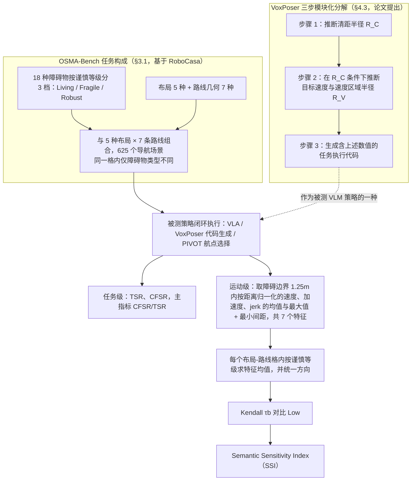

# Obstacle-Conditioned Safety Nav（arXiv:2610.34674）

**Obstacle-Conditioned Safety Nav**（*Benchmarking Obstacle-Conditioned Safety in Household Robot Navigation*，[arXiv:2610.34674](https://arxiv.org/abs/2610.34674)，[项目页](https://huggingface.co/ocsnav/groot-vlm-graft28)）来自 [具身智能小站 2026-10-28 盘点](../../sources/blogs/wechat_embodied_station_59_papers_human_video_to_robot_experience_2026-10-28.md)，属「评测与基准」组。

## 一句话定义

**用空间匹配、仅障碍类别不同的场景评测安全语义能否转为间距、速度和平滑性变化。**

## 英文缩写速查

| 缩写 | 英文全称 | 简要说明 |
|------|----------|----------|
| Obstacle-Conditioned Safety Nav | Benchmarking Obstacle-Conditioned Safety in Household Robot Navigation | 本文方法 / 基准的简称 |

## 为什么重要

- 识别危险物体还不等于安全绕行。模型即使认得风险，也常未改变运动；显式参数推断为语义落地提供了改进线索。
- 开源结论：**项目页未列 GitHub**（步骤 2.5，2026-10-28）。项目页 HTTP 200，未见 GitHub 链接或 coming soon 字样。
- 同期同组工作见 [潜在动作、免渲染事件仿真与机器人评测：具身智能小站 10-28 期 59 篇阅读坐标](../overview/embodied-station-2026-10-28-59-papers-technology-map.md)。

## 流程总览

图依据：论文 §3.1 / §3.2 / §4.1 / §4.3（Fig.4、Table 2）

## 核心机制

| 项 | 内容 |
|----|------|
| **arXiv** | [2610.34674](https://arxiv.org/abs/2610.34674) |
| **开源** | **项目页未列 GitHub** |
| **要点** | 用空间匹配、仅障碍类别不同的场景评测安全语义能否转为间距、速度和平滑性变化。 |
| **文内指标** | 公众号转述：模型即使认得风险，也常未改变运动；显式参数推断为语义落地提供了改进线索。 |

## 源码运行时序图

**不适用（项目页未列 GitHub）** — 项目页 HTTP 200，未见 GitHub 链接或 coming soon 字样。 不编造运行脚本；代码公开后再补。

## 实验与评测

- 公众号转述：模型即使认得风险，也常未改变运动；显式参数推断为语义落地提供了改进线索。
- **读法：** 本页为索引级摘要，依据公众号转述的官方摘要与仓库信息整理；逐项数字与 baseline 以原文 PDF 为准。

## 与其他工作对比

- 横向索引见 [潜在动作、免渲染事件仿真与机器人评测：具身智能小站 10-28 期 59 篇阅读坐标](../overview/embodied-station-2026-10-28-59-papers-technology-map.md)；同 arXiv 不重复造页。

## 结论

**识别危险物体还不等于安全绕行：模型即使认得风险，也常未改变运动；显式参数推断为语义落地提供了改进线索。**

1. 开源边界：**项目页未列 GitHub** — 项目页 HTTP 200，未见 GitHub 链接或 coming soon 字样。
2. 核心机制：用空间匹配、仅障碍类别不同的场景评测安全语义能否转为间距、速度和平滑性变化。
3. 复现与选型前核对任务协议、硬件与基准口径，勿直接横比公众号摘录数字。

## 关联页面

- [具身大模型评测基准选型闭环](../queries/embodied-eval-benchmark-selection-loop.md) — 本页可归入其 ③ 策略任务成功率评测层：在成功率之外检查安全语义是否落到间距/速度/平滑性
- [simulation-evaluation-infrastructure](../concepts/simulation-evaluation-infrastructure.md)
- [vla](../methods/vla.md)
- [manipulation](../tasks/manipulation.md)
- [vision-language-navigation](../tasks/vision-language-navigation.md)
- [embodied-station-2026-10-28-59-papers-technology-map](../overview/embodied-station-2026-10-28-59-papers-technology-map.md)

## 参考来源

- [obstacle_conditioned_safety_nav_arxiv_2610_34674.md](../../sources/papers/obstacle_conditioned_safety_nav_arxiv_2610_34674.md)
- [wechat_embodied_station_59_papers_human_video_to_robot_experience_2026-10-28.md](../../sources/blogs/wechat_embodied_station_59_papers_human_video_to_robot_experience_2026-10-28.md)
- [arXiv:2610.34674](https://arxiv.org/abs/2610.34674)
- [arXiv PDF](https://arxiv.org/pdf/2610.34674)：已通读方法部分（实验与附录以略读为准）：§1 引言、§3 OSMA-Bench（任务设计与 SSI 指标）、§4.1 实验设置、§4.2–4.3（RQ1/RQ2 的模块化分解）；RQ3 与附录未读

## 推荐继续阅读

- [arXiv PDF](https://arxiv.org/pdf/2610.34674)
- [项目页](https://huggingface.co/ocsnav/groot-vlm-graft28)
