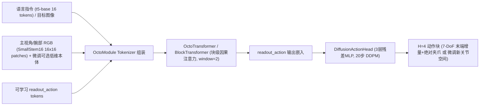
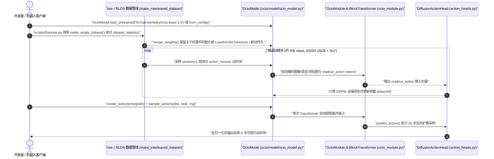

# Octo：灵活输入的开源通才操作策略

**Octo**（*Octo: An Open-Source Generalist Robot Policy*，[arXiv:2405.12213v2](https://arxiv.org/abs/2405.12213)，[项目页](https://octo-models.github.io/)，[代码](https://github.com/octo-models/octo)）由 **UC Berkeley、Stanford、CMU 与 Google DeepMind** 联合提出并发表于 **RSS 2024**：模型将多视角 RGB 观测、语言指令与目标图像条件统一组装为 token 序列，通过块级因果注意力主干与被动 `readout_action` token 驱动轻量扩散动作头，在约 27M–93M 参数量下实现跨本体零样本泛化与新相机/新动作空间的少样本微调。方法级综述与选型定位见 [octo-model](../methods/octo-model.md)；**`arxiv` 元数据规范只挂在本实体页**。

## 一句话定义

**通才策略的关键是观测与任务 token 接口可插拔、由独立动作读出头衔接多形态机器人控制，而不是先把主干参数堆到 7B。**

## 英文缩写速查

| 缩写 | 英文全称 | 简要说明 |
|------|----------|----------|
| OXE | Open X-Embodiment | Octo 预训练所用的跨本体多机构数据集（采样子集 25 个、约 80 万条轨迹） |
| VLA | Vision-Language-Action | 结合视觉、语言指令与机器人动作输出的通用策略范式 |
| GC | Goal Conditioning | 目标图像条件，与语言条件协同或替代指令描述目标状态 |
| DDPM | Denoising Diffusion Probabilistic Models | 扩散动作头（20 步 cosine 调度）用来建模多模态连续动作块分布 |
| DoF | Degrees of Freedom | 机器人末端或关节动作维度，微调时可通过替换读出头适配 |
| MSE | Mean Squared Error | 均方误差确定性回归动作头，在多模态操作数据上显著弱于扩散头 |

## 为什么重要

- **轻量开源基准与接口范式：** 以 `Octo-Small`（27M）和 `Octo-Base`（93M）证明轻量级架构在 **800k OXE 轨迹**上预训练后即可达到与 55B 闭源 RT-2-X 接近的零样本迁移表现，成为社区微调与对照的事实标准基线之一（见 [VLA/WM 14 篇路线](../overview/vla-wm-reading-roadmap-14-papers-technology-map.md)）。
- **可插拔观测与动作空间：** 预训练仅依赖主视角（及可选腕部）RGB，微调时只需为新增传感器（如力/力矩传感、关节本体状态 `LowdimObsTokenizer`）与新动作空间（如 14-DoF ALOHA 双臂关节位置）重配 tokenizer 和 `DiffusionActionHead`，无需重训整网。
- **双条件任务接口：** 同时训练语言指令与目标图像条件（训练时按比例随机掩码），解决自然语言对精细空间目标描述歧义的问题。

## 核心原理

### 核心信息

| 项 | 原文与源码核定细节 |
|----|----------------------|
| **机构与发布** | UC Berkeley、Stanford、CMU、Google DeepMind；RSS 2024（MIT 开源） |
| **模型规模** | 预训练主干定义 `Octo-Tiny`（10M）、`Octo-Small`（12L/384d/6h，27M）、`Octo-Base`（12L/768d/12h，93M）；外加冻结语言编码器 `t5-base`（111M） |
| **观测与任务 Token 化** | 语言经冻结 `t5-base` 编为 16 个 token；RGB 经浅层 CNN `SmallStem16`（`16×16` patch）编为 `256`（主视角 `256×256`）或 `64`（腕部 `128×128`）个 token；**原始论文与预训练配置不直接输入点云，且预训练刻意屏蔽本体状态以防因果混淆** |
| **主干与动作读出** | `OctoTransformer` + `BlockTransformer` 执行分块因果注意力：任务 token 对所有时间步可见，每步末尾附加 `readout_action` 被动汇总当前及历史窗口（`window=2`）状态，再送入 `DiffusionActionHead`（3 层 256 维残差 MLP + LayerNorm，20 步 cosine DDPM，单次前向仅需 1 次 Transformer 计算）生成 `H=4` 动作块 |
| **预训练数据与算力** | 25 个 OXE 数据集（`oxe_magic_soup` 配方，约 800k 轨迹 / 1.2TB；仅 27% 含腕部相机、56% 含语言标注），动作统一为 7-DoF delta 末端位姿 + 绝对二值夹爪（`+1` 开 / `0` 闭）；AdamW `lr=3e-4`、`batch=2048`、300k steps（TPU v4-128 上 Base 约 14h、Small 约 8h） |
| **开源产物** | 代码仓 `octo-models/octo`（JAX/Flax），HuggingFace 权重 `rail-berkeley/octo-small`、`octo-base`、`octo-small-1.5`、`octo-base-1.5` |

### 流程总览

## 源码运行时序图

以下时序基于官方仓库 `octo-models/octo`（commit `241fb351`）中 `scripts/train.py`、`scripts/finetune.py`、`examples/02_finetune_new_observation_action.py`、`octo/model/octo_model.py`、`octo/model/octo_module.py` 与 `octo/model/components/action_heads.py` 源码核对绘制：

## 工程实践

- **v1.5 关键工程修复（`scripts/configs/octo_pretrain_config.py` & `README.md`）：** 相对于最初论文版本，`octo-{base,small}-1.5` 开启 `repeat_task_tokens=True` 以增强语言/目标条件对齐、引入 GPT-3.5 生成的 `OXE_paraphrases`（`rephrase_prob=0.5`）做指令复述增强、移除扩散动作头中的 dropout（`dropout_rate=0.0`），并修复 `use_correct_attention` 中的掩码偏移与图像增强随机数种子复用 bug。
- **跨本体微调配方（`scripts/finetune.py`、`scripts/configs/finetune_config.py`、`examples/02_finetune_new_observation_action.py`）：**
  - 当接入新传感器（例如腕部相机、低维本体位置、力/力矩读数）或新动作空间（如 14-DoF 关节位置控制）时，删除或替换原 `heads['action']` 与对应 `observation_tokenizers`，再通过 `merge_weights(new_params, pretrained_params)` 复用主干与 `t5-base` 权重。
  - 原文 6 个真实场景微调默认只需约 **100 条演示**、**50k 步**微调，在单张 **NVIDIA A5000（24GB）上耗时不足 5 小时**；仅 Berkeley Bimanual（ALOHA）将 chunk size 调高至 64、执行前 12 步以匹配高频双臂控制。
- **推理延迟与条件选择：** RTX 4090 上实测吞吐 `Octo-Base` 约 **13 it/s**、`Octo-Small` 约 **17 it/s**；扩散采样的 20 步仅作用于轻量 3 层 MLP 动作头（Transformer 仅前向 1 次），显著快于自回归离散 VLA 逐步解码。若任务对物体空间终点敏感且容易用图像示教，优先采用目标图像条件（WidowX 零样本实测比纯语言高 +25%）。

## 评测

| 评测维度 | 核心设定 | 关键量化结果（原文 §IV–V & Table I–VII） |
|----------|----------|----------------------------------------|
| **跨本体 Zero-Shot（Fig. 5）** | WidowX / UR5 / RT-1 Robot 三个未参与微调基准 | Octo-Base 平均成功率比 **RT-1-X（35M）高 +29%**（WidowX `0.50` vs `0.20`；UR5 `0.70` vs `0.35`；RT-1 Robot `0.80` vs `0.60`），整体接近 55B 闭源 **RT-2-X**（WidowX `0.50`、RT-1 Robot `0.85`）；目标图像条件在 WidowX 上比语言条件高 `+25%` |
| **WidowX 泛化拆解（Table VII）** | 分布内 / 新物体 / 新环境 / 新技能 | 分布内 **85%**、新物体 **80%**、新环境 **40%**、新技能仅 **5%**（说明零样本很难跨出训练动作技能集合） |
| **新机器人/新模态少样本微调（Table I）** | 6 个全新任务/观测/动作空间（各约 100 条演示，50k 步） | CMU Baking **50%**、Stanford Coffee **75%**、Berkeley Peg Insertion（双相机+FT 力矩）**70%**、Berkeley Pick-Up（关节控制）**60%**、Berkeley Coke（未见 ViperX）**100%**、Berkeley Bimanual（ALOHA 14-DoF）**80%**；平均 **72%**（显著高于从头训练 **20%** 与 VC-1 **15%**） |
| **关键设计消融（Table II/VI & App. E）** | 动作头 / 视觉切片 / 语言模型 | `DiffusionActionHead`（**83%**）远超 MSE 头（**35%**）与 256-bin 离散头（**18%**）；`16×16` patch 优于 `32×32`；`t5-small`（30M）、`t5-large`（386M）或微调语言后两层均未超越冻结 `t5-base`（111M） |

## 结论

**在需要用中等规模算力适配新相机、力传感或新动作空间时，应优先以 Octo（推荐 `octo-base-1.5` / `octo-small-1.5`）的模块化 tokenizer + `DiffusionActionHead` 微调作为基线，而不是直接从头训练或盲目上 7B VLA。**

1. **动作头选型：** 连续多模态操作坚持使用 `DiffusionActionHead`（消融领先 MSE +48%、领先离散化 +65%），避免单峰 MSE 对多解轨迹做平均。
2. **夹爪表征：** 保持绝对二值夹爪（`+1` 开 / `0` 闭）而非相对增量夹爪，原文消融表明相对夹爪显著损害抓取失败后的重试能力。
3. **预训练本体感知取舍：** 在开放离线示范上做大范围预训练时慎加本体状态（易诱发只看关节位置不看图像的因果混淆），将其留到下游特定机器人微调阶段再以 `LowdimObsTokenizer` 接入。
4. **条件接口切换：** 语义组合清晰用语言条件；目标摆放形态精准、语言难描述时优先给目标图像条件（或两者混合）。
5. **定位边界：** Octo 适合作为桌面级操作与跨本体微调基座，对需要极高空间语义推理或全新技能零样本泛化的场景可进一步对比 [OpenVLA](./paper-openvla.md) 与 [Dita](./paper-dita-scaling-diffusion-transformer-vla.md)，方法叙事详参 [octo-model](../methods/octo-model.md)。

## 局限与风险

- **新技能零样本泛化薄弱：** Table VII 显示面对全新动作技能时零样本成功率跌至 **5%**，强依赖下游约 100 条演示微调。
- **语言微调对多语言/复杂指令理解有限：** 采用冻结 `t5-base`（111M）而非大型 VLM 骨干，复杂常识推理与长程语义组合能力不及后续基于 VLM 的 VLA（如 [OpenVLA](./paper-openvla.md)）。
- **OXE 数据长尾与格式对齐成本：** 25 个预训练子集中仅 **27%** 带腕部相机、**56%** 带语言标注，且跨机器人联合训练要求先做 RLDS 格式与动作空间对齐。
- **层级边界：** 原生面向末端/关节位姿动作块生成，不替代高频全身控制（WBC）或足式 [locomotion](../tasks/locomotion.md)。

## 与其他工作对比

| 工作 | 相对本页 |
|------|----------|
| [OpenVLA](./paper-openvla.md) | 基于 7B 预训练 VLM（Prismatic）+ 256-bin 离散动作 token，语言语义强但推理重且输入/动作槽位更固定；Octo 仅 27M–93M 且读出头可插拔 |
| [Dita](./paper-dita-scaling-diffusion-transformer-vla.md) | 同为 OXE 跨本体预训练：Octo 用单 `readout_action` 嵌入驱动独立小 MLP 去噪；Dita 直接将历史/动作 token 纳入 Diffusion Transformer 做 in-context 去噪 |
| [RT-1](./paper-rt-1.md) | 更早的固定视觉–离散动作映射策略，缺乏针对新观测与新动作空间的模块化读出重构机制 |
| [Open X-Embodiment](./paper-open-x-embodiment.md) | 提供 Octo 预训练 25 个子集（800k 轨迹）的核心跨本体数据底座 |

## 关联页面

- [Octo 方法页](../methods/octo-model.md)
- [OpenVLA](./paper-openvla.md)
- [Open X-Embodiment](./paper-open-x-embodiment.md)
- [VLA/WM 14 篇路线](../overview/vla-wm-reading-roadmap-14-papers-technology-map.md)
- [Dita](./paper-dita-scaling-diffusion-transformer-vla.md)
- [Action Chunking](../methods/action-chunking.md)
- [RT-1](./paper-rt-1.md)
- [VLA 历史演进技术地图](../overview/vla-history-rt1-to-molmoact-technology-map.md)
- [具身算法栈 2026](../overview/embodied-algorithm-stack-2026-vla-diffusion-rl-world-model.md)
- [Awesome World-Action Models（RCL）](paper-rcl-wam-robot-learning-control-survey.md)
- [RCL Awesome WAM 技术地图](../overview/rcl-awesome-wam-technology-map.md)
- [生成式世界模型](../methods/generative-world-models.md)
- [机器人操作（Manipulation）](../tasks/manipulation.md)
- [VLA 方法总览](../methods/vla.md)
- [足式运动控制（Locomotion）](../tasks/locomotion.md)

## 参考来源

- [octo_arxiv_2405_12213](../../sources/papers/octo_arxiv_2405_12213.md) — **主要一手来源**：论文全文 `2405.12213v2`（RSS 2024，含附录 A–F）与官网核对归档
- [octo-models](../../sources/repos/octo-models.md) — **主要一手来源**：官方仓 `octo-models/octo`（`241fb351`）源码与 v1.5 配置归档
- [具身智能研究室 VLA/WM 阅读路线](../../sources/blogs/wechat_embodied_ai_lab_vla_wm_reading_roadmap_2026-09-02.md)
- [`sources/papers/rcl_awesome_wam_ref_1c048eabe2faa444f31b_octo-an-open-source-generalist-robot-pol.md`](../../sources/papers/rcl_awesome_wam_ref_1c048eabe2faa444f31b_octo-an-open-source-generalist-robot-pol.md) — RCL 条目策展摘录
- [`sources/papers/rcl_awesome_wam_catalog.md`](../../sources/papers/rcl_awesome_wam_catalog.md) — RCL 列表总表
- [`sources/repos/awesome-world-action-models-rcl.md`](../../sources/repos/awesome-world-action-models-rcl.md)
- [VLA 演进梳理笔记](../../sources/blogs/x_starlitmatcha_vla_history_rt1_to_molmoact2_2026-11-01.md)
- [具身算法栈梳理](../../sources/blogs/wechat_xinjiqishijue_embodied_algorithm_stack_2026-11-04.md)
- 论文 RSS 终稿：<https://www.roboticsproceedings.org/rss20/p090.pdf>

## 推荐继续阅读

- [Octo 官方项目页](https://octo-models.github.io/)
- [Octo 论文全文（arXiv:2405.12213）](https://arxiv.org/abs/2405.12213)
- [Octo 方法深入对比页](../methods/octo-model.md)
- [RSS 2024 正式收录 PDF](https://www.roboticsproceedings.org/rss20/p090.pdf)
- [Awesome World-Action Models (RCL) 仓库](https://github.com/rcl-robotics/Awesome-World-Action-Models)
