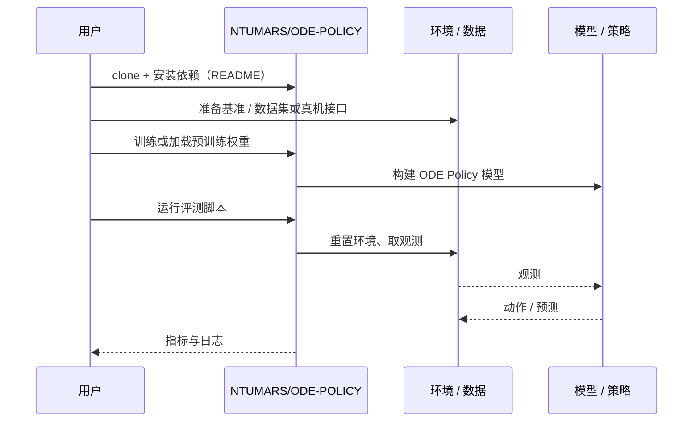

# ODE Policy（arXiv:2611.01729）

**ODE Policy**（*ODE Policy: Robot Learning via Action Dynamics, Not Actions*，[arXiv:2611.01729](https://arxiv.org/abs/2611.01729)，[项目页](https://ntumars.github.io/ODE/)，[代码](https://github.com/NTUMARS/ODE-POLICY)）来自 [具身智能小站 2026-11-04 盘点](../../sources/blogs/wechat_embodied_station_57_papers_da_reward_model_failure_2026-11-04.md)，属「奖励学习与策略后训练」组。

## 一句话定义

**动作块边界的跳变会妨碍平稳控制。**

## 英文缩写速查

| 缩写 | 英文全称 | 简要说明 |
|------|----------|----------|
| ODE Policy | ODE Policy: Robot Learning via Action Dynamics, Not Actions | 本文方法 / 基准的简称 |

## 为什么重要

- 让动作沿连续动力学自然衔接。ODE Policy直接学习动作变化的向量场，从上一动作积分得到下一动作；覆盖模仿学习、动作模型和强化学习，适合关注平滑性与推理效率的团队。
- 开源结论：**已开源**（步骤 2.5，2026-11-04）。仓库可达（git ls-remote）。项目页 HTTP 200。
- 同期同组工作见 [VLM 奖励评估、动作动力学与开放权重机器人智能体：具身智能小站 11-04 期 57 篇阅读坐标](../overview/embodied-station-2026-11-04-57-papers-technology-map.md)。

## 核心机制

| 项 | 内容 |
|----|------|
| **arXiv** | [2611.01729](https://arxiv.org/abs/2611.01729) |
| **开源** | **已开源** |
| **要点** | 动作块边界的跳变会妨碍平稳控制。 |
| **文内指标** | 公众号转述：平滑性要连同推理条件比较：作者在14项真机任务中测试，并在单RTX 4090的药片操作实验中报告动作块生成10.3 ms，对比FM-DiT的36.3 ms；这不是所有平台通用的加速倍数。 |

## 源码运行时序图

以下为按仓库入口（`NTUMARS/ODE-POLICY`）推断的通用运行链路；入库日仅核实仓库可达，未逐文件阅读，具体脚本名以 README 为准。

## 实验与评测

- 公众号转述：平滑性要连同推理条件比较：作者在14项真机任务中测试，并在单RTX 4090的药片操作实验中报告动作块生成10.3 ms，对比FM-DiT的36.3 ms；这不是所有平台通用的加速倍数。
- **读法：** 本页为索引级摘要，依据公众号转述的官方摘要与仓库信息整理；逐项数字与 baseline 以原文 PDF 为准。

## 与其他工作对比

- 横向索引见 [VLM 奖励评估、动作动力学与开放权重机器人智能体：具身智能小站 11-04 期 57 篇阅读坐标](../overview/embodied-station-2026-11-04-57-papers-technology-map.md)；同 arXiv 不重复造页。

## 结论

**让动作沿连续动力学自然衔接：平滑性要连同推理条件比较：作者在14项真机任务中测试，并在单RTX 4090的药片操作实验中报告动作块生成10.3 ms，对比FM-DiT的36.3 ms；这不是所有平台通用的加速倍数。**

1. 开源边界：**已开源** — 仓库可达（git ls-remote）。项目页 HTTP 200。
2. 核心机制：动作块边界的跳变会妨碍平稳控制。
3. 复现与选型前核对任务协议、硬件与基准口径，勿直接横比公众号摘录数字。

## 关联页面

- [vla](../methods/vla.md)
- [imitation-learning](../methods/imitation-learning.md)
- [reinforcement-learning](../methods/reinforcement-learning.md)
- [embodied-station-2026-11-04-57-papers-technology-map](../overview/embodied-station-2026-11-04-57-papers-technology-map.md)

## 参考来源

- [ode_policy_action_dynamics_arxiv_2611_01729.md](../../sources/papers/ode_policy_action_dynamics_arxiv_2611_01729.md)
- [wechat_embodied_station_57_papers_da_reward_model_failure_2026-11-04.md](../../sources/blogs/wechat_embodied_station_57_papers_da_reward_model_failure_2026-11-04.md)
- [arXiv:2611.01729](https://arxiv.org/abs/2611.01729)

## 推荐继续阅读

- [arXiv PDF](https://arxiv.org/pdf/2611.01729)
- [项目页](https://ntumars.github.io/ODE/)
- [https://github.com/NTUMARS/ODE-POLICY](https://github.com/NTUMARS/ODE-POLICY)
