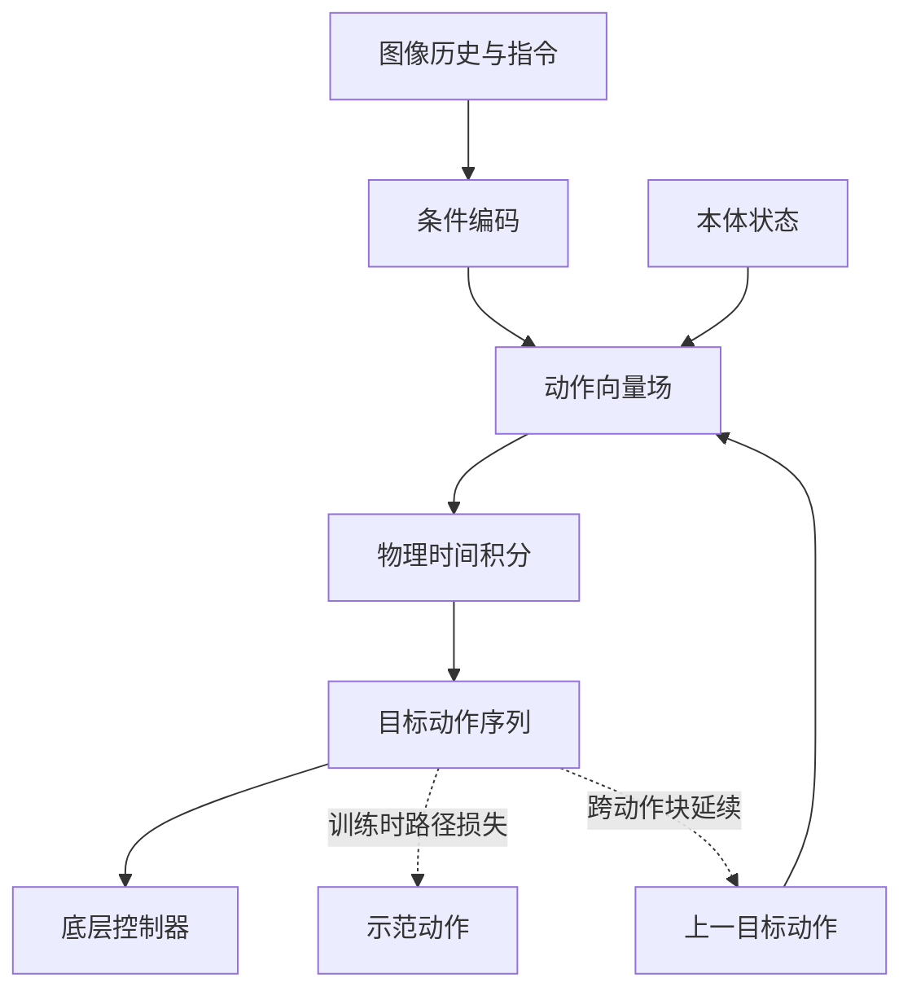

# ODE Policy: Robot Learning via Action Dynamics, Not Actions（基于动作动力学的机器人学习）

**ODE Policy**（*ODE Policy: Robot Learning via Action Dynamics, Not Actions*，[arXiv:2611.01729](https://arxiv.org/abs/2611.01729)，[项目页](https://ntumars.github.io/ODE/)，[代码](https://github.com/NTUMARS/ODE-POLICY)）来自 [具身智能小站 2026-11-04 盘点](../../sources/blogs/wechat_embodied_station_57_papers_da_reward_model_failure_2026-11-04.md)，属「奖励学习与策略后训练」组。

## 一句话定义

**ODE Policy 学习目标动作随物理时间变化的向量场，并从上一个目标动作积分得到后续动作。**

## 英文缩写速查

| 缩写 | 英文全称 | 简要说明 |
|------|----------|----------|
| ODE | Ordinary Differential Equation | 常微分方程 |
| IL | Imitation Learning | 模仿学习 |
| RL | Reinforcement Learning | 强化学习 |
| VLA | Vision-Language-Action | 视觉语言动作模型 |

## 核心机制与流程

论文 [arXiv:2611.01729v1](https://arxiv.org/pdf/2611.01729v1) 将向量场作用于发给底层控制器的**目标动作**，并以机器人实际时间积分；这与生成模型中的采样时间不同。图依据论文第 4 节，表示 IL 主流程。

- IL 在短动作块内积分，用整段示范动作的路径损失反向传播，无需动作导数标签；训练时扰动起点并引导轨迹回归，缓解推理时的误差累积。
- 可选多样性头通过随机化向量场方向表达多模态；RL 场景每个控制步积分一次，可替换 SuperMimic actor。
- 连续的是目标指令轨迹，实际机器人运动还受控制器跟踪误差、采样和硬件限制影响。

## 源码运行时序图

**待完成：**官方 [ODE-POLICY](https://github.com/NTUMARS/ODE-POLICY) 仓库有可运行实现，但相关源码调用链尚未逐项核验。原先的通用推测图已移除；读完源码后补充时序图。README 指出 main 分支含 LIBERO 训练评测及 2D 导航，另有实机和 π0.5 分支。

## 实验与评测

- LIBERO 四套任务上，论文报告视觉运动策略训练 1 epoch 后成功率 79.2%，100 epoch 后 93.8%；π0.5 的 ODE 头在 1 epoch 为 96.0%，原 flow matching 专家为 75.5%。比较须注意后者头部容量和初始化不同。
- 论文报告使用 Euler 积分时生成 8 个动作耗时 5.7 ms，比该实验中的 FM-DiT 快 10.8 倍；这不是所有硬件或求解器的通用倍数。
- 作者报告在 14 项单臂、双臂、灵巧手和人形真机任务上均取得被比较方法中的最高成功率；具体任务、样本量和差异需逐项核对。

## 结论

**动作动力学提供了连续的目标动作表示，但实际收益与训练设置、求解器、控制接口及任务有关。**

1. 跨块延续的是前一目标动作，不应直接用实测位置替代。
2. 向量场积分不能保证实机状态、力矩或安全约束自动满足。
3. 数字适用于论文对应实验协议，部署前应在目标硬件上测延迟和跟踪质量。
4. 当前为草稿：论文全文和源码调用链尚未全部核验，补齐后才能完成收录。

## 关联页面

- [vla](../methods/vla.md)
- [imitation-learning](../methods/imitation-learning.md)
- [reinforcement-learning](../methods/reinforcement-learning.md)
- [embodied-station-2026-11-04-57-papers-technology-map](../overview/embodied-station-2026-11-04-57-papers-technology-map.md)

## 参考来源

- [ode_policy_action_dynamics_arxiv_2611_01729.md](../../sources/papers/ode_policy_action_dynamics_arxiv_2611_01729.md)
- [wechat_embodied_station_57_papers_da_reward_model_failure_2026-11-04.md](../../sources/blogs/wechat_embodied_station_57_papers_da_reward_model_failure_2026-11-04.md)
- [arXiv:2611.01729](https://arxiv.org/abs/2611.01729)

## 推荐继续阅读

- [arXiv PDF](https://arxiv.org/pdf/2611.01729)
- [项目页](https://ntumars.github.io/ODE/)
- [https://github.com/NTUMARS/ODE-POLICY](https://github.com/NTUMARS/ODE-POLICY)
