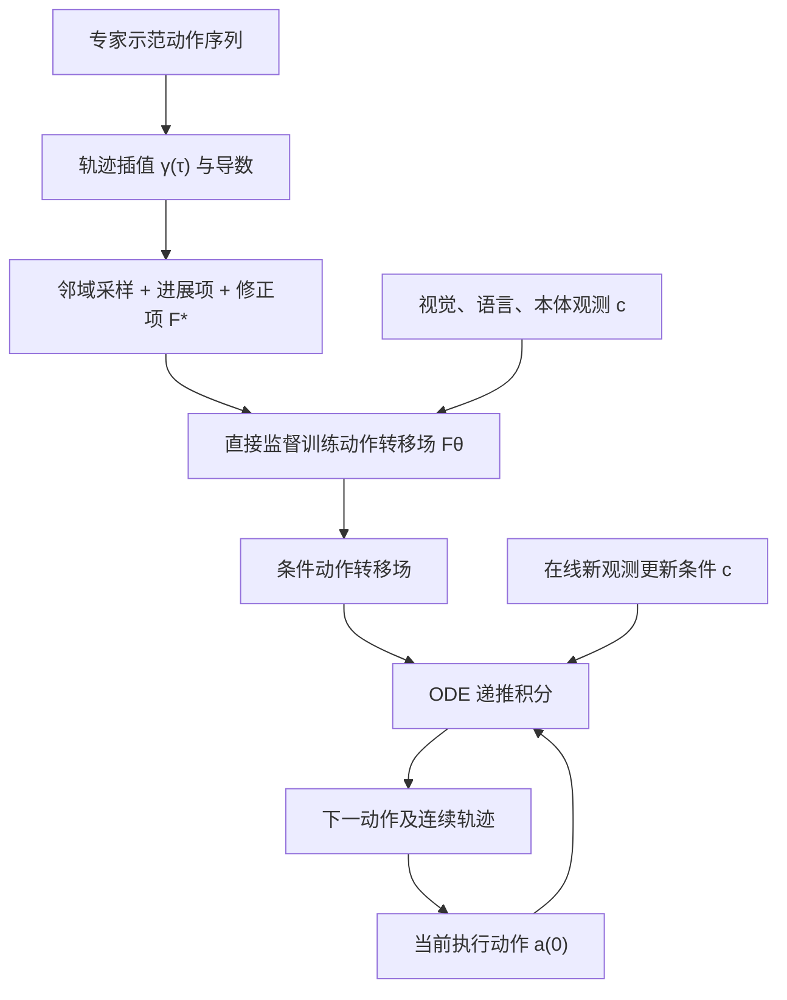

# ODEAction：从预测动作块到连续演化动作 / From Predicting Chunks to Evolving Actions

## 一句话定义

**ODEAction 通过条件动作转移场的常微分方程积分，从当前动作持续演化后续动作，替代把多个独立预测的 action chunks 直接拼接的做法。**

## 英文缩写速查

| 缩写 | 英文全称 | 简要说明 |
|------|----------|----------|
| ODE | Ordinary Differential Equation | 描述动作随演化时间的连续变化 |
| VLA | Vision-Language-Action | 视觉语言条件下机器人动作策略 |
| BDR | Boundary Discontinuity Reduction | 以原动作块边界评估跳变改善 |
| RTC | Real-Time Chunking | 跨动作块实时接续基线 |
| BC | Behavior Cloning | 从演示学习动作的范式 |

## 核心信息

| 字段 | 内容 |
|------|------|
| 原文 | [arXiv:2611.09672v1](https://arxiv.org/html/2611.09672v1) |
| 模式 | Chunk-free Continuous Action Evolution |
| 输入 | 图像、语言、机器人 proprioception、当前动作 |
| 输出 | 当前动作变化率（向量场）→ ODE 积分得到下一动作 |
| 基准 | LIBERO、EBench、RoboTwin、AgileX Cobot Magic 1.0 真机 |

## 为什么重要

按块重算动作的 VLA 容易在 chunk 边界发生位置/速度不连续。只做后处理平滑不能自动保证接续动作与新视觉观测一致。ODEAction 让**上一动作成为下一动作的初值**，再用条件动力学递推，显式维持相邻动作的生成依赖。

## 核心原理

- 条件场 `Fθ(a,τ|c)` 接受当前动作 `a`、演化时间 `τ`、视觉/语言/本体状态 `c`，预测变化率 `da/dτ`。
- 示范动作插值为 `γ(τ)`，并在其邻域采样扰动，目标为 `F*(a,τ) = γ̇(τ) + k(γ(τ)-a)`。第一项推进运动，第二项将偏离动作拉回示范附近。
- 训练用目标场直接监督 `Fθ`；执行从当前已执行动作积分（如 Euler、Runge–Kutta），每次观测更新条件，继续递推。

### 流程总览

## 源码运行时序图

**不适用（2026-11-10）：** 作者 arXiv v1 未给出可核实的官方 ODEAction 实现及运行入口。本文的结构图来自论文公式/算法，不应使用其他基础 VLA 项目的训练程序伪造 ODEAction 时序。

## 实验与评测

| 基准 / 设置 | Base | ODEAction | 对比口径 |
|-------------|------|-----------|----------|
| **EBench 平均** | **15.28%** | **24.72%** | **+9.44pp，+61.8% 相对提升** |
| LIBERO 平均 | 96.85% | 98.25% | +1.40pp |
| RoboTwin 50 项 Clean | 85.7% | 89.4% | StarVLA-OFT 为共同底座 |
| RoboTwin 50 项 Random | 87.3% | 89.8% | 同上 |
| 邻域/修正消融 | 无邻域 47.4%；无修正 56.2% | 完整 84.4% | 该消融设置，不能和 EBench 均值混算 |

论文还报告 NLDLJ、NSPARC、EE-MAJ、Boundary Jump 等轨迹质量指标改善；相对成功率提升并不等于 61.8 个百分点。

## 结论

**ODEAction 将策略生成的单元从“未来动作块”转为“当前动作的连续演化”，使连续性改善可以和成功率一并验证。**

1. 评测必须在同一 backbone、数据、控制频率、视觉更新时间下对照。
2. BDR 在基线动作块边界上评价，更能直接衡量接续跳变。
3. 不能把 +61.8% 相对提升写成“成功率 61.8%”。
4. 递归误差可能累积，因此邻域采样和回归示范的修正项不可省略。
5. 需要监控动作时戳、执行延迟与在线观测刷新，而不仅是离线轨迹平滑。

## 工程实践

- 接口：`Fθ(current_action, evolution_time | visual, language, proprio)` → 动作变化率。
- 训练：从示范构造目标向量场、加入邻域噪声、回归 field；推理：实时更新条件并积分。
- 部署：将 ODE 积分与机器人控制环隔离，检查控制频率与数值积分的稳定性。
- 开源：截至核验日没有官方可运行 ODEAction 仓库入口；未复现论文结果。

## 局限与风险

- 一步预测的误差可在递推积分中积累，修正项需覆盖偏离示范的状态。
- 连续轨迹不自动保证碰撞安全、力控制或动态接触稳定。
- 各实验底座/任务不同，不可把表中数字看作跨平台绝对优劣。
- 未见官方代码，尚不能核查数值积分、视觉刷新与真机调度的全部工程实现。

## 关联页面

- [GR00T 2：未来视频与动作联合预测](paper-gr00t-2.md)
- [Apple AMP1：代码型智能体操作](paper-apple-amp1.md)
- [VLA 方法](../methods/vla.md)

## 参考来源

- [ODEAction 原始论文及实验口径归档](../../sources/papers/odeaction_arxiv_2611_09672.md)

## 推荐继续阅读

- [ODEAction arXiv HTML 原文](https://arxiv.org/html/2611.09672v1)
