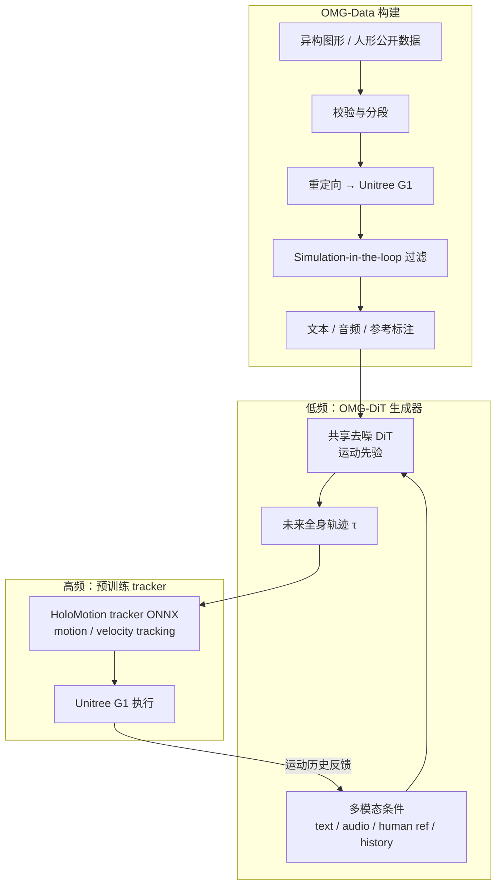
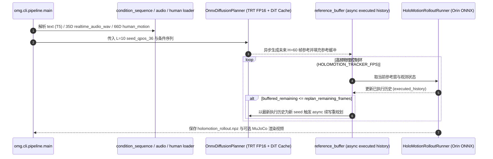

# OMG：Omni-Modal Motion Generation for Generalist Humanoid Control

**OMG**（*Omni-Modal Motion Generation for Generalist Humanoid Control*，[arXiv:2606.10340](https://arxiv.org/abs/2606.10340)，[项目页](https://tsinghua-mars-lab.github.io/OMG/)，[GitHub](https://github.com/tsinghua-mars-lab/OMG)，Tsinghua University MARS Lab）把人形全身控制补上一层 **通用运动生成器**：在推理期不再强依赖外部参考文件，而是把 **语言、音频、人体参考轨迹、运动历史及其零样本组合** 实时映射为 **Unitree G1** 上 `125D` root-centric 可跟踪全身未来轨迹（`L=10 -> H=60` @ `30 Hz`），再由 **预训练 HoloMotion tracker** 物理执行。

> 2026-11-20 更新：正式论文 `arXiv:2606.10340v1`、Hugging Face 数据集 `THU-MARS/OMG-Data` 及 `50m/100m/300m/500m` 预训练模型与评测器 `step_007000.pt`（`THU-MARS/OMG`）均已发布。

## 一句话定义

采用 **OMG-DiT 全模态扩散规划器**（T5-Base 交叉注意力注入文本与历史、FiLM 调制帧级音频/人体参考/新模态分支，经 TensorRT FP16 + DiT cache 加速 `25.1x` 至 `51.7 ms`）结合 **HoloMotion 预训练全身跟踪器**（双机部署于 Jetson Orin），在大规模 MuJoCo 筛洗的 `1174.66 h` `OMG-Data` 上实现真机可控、可实时切换模态的 G1 通用全身控制。

## 英文缩写速查

| 缩写 | 英文全称 | 简要说明 |
|------|----------|----------|
| DiT | Diffusion Transformer | 以 Transformer 为骨干的扩散去噪生成架构（OMG-DiT） |
| CFG | Classifier-Free Guidance | 训练时随机丢弃条件、推理时放大条件影响的扩散引导技巧 |
| FiLM | Feature-wise Linear Modulation | 用仿射变换调制特征图，常用于多模态条件注入 |
| WBT | Whole-Body Tracking | 让人形按参考全身运动的跟踪控制范式 |
| G1 | Unitree G1 Humanoid | 本文真机验证与 OMG-Data 对齐的目标平台 |
| BFM | Behavior Foundation Model | 大规模行为数据预训练的可复用全身行为先验叙事 |
| ONNX | Open Neural Network Exchange | 跨框架模型交换格式；OMG 导出供 TensorRT 实时推理 |
| Sim2Real | Simulation to Real | 仿真训练策略迁移真机；OMG-Data 含 sim-in-the-loop 过滤 |

## 为什么重要

- 在 [运动小脑 64 篇技术地图](../overview/humanoid-motion-cerebellum-technology-map.md) 中归类为 **E 可提示控制**（40/64）：可提示小脑：多模态提示到人形全身动作。
- **补上「意图 → 运动」缺失层：** [SONIC](./nvidia-sonic.md)、[BeyondMimic](../methods/beyondmimic.md) 等 tracking 路线推理期仍需参考；窄技能 RL 又难覆盖开放指令。OMG 把 **多模态意图** 当作生成条件，与 [ETH G1 扩散 locomotion](./paper-hrl-stack-27-learning-whole-body-humanoid-locomot.md)、[Heracles](./paper-heracles-humanoid-diffusion.md) 同属 **生成参考 + 物理执行**，但强调 **omni-modal 组合与 foundation scaling**。
- **数据与模型一体：** **OMG-Data**（约 **1174.66 h**，经重定向 + 仿真筛选对齐 G1）支撑 **50M–1B** 规模 OMG-DiT 训练与 scaling 叙事，接近 [BFM](./paper-behavior-foundation-model-humanoid.md) / [HoloMotion](./holomotion.md) 的「运动基础模型」工程路径。
- **真机多模态切换：** 项目页 **一镜到底** 演示在 text / human ref / audio / 组合条件间 **实时切换**，把「通用人形控制接口」从单模态 tracking 推进到 **runtime 可组合**。
- **开源可复现栈：** MIT 仓库覆盖训练、ONNX 导出、pipeline 模式与 **G1 双机部署**（GPU planner + Orin tracker/bridge），降低与 [Whole-Body Tracking Pipeline](../concepts/whole-body-tracking-pipeline.md) 对照实验的门槛。

## 流程总览

## 核心机制（归纳）

### 1）Generator–tracker 分层

- **生成器（OMG-DiT）：** 扩散 Transformer 建模 **G1 可行运动流形**；条件与先验 **解耦**，新控制接口主要通过 **轻量 encoder + cross-attention / FiLM / CFG** 接入，复用预训练运动先验。
- **跟踪器：** 复用 [HoloMotion](./holomotion.md) 预训练 ONNX（`motion_tracking` / 真机推荐 `velocity_tracking`），把生成轨迹转为扭矩级可执行命令——与自研 RL tracker 的 [ETH G1](./paper-hrl-stack-27-learning-whole-body-humanoid-locomot.md) 路线形成对照。

### 2）OMG-DiT 多模态条件

| 模态 | 注入方式（项目页归纳） | 典型能力 |
|------|------------------------|----------|
| **语言** | 运动历史 + 指令 → 全局 context token | 自然语言驱动 stylized 动作与全身 locomotion |
| **音频** | 帧对齐音乐/音频，cross-attention + FiLM | 节奏、timing、风格调制 |
| **人体参考** | 逐帧 motion guidance | 神经重定向式全身跟踪引导 |
| **组合** | 多条件同时或运行时切换 | 零样本组合与一镜到底 modality switch |

### 3）OMG-Data（`THU-MARS/OMG-Data`）

- **规模：** 总计 **1174.66 h**（`364.5k` clips @ `30 Hz`，`125D` root-centric G1 状态）；其中文本标注 **1166.6 h**（含 Seed-1.8 VLM 重标）、人体参考 **958.77 h**、音频条件 **191.6 h**。
- **管线：** 聚合公开异构数据 → G1 重定向 → **MuJoCo PD 仿真内跌倒筛选**剔除物理无效轨迹 → 多模态对齐标注，并开源于 Hugging Face `THU-MARS/OMG-Data`。

### 4）训练、推理与部署栈

- **模型规模与架构：** `50M / 100M / 300M / 500M`（仓库另含 `1b` 配置），采用 $x_0$-prediction，基于 `L=10 -> H=60` 滑窗预测，T5-Base cross-attention 注入历史与文本，FiLM 调制 35D 音频 / 66D 人体参考 / 零初始化 Pico VR 18D 等条件分支。
- **推理加速：** 结合 **TensorRT FP16 + DiT cache** 加速 **25.1x**（NVIDIA A800 上单次去噪 `31.2 ms`、完整采样 `51.7 ms`）。
- **真机双机架构：** **Jetson Orin** 运行 HoloMotion ONNX（`motion_tracking` / `velocity_tracking`）与桥接；**RTX 4090 GPU 工作站** 经以太网运行 OMG 实时异步规划器。

## 工程实践与开源范围

| 组件 | 状态（2026-11-20 核查） | 官方地址 / 入口 |
|------|-------------------------|----------------|
| **代码仓库** | **已开源（MIT）** | [tsinghua-mars-lab/OMG](https://github.com/tsinghua-mars-lab/OMG)（`omg.cli.generation.{train,export_onnx,benchmark}` & `omg.cli.pipeline.main`） |
| **预训练权重 & 评测器** | **已发布（HF）** | `THU-MARS/OMG`（`50m/100m/300m/500m` 与评测器 `step_007000.pt`） |
| **OMG-Data 数据集** | **已发布（HF）** | `THU-MARS/OMG-Data`（LeRobot v3 格式，支持 `scripts/materialize_omg_data.sh`） |
| **底层 Tracker** | **独立上游获取** | 复用 [HorizonRobotics/HoloMotion](https://github.com/HorizonRobotics/HoloMotion) ONNX |
| **源码运行时序图** | 见下一节 | — |

## 源码运行时序图

对齐 `tsinghua-mars-lab/OMG` 实测代码入口 `src/omg/cli/pipeline/main.py` 与 `src/omg/cli/pipeline/modes.py` 中的 `async` 实时闭环：

## 局限与风险

1. **OMG 取代 tracker（误区）：** 生成器只产出 **125D 参考轨迹**；物理可行性与高频关节控制仍由独立 **HoloMotion tracker** 承担。
2. **双机与算力分离依赖：** 虽然通过 TensorRT FP16 + DiT cache 将 A800 采样压至 `51.7 ms`，真机仍通过以太网由桌面 RTX 4090 跑规划器 + Orin 跑 tracker，非全机身 onboard 单芯片运行。
3. **HoloMotion 资产外部依赖：** 官方 MIT 仓不随仓分发 HoloMotion tracker 权重，用户须另行从 HorizonRobotics 获取并遵循其许可条款。
4. **物理筛除边界：** OMG-Data 使用 MuJoCo PD 前向跌倒筛选，能清掉严重不可行片段，但极高动态交互或未见外部碰撞扰动仍依赖底层 tracker 鲁棒上限。

## 评测与开放进度

- **数据规模与质量：** OMG-Data 总计 **1174.66 h**（`364.5k` 片段 @ `30 Hz`，经 MuJoCo PD 跌倒筛选），含文本 `1166.6 h`、人体参考 `958.77 h`、音频 `191.6 h`。
- **延迟实测（`arXiv:2606.10340`）：** 开启 TensorRT FP16 与 DiT cache 实现 **25.1x** 加速，A800 单次去噪耗时 **31.2 ms**、完整采样 **51.7 ms**，满足真机多模态异步重规划带宽。
- **零样本新模态适配与扩展：** 通过零初始化条件输入头可在极少微调下接入未见 **Pico VR 18D** 遥操信号，并与文本/音频组合生成；`THU-MARS/OMG` 已发布 `50m`–`500m` 模型及评测器 checkpoint `step_007000.pt`。

## 结论

**OMG 的核心贡献是构建了经过 MuJoCo 物理筛洗的千小时 G1 全模态数据集（OMG-Data），并用「T5 + FiLM 解耦式 DiT 规划 + TensorRT 25.1x 加速 + HoloMotion 异步执行」跑通了真机实时多模态切换与开放权重闭环。**

1. **Generator–Tracker 清晰分层** — 高层 `OMG-DiT` 只在 30 Hz `125D` 空间生成参考，底层 `HoloMotion ONNX` 负责高频力矩跟踪。
2. **千小时物理筛选语料可下载复用** — `THU-MARS/OMG-Data` 已公开发布，且全部片段经过 MuJoCo 跌倒校验。
3. **条件解耦支持快速插拔新模态** — 语言走 T5-Base cross-attention，音频/人体参考/Pico 18D 走 FiLM 零初始化适配头。
4. **TensorRT FP16 + DiT Cache 是实时关键** — A800 上把单次采样压到 `51.7 ms`（`25.1x`），支撑 `async` 执行历史异步续写重规划。
5. **当前部署仍为工作站+Orin 分离式算力** — 脱离独立工作站 GPU 的纯机载规划尚待进一步端侧轻量化。

## 与其他工作对比（定性）

| 路线 | 生成层 | 执行层 | 条件模态 | 真机平台 |
|------|--------|--------|----------|----------|
| **OMG** | OMG-DiT 扩散 | HoloMotion tracker | text + audio + human ref + history + 组合 | G1 |
| **ETH G1 loco** | 地形条件 MDM | 自训 RL tracker | 朝向 + 高程图 | G1 |
| **Heracles** | Flow matching 中间件 | 通用 RL tracker | 状态 + 原始参考 | 多平台 |
| **BFM** | 潜空间生成式 WBC | 同一策略 | VR / 摇杆 / tracking 等 | G1 |
| **SONIC** | —（无生成层） | 规模化 tracking | 参考运动 / 视频估计 | 多具身 |

## 参考来源

- [OMG 论文摘录（arXiv:2606.10340）](../../sources/papers/omg_arxiv_2606_10340.md)
- [OMG 项目页](../../sources/sites/omg-tsinghua-mars-lab-github-io.md)
- [OMG 官方仓库](../../sources/repos/omg-tsinghua-mars-lab.md)

## 关联页面

- [扩散运动生成](../methods/diffusion-motion-generation.md) — 扩散作为高层运动规划器的方法族
- [Whole-Body Tracking Pipeline](../concepts/whole-body-tracking-pipeline.md) — WBT 六阶段与 generator–tracker 扩展
- [HoloMotion](./holomotion.md) — OMG 默认 tracker 与权重来源
- [ETH G1 扩散全身 locomotion](./paper-hrl-stack-27-learning-whole-body-humanoid-locomot.md)、[Heracles](./paper-heracles-humanoid-diffusion.md)、[BFM](./paper-behavior-foundation-model-humanoid.md) — 生成 + 执行分层对照
- [人形运动跟踪方法选型](../queries/humanoid-motion-tracking-method-selection.md)
- [Unitree G1](./unitree-g1.md)

## 推荐继续阅读

- [OMG 项目页](https://tsinghua-mars-lab.github.io/OMG/) — 多模态演示视频与贡献列表
- [GitHub: tsinghua-mars-lab/OMG](https://github.com/tsinghua-mars-lab/OMG) — 安装、训练、部署文档
- [HoloMotion 仓库](https://github.com/HorizonRobotics/HoloMotion) — tracker ONNX 与权重下载
