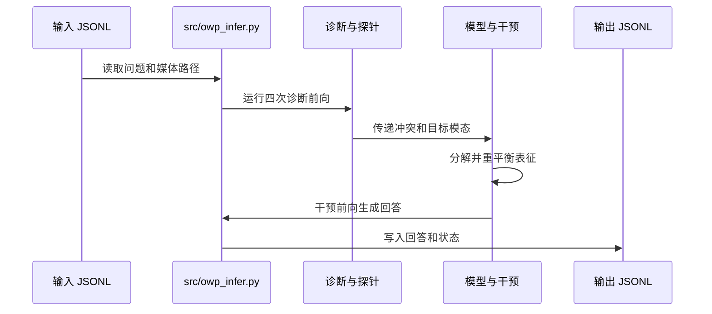

# Omni-Woodpecker：音视频跨模态幻觉纠正

## 一句话定义

OWP 是无需训练的推理干预方法，通过识别音视频模态冲突并调整隐藏表征，抑制误导性先验、恢复与问题相关的证据。

## 英文缩写速查

| 缩写 | 英文全称 | 简要说明 |
|---|---|---|
| OWP | Omni-Woodpecker | 本文方法 |
| OLLM | Omni Large Language Model | 联合处理多模态输入的大语言模型 |
| AVQA | Audio-Visual Question Answering | 音视频问答 |

## 核心信息

| 项 | 内容 |
|---|---|
| 机构 | 南京大学；中国科学院大学 |
| 论文 | [arXiv:2610.27103](https://arxiv.org/abs/2610.27103)，2026 年预印本 |
| 输入与输出 | 音视频及问题；生成经纠正的回答 |
| 骨干 | Qwen2.5-Omni-7B、VideoLLaMA2-AV |
| 开源 | [官方实现](../../sources/repos/omni-woodpecker.md)已公开，MIT；权重和数据许可另计 |

## 方法

1. **冲突诊断：** 用冻结模型的四个互补视图识别问题所需模态和竞争模态。
2. **证据与先验分解：** 在隐藏状态中通过正交分解区分接地证据与竞争先验。
3. **表征重平衡：** 解码前抑制误导性先验并恢复被忽略的证据，不更新模型参数。

## 源码运行时序图

官方入口及模块对应关系见[源码归档](../../sources/repos/omni-woodpecker.md)。四次诊断加一次干预前向意味着需要评估推理时延。

## 评测

下表为作者报告的准确率（%，括号为相对原骨干的百分点变化）：

| 骨干 | CMM 原始 → OWP | AVHBench 原始 → OWP |
|---|---|---|
| Qwen2.5-Omni-7B | 73.2 → 86.1（+12.9） | 75.1 → 83.7（+8.6） |
| VideoLLaMA2-AV | 76.2 → 80.8（+4.6） | 70.2 → 74.1（+3.9） |

Qwen 的四个通用音视频推理基准提升 0.67–2.25 个百分点。但 CMM 感知准确率分别从 89.5 降至 86.7、87.2 降至 83.8，应同时检查抗幻觉与感知能力。

## 结论

OWP 在作者测试的两个音视频模型上改善跨模态幻觉基准，代价和迁移边界仍需结合具体场景验证。

- 优先在音视频线索冲突的问答中评估，并记录各模态的感知准确率。
- 以未干预骨干作为基线，同时测准确率和任务时延；一次标准运行包含五次前向。
- 官方 README 要求 BF16 至少 24 GB 显存；本地运行前核对模型和基准数据许可。
- 论文未提供机器人闭环实验；把这一思路用于机器人感知时需要独立验证实时性和安全表现。

## 与其他工作对比

- **vs 微调式抗幻觉：** OWP 不更新模型参数，仅在推理时对隐藏状态做证据–先验分解与重平衡；代价是一次标准运行包含五次前向。
- **跨骨干差异：** 同一方法在 Qwen2.5-Omni-7B 上 CMM 提升 12.9 个百分点，在 VideoLLaMA2-AV 上为 4.6，收益依赖骨干；两者 CMM 感知准确率均有下降（89.5 → 86.7、87.2 → 83.8）。
- **定位：** 属 [多模态 LLM](../overview/multimodal-llm-development.md) 推理期干预，而非机器人闭环方法；论文未提供机器人实验。

## 关联页面

- [多模态基础概念](../concepts/multimodality-basics.md)
- [多模态 LLM 发展路线](../overview/multimodal-llm-development.md)

## 参考来源

- [论文归档](../../sources/papers/omni_woodpecker_arxiv_2610_27103.md)
- [官方代码归档](../../sources/repos/omni-woodpecker.md)

## 推荐继续阅读

- [官方仓库和复现说明](https://github.com/ZiiJianLiu/Omni-Woodpecker)
