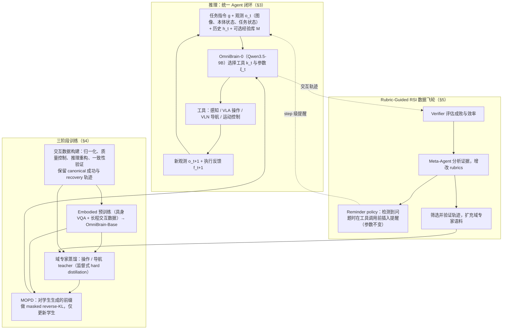

# OmniBrain-0（arXiv:2610.36013）

**OmniBrain-0**（*OmniBrain-0: A Unified Agentic Model for Embodied Intelligence*，[arXiv:2610.36013](https://arxiv.org/abs/2610.36013)，[项目页](https://public-bots.github.io/OmniBrain-0/)）来自 [具身智能小站 2026-10-28 盘点](../../sources/blogs/wechat_embodied_station_59_papers_human_video_to_robot_experience_2026-10-28.md)，属「VLA 与策略后训练」组。

## 一句话定义

**通过具身预训练、领域专家蒸馏和多教师在策略蒸馏整合导航与操作决策。**

## 英文缩写速查

| 缩写 | 英文全称 | 简要说明 |
|------|----------|----------|
| MOPD | Multi-teacher On-Policy Distillation | 多教师在策略蒸馏 |
| RSI | Recursive Self-Improvement | 递归自我改进 |
| VLA | Vision-Language-Action | 视觉语言动作策略 |

## 为什么重要

- 把导航与操作统一到决策模型。再把执行证据变为评分规则和验证轨迹，考察长任务恢复，收益仍需结合具体工具接口理解。
- 开源结论：**模型代码待发布**（2026-11-06）：[官方仓库](https://github.com/luo-yc17/OmniBrain-0) README 标注 Code: coming soon；公开仓库包括项目展示资源。
- 同期同组工作见 [潜在动作、免渲染事件仿真与机器人评测：具身智能小站 10-28 期 59 篇阅读坐标](../overview/embodied-station-2026-10-28-59-papers-technology-map.md)。

## 流程总览

图依据：论文 §3 / §4 / §5 / Fig.3–7

## 核心机制

| 项 | 内容 |
|----|------|
| **arXiv** | [2610.36013](https://arxiv.org/abs/2610.36013) |
| **开源** | 模型代码待发布；项目展示资源公开 |
| **要点** | 通过具身预训练、领域专家蒸馏和多教师在策略蒸馏整合导航与操作决策。 |
| **文内指标** | 公众号转述：再把执行证据变为评分规则和验证轨迹，考察长任务恢复，收益仍需结合具体工具接口理解。 |

## 源码运行时序图

**不适用：** 官方 README 标注模型代码待发布；当前 scripts 仅列展示素材准备脚本，未见模型训练或推理入口。

## 实验与评测

项目页列出的 9B / RSI 成功率：LIBERO-Pro 65.5% / 69.3%；LIBERO-Plus 83.8% / 84.5%；RoboCasa365 39.6% / 43.2%；RoboTwin 2.0 88.2% / 89.4%；R2R-CE 65.0% / 66.0%。R2R-CE 为 Val-Unseen 的 rand100 子集；不宜与完整集结果直接比较。

**阅读状态：** 本次核对了论文摘要、项目页及仓库 README；PDF 超过读取工具大小限制，实验、局限和附录尚未通读，因此保留草稿状态。

- 公众号转述：再把执行证据变为评分规则和验证轨迹，考察长任务恢复，收益仍需结合具体工具接口理解。
- **读法：** 本页为索引级摘要，依据公众号转述的官方摘要与仓库信息整理；逐项数字与 baseline 以原文 PDF 为准。

## 与其他工作对比

- 横向索引见 [潜在动作、免渲染事件仿真与机器人评测：具身智能小站 10-28 期 59 篇阅读坐标](../overview/embodied-station-2026-10-28-59-papers-technology-map.md)；同 arXiv 不重复造页。

## 结论

**把导航与操作统一到决策模型：再把执行证据变为评分规则和验证轨迹，考察长任务恢复，收益仍需结合具体工具接口理解。**

1. 开源边界：项目展示资源公开，模型代码待发布。
2. 核心机制：通过具身预训练、领域专家蒸馏和多教师在策略蒸馏整合导航与操作决策。
3. 复现与选型前核对任务协议、硬件与基准口径，勿直接横比公众号摘录数字。

## 关联页面

- [vla](../methods/vla.md)
- [imitation-learning](../methods/imitation-learning.md)
- [reinforcement-learning](../methods/reinforcement-learning.md)
- [embodied-station-2026-10-28-59-papers-technology-map](../overview/embodied-station-2026-10-28-59-papers-technology-map.md)

## 参考来源

- [omnibrain_0_arxiv_2610_36013.md](../../sources/papers/omnibrain_0_arxiv_2610_36013.md)
- [wechat_embodied_station_59_papers_human_video_to_robot_experience_2026-10-28.md](../../sources/blogs/wechat_embodied_station_59_papers_human_video_to_robot_experience_2026-10-28.md)
- [arXiv:2610.36013](https://arxiv.org/abs/2610.36013)
- [arXiv PDF](https://arxiv.org/pdf/2610.36013)：此前方法部分已读；本次未能获取全文，实验与附录尚待通读。

## 推荐继续阅读

- [arXiv PDF](https://arxiv.org/pdf/2610.36013)
- [项目页](https://public-bots.github.io/OmniBrain-0/)
