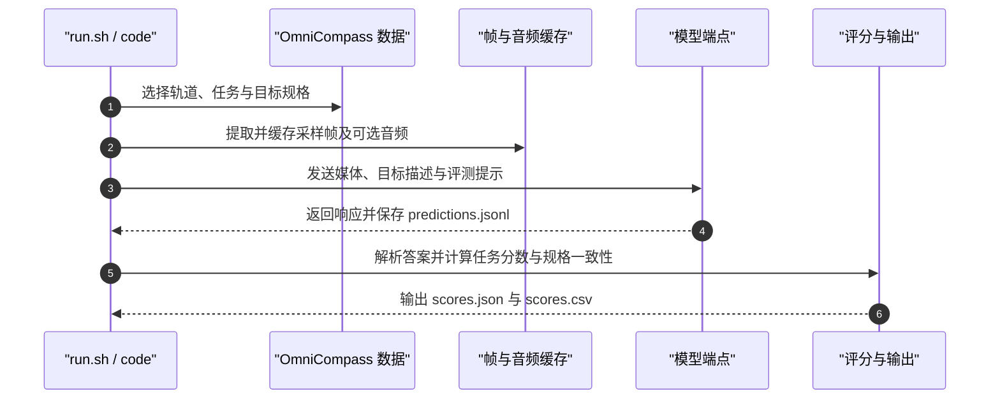

# OmniCompass（全模态视频定位与理解基准 · arXiv:2610.18829）

**OmniCompass** 以配对的文本与文本+图像目标描述，评测视觉语言模型及音视频模型对视频的时序定位、空间定位和问答能力。

## 英文缩写速查

| 缩写 | 英文全称 | 简要说明 |
|------|----------|----------|
| TG | Temporal Grounding | 根据目标描述定位视频中的时间区间 |
| SG | Spatial Grounding | 根据目标描述定位视频帧内的空间位置 |
| QA | Question Answering | 回答关于视频内容的问题 |
| MLLM | Multimodal Large Language Model | 本文的多模态视频理解评测对象 |
| VL / AV | Vision-Language / Audio-Visual | 分别表示视觉语言与含原生音频的轨道 |

## 为什么重要

一般视频基准常只测问答或单一定位任务，难以区分模型是不能识别目标、定位事件，还是结合音频。OmniCompass 把目标规格、视频证据、任务类型和时长组成统一评测，并用同一目标的文本、文本+图像两种规格检查模型表现与输入变化下的一致性。

对机器人研究而言，它适合比较上游视频/多模态模型的理解与 grounding 能力；它没有机器人动作接口或物理交互成功率，不能替代策略、仿真或真机评测。可与[具身评测基准选型闭环](../overview/hub-embodied-eval-benchmark.md)分层阅读。

## 核心原理（方法栈）

- **两条轨道：** OmniCompass-VL 面向视觉语言模型；OmniCompass-AV 面向需要联合音频与视频证据的模型。
- **三个任务：** TG 判断目标何时出现；SG 判断目标在画面何处；QA 判断视频中发生什么。
- **两种目标规格：** text 与 text+image 配对指向同一目标，便于比较规格变化带来的性能与一致性差异。
- **覆盖维度：** 视频包含 short、medium、long 三类时长；VL 的 QA 有 5 种感知与 3 种推理类别，AV 的 QA 有 3 种感知与 2 种推理类别。

### 评测流程总览

## 实验与评测

- **数据规模：** OmniCompass-VL 有 820 个视频、2,460 个实例；OmniCompass-AV 是含原生音频的 240 个视频、720 个实例子集。
- **标注：** 官方 README 报告约 1,800 人时人工标注，并采用多轮质量核验。
- **评测对象：** 论文评估 50 个多模态大模型，报告任务表现及跨目标规格一致性。
- **摘要级发现：** 开源模型整体落后于专有模型，尤其在音视频理解上；精准时空 grounding 对领先模型仍有挑战，配对规格下也会出现预测不一致。
- **机器人适配：** 数据只含视频、音频与目标标注，没有机器人动作、形态或物理状态；不能作为策略训练输入直接复用，只适合评测上游感知模型。
- **数据可得性：** HF 数据卡当前展示 VL 的 2,460 行 test split；AV 子集具体公开文件范围需以 HF / ModelScope 文件列表核验。

## 结论

**OmniCompass 的核心价值是把视频理解拆成“何时、何处、发生什么”，并以配对目标规格检验模型是否对目标表达方式稳定。**

1. **按证据类型选轨道** — 只需视觉证据时评估 VL；任务依赖原生音频时使用 AV，并先确认对应数据可获取。
2. **定位与问答分开读** — TG、SG、QA 回答不同问题，不用单一总分掩盖时空定位短板。
3. **跨规格一致性是诊断信号** — text 与 text+image 的表现差异反映目标规格敏感性，不等于真实世界鲁棒性。
4. **机器人用途在上游感知评测** — 高分表示视频理解/grounding 能力，不证明模型能输出安全稳定的机器人动作。
5. **复现时对齐配置** — 轨道、任务、目标规格、采帧策略及模型音频接口都会改变输入，应一并报告。

## 源码运行时序图

官方 README 将 run.sh 列为 API 与自托管模型共用入口，支持 VL / AV、TG / SG / QA、帧采样、音频与断点续跑。

## 工程实践

| 项 | 实践要点 |
|----|----------|
| 入口 | 官方仓库 run.sh；依赖分别列于 requirements-api.txt / requirements-frames.txt |
| 输入配置 | 报告 VL / AV、TG / SG / QA、text / text+image；明确采帧数或 FPS |
| 输出 | predictions.jsonl 与分项结果 scores.json、scores.csv |
| 许可证 | HF 数据卡为 CC BY-NC-SA 4.0；仓库根目录未见 LICENSE，代码许可应另行核实 |
| 开源边界 | 评测代码和 VL 数据入口已公开；AV 数据具体发布范围需核对文件列表 |

## 与其他工作对比

| 基准 | 主要范围 | 与 OmniCompass 的区别 |
|------|----------|----------------------|
| [MMHU](./paper-mmhu.md) | 驾驶场景人体行为、运动与 Behavior VQA | 聚焦驾驶行人及其运动语义；OmniCompass 聚焦通用视频时空 grounding 和音视频理解 |
| [Daily-Omni](./paper-daily-omni.md) | 日常音视频理解与跨模态时序对齐 | 提供日常 AV 评测视角；OmniCompass 增加时空 grounding 与配对目标规格 |
| [具身评测基准选型闭环](../overview/hub-embodied-eval-benchmark.md) | MLLM、世界模型与策略层评测谱系 | 提供评测对象分层，避免把上游视频理解分数当成机器人策略能力 |

## 局限与风险

- **不是机器人控制基准：** 没有动作空间、闭环交互或机器人任务成功率指标；应视为上游多模态理解评测。
- **分轨数据需确认：** 论文描述 AV 子集，但 HF 当前 viewer 展示 VL split；运行 AV 评测前核对媒体文件与许可。
- **分数受输入预算影响：** 帧采样、参考图像、音频、上下文窗口和模型图像上限均会影响结果；不同设置不宜直接混排。
- **指标边界：** 标注答案匹配不能覆盖所有场景歧义、长尾情况或部署安全要求。

## 关联页面

- [具身评测基准选型闭环](../overview/hub-embodied-eval-benchmark.md) — 将 OmniCompass 定位于上游视频理解评测
- [MMHU](./paper-mmhu.md) — 驾驶域多模态视频行为与问答基准
- [Daily-Omni](./paper-daily-omni.md) — 日常音视频理解对照

## 参考来源

- [论文归档](../../sources/papers/omnicompass_arxiv_2610_18829.md)
- [项目页归档](../../sources/sites/omnicompass-netlify-app.md)
- [官方代码仓库归档](../../sources/repos/polyu-vclab-omnicompass.md)
- [数据集归档](../../sources/datasets/vclab-polyu-omnicompass.md)
- [arXiv:2610.18829](https://arxiv.org/abs/2610.18829)
- [官方 GitHub README](https://github.com/PolyU-VCLab/OmniCompass#readme)

## 推荐继续阅读

- [官方项目页](https://omnicompass.netlify.app/)
- [GitHub 评测工具](https://github.com/PolyU-VCLab/OmniCompass)
- [Hugging Face 数据集](https://huggingface.co/datasets/VCLab-PolyU/OmniCompass)