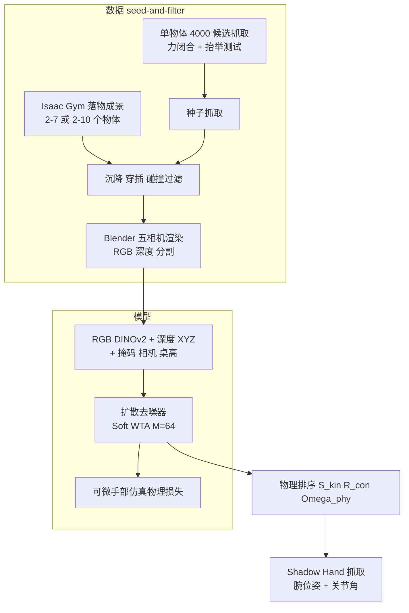

# OmniDex

**OmniDex**（*Scaling Dexterous Hand Grasping to Diverse Cluttered Scenes*，arXiv:2610.11194）同时给出一个杂乱场景灵巧抓取基准（超过 2.6M 场景、约 0.4B 场景级抓取真值）和一个扩散式抓取模型：用 Soft Winner-Takes-All 处理抓取多模态，用可微物理损失和推理期物理排序修正末端接触。

## 英文缩写速查

| 缩写 | 英文全称 | 简要说明 |
|------|----------|----------|
| WTA | Winner-Takes-All | 多假设中只让最优假设承担损失，避免多模态被平均 |
| SR_scene | Success Rate under scene gravity | 真实场景重力下的抓取成功率，本文主指标 |
| CFR | Collision-Free Rate | 无支撑面或非目标物体碰撞的比例 |
| SDF | Signed Distance Field | 符号距离场，用于穿插惩罚 |
| TTP | Test-Time Optimization | 推理时再做梯度优化，文中作为对照 |
| DoF | Degrees of Freedom | Shadow Hand 24 DoF |

## 为什么重要

- 杂乱场景抓取的瓶颈是数据：场景级优化慢，OmniDex 先在单物体上优化种子抓取，再随场景迁移并过滤，避开场景级优化。
- 灵巧抓取天然多模态，直接做去噪回归会取平均；论文用 M=64 假设共享噪声的 Soft WTA 解决这点。
- 推理期不做后优化：200 步测试时优化只有 CFR 2.56，被物理排序取代。
- 给出了清晰的失败结构：成功样本之外 95.71% 的未成功是接触后不稳而非没碰到。

## 流程总览

## 方法

### 数据构建

- 每个物体 4,000 个候选抓取，经力闭合估计器优化并通过仿真抬举的作为种子。
- Isaac Gym 落物：桌面 2–7 个物体，箱子 2–10 个；速度低于 0.03 m/s、0.10 rad/s 或 500 步视为静止；沉降/悬浮超过 3 mm、物间穿插超过 2 mm 的场景被拒。
- 种子抓取迁移到场景位姿，保留与目标接触且无支撑面/非目标碰撞的抓取。
- 子集：D_std 1.14M、D_mix 0.94M、D_box 0.14M、D_grid 0.28M、D_shelf 0.14M；超过 6,000 个物体；训练/测试 8/2，测试分已见物体新布局与未见物体新布局。

### 模型与损失

- 条件：RGB 的 DINOv2 特征、深度反投影 XYZ 图、指令掩码、相机参数、桌面高度；多视角用 alpha 图早期融合与相机关系 token。
- 输出：Shadow Hand 24 DoF 抓取（腕平移、腕旋转、关节角）。
- 损失：λ_WTA=1，λ_phys=100；物理项为拇指接触、对向手指接触、对跖闭合、SDF 穿插，比例 5:1:0.2:2；物理损失前 10 轮关闭，10–20 轮线性升到满权重；AdamW、lr 1e-4、25 轮、A800。
- 推理：采 64 个候选，按 S = S_kin − R_con + Ω_phy 打分取最高有效抓取。

## 源码运行时序图

不适用：论文页与 HTML 均未列项目页、仓库或权重，截至 2026-10-12 无可运行官方实现可对齐。

## 工程实践

| 项 | 内容 |
|----|------|
| 机构 | ACE Robotics；CUHK MMLab；CPII（InnoHK）；同济大学；上海交通大学；浙江大学；南洋理工大学 |
| 算力 | 数据生成与 A800 训练需大量 GPU（论文自述） |
| 推理耗时 | M=1 为 219 ms，M=64 为 1598 ms；M 增大换取成功率 36.08 到 44.41 |
| 真机 | Tianji Marvin M6S 臂 + BrainCo Revo2 手，苹果、山竹、杯子，仅定性 |
| 开源状态 | 未发现项目页、代码或数据链接（截至 2026-10-12 核查 arXiv 摘要页与 HTML） |

## 实验与评测

- **D_std 单视角 SR_scene / CFR**：OmniDex 已见 33.60 / 84.12，未见 40.15 / 84.61；DexGraspVLA 24.30 / 81.44；DexGraspNet 2.0 28.03 / 81.06；Grasp-as-You-Say 0.24 / 38.57。多视角 OmniDex 为 37.35 / 45.05。基线均在同一训练集重训。
- **其他子集（OmniDex 单视角已见）**：D_mix 32.05；D_box 32.34；D_grid 55.01；D_shelf 29.49。
- **数据量**：20%→100% 训练数据 SR_scene 40.50→44.41，边际增益在后段趋缓。
- **假设数 M**：1/4/16/64 的 SR_scene 为 36.08/41.06/43.41/44.41，耗时 219/266/544/1598 ms。
- **物理排序 vs 随机**：30% → 40%（消融 mini-split）。
- **可达性**：Franka 臂五种基座位置下 83.75%–87.98% 的成功抓取可达。
- **数据不一致提示**：正文称 SR_scene 55.80，表 3 中该值位于带星号（手指施力变体）列，本页只引用表内无星号数值。

## 结论

**OmniDex 的价值首先在数据管线和多假设加物理排序的组合，成功率绝对值仍偏低（D_std 单视角 33–40%），且仅有仿真定量结果。**

1. **以 SR_scene 为准，不要用带星号变体比较** — 星号用 DexGraspNet 的手指施力技巧，数值明显更高。
2. **多假设 + 物理排序是性价比点** — M 从 1 到 16 涨 7.3 个点，耗时 219→544 ms；M=64 再涨 1 点但耗时 1598 ms。
3. **失败集中在接触后不稳** — 95.71% 未成功属稳定性失败，优化方向应是接触质量而非检测。
4. **碰撞主因是支撑基座** — CFR 失败中 61.26% 撞基座，桌高/基座建模值得先加强。
5. **真机证据弱** — 三个物体的定性演示，无成功率；落地前需自行评测 sim2real。
6. **复现受限** — 无代码、无数据发布声明。

## 局限与风险

- 基准与主评测全在仿真；传感器噪声、标定与接触参数失配未量化。
- Shadow Hand 单一手型；换手需重新生成数据。
- 最高 SR_scene 不到 50%（多视角消融 49.87），离可靠部署还远。
- 开源：未见代码、数据、权重公开。

## 与其他工作对比

- [DexGraspNet](./paper-rcl-2210-02697-dexgraspnet-a-large-scale-robotic-dexterous-gras.md)：单物体大规模灵巧抓取数据集；OmniDex 扩展到多物体杂乱场景，并训练了 DexGraspNet 2.0 同类基线。
- [OpenDexGrasp](./paper-opendexgrasp.md)：语言功能意图驱动的任务导向抓取；OmniDex 无语言，只用目标掩码指定对象。
- [Arm-Aware DexGrasp](./paper-arm-aware-dexgrasp.md)：推理期注入臂运动学与环境 SDF 约束；OmniDex 用 IK 可达性做后验统计。
- 同周同类：[OmniHOI](./paper-omnihoi.md) 从视频恢复演示，不做抓取泛化。

## 关联页面

- [Manipulation 周报汇总（2026-10-05 至 10-09）](../overview/frontier-manipulation-2026-10-05-10-09.md)
- [操作任务](../tasks/manipulation.md)
- [抓取位姿估计](../methods/grasp-pose-estimation.md)
- [Shadow Hand](./shadow-hand.md)

## 参考来源

- [omnidex_arxiv_2610_11194.md](../../sources/papers/omnidex_arxiv_2610_11194.md) — 论文归档
- [frontier_manipulation_2026_10_05_10_09.md](../../sources/blogs/frontier_manipulation_2026_10_05_10_09.md) — 周报线索
- 论文：<https://arxiv.org/abs/2610.11194>

## 推荐继续阅读

- [arXiv HTML 全文](https://arxiv.org/html/2610.11194v1)
- [DexGraspNet 页](./paper-rcl-2210-02697-dexgraspnet-a-large-scale-robotic-dexterous-gras.md)
- [OpenDexGrasp 页](./paper-opendexgrasp.md)
