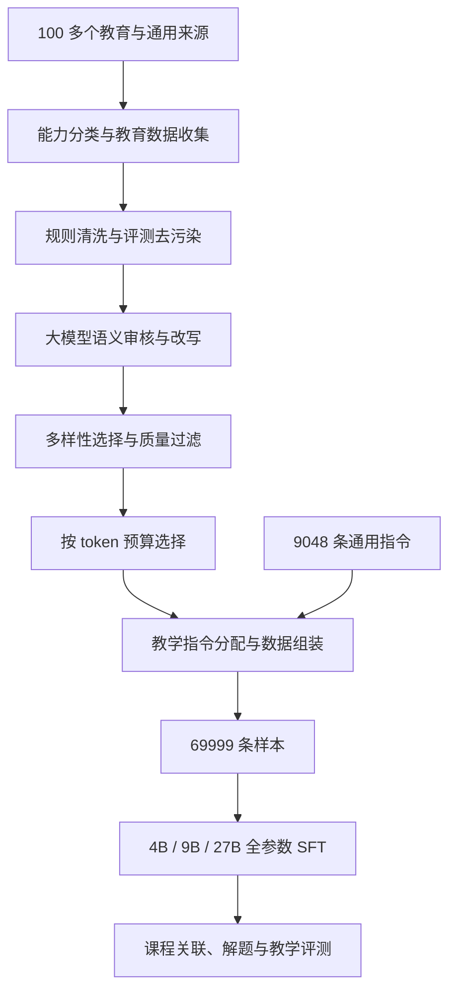
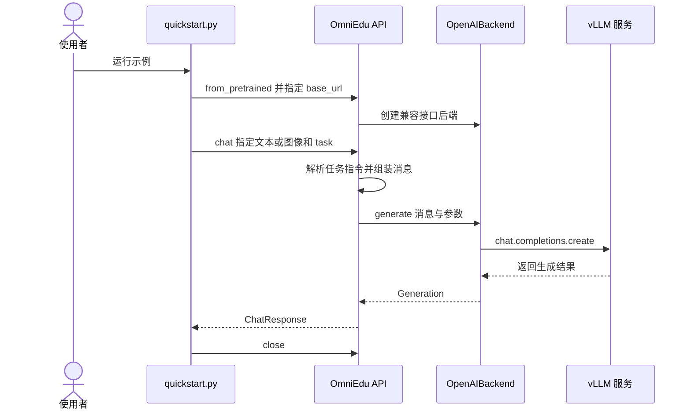

# OmniEdu：面向学习与教学的开放基础模型

## 一句话定义

OmniEdu 是以学科解题、课程关联、学习诊断和教学引导为目标的 4B、9B、27B 教育模型族。

## 英文缩写速查

| 缩写 | 英文全称 | 简要说明 |
|---|---|---|
| SFT | Supervised Fine-Tuning | 监督微调 |
| LLM | Large Language Model | 大语言模型 |
| EM | Exact Match | 精确匹配指标 |
| FP8 | 8-bit Floating Point | 权重量化格式 |

## 为什么重要

教育辅助需要判断知识点和学生错误，并选择提示或解释；这些能力不能仅用最终答案正确率衡量。

## 流程总览

依据论文 v1 图 1 和第 3–4 节：

## 核心原理

教育数据按学科能力、课程关联、诊断推理、教学行动和支架四类组织。约 134 万条教育候选样本经过规则清理、评测去污染、LLM 审核和改写、多样性及质量过滤，保留 60,951 条；再加入 9,048 条通用指令。样本按任务桶分配 20 种系统指令之一，以区分直接解题和引导式教学等行为。

论文使用 LlamaFactory 进行全参数 SFT，学习率为 5×10⁻⁶，序列长度 32,768，训练 3 个 epoch。

## 源码运行时序图

以下对应官方 SDK 的 `sdk/examples/quickstart.py`、`api.py` 与 `backends/openai_backend.py`，仅描述示例使用的远程服务路径。

服务需预先启动；上述图未将服务内部推理过程当作 SDK 中已核实的实现。

## 工程实践

官方项目提供权重、训练数据、数据处理与 SDK；4B FP8 权重下载约 5.14 GiB，实际显存还包括缓存、激活和服务开销。数据的各组成来源需分别检查使用条款。

## 实验与评测

论文 v1 报告 OmniEdu-27B 在 K12-Bench 为 63.12% EM / 76.69% F1，MathFish 为 85.89%，MathTutorBench Scaffold 胜率为 78.74%，LongTutor Teaching 为 3.02。与各自基础模型相比，三个规模的教育评测汇总指标均提升；排名限于论文的评测模型和设置。

## 结论

能力导向的教育数据整理与 SFT 在论文报告的基准上改善了多个教育任务。

- 评估教学引导时，应同时观察支架、反馈和诊断指标。
- 模型可能生成错误内容，实际教学使用需要审核。
- 基准成绩不能单独证明真实课堂学习收益。

## 局限与风险

论文对比中部分模型在含图题目上只接收文本，跨模型比较需考虑输入差异。LongTutor 知识状态诊断仍有明显错误。当前草稿尚需通读全文剩余部分和全部相关附录，并运行仓库完整 CI。

## 关联页面

- [OpenMAIC](./openmaic.md) — 面向课堂生成的应用系统。
- [OpenClaw](./openclaw.md) — 可作为不同应用编排层的参照。

## 参考来源

- [论文归档](../../sources/papers/omniedu.md)
- [项目主页归档](../../sources/sites/omniedu.md)
- [官方代码归档](../../sources/repos/omniedu.md)

## 推荐继续阅读

- [论文 v1](https://arxiv.org/pdf/2609.23088)
- [官方代码及部署说明](https://github.com/haolpku/Omni-Edu)
