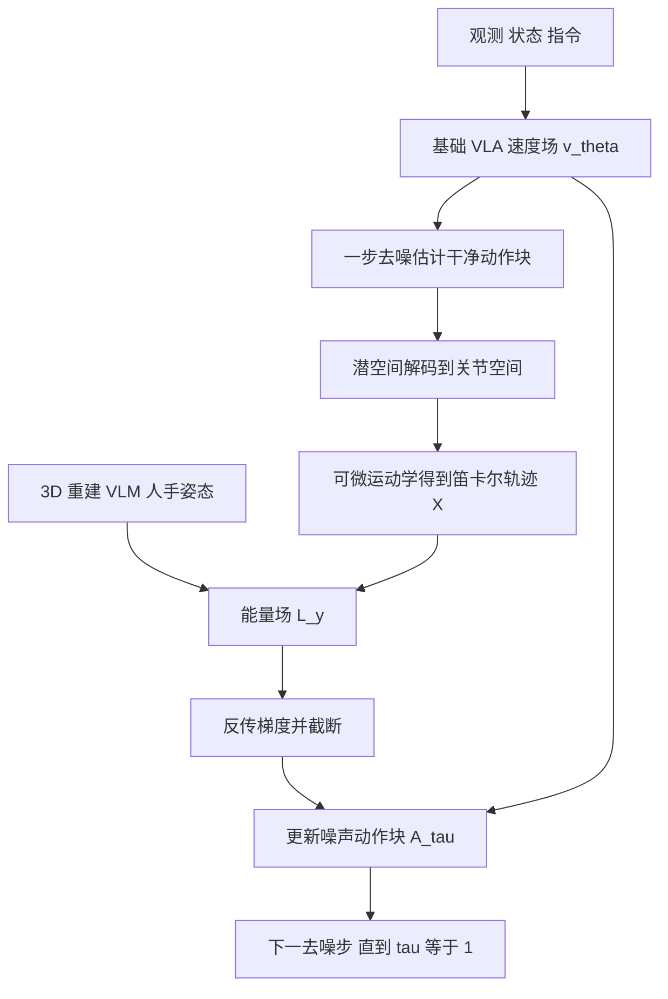

# OmniGuide（arXiv:2603.10052）

**OmniGuide**（*OmniGuide: Universal Guidance Fields for Enhancing Generalist Robot Policies*，[arXiv:2603.10052](https://arxiv.org/abs/2603.10052)，宾夕法尼亚大学）：测试时对 flow-matching VLA 做「外挂式」引导，不更新 VLA 权重也不加机器人数据。

## 一句话定义

**把碰撞避让、VLM 语义目标、人类手部轨迹统一成笛卡尔空间的可微能量场，经可微运动学把梯度反传到 flow-matching VLA 的每个去噪步，在测试时引导动作采样；基础策略保持不变。**

## 英文缩写速查

| 缩写 | 英文全称 | 简要说明 |
|------|----------|----------|
| VLA | Vision-Language-Action | 视觉–语言–动作策略（本文基座为 π0.5 与 GR00T N1.6） |
| VLM | Vision-Language Model | 本文用 Gemini-2.5-Flash 给出语义目标点 |
| SDF | Signed Distance Function | 到最近障碍表面的有符号距离，碰撞场由它构造 |
| VGGT | Visual Geometry Grounded Transformer | 多视角前馈 3D 重建模型，真机用它出点云 |
| DTW | Dynamic Time Warping | 动态时间规整，本文 Alg. 1 是其单调最近邻变体 |
| HaPTIC | 人手 3D 姿态估计模型 | 本文用它从示范视频提取人手腕部轨迹（全称论文正文未展开） |
| CLIP | Contrastive Language-Image Pre-training | 本文用 patch 级特征标出任务相关区域并从碰撞点云剔除 |
| MPPI | Model Predictive Path Integral | cuRobo 后处理基线中的采样优化器 |

## 为什么重要

- 预训练 VLA 常在「最后一公里」失手：3D 避碰、精确物理落地、铰接物体操作（I 节）；常规补救是用更多目标环境数据微调，昂贵且稀缺。
- 本文给出一条不重训的路径：外部感知基础模型（3D 重建、VLM、人手姿态）提供 VLA 缺的知识，用同一个能量场抽象接入（I 节，III-C 节）。
- 与专门方法（cuRobo、F3RM、DemoDiffusion）在真机上对比，作者称统一框架持平或更好（摘要，IV-C 节）。

## 核心原理与流程总览

**机制（III 节，作者自述）：** flow-matching 策略在去噪时间 τ 上积分速度场；引导等价于在速度场上叠加任务能量的负梯度（式 9、12）。约束天然定义在会被执行的干净笛卡尔轨迹上，而不是噪声动作上，所以每个去噪步要先估计干净动作块，再经可微运动学得到末端轨迹，评估能量，梯度反传回噪声动作块。

三类场（III-C 节）：

| 场 | 类型 | 构造 | 公式 |
|----|------|------|------|
| 碰撞 | 排斥 | 点云量化为占据栅格，算 SDF，风险区 0 < SDF ≤ d，L_C = −log SDF | 式 14-16 |
| 语义 | 吸引 | VLM 指出目标像素，深度反投影到 3D，到目标距离的高斯负对数似然，外加朝向项 | 式 17-18，附录 E |
| 人类轨迹 | 吸引 | HaPTIC 提腕部轨迹，Alg. 1 单调匹配后只对匹配点施加高斯吸引 | 式 19 |

另有可选的初始噪声引导：采样 N 个初始噪声，少步去噪后选能量最低者（式 13，III-B 节）。

## 工程实践

- **适用范围：** 仅适用于经扩散或 flow matching 生成动作的 VLA，且要求端到端可微（I 节，III-A 节）。GR00T N1.6 在学习到的潜动作空间去噪，π0.5 在关节空间（III-A 节）。
- **仿真设置（IV-A 节，附录 A）：** RoboCasa，GR00T N1.6-3B，Franka Panda，使用地面真值深度与物体位姿，刻意排除感知误差；d=0.15 m，λ_C=0.02，λ_S=5.0，朝向项 0.02λ_S。
- **真机设置（IV-C 节，附录 B）：** DROID 平台，Franka 机械臂，腕部 ZED Mini 与多台 ZED 2（附录 B 称另加一台顶置相机，IV-C 节称三台固定相机）；VGGT 点云，用标定相机对距离重标尺度；PyBullet 渲染机器人遮罩去除本体点；CLIP 前 95% 分位点视为任务相关并剔除；π0.5 的动作块 H=15、执行 h=8（附录 C）。
- **延迟（IV-C 节，图 10）：** 单张 RTX 5090，约 0.25 s 增至约 0.53 s，控制频率 30 Hz 降到约 15 Hz；通过并行 KV cache、CLIP、VGGT 计算缓解。
- **复现提示：** 项目页有 GitHub 链接，但本页作者未能访问仓库，不能保证代码已发布或可复现。

## 与清单说法的核对

清单（Glen Berseth 的 CoRL 2026 阅读清单，P1，「VLAs & Generalist Policies」，摘要由 LLM 据摘要起草，排序是作者自己的兴趣模型打分，不是质量评价）原文：「Expresses 3D, semantic and human-pose guidance as differentiable energy fields that steer VLA action sampling at test time.」

| 清单措辞 | 论文核对 | 结论 |
|----------|----------|------|
| 3D、semantic、human-pose 三类引导 | 摘要与 III-C 节：3D 碰撞（VGGT 点云 SDF）、VLM 语义目标、人手轨迹（HaPTIC 提腕部位置）；注意「human-pose」实际只用了手腕 3D 位置作为参考轨迹，不是全身姿态 | 基本对得上，限定词需补 |
| differentiable energy fields | III-A、III-B 节：能量定义在笛卡尔轨迹上，经可微运动学反传；场本身解析可微（SDF 用有限差分加三线性插值） | 对 |
| steer VLA action sampling at test time | 对：不训练、去噪时叠加梯度；另可选初始噪声引导 | 对，但限定：仅限扩散 / flow-matching 动作头的 VLA |
| 清单标题 "Universal Spatial Guidance Fields" | arXiv v1 标题为 "Universal Guidance Fields"，"A Universal Spatial Guidance Field" 是 III-C 节小标题；OpenReview 版标题可能不同（本环境未能打开） | 标题与 v1 不完全一致 |
| 未提及的实验范围 | 仿真为 RoboCasa 加 GR00T N1.6（地面真值深度与位姿），真机为 DROID 加 π0.5；真机每配置只有 5 次试验（IV-C 节） | 一句话摘要没有体现样本量小与仿真用真值感知 |
| 摘要头条数字（论文 I 节，非清单） | 「24.2% 到 92.4%」「7.0% 到 93.5%」在正文与图 5、9 中找不到对应汇总，口径不明 | 无法核实 |

## 局限

**作者自承（III-C 节与 V 节）：**
- 引导场确定且任务特定，可能陷入局部极小、接触动力学建模不全；引导无法自行解决人到机器人重定向的运动学失配，因此预训练 VLA 先验仍必需。
- 展望的方向（物体中心表示、力传感器、点轨迹、生成视频、检索动作）说明当前不含这些模态。

**本页作者看到的未验证之处（判断，与作者自述分开）：**
- 真机每个配置仅 5 次试验（IV-C 节），图 9 上多处 0% 与 100%，未给置信区间或显著性检验；仿真 50 次试验，也未见区间。
- 仿真刻意使用地面真值深度与物体位姿（IV-A 节），仿真结果不含感知误差；感知误差只在真机间接体现，没有单独的消融。
- 碰撞引导的前提是点云能区分障碍与任务相关物体，靠 CLIP 相似度前 95% 分位阈值剔除（附录 B）；该阈值的敏感性、剔除失误对安全率的影响没有分析（推测：杂乱场景中可能误删障碍）。
- 安全率只统计机器人本体与静态家具的碰撞（IV-A 节）；真机的动态与「reactive」任务的评价口径正文只给了任务描述。
- 与专门基线的比较中，cuRobo 权重（wcoll=1e7 等）为作者自行调定（附录 C），F3RM 需要额外示范；是否对基线做了同等调参，论文未说明。
- 延迟约翻倍（图 10）；更大动作块、更重的基座或更多引导源时的开销没有评估。

## 关联页面

- [VLA（Vision-Language-Action）](../methods/vla.md)
- [Flow Matching 具身策略](../concepts/flow-matching-embodied-policy.md)
- [Diffusion Policy](../methods/diffusion-policy.md)
- [Safety Filter](../concepts/safety-filter.md)
- [碰撞距离优化](../concepts/collision-distance-optimization.md)
- [π0.5 开放世界 VLA](../entities/paper-pi05-open-world-vla.md)
- [Isaac GR00T](../entities/isaac-gr00t.md)
- [DROID 策略学习](../entities/droid-policy-learning.md)
- [RoboCasa](../entities/robocasa.md)
- [RAGu：检索增强引导（同样用能量引导注入 flow-matching VLA，并引用了本文）](../entities/paper-ragu-retrieval-augmented-guidance.md)

## 参考来源

- [omniguide_arxiv_2603_10052.md](../../sources/papers/omniguide_arxiv_2603_10052.md)
- [arXiv:2603.10052](https://arxiv.org/abs/2603.10052)
- [项目页](https://omniguide.github.io/)

## 推荐继续阅读

- [arXiv PDF](https://arxiv.org/pdf/2603.10052v1)
- [RAGu：检索增强引导](../entities/paper-ragu-retrieval-augmented-guidance.md)
- [Flow Matching 具身策略](../concepts/flow-matching-embodied-policy.md)
