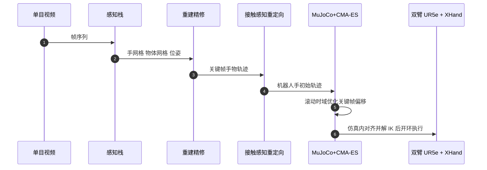

# OmniHOI

**OmniHOI**（*Dexterous Hand-Object Interaction from Monocular Human Video*，arXiv:2610.10855）把一段单目 RGB 手物交互视频转成可驱动灵巧手的物体轨迹：先重建手与物体，再按接触几何重定向到机器人手，最后在 MuJoCo 物理回路里用 CMA-ES 修正，使物体真正被「推着走」。它是优化型流水线，不训练神经策略。

## 英文缩写速查

| 缩写 | 英文全称 | 简要说明 |
|------|----------|----------|
| HOI | Hand-Object Interaction | 手与物体交互，本文的重建与迁移对象 |
| MANO | Hand Model with Articulated and Non-rigid defOrmations | 参数化人手网格模型，WiLoR 输出该格式 |
| CMA-ES | Covariance Matrix Adaptation Evolution Strategy | 无梯度进化优化器，本文用于物理回路里的关键帧偏移搜索 |
| ATE | Absolute Trajectory Error | 物体轨迹绝对误差，成功判据为 <10 cm 且 <0.5 rad |
| PCHIP | Piecewise Cubic Hermite Interpolating Polynomial | 保形分段三次插值，把关键帧补到 60 Hz |
| DoF | Degrees of Freedom | 灵巧手自由度，本文覆盖 6–22 |

## 为什么重要

- **视频是最便宜的灵巧操作数据源**，但单目缺度量尺度且手被遮挡；论文的贡献是在每个阶段挂上不同类型的物理约束，而不是只做一次后处理。
- **跨手可迁移**：同一流水线在 Inspire(6)、XHand(12)、Wuji(20)、SharpaWave(22)、Shadow(20) 五只手上输出轨迹，无需为每只手重训。
- **物理回路是增益大头**：消融显示它把四个高自由度手的成功率从 9–29% 提到 85–89%（见下文评测）。
- 与动捕系重定向（SPIDER、OmniRetarget）相比，输入从精确动捕降到了单目视频，仍保持更高成功率。

## 流程总览

## 方法

### 阶段 1：关键帧重建

- 感知栈：SAM 3（手、物体、桌面分割）、MoGe-3（内参与深度点图）、WiLoR（MANO 手网格）、SAM 3D（物体网格）、FoundationPose（逐帧物体位姿）。
- 自适应关键帧：按运动累积量等间隔放关键帧，只精修约 20% 帧（r=0.2）；消融中自适应 83% 成功对均匀采样 81%，优势很小（XHand）。
- 精修交替两个目标：图像对齐（有序遮挡损失、可微光栅化）与接触穿插优化（grasp loss），再加手指交叉修复，Adam 优化。

### 阶段 2：接触感知重定向

以 WujiHand 的关键点求解器作初始解；接触手指被拉向演示中的接触区域，同时消除穿插与手指交叉，交叉用字典序目标优先修复。

### 阶段 3：物理回路精修

关键帧经 PCHIP 插值到 60 Hz，在 MuJoCo 里回放；CMA-ES 在滚动时域上为每个关键帧优化偏移量。代价项：物体位姿误差、接触、对向接触力、穿插、偏移先验、终端惩罚。原文未给出各项权重（代码未发布，无法核对）。

## 源码运行时序图

不适用：截至 2026-10-12 项目页只写 "Code soon"，没有 GitHub 仓库，无可对齐的目录或脚本。下图仅为论文描述的运行顺序（非仓库）：

## 工程实践

| 项 | 内容 |
|----|------|
| 机构 | 浙江大学；香港大学；上海交通大学；上海人工智能实验室（据 arXiv HTML 作者脚注） |
| 每条轨迹耗时 | OmniHOI 19 min；SPIDER 37 min；ManipTrans 385 min；OmniRetarget 0.3 min |
| 真机 | 两只 XHand 装在两台 UR5e 上，七项任务，轨迹在仿真中对齐、解 IK、开环执行 |
| 项目页 | [hydrofoooil.github.io/OmniHOI](https://hydrofoooil.github.io/OmniHOI/)，归档见 [omnihoi-project.md](../../sources/sites/omnihoi-project.md) |
| 开源状态 | 截至 2026-10-12 未发布：页面 "Code soon"，无仓库与数据链接 |

## 实验与评测

- **数据**：150 条动捕轨迹（TACO 58、OakInk2 62、ARCTIC 30；60 单手、90 双手）；60 段单目视频（TACO 51、OakInk2 9）。成功判据：物体 ATE <10 cm 且 <0.5 rad，双手任务要求两物体都通过。
- **运动迁移成功率**（Inspire/XHand/Wuji/SharpaWave/Shadow）：OmniHOI 39/89/86/89/85%；SPIDER 26/26/20/19/15%；OmniRetarget 24/31/27/20/16%；ManipTrans 24/22/–/–/26%。
- **端到端视频（60 段，XHand）**：OmniHOI 53% 成功、71% 进度、5.7 cm、26°；VideoManip 28%、49%、8.6 cm、31°；Do as I Do 25%、48%、9.1 cm、31°。28 次失败中 14 感知、13 执行、1 运动规划。
- **重建**：F5 0.3878、CD 0.9574 cm²、MPVPE 6.05 mm，对最佳基线 EasyHOI 的 0.2187、1.7110 cm²、14.63 mm。
- **消融**：穿插体积 IV 4.27→3.61→3.03→2.75 cm³（放置、+图像对齐、+接触穿插、+交叉修复）；物理回路使最大穿插中位数 9.17→4.73 mm。
- **真机**：七项任务演示；论文未提供真机成功率表（原文未报告）。

## 结论

**OmniHOI 的真影响来自物理回路精修而非更好的重建；它让视频到灵巧手轨迹在仿真里「推得动物体」，但真机仍是开环演示。**

1. **读成功率先看手的自由度** — 39% 是 6 DoF 的 Inspire，其余四只手 85–89%；不要把 39–89% 当成单一水平。
2. **物理回路是主增益** — 高自由度手 9–29% → 85–89%，说明纯几何重定向不够。
3. **重建改进是次要代价项** — 自适应关键帧只比均匀采样高 2 个点，别为此重写感知栈。
4. **耗时在分钟级** — 19 min/条，比 ManipTrans 的 385 min 快，但比 OmniRetarget 的 0.3 min 慢两个数量级。
5. **瓶颈在单目度量尺度** — 28 次视频失败中 14 次为感知；物体几何与物理属性误差会传入精修。
6. **复现暂不可行** — 代码未发布，权重/代价项系数未知，仅能按论文方法重搭。

## 局限与风险

- 精度受单目度量尺度约束；视频推得的物体几何与质量等属性误差影响物理精修。
- 真机为开环、仿真中解 IK，无闭环反馈；论文把闭环控制列为未来工作。
- 视频评测只有 60 段，来自 TACO 与 OakInk2（均由动捕数据集选出），野外视频泛化未核实。
- 开源：截至 2026-10-12 未发布代码与数据。

## 与其他工作对比

- [SPIDER](../methods/spider-physics-informed-dexterous-retargeting.md)：同样用物理仿真采样优化做重定向，输入为动捕；本文表中其成功率 15–26%、37 min/条。
- [OmniRetarget](./paper-hrl-stack-03-omniretarget.md)：交互网格硬约束的快速重定向（0.3 min/条），成功率 16–31%；本文以更长耗时换更高成功率。
- [TopoRetarget](../methods/toporetarget-interaction-preserving-dexterous-retargeting.md)：保持交互拓扑的重定向，侧重几何一致；本文额外加入仿真回路。
- 同期杂乱场景灵巧抓取见 [OmniDex](./paper-omnidex.md)：那是从数据学抓取，这里是从视频还原演示。

## 关联页面

- [Manipulation 周报汇总（2026-10-05 至 10-09）](../overview/frontier-manipulation-2026-10-05-10-09.md)
- [操作任务](../tasks/manipulation.md)、[双臂操作](../tasks/bimanual-manipulation.md)
- [灵巧手运动学](../concepts/dexterous-kinematics.md)

## 参考来源

- [omnihoi_arxiv_2610_10855.md](../../sources/papers/omnihoi_arxiv_2610_10855.md) — 论文归档
- [omnihoi-project.md](../../sources/sites/omnihoi-project.md) — 项目页核查
- [frontier_manipulation_2026_10_05_10_09.md](../../sources/blogs/frontier_manipulation_2026_10_05_10_09.md) — 周报线索
- 论文：<https://arxiv.org/abs/2610.10855>

## 推荐继续阅读

- [OmniHOI 项目页](https://hydrofoooil.github.io/OmniHOI/)
- [arXiv HTML 全文](https://arxiv.org/html/2610.10855v1)
- [SPIDER 方法页](../methods/spider-physics-informed-dexterous-retargeting.md)
