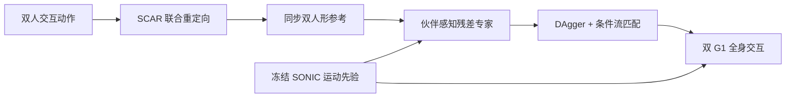

# OmniInteract：双人形全身交互控制

**OmniInteract**（*Towards Unified Whole-Body Interaction Control for Dual Humanoids*，[arXiv:2610.26043](https://arxiv.org/abs/2610.26043)）从人类双人交互动作学习双人形协调控制：先保留两具身体之间的表面接触与近场几何，再学习伙伴条件化的交互残差动作。

## 一句话定义

**以表面级接触重定向生成双人形参考动作，再将伙伴感知的残差专家蒸馏成统一策略，叠加在冻结的全身运动先验上执行。**

## 英文缩写速查

| 缩写 | 英文全称 | 简要说明 |
|------|----------|----------|
| SCAR | Surface Contact-Aware Retargeting | 联合重定向两台机器人并保留接触界面及附近几何 |
| SONIC | Scalable Omni-directional humanoid motion tracking Controller | 论文冻结并复用的全身运动跟踪先验 |
| MAPPO | Multi-Agent Proximal Policy Optimization | 训练交互残差专家的多智能体 PPO |
| DAgger | Dataset Aggregation | 收集策略访问状态并查询专家动作的模仿学习流程 |
| G1 | Unitree G1 humanoid robot | 论文真机双人形平台 |

## 为什么重要

- **交互要求两具身体协同接触：** 单独把两条人体动作重定向到机器人，并不保证机器人之间能形成正确的手掌、肩部或躯干接触。
- **避免从头学习平衡与交互：** 冻结 SONIC 的运动先验，把新策略容量用于伙伴引起的偏差和接触协调。
- **把技能扩展与控制保真度一起评估：** 不只展示单一交互；论文逐步增加交互动作种类，并报告仿真泛化与双 G1 真机任务。

## 核心原理

### 方法栈

1. **SCAR 双体重定向：** 通过稠密人体—机器人表面对应，把两台机器人的关节与根位姿作为耦合变量联合优化。显式接触点约束保留接触界面，近场 Laplacian 关系保留接触周围的局部几何；优化同时处理关节、速度、地面与碰撞可行性。
2. **伙伴条件化残差专家：** 冻结 SONIC 策略作为基础动作。每种交互由一个共享给两台机器人的专家，根据自身与伙伴的历史状态、相对位姿和未来参考，使用 MAPPO 学习有界残差动作。
3. **流匹配统一策略：** 用专家 rollout 和 DAgger 收集状态—残差监督，再用 conditional flow matching 训练共享残差策略。部署时从条件策略生成残差，加到冻结基础动作上。

### 流程总览

## 实验与评测

| 评测 | 论文报告 | 读法 |
|------|----------|------|
| 数据集 | InterHuman、Inter-X；各选 30 种交互动作构成控制基准 | 数据集用于重定向与控制评测；作者未在项目页提供独立数据下载入口 |
| 仿真泛化 | 未见交互动作成功率 72.89% | 反映对训练参考动作之外动作的迁移 |
| 多样性扩展 | 60 种动作下成功率 84.3%；统一 MLP 为 80.7%，从零 RL 为 68.5% | 该表反映论文指定仿真设定，不应直接等同真实任务成功率 |
| 双 G1 真机 | High-Five：85.7%（14 次）；Hug：72.7%（22 次）；Shoulder：77.8%（18 次） | 每任务试验次数有限；读数用于证明可执行性而非给出高置信度可靠性估计 |

## 与其他工作对比

- **相对独立运行单机器人跟踪器：** 伙伴条件化残差能修正两台机器人之间积累的相对偏差。
- **相对从零 RL / 统一 MLP：** 冻结运动先验减少了同时学习个体跟踪、平衡和互动协调的负担；论文仿真多动作设定中流匹配统一策略优于这两类对照（见上表）。
- **相对 [SONIC](./nvidia-sonic.md)：** SONIC 是单体全身动作跟踪先验，OmniInteract 不改动它，只在其上叠加伙伴感知残差。
- **相对 [去中心化多人形搬运](./paper-decentralized-multi-humanoid-pickup.md)：** 后者以物体为中心、无直接通信地协同搬运；OmniInteract 处理的是两具身体之间的直接表面接触，输入显式包含伙伴状态与相对位姿。

## 结论

**一句话总判：该工作把双人形交互拆成“保接触地生成参考”和“在强单体先验上学习伙伴修正”，并以仿真规模实验及双 G1 演示验证路线可行。**

1. 研究接触重定向时，应同时检查接触界面和其周边几何；只看关节姿态误差会漏掉交互关系失真。
2. 学习双机协作时，可先复用稳定单机全身控制，再让策略学习伙伴条件化的残差。
3. 流匹配统一策略在论文仿真多动作设定中优于所列的统一 MLP 和从零 RL 对照；数字只适用于相同数据与评测定义。
4. 真机部分证明了双 G1 的 High-Five、拥抱和肩部交互可执行，但单任务试验数不大，尚不足以证明长时连续运行可靠性。
5. 截至入库日，官方项目页没有可运行源码入口；复现前需等待作者公开代码与模型/数据说明。

## 源码运行时序图

**不适用：** 截至 2026-10-24，官方项目页与论文未提供可访问的训练、推理或部署代码仓库，因此没有可核对的源码运行入口。

## 局限与风险

- 真实机器人评测使用两台 Unitree G1 和少量指定交互任务；论文演示不能直接推出任意双人形平台、任意接触任务上的泛化。
- 当前公开页面未列出代码或数据下载链接，无法从归档资源直接复现表面对应预处理、残差专家训练和流策略部署。
- 论文仿真成功率依赖其动作集合、仿真动力学与成功判据；与其他论文的数字应先核对评测定义。

## 关联页面

- [人形多机协调](../concepts/humanoid-multi-robot-coordination.md) — 多机协作的任务边界与路线
- [Motion Retargeting](../concepts/motion-retargeting.md) — 动作跨本体转换
- [Loco-Manipulation](../tasks/loco-manipulation.md) — 全身移动与接触任务
- [去中心化多人形搬运](./paper-decentralized-multi-humanoid-pickup.md) — 以物体为中心的多机运输策略

## 参考来源

- [论文归档](../../sources/papers/omniinteract_arxiv_2610_26043.md)
- [官方项目页归档](../../sources/sites/omniinteract-project.md)
- [arXiv HTML v2](https://arxiv.org/html/2610.26043v2)

## 推荐继续阅读

- [arXiv 论文](https://arxiv.org/abs/2610.26043)
- [OmniInteract 项目演示页](https://calvinyhli.github.io/omniinteract.github.io/)
