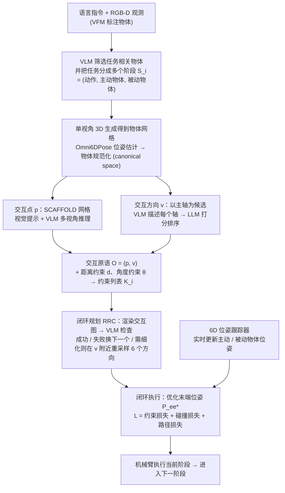

# OmniManip

**OmniManip**（[arXiv:2501.03841](https://arxiv.org/abs/2501.03841)）收录于 Lumina [Embodied-AI-Guide 微信专辑](../../wiki/overview/embodied-ai-guide-wechat-album-curator.md)。本页为独立详情节点；实验数字以原文为准。

## 一句话定义

**LLM 生成可交给规划/控制的几何约束。**

## 英文缩写速查

| 缩写 | 英文全称 | 简要说明 |
|------|----------|----------|
| VLA | Vision-Language-Action | 视觉–语言–动作策略 |
| LLM | Large Language Model | 大语言模型 |
| IL | Imitation Learning | 模仿学习 |
| BC | Behavior Cloning | 行为克隆 |

## 流程总览

图依据：论文 §3.1–3.3（交互原语与空间约束、原语提取、双闭环系统）/ Fig.2、Algorithm 1、Eq.(1)-(5)

## 核心信息

| 项 | 内容 |
|----|------|
| **机构** | — |
| **arXiv** | [2501.03841](https://arxiv.org/abs/2501.03841) |
| **开源** | 待核实 |

## 实验与评测

- **本页为索引级节点**（Lumina Embodied-AI-Guide 微信专辑）：正文固化定位与开源边界，**未转存原文实验表**。
- **回原文须核对的证据**：本页未转存原文实验表——回原文须核对其 3D 表示的构建开销与操作成功率的对应关系，以及开源范围（本页开源一栏为待核实，以项目页为准）。
- **读法：** 先对齐本体、任务集与成功判定，再读任何数字；勿把专辑摘要当实验结论。

## 与其他工作对比

| 维度 | 读法 |
|------|------|
| **对照工作** | 与 [VoxPoser](./paper-voxposer.md) 对照：VoxPoser 用 3D value map 作规划接口，本文转向显式**约束**表达，同属 VoxPoser 之后的 3D + LLM 线 |
| **横比口径** | 3D + LLM 路线的成功率强依赖深度 / 重建质量；换感知前端后须重测，不可沿用原文数字。 |
| **开源状态** | **待核实** — 复现前以项目页 / 官方仓实际链接为准 |

## 结论

OmniManip 延续 VoxPoser 之后 3D+LLM 线。

- 与 VoxPoser 对照 value map vs 约束
- 开源以项目页为准

## 源码运行时序图

**不适用**

## 关联页面

- [paper-voxposer](./paper-voxposer.md)
- [paper-pai-2209-07753-codeaspolicies](./paper-pai-2209-07753-codeaspolicies.md)

## 参考来源

- [wechat_lumina_embodied_practice_part2_code_as_policy_2026-09-20.md](../../sources/blogs/wechat_lumina_embodied_practice_part2_code_as_policy_2026-09-20.md)
- [arXiv PDF](https://arxiv.org/pdf/2501.03841)：已通读方法部分（实验与附录以略读为准）：§3 方法（3.1 问题形式化、3.2 原语与约束提取、3.3 双闭环系统）、§4.1 实验设置

## 推荐继续阅读

- [arXiv:2501.03841](https://arxiv.org/abs/2501.03841)
