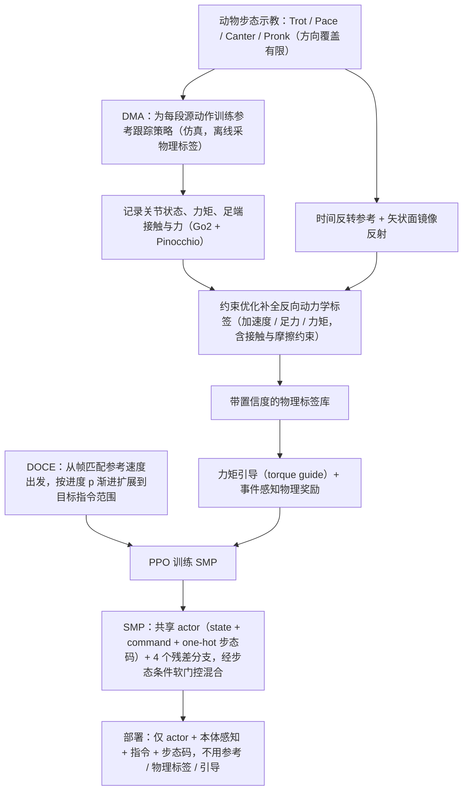

# OmniMimic（arXiv:2609.20566）

**OmniMimic**（*Dynamics-completed Motion Augmentation for Multi-style Omnidirectional Quadruped Locomotion*，[arXiv:2609.20566](https://arxiv.org/abs/2609.20566)，[项目页](https://omnimimic.github.io/)）来自 [具身智能小站 10 篇盘点](../../sources/blogs/wechat_embodied_station_10_papers_contact_wm_2026-09-18.md)（策展档位：**扫读**）。

## 一句话定义

**时间反转 + 动力学补全 + 矢状面反射扩展四足步态监督；共享 actor + 软门控残差专家；仿真 RMSE −63.1%，真机无微调部署。**

## 英文缩写速查

| 缩写 | 英文全称 | 简要说明 |
|------|----------|----------|
| WAM | World-Action Model | 联合预测未来观测与动作的策略 |
| VLA | Vision-Language-Action | 视觉–语言–动作策略 |
| SR | Success Rate | 任务成功率 |
| IL | Imitation Learning | 模仿学习 |
| GS | Gaussian Splatting | 高斯溅射三维表示 |

## 为什么重要

- 公众号将本文归入「接触时视觉之外还需预测什么」专题；扫读档位。
- **（待论文正式披露）**；开源结论：**待发布**（步骤 2.5，2026-09-18）。
- 与 tactile/WAM、主动视角、多智能体场景理解、Sim2Real、人形导航等主线交叉。

## 流程总览

图依据：论文 §III-A（DMA）/ §III-B（DOCE）/ §III-C（SMP）、Fig. 3。

## 核心机制

| 项 | 内容 |
|----|------|
| **arXiv** | [2609.20566](https://arxiv.org/abs/2609.20566) |
| **开源** | **待发布** |
| **策展摘要** | 时间反转 + 动力学补全 + 矢状面反射扩展四足步态监督；共享 actor + 软门控残差专家；仿真 RMSE −63.1%，真机无微调部署。 |

## 源码运行时序图

**不适用**（截至 2026-09-18 项目页/arXiv 未发布可运行官方代码）。

## 实验与评测

- 定量指标与 baseline 协议以 arXiv PDF 与项目页为准；本页为清单级摘要。
- 读法：先确认任务设定（仿真/真机、传感器、成功定义）再对比 SR/延迟/路径长度等 headline 数字。

## 与其他工作对比

> 本页为清单级摘要，下表只做**定位对照**：仿真 RMSE −63.1% 与「真机无微调」未与下列各页核对同一评测协议，不可横比。

| 对照 | 差异读法 |
|------|----------|
| [RecMorph](./paper-recmorph.md) | 同为扩大 locomotion 的监督覆盖，入口不同：RecMorph 动的是形态/结构侧，OmniMimic 动的是**参考运动本身**（时间反转、动力学补全、矢状面反射）。一个改机器人，一个改数据 |
| [ViLoMan](./paper-viloman.md) | 同批次里另一条「先造监督再落策略」：ViLoMan 从人–物交互重定向拿人形 loco-manip 监督，OmniMimic 在同 embodiment 内做几何/动力学增广。跨 embodiment vs 同分布扩充，覆盖边界由此决定 |
| **按风格分别训策略 + 运行时切换**（本文要替代的默认做法） | 同为支持多风格全向步态，差别在**专家怎么组织**：分风格训练靠外部切换逻辑，OmniMimic 用共享 actor + 软门控残差专家，切换由门控隐式完成 |
| [Sim2Real](../concepts/sim2real.md) | 「真机无微调部署」是强主张；该页给判读口径（随机化范围、测试分布），读零微调结论前应先对齐这些前提 |
| [10 篇技术地图](../overview/contact-wm-10-papers-technology-map.md) | 同批次横向对照入口：本文列 **扫读** 档位 |

## 结论

**OmniMimic 代表「扫读」档位的 locomotion 方向样本——部署前以开源状态与评测协议为准绳。**

1. 开源状态：**待发布**；勿凭 PDF 臆断可复现性。
2. 与同专辑 [Agile-WAM](./paper-agile-wam.md) / [INSPECT](./paper-inspect-view-selection.md) 等形成「触觉 WAM → 主动视角 → 系统平台」阅读链。
3. 若做工程选型，先对齐传感器栈与任务是否匹配文内设定。
4. 关注项目页/arXiv 版本更新与代码发布。

## 关联页面

- [locomotion](../tasks/locomotion.md)
- [sim2real](../concepts/sim2real.md)
- [reinforcement-learning](../methods/reinforcement-learning.md)
- ./paper-recmorph.md
- [10 篇技术地图](../overview/contact-wm-10-papers-technology-map.md)

## 参考来源

- [omnimimic_arxiv_2609_20566.md](../../sources/papers/omnimimic_arxiv_2609_20566.md)
- [wechat_embodied_station_10_papers_contact_wm_2026-09-18.md](../../sources/blogs/wechat_embodied_station_10_papers_contact_wm_2026-09-18.md)
- [arXiv:2609.20566](https://arxiv.org/abs/2609.20566)
- [arXiv PDF](https://arxiv.org/pdf/2609.20566)：已通读方法部分（实验与附录以略读为准）：§III-A DMA、§III-B DOCE、§III-C SMP、§IV-A 实验设定

## 推荐继续阅读

- [arXiv PDF](https://arxiv.org/pdf/2609.20566)
