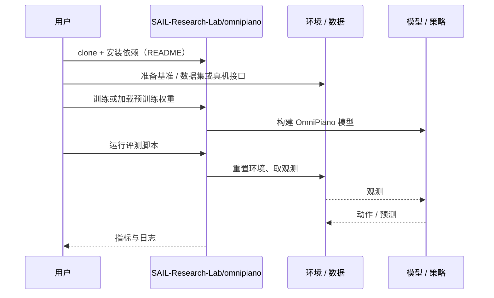

# OmniPiano（arXiv:2611.00243）

**OmniPiano**（*OmniPiano: Diverse Dexterous Piano-Playing Challenges for Standard, Robust, Safe, and Multi-Agent RL*，[arXiv:2611.00243](https://arxiv.org/abs/2611.00243)，[项目页](https://sail-research-lab.github.io/omnipiano/)，[代码](https://github.com/SAIL-Research-Lab/omnipiano)）来自 [具身智能小站 2026-11-03 盘点](../../sources/blogs/wechat_embodied_station_49_papers_sacq_action_aware_quantization_2026-11-03.md)，属「人形与灵巧控制」组。

## 一句话定义

**OmniPiano 在同一任务族中覆盖多手协作、扰动和安全约束，适合比较强化学习方法。**

## 英文缩写速查

| 缩写 | 英文全称 | 简要说明 |
|------|----------|----------|
| OmniPiano | OmniPiano: Diverse Dexterous Piano-Playing Challenges for Standard, Robust, Safe, and Multi-Agent RL | 本文方法 / 基准的简称 |

## 为什么重要

- 用弹琴统一检验灵巧控制。任务难度与手数可配置，结果不宜直接外推到通用灵巧操作。
- 开源结论：**已开源**（步骤 2.5，2026-11-03）。仓库可达（git ls-remote）。项目页 HTTP 200。
- 同期同组工作见 [动作感知量化、失败定位与可验证自主：具身智能小站 11-03 期 49 篇阅读坐标](../overview/embodied-station-2026-11-03-49-papers-technology-map.md)。

## 核心机制

| 项 | 内容 |
|----|------|
| **arXiv** | [2611.00243](https://arxiv.org/abs/2611.00243) |
| **开源** | **已开源** |
| **要点** | OmniPiano 在同一任务族中覆盖多手协作、扰动和安全约束，适合比较强化学习方法。 |
| **文内指标** | 公众号转述：任务难度与手数可配置，结果不宜直接外推到通用灵巧操作。 |

## 源码运行时序图

以下为按仓库入口（`SAIL-Research-Lab/omnipiano`）推断的通用运行链路；入库日仅核实仓库可达，未逐文件阅读，具体脚本名以 README 为准。

## 实验与评测

- 公众号转述：任务难度与手数可配置，结果不宜直接外推到通用灵巧操作。
- **读法：** 本页为索引级摘要，依据公众号转述的官方摘要与仓库信息整理；逐项数字与 baseline 以原文 PDF 为准。

## 与其他工作对比

- 横向索引见 [动作感知量化、失败定位与可验证自主：具身智能小站 11-03 期 49 篇阅读坐标](../overview/embodied-station-2026-11-03-49-papers-technology-map.md)；同 arXiv 不重复造页。

## 结论

**用弹琴统一检验灵巧控制：任务难度与手数可配置，结果不宜直接外推到通用灵巧操作。**

1. 开源边界：**已开源** — 仓库可达（git ls-remote）。项目页 HTTP 200。
2. 核心机制：OmniPiano 在同一任务族中覆盖多手协作、扰动和安全约束，适合比较强化学习方法。
3. 复现与选型前核对任务协议、硬件与基准口径，勿直接横比公众号摘录数字。

## 关联页面

- [locomotion](../tasks/locomotion.md)
- [motion-retargeting](../concepts/motion-retargeting.md)
- [dexterous-kinematics](../concepts/dexterous-kinematics.md)
- [contact-rich-manipulation](../concepts/contact-rich-manipulation.md)
- [embodied-station-2026-11-03-49-papers-technology-map](../overview/embodied-station-2026-11-03-49-papers-technology-map.md)

## 参考来源

- [omnipiano_arxiv_2611_00243.md](../../sources/papers/omnipiano_arxiv_2611_00243.md)
- [wechat_embodied_station_49_papers_sacq_action_aware_quantization_2026-11-03.md](../../sources/blogs/wechat_embodied_station_49_papers_sacq_action_aware_quantization_2026-11-03.md)
- [arXiv:2611.00243](https://arxiv.org/abs/2611.00243)

## 推荐继续阅读

- [arXiv PDF](https://arxiv.org/pdf/2611.00243)
- [项目页](https://sail-research-lab.github.io/omnipiano/)
- [https://github.com/SAIL-Research-Lab/omnipiano](https://github.com/SAIL-Research-Lab/omnipiano)
