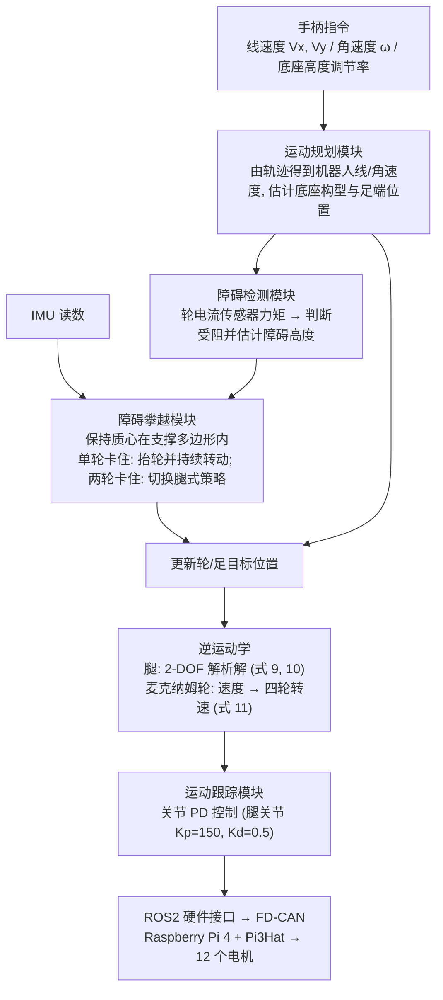

# OmniQuad：采用全向轮的轮腿混合机器人

**OmniQuad**（*OmniQuad: A Wheeled-Legged Hybrid Robot with Omnidirectional Wheels*，[arXiv:2610.38502](https://arxiv.org/abs/2610.38502)）收录于 senlanke「具身运控lab」10-26–10-30 前沿论文动态（人形/四足）。本页依据**周报条目 + arXiv 摘要页**整理，未逐页核对正文 PDF；指标与结论以论文为准。

## 一句话定义

**OmniQuad：采用全向轮的轮腿混合机器人——设计安装麦克纳姆轮的轮式足端，并与 EM-Act 腿部执行器组成 OmniQuad；机器人可在不改变机身朝向的情况下完成前后、横向和斜向移动，并保留腿式越障能力。**

## 英文缩写速查

| 缩写 | 英文全称 | 简要说明 |
|------|----------|----------|
| RL | Reinforcement Learning | 强化学习 |
| WBC | Whole-Body Control | 全身控制 |

## 为什么重要

- 周报所述待解决的问题：普通主动轮腿机器人在狭窄空间内侧移或保持固定朝向移动时受到轮子非完整约束。

## 流程总览

图依据：论文 §4.5 / Fig.8（控制框图）、§4.5.2、§5.1

## 核心机制

| 项 | 内容 |
|----|------|
| **arXiv** | [2610.38502](https://arxiv.org/abs/2610.38502) · [PDF](https://arxiv.org/pdf/2610.38502) |
| **作者（arXiv）** | Iotti, Francesco, Ranjan, Alok, Angelini, Franco, Garabini, Manolo |
| **机构（周报所述，未逐条核实）** | 比萨大学、Enrico Piaggio 研究中心 |
| **arXiv 评论栏** | （无） |
| **开源** | arXiv 摘要页与评论未见代码或项目页链接（仅核对 arXiv 摘要页，不代表未发布）（2026-11-02） |
| **周报所述创新点** | 设计安装麦克纳姆轮的轮式足端，并与 EM-Act 腿部执行器组成 OmniQuad；机器人可在不改变机身朝向的情况下完成前后、横向和斜向移动，并保留腿式越障能力。 |

### arXiv 摘要节选（英文原文）

> Combining wheeled and legged locomotion within a single robotic platform offers the potential to harness the advantages of both systems. The development of such hybrid systems remains an active area of research.

## 源码运行时序图

**不适用**：arXiv 摘要页与评论未见代码或项目页链接（仅核对 arXiv 摘要页，不代表未发布），无可对齐的官方代码流程。

## 实验与评测

- 周报与摘要给出的数字/场景已写入上表「创新点」与摘要节选；其余实验细节、基线与成功率定义请回到论文正文。
- 读法：先对齐任务设定、传感器与成功定义（仿真/真机），再解读 headline 数字，勿跨论文直接比较。

## 与其他工作对比

| 维度 | 读法 |
|------|------|
| **同周对照** | 见 [人形/四足周报技术地图](../overview/senlanke-weekly-2026-10-26-30-humanoid-quadruped-technology-map.md)，按方向浏览同期论文 |
| **开源状态** | arXiv 摘要页与评论未见代码或项目页链接（仅核对 arXiv 摘要页，不代表未发布） |

## 结论

**OmniQuad：采用全向轮的轮腿混合机器人。**

1. 本页是入库级摘要，复现前请核对论文正文、附录与代码仓库。
2. 指标须连同实验条件解读。
3. 关注 arXiv 版本更新与代码发布。

## 关联页面

- [senlanke-weekly-2026-10-26-30-humanoid-quadruped-technology-map](../overview/senlanke-weekly-2026-10-26-30-humanoid-quadruped-technology-map.md)
- [locomotion](../tasks/locomotion.md)

## 参考来源

- [omniquad-wheeled-legged-omnidirectional_arxiv_2610_38502.md](../../sources/papers/omniquad-wheeled-legged-omnidirectional_arxiv_2610_38502.md)
- [wechat_senlanke_weekly_humanoid_quadruped_2026-10-26_30.md](../../sources/blogs/wechat_senlanke_weekly_humanoid_quadruped_2026-10-26_30.md)
- [arXiv:2610.38502](https://arxiv.org/abs/2610.38502)
- [arXiv PDF](https://arxiv.org/pdf/2610.38502)：已通读全文：§3.4 电子系统、§4 建模与控制（运动学、混合系统、控制框图）、§5 实验验证

## 推荐继续阅读

- [arXiv PDF](https://arxiv.org/pdf/2610.38502)
