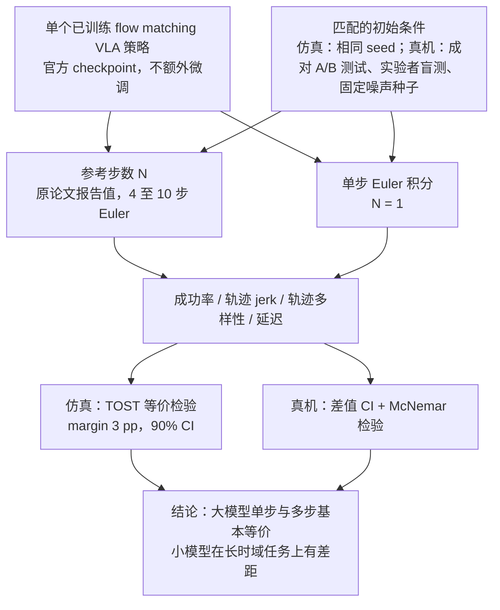

# One-Step Euler FM：何时一步就够：Flow Matching 策略中欧拉积分的实证研究

**One-Step Euler FM**（*When One Step Is Enough: An Empirical Study of Euler Integration in Flow-Matching Policies*，[arXiv:2610.30735](https://arxiv.org/abs/2610.30735)）收录于 senlanke「具身运控lab」10-19–10-23 前沿论文动态（Manipulation）。本页依据**周报条目 + arXiv 摘要页**整理，流程图依据论文方法部分（见参考来源），未逐页核对实验数字；指标与结论以论文为准。

## 一句话定义

**One-Step Euler FM：何时一步就够：Flow Matching 策略中欧拉积分的实证研究——系统研究欧拉积分步数对生成式机器人策略的影响，重点分析单步积分在不同条件下的适用性。论文已被 CoRL 2026 接收。**

## 英文缩写速查

| 缩写 | 英文全称 | 简要说明 |
|------|----------|----------|
| VLA | Vision-Language-Action | 视觉–语言–动作模型 |
| IL | Imitation Learning | 模仿学习 |

## 为什么重要

- 周报所述待解决的问题：Flow Matching Policy 通常需要通过数值积分生成动作。增加积分步数会提高推理开销，但更多步数不一定带来相应的控制收益。

## 流程总览

图依据：论文 §3 Experimental Design / §3.3 Evaluation Protocol / Fig.1（本文为评测协议而非新算法；“结论”节点为 §4 摘要，Fig.3、Fig.4 的指标未单独画出）。

## 核心机制

| 项 | 内容 |
|----|------|
| **arXiv** | [2610.30735](https://arxiv.org/abs/2610.30735) · [PDF](https://arxiv.org/pdf/2610.30735) |
| **作者（arXiv）** | Shivakanth Sujit, Luca Nunziante, Rousslan Fernand Julien Dossa, Kai Arulkumaran |
| **机构（周报所述，未逐条核实）** | 待核实（作者：Shivakanth Sujit、Luca Nunziante、Rousslan Fernand Julien Dossa、Kai Arulkumaran）。 |
| **arXiv 评论栏** | Accepted at the 10th Conference on Robot Learning (CoRL 2026) |
| **开源** | arXiv 摘要页与评论未见代码或项目页链接（仅核对 arXiv 摘要页，不代表未发布）（2026-10-26） |
| **周报所述创新点** | 系统研究欧拉积分步数对生成式机器人策略的影响，重点分析单步积分在不同条件下的适用性。论文已被 CoRL 2026 接收。 |

### arXiv 摘要节选（英文原文）

> Flow matching is now the dominant approach for vision-language action (VLA) robot policies, thanks to its expressiveness and simple training objective. However, inference for standard flow matching requires iteratively solving an ODE, limiting the control frequency at deployment.

## 源码运行时序图

**不适用**：arXiv 摘要页与评论未见代码或项目页链接（仅核对 arXiv 摘要页，不代表未发布），无可对齐的官方代码流程。

## 实验与评测

- 周报与摘要给出的数字/场景已写入上表「创新点」与摘要节选；其余实验细节、基线与成功率定义请回到论文正文。
- 读法：先对齐任务设定、传感器与成功定义（仿真/真机），再解读 headline 数字，勿跨论文直接比较。

## 与其他工作对比

| 维度 | 读法 |
|------|------|
| **同周对照** | 见 [Manipulation周报技术地图](../overview/senlanke-weekly-2026-10-19-23-manipulation-technology-map.md)，按方向浏览同期论文 |
| **开源状态** | arXiv 摘要页与评论未见代码或项目页链接（仅核对 arXiv 摘要页，不代表未发布） |

## 结论

**One-Step Euler FM：何时一步就够：Flow Matching 策略中欧拉积分的实证研究。**

1. 本页是入库级摘要，复现前请核对论文正文、附录与代码仓库。
2. 指标须连同实验条件解读。
3. 关注 arXiv 版本更新与代码发布。

## 关联页面

- [senlanke-weekly-2026-10-19-23-manipulation-technology-map](../overview/senlanke-weekly-2026-10-19-23-manipulation-technology-map.md)
- [manipulation](../tasks/manipulation.md)
- [vla](../methods/vla.md)

## 参考来源

- [one-step-euler-integration-flow-matching-policies_arxiv_2610_30735.md](../../sources/papers/one-step-euler-integration-flow-matching-policies_arxiv_2610_30735.md)
- [wechat_senlanke_weekly_manipulation_2026-10-19_23.md](../../sources/blogs/wechat_senlanke_weekly_manipulation_2026-10-19_23.md)
- [arXiv:2610.30735](https://arxiv.org/abs/2610.30735)
- [arXiv PDF](https://arxiv.org/pdf/2610.30735)：已通读方法部分（实验与附录以略读为准）：§1 引言、§2 背景（Flow matching 与欧拉积分）、§3 实验设计（配对比较协议、评测协议）、§4 实验结果（§4.1 至 §4.5 略读）

## 推荐继续阅读

- [arXiv PDF](https://arxiv.org/pdf/2610.30735)
