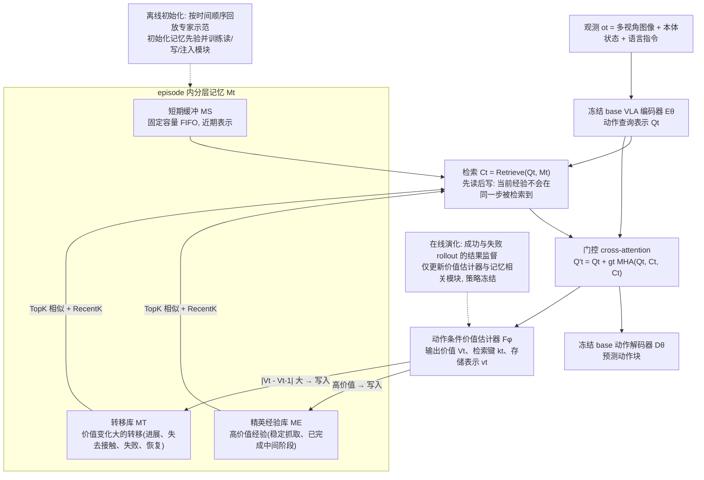

# OnEvoMemory（arXiv:2608.08749）

**OnEvoMemory**（[arXiv:2608.08749](https://arxiv.org/abs/2608.08749)）收录于 [多模空间 · 一周 VLA 研究趋势简析（2026.08.10–08.16）第一篇](../../sources/blogs/wechat_duomo_vla_weekly_trends_2026-08-10_part1.md) **长程记忆** 段。

## 一句话定义

**为预训练机器人策略加入价值引导记忆模块：保存近期、高价值与重要状态变化，离线示范初始化、在线成败轨迹调整取舍，提升长时序任务阶段识别与防重复操作（EMR@ECCV 2026）。**

## 英文缩写速查

| 缩写 | 英文全称 | 简要说明 |
|------|----------|----------|
| VLA | Vision-Language-Action | 视觉–语言–动作策略 |
| VLM | Vision-Language Model | 视觉–语言多模态模型 |
| VLN | Vision-Language Navigation | 视觉–语言导航 |
| WAM | World Action Model | 联合未来与动作生成的具身策略 |
| TTT | Test-Time Training | 部署阶段无标注数据的在线适配 |

## 为什么重要

- 为预训练机器人策略加入价值引导记忆模块：保存近期、高价值与重要状态变化，离线示范初始化、在线成败轨迹调整取舍，提升长时序任务阶段识别与防重复操作（EMR@ECCV 2026）。
- 开源状态：**待核实**（步骤 2.5，入库日 2026-09-19）。
- 与 [vla weekly trends 2026 08 10 part1 technology map](../overview/vla-weekly-trends-2026-08-10-part1-technology-map.md) 同批工作可横向对照。

## 流程总览

图依据：论文 §3 Method（概述、§3.1、§3.2）/ Fig.1

## 核心机制

| 项 | 内容 |
|----|------|
| **arXiv** | [2608.08749](https://arxiv.org/abs/2608.08749) |
| **开源** | **待核实** |
| **文内评测** | LiberoLong-10、RMBench 长程子集 |

## 源码运行时序图

**不适用**（截至入库日未提供可运行官方代码入口，或仓库尚未公开）。

## 实验与评测

- **文内口径：** LiberoLong-10、RMBench 长程子集
- **读法：** 本页为 [公众号策展](../../sources/blogs/wechat_duomo_vla_weekly_trends_2026-08-10_part1.md) 摘要；逐项指标以 **原文 PDF** 为准。

## 与其他工作对比

> 下表只做**定位对照**：本页与下列同批各页均为 [公众号策展](../../sources/blogs/wechat_duomo_vla_weekly_trends_2026-08-10_part1.md) 的索引级摘要，未逐条核对原文实验表，彼此**不共享同一评测协议**，不可据此横比数字。

| 对照 | 差异读法 |
|------|----------|
| [HyMeS](./paper-hymes-hybrid-memory-manipulation.md) | 同批两条长程记忆路线，分界在**记忆存在哪里**：OnEvoMemory 是策略内的价值引导记忆模块（近期 / 高价值 / 重要状态变化三类取舍），HyMeS 把记忆外置成 coding agent 维护的显式规则。本文可直接挂在**已有预训练策略**上，那条要多带一个 agent 但记忆可读可审计 |
| [VANE](./paper-vane.md) | 同批同为部署期演化，改的对象不同：VANE 改**权重**并要求「验证有帮助才启用」，本文改的是**记忆的取舍策略**（在线成败轨迹调整），权重可以不动 |
| [Action Chunking](../methods/action-chunking.md) | 该页讲 chunk 缓解的是**几步之内**的时域错配；本文针对的是**跨阶段**的长时序识别与防重复操作——两者补的不是同一段记忆，不可互相替代 |
| [VLA](../methods/vla.md) | 该页默认策略近似马尔可夫；本文的前提恰是「长程任务不满足这一点」，所以补的是**外部状态**而不是更大的骨干——这也是它能用离线示范初始化的原因 |

## 结论

**OnEvoMemory 适合作为本期「长程记忆」路线的快速索引页。**

1. 核心贡献：为预训练机器人策略加入价值引导记忆模块：保存近期、高价值与重要状态变化，离线示范初始化、在线成败轨迹调整取舍，提升长时序任务阶段识别与防重复操作（EMR@ECCV 2026）。
2. 开源结论：**待核实** — 以项目页/仓库实际链接为准。
3. 横向对照见 [技术地图](../overview/vla-weekly-trends-2026-08-10-part1-technology-map.md)，避免与同 arXiv 重复造页。

## 关联页面

- [VLA（Vision-Language-Action）](../methods/vla.md)
- [一周 VLA 趋势技术地图](../overview/vla-weekly-trends-2026-08-10-part1-technology-map.md)
- [Generative World Models](../methods/generative-world-models.md)

## 参考来源

- [wechat_duomo_vla_weekly_trends_2026-08-10_part1.md](../../sources/blogs/wechat_duomo_vla_weekly_trends_2026-08-10_part1.md)
- [arXiv:2608.08749](https://arxiv.org/abs/2608.08749)
- [arXiv PDF](https://arxiv.org/pdf/2608.08749)：已通读方法部分（实验与附录以略读为准）：§1 Introduction、§3 Method（概述、§3.1 价值引导分层记忆、§3.2 离线初始化与在线演化）、§4 实验设定与结果表

## 推荐继续阅读

- [VLA 方法页](../methods/vla.md)
- [arXiv PDF](https://arxiv.org/pdf/2608.08749)
