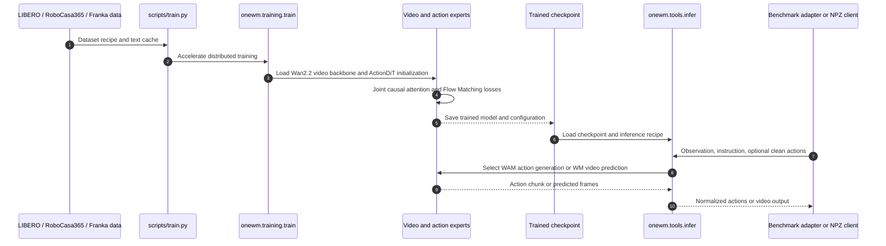

# OneWM：世界预测与动作生成的因果协同训练

**OneWM** 在共享的因果视频—动作架构中同时学习“给定动作后世界如何变化”与“根据当前观测生成动作”，用三种动作条件化方式检验两类监督能否互相促进。

## 英文缩写速查

| 缩写 | 英文全称 | 简要说明 |
|---|---|---|
| WAM | World Action Model | 联合学习机器人动作与动作后世界变化的模型路线 |
| MoT | Mixture-of-Transformers | OneWM 中视频专家和动作专家通过因果联合注意力交互的架构 |
| WM | World Model | 论文中仅做给定动作后视频预测的对照模型 |
| PSNR | Peak Signal-to-Noise Ratio | 逐像素重建质量指标，越高通常越好 |
| LPIPS | Learned Perceptual Image Patch Similarity | 感知相似度距离，越低通常越好 |
| FVD | Fréchet Video Distance | 视频特征分布距离，越低通常越好 |

## 为什么重要

常见具身模型把视频预测当作辅助目标，但动作条件可能在训练中始终是带噪生成目标，模型未必学到“指定一个干净控制后，场景会发生什么”。OneWM 将这种前向动态预测作为显式训练任务，并和策略动作生成放进同一因果模型；实验分别检查世界监督对策略、动作监督对世界预测的影响。

## 方法栈与训练机制

OneWM 使用视频和动作两个专家。视频专家从 Wan2.2-TI2V-5B 初始化，在视频 VAE latent 空间预测未来帧；动作专家生成动作块。两者各自接收同一语言任务指令，并通过按时间对齐的因果联合注意力交换信息：未来视频 token 可读取同一时刻及此前动作，动作 token 读取当前观测和此前动作。

训练时按样本混合三类动作条件。三者都保留观测视频前缀，并预测未来视频；含噪动作段才计算动作生成损失。

| 条件方式 | 动作输入 | 学习目标 |
|---|---|---|
| **All-clean** | 整段动作保持干净 | 视频预测学习指定动作的视觉后果，不产生动作去噪损失 |
| **Partial-clean** | 干净动作前缀 + 含噪动作后缀 | 预测未来视频，并从已知动作前缀补全剩余动作 |
| **All-noisy** | 整段动作加噪 | 从观测与指令生成动作，同时以带噪动作条件预测未来视频 |

视频和动作专家使用 Flow Matching 联合优化。论文默认混合比例为 all-noisy / partial-clean / all-clean = **60 / 25 / 15**；对照结果显示条件占比会同时影响策略成功率与视频预测质量。

## 推理路径

同一个检查点有两种独立推理模式：给定干净动作，视频专家生成后续帧；或者从噪声动作块开始，动作专家根据观测与指令生成控制块。论文的 “Endless Dream” 串接这两种模式，把每轮预测视频的最后一帧作为下一轮观察，从而在想象中继续生成动作和后果。

## 源码运行时序图

仓库的 Franka adapter 返回动作目标，不直接控制硬件；真实控制客户端需自行实现频率、单位、同步和限幅。

## 实验与评测

论文比较了不同策略变体和仅做动作条件视频预测的架构匹配对照。下表是论文 / 项目页报告值；比例变化以百分点（pp）计。

| 指标 | OneWM | 对照 | 读数 |
|---|---:|---:|---|
| LIBERO 平均成功率 | **94.95%** | WAM_mask 92.45% | +2.50 pp；同一因果架构下加入干净动作条件的世界预测监督 |
| LIBERO-Plus 总成功率 | **59.27%** | WAM_mask 53.37% | +5.90 pp；对摄像机、背景、布局、语言和噪声等扰动的增益不均匀 |
| RoboCasa365 总成功率 | **36.68%** | WAM_mask 28.32% | +8.36 pp；覆盖多场景静态与移动操作任务 |
| 真实机器人总成功率 | **66.7%** | WAM_mask 48.9% | 三项操作任务的项目页汇总；每个模型、任务各 15 次试验 |
| PSNR（LIBERO / Plus / RoboCasa365） | **22.95 / 21.05 / 25.21** | 同架构 WM：22.33 / 20.54 / 24.72 | 三个 benchmark 上均提升 |
| SSIM（LIBERO / Plus / RoboCasa365） | **0.8423 / 0.8049 / 0.8515** | WM：0.8325 / 0.7937 / 0.8433 | 三个 benchmark 上均提升 |
| LPIPS（LIBERO / Plus / RoboCasa365） | **0.1458 / 0.1935 / 0.1015** | WM：0.1529 / 0.2014 / 0.1087 | 三个 benchmark 上均下降 |

项目页还报告 3 项真实机器人操作：堆叠、插入与早餐摆放。OneWM 在这些任务中胜过动作遮蔽的视频分支对照；真实试验规模较小，适合作为真机可行性证据，不等于广泛可靠性结论。

### Endless Dream 结果边界

LIBERO 想象 rollout 连续 16 轮，每轮预测 32 个动作和 8 个未来帧，共计 512 个动作、建模时长 25.6 秒。后续每轮视觉输入均来自模型生成的最后一帧，没有继续读取真实观测或记录动作；演示没有在模拟器执行这些动作，也不自动判断任务成功。长时生成会累积漂移与伪影。

## 与其他工作对比

| 对照 | 主要差异 |
|---|---|
| **WAM_mask / WAM_noisy** | 同一类因果架构中的策略基线；视频预测分别屏蔽动作信息或始终接收带噪动作。OneWM 增加干净与部分干净动作条件。 |
| **WM** | 相同 MoT 下只训练干净动作条件的视频预测，不训练动作生成；用于隔离动作学习给世界预测带来的影响。 |
| [UniWAM](./paper-uniwam-unified-world-action-model.md) | UniWAM 加入物理语言推理专家和多来源预训练数据；OneWM 聚焦因果条件化设计及两种任务监督的相互作用。 |
| [DreamWAM](./paper-dreamwam.md) | DreamWAM 以 flow、depth、语义扩展训练期未来监督；OneWM 研究干净动作条件与联合动作生成。 |

## 结论

**在 OneWM 的固定因果架构与评测设定内，动作条件世界预测和动作生成显示出相互增益；关键设计是把干净动作条件纳入训练，同时保留足够的含噪动作生成样本。**

1. **按任务看对照：** 策略成功率与 WAM 变体比较；世界预测与同架构 WM 比较，不能混为一组结论。
2. **保留混合比例：** 论文测试中偏向干净条件虽可维持视频预测，却会损害分布外策略表现；部署从噪声生成动作，训练要覆盖这一路径。
3. **区分想象与执行：** Endless Dream 展示在模型内部闭环推进，不能当作机器人或仿真环境已经完成任务。
4. **复现时配齐版本：** checkpoint 需和训练 recipe、动作归一化统计、text cache 与对应数据转换保持匹配。

## 工程实践与局限

- **代码已公开：** 官方 GitHub 提供训练入口、部署工具和三个数据集配置，许可证为 Apache-2.0。
- **数据和 checkpoint 要另备：** README 要求用户获取 Wan2.2-TI2V-5B 骨干并准备 LIBERO、RoboCasa365 或 Franka 数据；OneWM checkpoint 示例由调用者自行训练和指定。
- **真机适配范围：** Franka 适配器仅输出动作目标，不连接控制器；实际硬件部署仍需闭环状态回读、时序、限幅和急停链路。
- **评测有边界：** benchmark 总成功率依赖各自任务划分和试验协议；LIBERO-Plus 的照明与机器人初始化扰动上，收益没有其它扰动类别稳定。
- **世界预测指标互补：** PSNR、SSIM、LPIPS 衡量配对预测质量；FID、FVD 则衡量边际视频分布，不能单独证明视频严格遵循控制动作。

## 关联页面

- [World Action Models（WAM）](../concepts/world-action-models.md) — 联合世界预测与动作生成的模型路线。
- [生成式世界模型](../methods/generative-world-models.md) — 视频生成与动作条件预测的基础方法。
- [UniWAM](./paper-uniwam-unified-world-action-model.md) — 把物理语义推理、世界预测和动作生成纳入 MoT 的工作。
- [DreamWAM](./paper-dreamwam.md) — 通过多种未来监督改善 WAM 表征。
- [机器人操作](../tasks/manipulation.md) — 主要任务与评测背景。

## 参考来源

- [OneWM 论文归档](../../sources/papers/onewm_arxiv_2610_21095.md)
- [OneWM 项目页与开源状态核查](../../sources/sites/onewm-project.md)
- [OneWM 官方仓库归档](../../sources/repos/onewm.md)

## 推荐继续阅读

- [OneWM arXiv 论文](https://arxiv.org/abs/2610.21095)
- [OneWM 官方项目页](https://selen-suyue.github.io/OneWMNet/)
- [OneWM 官方代码仓库](https://github.com/Interactive-Active-AI/OneWM)
