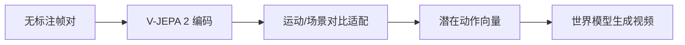

# OnlyAct: Extracting Action Representations from Foundation Models for World Models｜从视频基础模型提取动作表征

## 一句话定义

OnlyAct 使用预训练 V-JEPA 2 和跨场景对比学习，把视频运动信息提取为尽量不依赖背景的潜动作表征。

## 英文缩写速查

| 缩写 | 英文全称 | 简要说明 |
|---|---|---|
| V-JEPA 2 | Video Joint Embedding Predictive Architecture 2 | 本研究涉及的V-JEPA 2术语 |
| LoRA | Low Rank Adaptation | 本研究涉及的LoRA术语 |
| LPIPS | Learned Perceptual Image Patch Similarity | 本研究涉及的LPIPS术语 |

## 为什么重要

从无标签视频帧对读取预训练 V-JEPA 2 视频表征。

## 核心原理与方法

1. 从无标签视频帧对读取预训练 V-JEPA 2 视频表征。
2. 相同运动跨场景的帧对拉近、同场景不同运动的帧对推远，不依赖动作标签。
3. 按动作可表达性、场景泄露与动作驱动视频生成评测，不直接等同真机成功率。

## 流程总览



> 方法流程根据摘要/官网整理，尚待论文原文逐图核实。

## 实验与评测

官方项目披露训练 9 个数据集共 168,000 帧对，LoRA 7.1M 可训练参数；13 个数据集的线性探针平均 R²=0.490。

上述结果均为作者报告或用户附件转载，**不是本次复测**。

## 结论

**OnlyAct 使用预训练 V-JEPA 2 和跨场景对比学习，把视频运动信息提取为尽量不依赖背景的潜动作表征。**

1. 从无标签视频帧对读取预训练 V-JEPA 2 视频表征。
2. 相同运动跨场景的帧对拉近、同场景不同运动的帧对推远，不依赖动作标签。
3. 场景解耦依赖样本构造；视频动作转移与动力学控制存在鸿沟。

## 与其他工作对比

比较本文与相关基线时应在相同任务、数据、样本量、传感器和部署条件下评估；不能把论文中的单个数字解释为真实部署的通用进步。待全文表格核对后补足逐项量化对照。

## 源码运行时序图

```mermaid
sequenceDiagram
  participant A0 as reproduce_table1.sh
  participant A1 as onlyact.extract
  participant A2 as V-JEPA 2 encoder
  participant A3 as Linear probe
  A0->>A1: 启动评测/训练
  A1->>A2: 处理环境与模型输入
  A2->>A3: 执行模型或输出指标
  A3-->>A0: 返回状态
````

**README 入口：** `DATA=... bash scripts/reproduce_table1.sh`。图仅表示已核对到的入口与概念性组件顺序，不代表已运行或逐行审阅。

## 工程实践

- 对齐版本、传感器、动作/观测空间和评测预算后再尝试复现。
- 正式应用应增加跨分布扰动与任务安全边界检查；原文完整复现步骤待核对。
- 本次通读状态：**未完成**；页面仍为 draft。

## 局限与风险

场景解耦依赖样本构造；视频动作转移与动力学控制存在鸿沟。

未对全部论文正文/附录及运行细节完成审阅，任何进一步量化外推均不成立。

## 关联页面

- [world-action-models](../concepts/world-action-models.md)
- [vla](../methods/vla.md)

## 参考来源

- [原论文及阅读进度](../../sources/papers/onlyact_arxiv_2611_14420.md)
- [官方源码入口](../../sources/repos/onlyact.md)
- [官方项目页](../../sources/sites/onlyact.md)
- [用户附件 13 篇原始资讯整理](../../sources/blogs/embodied-research-digest-2026-11-12.md)

## 推荐继续阅读

- [arXiv 原文](https://arxiv.org/abs/2611.14420)
- [官方源码](https://github.com/runjiali-rl/onlyact)
