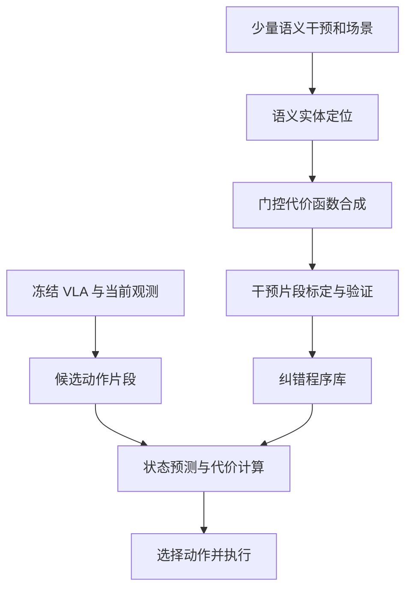

# OopsieRecover：从语义干预中学习可迁移的 VLA 纠错

## 一句话定义

从少量语义纠错生成带门控条件的几何代价函数，以测试时候选动作评分引导冻结 VLA 恢复执行。

## 英文缩写速查

| 缩写 | 英文全称 | 简要说明 |
|---|---|---|
| VLA | Vision-Language-Action | 基于视觉和语言的动作策略 |
| VLM | Vision-Language Model | 语义干预解析辅助模型 |
| DROID | Distributed Robot Interaction Dataset | 文中真机数据/任务来源 |
| 3D | Three-Dimensional | 几何代价中的物体关系 |

## 为什么重要

- VLA 常在测试场景犯相似的语义和几何错误，直接后训练纠错策略通常需要额外大量轨迹。
- 语义纠偏可描述目标与禁止的几何关系，把人类一次干预扩展成对多个场景可用的纠错条件。

## 核心原理（方法）

1. **纠错示范：** 收集少量人类干预及自然语言错误解释，结合视觉识别找到相关的目标/障碍等场景实体。
2. **程序生成：** 合成由谓词控制是否激活的几何代价函数，并以干预前后片段标定、验证；这不是常开式全局惩罚项。
3. **测试期引导：** 在不修改基础 VLA 权重的前提下采样候选动作片段，借助状态/动力学预测评价纠错代价后选择动作执行。

## 项目流程图

## 工程实践

- 以干预前数据校准代价的激活范围和数值尺度，防止规则触发到非对应任务。
- 分别记录候选数、动力学预测开销、纠正失败与原始 VLA 原有任务表现，避免改善一个错误却损害其他动作。
- 截至核对日官方项目页可读论文和演示，未找到可核实可运行 GitHub 入口；运行时序图不能凭推测创建。

## 实验与评测

- 在论文真机 DROID 任务进度协议中，作者报告相对次优基线约 35.1% → 61.0%，提高约 74%（相对百分比），非增加 74 个百分点。
- 该结论依赖论文选定的介入次数、任务配置与进度定义；不是完整任务成功率普遍提升 74%。

## 与其他工作对比

- 重训 VLA 往往更新权重；OopsieRecover 在冻结模型外用可解释的语义门控代价进行测试时 steering。
- 相较固定全局 reward，门控代价针对错误语境激活，但额外受场景识别与预测误差制约。

## 结论

**从少量语义纠错生成带门控条件的几何代价函数，以测试时候选动作评分引导冻结 VLA 恢复执行。**

1. 牢记 74% 是相对任务进度改善，并非绝对成功率百分点。
2. 冻结策略并不表示测试时免费：候选评估和场景模型同样消耗资源。
3. 工程上先验证门控规则误触发率和失效保护。

## 局限与风险

- 若实体定位错误，生成的纠偏程序可能评价错误的对象。
- 有限类型的规则不能覆盖新奇失误；候选 rollout 成本会增加延迟。
- 目前真机任务数量和干预规模有限，不能推断复杂长期任务的通用恢复率。

## 源码运行时序图

不适用：截至 2026-11-09 未找到该项目可核实的官方可运行源码入口；方法数据流依照论文原文绘制，不能据此虚构源码调用时序。

## 关联页面

- [vla ](../methods/vla.md)
- [manipulation ](../tasks/manipulation.md)
- [paper-sla-spatial-language-action ](./paper-sla-spatial-language-action.md)

## 参考来源

- [原始论文资料核验归档](../../sources/papers/oopsierecover_arxiv_2611_08462.md)
- [官方项目页开放状态归档](../../sources/sites/oopsierecover.md)
- [arXiv HTML v1](https://arxiv.org/html/2611.08462v1)

## 推荐继续阅读

- [官方项目主页](https://robin-lab.cs.utexas.edu/oopsierecover/)

