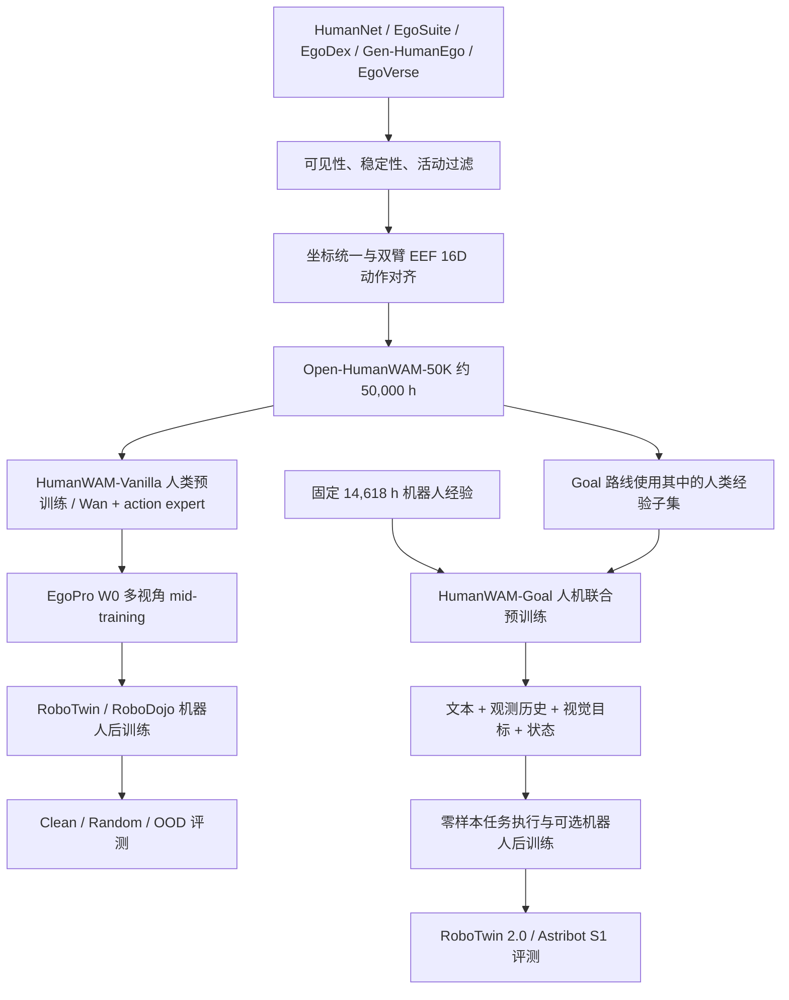
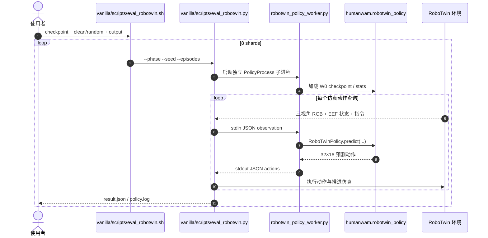

# Open-HumanWAM：规模化人类与机器人经验的具身基础模型开放配方 / An Open Recipe for Scaling Human and Robot Experience for Embodied Foundation Models

## 一句话定义

**Open-HumanWAM**（[arXiv:2611.06817](https://arxiv.org/abs/2611.06817)，2026-11-04 首次提交）构建约 **50,000 小时**第一人称人类视频—动作数据，并分别以纯人类预训练的 **HumanWAM-Vanilla** 和视觉目标条件的人机联合预训练 **HumanWAM-Goal** 研究跨场景泛化、机器人后训练与无需任务级参数更新的执行能力；这是数据、模型与实验配方的组合，不是单个现成 VLA 模型。

## 英文缩写速查

| 缩写 | 英文全称 | 简要说明 |
|---|---|---|
| WAM | World Action Model | 联合建模未来视频与动作 |
| EEF | End-Effector | 双臂末端执行器位置、姿态、夹爪状态 |
| IDM | Inverse Dynamics Model | 利用未来视觉信息辅助动作预测的分支/注意力条件 |
| OOD | Out of Distribution | 训练分布之外的场景、外观或任务 |
| VLA | Vision-Language-Action | 视觉、语言到机器人动作的策略范式 |
| W0 | 论文与代码中的配置代号（无统一展开） | 多视角机器人适配阶段；不强行扩写缩写 |

## 为什么重要

- 人类第一人称演示视频比遥操作机器人轨迹更容易大规模收集；本论文检验它是否能在**固定机器人数据**前提下提高视觉泛化，而不是只增加训练总量。
- 不把两类模型混为一谈：Vanilla 重点验证**纯人类动作经验的扩展规律**；Goal 则引入机器人数据和**显式视觉目标**，验证零样本执行与后训练。
- 论文报告，受控 IDM 预训练从 **100 h → 50,000 h**，Scene-OOD 成功率 **49.1% → 73.2%**；该结果不等于最终 RoboTwin 综合分数。

## 核心信息

| 项目 | 核对结果 |
|---|---|
| **机构** | 北京大学（PKU）、新加坡国立大学（NUS）、麻省理工学院（MIT）、加州大学圣巴巴拉分校（UCSB）、NVIDIA |
| **论文** | [arXiv:2611.06817](https://arxiv.org/abs/2611.06817)，首次提交 2026-11-04；本次核对 v2（2026-11-05）的 [HTML 全文](https://arxiv.org/html/2611.06817) |
| **项目** | [Open-HumanWAM 官方主页](https://dagroup-pku.github.io/open-humanwam/) |
| **源码** | [DAGroup-PKU/HumanNet · open-humanscale](https://github.com/DAGroup-PKU/HumanNet/tree/open-humanscale)，包含 `humanwam_vanilla/` 与 `humanwam_goal/` |
| **开放程度** | **部分开源**（截至 2026-11-08）：已见训练/评测/推理入口及部分权重；完整 50K 语料仍在上传，Goal 后训练脚本未公开 |
| **名称辨析** | 部分早期资料写作 Open-HumanScale；本页按官方项目/论文题名 Open-HumanWAM 维护，且不同于 [HumanScale](paper-sa-2606-20521.md) |

## 核心原理

### 数据与动作表示

论文将 HumanNet、EgoSuite-Open100K、EgoDex、Gen-HumanEgo、EgoVerse 的自我中心视频统一整理为 **Open-HumanWAM-50K**（论文报告 35.9M clips，约 50K 小时）；经过手部可见性、运动稳定性及无效片段筛选，按相机与腕部坐标对齐至**双臂 16 维 EEF 状态/动作**：每臂位置 3 + 四元数 4 + 夹爪 1。原始多源语料的动作格式不同，不能直接把视频帧当作可执行机器人关节轨迹。

### 两条模型路线

| | HumanWAM-Vanilla | HumanWAM-Goal |
|---|---|---|
| **基础架构** | Wan2.2-TI2V-5B 视频基础模型 + action expert | Cosmos3-Nano-16B，视觉/语言推理与视频—动作生成结构 |
| **预训练** | 人类第一人称视频/手部动作；50K h 最终规模 | 固定 **14,618 h** 机器人经验 + 人类经验（受控实验最多 **45,938 h**） |
| **输入重点** | 语言、图像与本体状态；IDM 对视觉与动作进行联建 | 文本指令、相机观测和短历史、机器人状态、**目标图像** |
| **中间适配** | EgoPro 多视角 W0 mid-training；再做 RoboTwin/RoboDojo 后训练 | 人机混合预训练；可零样本评测，也可用机器人示范后训练 |
| **预测动作** | RoboTwin 公开适配器生成 **32×16** EEF action chunk | Goal 公开推理接口返回 **48×49** action chunk（含物理后处理） |
| **用途区分** | 验证人类动作缩放与机器人适应 | 视觉目标驱动、混合经验迁移与具身 in-context 执行 |

此处的 49D 为 Goal 统一动作布局（正文及代码有机器人状态/底盘/末端/头部元数据的定义），不是“49 个关节”；论文所称上下文执行是**无需更新任务参数**，不等于训练过程中从未见过机器人数据。

### 流程总览

以下为论文方法与仓库 README 对齐的数据/控制流；**Vanilla 与 Goal 是两条实验路径**，不应画成先训练 Vanilla 再串行训练 Goal。



## 工程实践

先辨认想复现的对象：**Vanilla 训练/仿真评测**还是**Goal 推理/目标缓存评测**。官方仓库当前两条路径独立：

- **Vanilla 训练：** 在 `humanwam_vanilla/` 执行 `bash scripts/setup_environment.sh train`、`bash scripts/prepare_resources.sh wan`；如数据、统计与缓存准备完毕，`bash scripts/train.sh --config configs/scaling_idm/pretrain_50000h.yaml`。README 另给 `configs/midtrain.yaml`、`configs/robotwin.yaml` 等阶段配置，不能直接从零跳到 50K 复现。
- **Vanilla RoboTwin：** 先准备 sim 环境、RoboTwin 与 checkpoint/config/stats；运行 `bash scripts/eval_robotwin.sh CHECKPOINT clean OUTDIR`，然后对 `random` 重跑并用 `scripts/summarize_robotwin.py` 汇总。公开脚本为**每任务每条件 50 回合**；论文正式报告为 **100 回合**，报告数值必须标记协议差异。
- **Goal 推理：** 在 `humanwam_goal/` 安装环境、下载 `HumanWAM-Goal-RoboTwin` 权重；使用 `goalwam infer --checkpoint "$GOALWAM_CHECKPOINT" --sample examples/sample/observation.json`。Goal 官方说明环境是 **Python 3.13 / PyTorch 2.10 / CUDA 12.8 / Hopper SM90**，不是任意 CUDA 显卡可直接运行。
- **Goal RoboTwin：** `goalwam.robotwin` 使用 `OfficialGoalCache`、`RoboTwinSession` 接入 XPolicyLab；官方提供 10,000 条官方评测 case 的目标缓存，运行前需核验 case/seed/step-zero 观测及库版本。
- **检查点边界：** Goal RoboTwin 后训练权重和 Vanilla 部分模型已发布；Goal 后训练代码、全部探索权重、RoboDojo 可复现资源与完整 50K 数据下载说明仍未齐。不能把“仓库有脚本”解释为“论文所有实验一键可复现”。

### 源码运行时序图

读过的官方实现入口为 `humanwam_vanilla/scripts/train.sh`、`train.py`、`humanwam/runtime.py`、`trainer.py`、`eval_robotwin.sh`、`eval_robotwin.py`、`robotwin_policy.py`；Goal 为 `goalwam/cli.py`、`engine.py`、`server.py`、`humanwam_goal/README.md`。下图是**源码静态路径**，未在 GPU 环境执行。

```mermaid
sequenceDiagram
  autonumber
  actor User as 使用者
  participant Sh as vanilla/scripts/train.sh
  participant Py as vanilla/scripts/train.py
  participant Rt as humanwam.runtime
  participant Tr as humanwam.trainer
  User->>Sh: --config configs/robotwin.yaml 等
  Sh->>Py: 单进程 Python 或 torch.distributed.run
  Py->>Rt: load_config; run_training(cfg)
  Rt->>Tr: 构造数据集与训练器 / 执行训练
  Tr-->>User: 保存 checkpoint 与训练状态
  Note over User,Tr: 训练输入/权重需另行准备，本图不是已实际跑通的证明
```



```mermaid
sequenceDiagram
  autonumber
  actor User as 使用者
  participant CLI as goalwam/cli.py
  participant IO as goalwam/io.py
  participant Engine as GoalWAM engine.py
  participant Proc as ObservationProcessor / RobotProcessor
  participant Back as NativeBackend 或 PhyAIBackend
  User->>CLI: goalwam infer --checkpoint --sample
  CLI->>Engine: GoalWAM(checkpoint)
  Engine->>Back: 初始化权重与推理后端
  CLI->>IO: read_observation(sample)
  IO-->>CLI: instruction / goal / cameras / state
  CLI->>Engine: predict(observation)
  Engine->>Proc: 物理状态及观测预处理
  Proc-->>Engine: normalized inputs
  Engine->>Back: set_instruction (变化时); predict
  Back-->>Engine: action chunk
  Engine->>Proc: 按需恢复物理动作
  Engine-->>CLI: normalized_actions / actions
  CLI->>IO: save_actions(output)
  IO-->>User: actions.npz
```

## 实验与评测

| 实验与协议 | 条件 | 结果 | 如何解读 |
|---|---|---|---|
| Vanilla IDM 缩放 | 人类视频 100 h → 50,000 h，Scene-OOD | **49.1% → 73.2%** | 固定方法下的人类经验规模实验；论文给出经验对数线性关系，非无界外推 |
| Vanilla 最终模型 | RoboTwin 2.0 Clean2Clean / Clean2Random | **92.08% / 68.88%**（平均 80.48%） | 纯人类预训练后仍需机器人后训练 |
| Vanilla RoboDojo | 后训练后的任务成功率 / 进度分 | **14.17% / 19.00** | 与 RoboTwin 不同基准，且相关权重/评测仍在整理 |
| Goal 固定机器人数据缩放 | 14,618 h 机器人数据 + 最多 45,938 h 人类视频 | RoboTwin 零样本 **11.48% → 13.94%** | **零样本**是目标任务不更新权重；不是“无机器人训练” |
| Goal 固定机器人数据缩放 | 20 个真机任务，10 次/任务 | **20.0% → 30.5%** | 真机零样本平均成功率，平台/协议与 RoboTwin 不同 |
| Goal 控制变量后训练 | 50 个 RoboTwin 任务 × 每任务 50 条 clean demos | Random **70.80% → 74.36%** | 数据扩展对比实验；**不可写成最终 84.60%** |
| Goal 最终 RoboTwin 2.0 | Clean2Clean / Clean2Random，50 tasks × 100 seeds × 2 settings | **92.70% / 84.60%**（平均 **88.65%**） | 最终后训练模型；共 10,000 个评测回合，含进一步训练/增强配置 |

以上为论文主文/附录与官方仓库 README 交叉核对的作者报告值，**非独立复现实测**。特别注意 Vanilla 官方公开 `eval_robotwin.sh` 的 50 episodes/task 与论文表格 100 episodes/task 差异，不能混用公开脚本结果与论文最终协议。

## 与其他工作对比

- **视频-only 预训练 vs 带动作监督的人类视频：** 本文的消融关注可对齐双臂动作的第一人称语料对机器人操作的可迁移性；不宜把贡献简化为“视频规模增加”。
- **固定机器人语料 vs 人机联合：** Goal 先固定 14,618 h 机器人数据，再额外加入不同规模人类演示以隔离人类经验增益；仍需考虑两类数据分布与采样比例。
- **Vanilla vs Goal：** 前者主要研究预训练缩放、IDM 和多视角适配；后者用显式目标图像、人机联合及目标缓存支持零样本/后训练，模型与动作输出维度均不同。
- **与 [HumanScale（2606.20521）](paper-sa-2606-20521.md)：** 论文实体不同；另与 [HumanNet](humannet.md) 原始人类动作数据集的职责区分，避免同仓同名误归并。

## 结论

**Open-HumanWAM 的主要证据是：在固定机器人经验时，增加可对齐的人类第一人称动作经验改善跨场景泛化；但不同预训练/后训练实验与模型之间不能直接混算成功率。**

1. 验证人类经验扩展，应看 **Scene-OOD 49.1%→73.2%** 的受控 IDM 曲线，不用 88.65% 反推单独的缩放收益。
2. 评估混合数据价值，应比较 **14,618 h 固定机器人语料**下的零样本与受控后训练实验；**74.36% ≠ 最终 84.60%**。
3. 做复现时先锁定模型分支、数据、checkpoint 和回合协议；Goal 需要 Hopper CUDA 环境，Vanilla 公开评测脚本默认 50 而非论文 100 回合/任务。
4. 把 **目标图像 + 短视觉历史 + 机器人状态** 作为 Goal 的必要条件，不能仅用文本指令代替其预处理路径。
5. 关注开放边界：50K 全量数据、Goal 后训练等仍未全部公开，短期更适合验证已发布 checkpoint 的推理与评测链路。

## 局限与风险

- 论文中的“对数线性”是**有限数据规模范围内的经验拟合**，不保证继续堆数据便持续同比改善；语料多样性和动作对齐质量也重要。
- Goal 使用视觉目标图像；目标可见性不等于目标在真实物理约束下可达，且需精确匹配相机/本体动作协议。
- 某些结果使用人工审查的目标缓存、任务级机器人后训练与固定基准，不代表开放世界任意任务零样本泛化；长程序列示例也要区分是否经过后训练。
- **部分开源，非全部复现已就绪。** 论文数字是作者报告；本次为原文全文及关键入口静态核查，**未在 GPU 上训练或独立复现**。
- 项目根代码标注 Apache-2.0；Goal 原生模型组件还涉及 NVIDIA Cosmos 的 OpenMDW-1.1、独立的模型权重与数据卡许可，应分别检查。

## 关联页面

- [模仿学习](../methods/imitation-learning.md)
- [机器人操作](../tasks/manipulation.md)
- [VLA](../methods/vla.md)
- [具身数据采集四层分类](../concepts/embodied-data-collection-four-layers-taxonomy.md)
- [具身智能小站 11-06 阅读坐标](../overview/embodied-station-2026-11-06-20-papers-technology-map.md)

## 参考来源

- [论文全文核对归档](../../sources/papers/open_humanwam_arxiv_2611_06817.md)
- [官方项目页核对归档](../../sources/sites/open-humanwam.md)
- [官方源码入口核对归档](../../sources/repos/open_humanwam.md)
- [具身智能小站原始盘点（仅线索，不作为核心数字依据）](../../sources/blogs/wechat_embodied_station_20_papers_curobov2_fast_halo_humanwam_2026-11-06.md)

## 推荐继续阅读

- [arXiv v2 全文 HTML](https://arxiv.org/html/2611.06817)
- [arXiv PDF](https://arxiv.org/pdf/2611.06817)
- [Open-HumanWAM 项目主页](https://dagroup-pku.github.io/open-humanwam/)
- [HumanNet 官方 Open-HumanWAM 源码分支](https://github.com/DAGroup-PKU/HumanNet/tree/open-humanscale)
- [HumanWAM-Goal 推理与基准说明](https://github.com/DAGroup-PKU/HumanNet/blob/open-humanscale/humanwam_goal/README.md)
