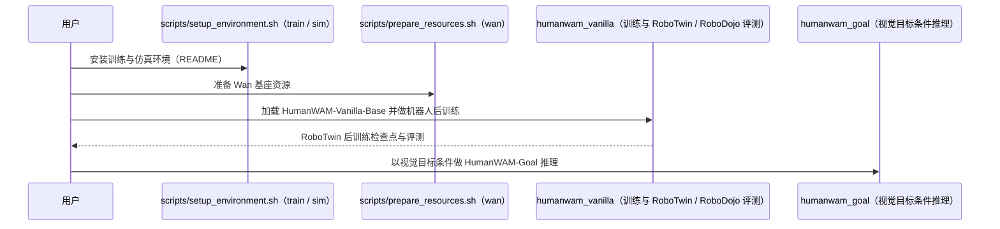

# Open-HumanWAM（arXiv:2611.06817）

**Open-HumanWAM**（*Open-HumanWAM: An Open Recipe for Scaling Human and Robot Experience for Embodied Foundation Models*，[arXiv:2611.06817](https://arxiv.org/abs/2611.06817)，[项目页](https://dagroup-pku.github.io/open-humanscale/)，[代码](https://github.com/DAGroup-PKU/HumanNet/tree/open-humanscale)）来自 [具身智能小站 2026-11-06 盘点](../../sources/blogs/wechat_embodied_station_20_papers_curobov2_fast_halo_humanwam_2026-11-06.md)，属「操作策略与数据」组。

## 一句话定义

**Open-HumanWAM**（公众号写作 Open-HumanScale，arXiv 最新题名 Open-HumanWAM）是把第一人称人类视频预训练扩展到 5 万小时的开放配方：含 Open-HumanWAM-50K 语料、HumanWAM-Vanilla（仅人类视频预训练的世界–动作模型）与 HumanWAM-Goal（视觉目标条件、人机联合预训练）（arXiv 摘要）。

## 英文缩写速查

| 缩写 | 英文全称 | 简要说明 |
|------|----------|----------|
| Open-HumanWAM | Open-HumanWAM: An Open Recipe for Scaling Human and Robot Experience for Embodied Foundation Models | 本文方法 / 基准的简称 |
| WAM | World Action Model | 世界–动作联合模型 |

## 为什么重要

- 人手操作视频能帮机器人适应新桌面吗。作者固定机器人预训练数据和每项任务的示范数，检验加入人类视频后，策略能否适应新的灯光与桌面。
- 开源结论：**部分开源**（步骤 2.5，2026-11-06）。公众号称 Open-HumanScale，arXiv 最新题名为 Open-HumanWAM；DAGroup-PKU/HumanNet 的 open-humanscale 分支经 git ls-remote 可达（Apache-2.0，含 humanwam_vanilla / humanwam_goal 目录）。README 新闻栏（2026-11-05）写代码与文档仍在整理，Open-HumanWAM-50K 语料标 Coming soon，模型权重集合上传中，因此只算部分开源。
- 同期同组工作见 [按路段调速的规划、虚拟房间到真机的人形动作与人类视频缩放：具身智能小站 11-06 期 20 篇阅读坐标](../overview/embodied-station-2026-11-06-20-papers-technology-map.md)。

## 核心机制

| 项 | 内容 |
|----|------|
| **arXiv** | [2611.06817](https://arxiv.org/abs/2611.06817) |
| **开源** | **部分开源** |
| **要点** | 用闭环仿真评测研究纯人类视频预训练，发现预训练小时数与下游机器人成功率之间的经验对数线性缩放规律；HumanWAM-Vanilla 仅用 5 万小时第一人称人类视频预训练，HumanWAM-Goal 加入机器人数据并以视觉目标为条件（摘要）。 |
| **文内指标** | arXiv 摘要：HumanWAM-Vanilla 经机器人后训练，RoboTwin 2.0 Clean2Clean 92.08%、Clean2Random 68.88%，RoboDojo 平均成功率 14.17%、平均进度分 19.00；HumanWAM-Goal 达 RoboTwin 2.0 Clean2Clean 92.70%、Clean2Random 84.60%，真机上出现无需更新参数的具身上下文学习。官方 README：预训练从 100 小时到 5 万小时使 Scene-OOD 成功率由 49.1% 升到 73.2%；固定机器人语料加入人类数据后，RoboTwin 零样本由 11.48% 升到 13.94%、20 个真实任务由 20.0% 升到 30.5%。公众号转述（口径未回论文核对）：固定 14,618 小时机器人数据再加 45,938 小时人类视频，每项 50 条干净示范微调，RoboTwin 随机场景成功率 70.80% → 74.36%（50 项仿真任务、各测 100 次）。 |

## 源码运行时序图

按官方 README 与目录结构画（浅克隆 `DAGroup-PKU/HumanNet` 的 `open-humanscale` 分支，Apache-2.0，**静态阅读、未运行**）：仓库有 `humanwam_vanilla/`（`configs`、`scripts`、`src`、`evaluation`）与 `humanwam_goal/`（`configs`、`scripts`、`src`、`examples`、`release`）两个独立子项目。README 新闻栏（2026-11-05）称代码与文档仍在整理，语料 Open-HumanWAM-50K 标 Coming soon；下图只覆盖 README 已写的安装 → 资源准备 → 训练 / 推理流程，具体脚本以仓库为准。

## 实验与评测

- 公众号转述：每项用 50 条干净示范微调后，RoboTwin 随机场景成功率从 70.80% 升至 74.36%（50 项仿真任务，各测 100 次）。
- **读法：** 本页为索引级摘要，依据公众号转述的官方摘要与仓库信息整理；逐项数字与 baseline 以原文 PDF 为准。

## 与其他工作对比

- 横向索引见 [按路段调速的规划、虚拟房间到真机的人形动作与人类视频缩放：具身智能小站 11-06 期 20 篇阅读坐标](../overview/embodied-station-2026-11-06-20-papers-technology-map.md)；同 arXiv 不重复造页。

## 结论

**人手操作视频能帮机器人适应新桌面吗：每项用 50 条干净示范微调后，RoboTwin 随机场景成功率从 70.80% 升至 74.36%（50 项仿真任务，各测 100 次）。**

1. 开源边界：**部分开源** — 公众号称 Open-HumanScale，arXiv 最新题名为 Open-HumanWAM；DAGroup-PKU/HumanNet 的 open-humanscale 分支经 git ls-remote 可达（Apache-2.0，含 humanwam_vanilla / humanwam_goal 目录）。README 新闻栏（2026-11-05）写代码与文档仍在整理，Open-HumanWAM-50K 语料标 Coming soon，模型权重集合上传中，因此只算部分开源。
2. 核心机制：Open-HumanScale 从第一人称视频里提取手部动作。
3. 复现与选型前核对任务协议、硬件与基准口径，勿直接横比公众号摘录数字。

## 关联页面

- [imitation-learning](../methods/imitation-learning.md)
- [manipulation](../tasks/manipulation.md)
- [vla](../methods/vla.md)
- [embodied-data-collection-four-layers-taxonomy](../concepts/embodied-data-collection-four-layers-taxonomy.md)
- [embodied-station-2026-11-06-20-papers-technology-map](../overview/embodied-station-2026-11-06-20-papers-technology-map.md)

## 参考来源

- [open_humanwam_arxiv_2611_06817.md](../../sources/papers/open_humanwam_arxiv_2611_06817.md)
- [wechat_embodied_station_20_papers_curobov2_fast_halo_humanwam_2026-11-06.md](../../sources/blogs/wechat_embodied_station_20_papers_curobov2_fast_halo_humanwam_2026-11-06.md)
- [arXiv:2611.06817](https://arxiv.org/abs/2611.06817)

## 推荐继续阅读

- [arXiv PDF](https://arxiv.org/pdf/2611.06817)
- [项目页](https://dagroup-pku.github.io/open-humanscale/)
- [https://github.com/DAGroup-PKU/HumanNet/tree/open-humanscale](https://github.com/DAGroup-PKU/HumanNet/tree/open-humanscale)
