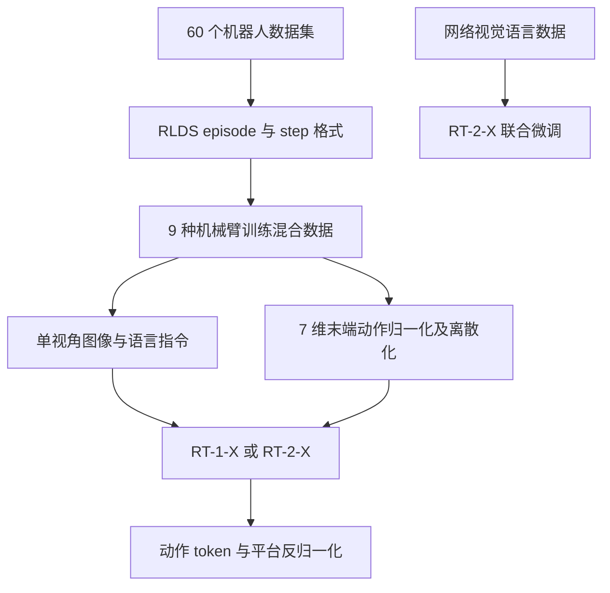
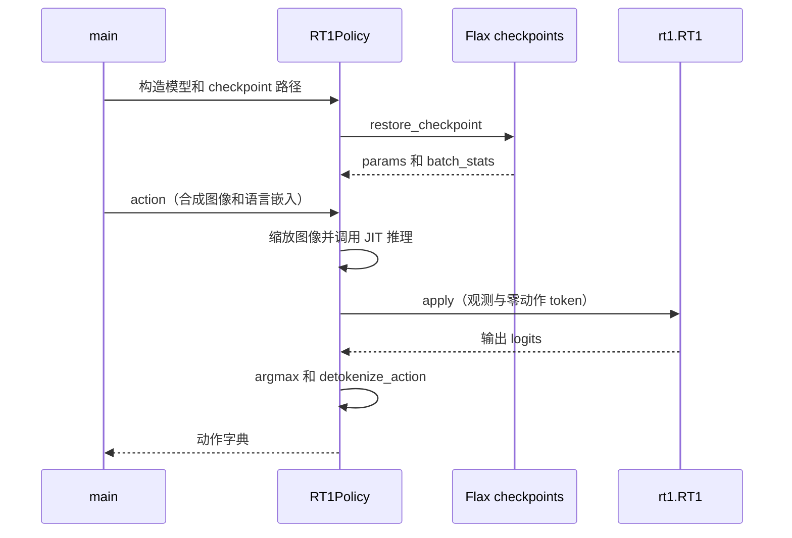

# Open X-Embodiment: Robotic Learning Datasets and RT-X Models（跨本体机器人学习数据集与 RT-X 模型）

**Open X-Embodiment**（*Open X-Embodiment: Robotic Learning Datasets and RT-X Models*，2023，[arXiv:2310.08864](https://arxiv.org/abs/2310.08864)）收录于具身智能研究室 [论文与项目总索引](https://github.com/RealXiaoze/humanoid-motion-intelligence/blob/main/%E8%AE%BA%E6%96%87%E4%B8%8E%E9%A1%B9%E7%9B%AE/README.md) **P055**，主分类为 **世界模型、VLA与Agent**。本页结合论文 v9 和官方代码更新，保留 HMI 索引关系。

## 一句话定义

把 60+ 数据集、22 类本体整理到统一 schema，并用 RT-X 检验跨本体混合训练何时带来正迁移——统一的是存储与粗动作接口，不是动力学。

## 英文缩写速查

| 缩写 | 英文全称 | 简要说明 |
|------|----------|----------|
| OXE | Open X-Embodiment | 跨本体公开机器人数据集聚合 |
| RT-X | Robotics Transformer X | 在 OXE 上训练的 RT 系列模型 |
| VLA | Vision-Language-Action | 后续通才策略路线 |
| DoF | Degrees of Freedom | 本体动作维度差异 |

## 为什么重要

- 数据会被转为标准episode/步格式，包括图像、自然语言任务、机器人状态和动作。联合模型主要对齐为7维末端动作：位移、旋转和夹爪，再做数据集级归一化。但不同数据集的坐标系、绝对/相对动作、控制频率、相机位置、夹爪语义和任务分布仍然不同。这是“粗粒度共享动作空间”，不是把关节级动力学重定向问题解决了。
- 在 HMI 六条技术路线中属于 **世界模型、VLA与Agent**，补齐「总索引有条目、本库无下钻页」的缺口。
- 与相邻方法对照时，优先看问题设定与接口，而不是只记算法名。

## 核心信息

| 字段 | 内容 |
|------|------|
| HMI ID | P055 |
| 年份 | 2023 |
| 分组 | 世界模型、VLA与Agent |
| 开源状态 | 部分开源（数据协议与汇总入口；各源数据集许可仍独立） |
| 原文 | https://arxiv.org/abs/2310.08864 |

## 核心原理

Open X-Embodiment的价值先在数据基础设施，然后才在RT-X模型。60个数据集、22类本体、超过100万条轨迹被整理到相对统一的格式，使“跨机构、跨机器人联合训练”第一次有了足够大的公开实验底座。但这种统一主要发生在存储schema和常见末端动作层，并没有消除本体差异。

### 流程直觉

论文 v9 的数据与模型流程如下：

RT-2-X 还与视觉语言数据联合微调；上图的模型输出需按本体对应的动作语义解释。

模块边界与符号定义以原文为准；上图只固定阅读骨架。

## 工程实践

每个episode还应保留本体、数据源、任务文本、观测键、动作语义和时间结构，否则统一张量会掩盖不可比数据。RT-X训练通过数据集混合采样，让图像和语言条件映射到共享末端token；它没有一个显式跨本体世界模型去预测每台机器人的动力学。动作最终仍由各平台自己的逆运动学、轨迹控制与安全接口执行。

| 检查项 | 建议 |
|--------|------|
| 一手来源 | 回 arXiv / DOI / 项目页核对数值与声明 |
| 开源边界 | 部分开源（数据协议与汇总入口；各源数据集许可仍独立） |
| 本库定位 | 详情编译页；深入公式与实验表读原文 |

## 源码运行时序图

官方 JAX 示例 [rt1_inference_example.py](https://github.com/google-deepmind/open_x_embodiment/blob/9eeb68b989efbcf474e8fb9019e01d02b962a604/models/rt1_inference_example.py) 使用合成观测演示离线推理，不包含真机控制闭环。

示例输入是长度 15 的图像序列和预计算语言嵌入；不能将示例中的合成输入当成真实机器人部署。
## 实验与评测读法

论文共进行 3600 次评测、覆盖 6 种机器人。小数据域中，RT-1-X 在 5 个数据集的 4 个上优于各自原方法；大数据域的 RT-1-X 出现欠拟合。Google Robot 的跨本体新技能评测中，55B RT-2-X 为 75.8%，RT-2 为 27.3%；这是该组任务的结果，不是所有任务均提升三倍。未见物体与背景的泛化分别为 61% 和 62%。

- 把「仿真指标 / 真机证据 / 仅项目演示」分开记账。
- 对照同组相邻工作（见关联页面）时，对齐任务定义与观测接口，再比成功率。
- 综述类条目关注分类框架与缺口，不把引用列表当作选型排名。

## 结论

**Open X-Embodiment 应作为 HMI「世界模型、VLA与Agent」线上的独立知识节点阅读：先抓住其真正改变的问题接口，再决定是否进入复现或对比实验。**

- 核心贡献是问题表达或管线接口，而不只是单一网络结构名。
- 开源状态：部分开源（数据协议与汇总入口；各源数据集许可仍独立）。
- 与本库已有相邻页交叉阅读，避免重复造页。
- 数值、消融与许可以一手来源为准；本页是编译索引。
- 若官方后续补齐代码/数据，应回写 `sources/` 与本节开源字段。

## 局限与风险

- 作者分别训练RT-1-X和大型RT-2-X，发现跨本体混合数据对许多小数据域有正迁移，大模型在新技能、新物体和新场景上尤其受益。但论文当时的RT-X训练实际选用了9种本体，不是22种全部进入同一个模型；RT-1-X在某些大数据域还出现容量不足。所以证据支持“数据多样性能帮助迁移”，不支持“训一次就可零样本控制任意机器人”。
- 勿把 HMI 解读中的工程判断直接写成论文作者承诺。
- 经典控制论文与现代 RL/VLA 论文的「可复现」标准不同，选型时分开评估。

## 与其他工作对比

| 维度 | 本工作（OXE / RT-X） | [RT 系列](../methods/robotics-transformer-rt-series.md) | [Octo](../methods/octo-model.md) | [OpenVLA](paper-openvla.md) |
|------|----------------------|--------------------------------------------------------|----------------------------------|-----------------------|
| 定位 | 跨本体数据底座 + 统一 schema | 数据源之一，并以 RT-X 验证迁移 | 在 OXE 上训的开源通用策略 | 在 OXE 等上训的开源 VLA |
| 主要贡献 | 60+ 数据集、22 类本体统一存储与粗动作接口 | Transformer 动作策略骨架 | 块状注意力 + 可换读出头 | Prismatic VLM + 离散动作 token |
| 统一层次 | 存储 schema + 7 维末端动作，非关节动力学 | 单/少本体动作 token | 少样本适配新相机/动作空间 | 离散 token，LoRA/OFT 微调 |
| 关系/取舍 | 提供实验底座；证明数据多样性助迁移，非零样本控任意机器人 | 被 OXE 汇聚并联合训练 | OXE 的下游消费者 | OXE 的下游消费者 |

## 关联页面

- [HMI 论文覆盖导读](../queries/hmi-papers-coverage.md)
- [Humanoid Motion Intelligence](./humanoid-motion-intelligence.md)
- [robotics-transformer-rt-series](../methods/robotics-transformer-rt-series.md)
- [openvla](paper-openvla.md)
- [octo-model](../methods/octo-model.md)
- [cross-embodiment-transfer-strategy](../queries/cross-embodiment-transfer-strategy.md)

## 参考来源

- [官方项目页归档](../../sources/sites/open-x-embodiment.md)
- [官方源码归档](../../sources/repos/open-x-embodiment.md)
- [sources/papers/hmi_p055_open-x-embodiment.md](../../sources/papers/hmi_p055_open-x-embodiment.md)
- [sources/repos/humanoid-motion-intelligence.md](../../sources/repos/humanoid-motion-intelligence.md)
- [HMI 论文总索引](https://github.com/RealXiaoze/humanoid-motion-intelligence/blob/main/%E8%AE%BA%E6%96%87%E4%B8%8E%E9%A1%B9%E7%9B%AE/README.md)

## 推荐继续阅读

- [arXiv:2310.08864](https://arxiv.org/abs/2310.08864)
- [项目/官方解读](https://robotics-transformer-x.github.io/)
- [代码](https://github.com/google-deepmind/open_x_embodiment)
- [HMI 逐篇解读 P055](https://github.com/RealXiaoze/humanoid-motion-intelligence/blob/main/%E8%AE%BA%E6%96%87%E4%B8%8E%E9%A1%B9%E7%9B%AE/%E8%AE%BA%E6%96%87%E9%80%90%E7%AF%87%E8%A7%A3%E8%AF%BB/P055.md)
