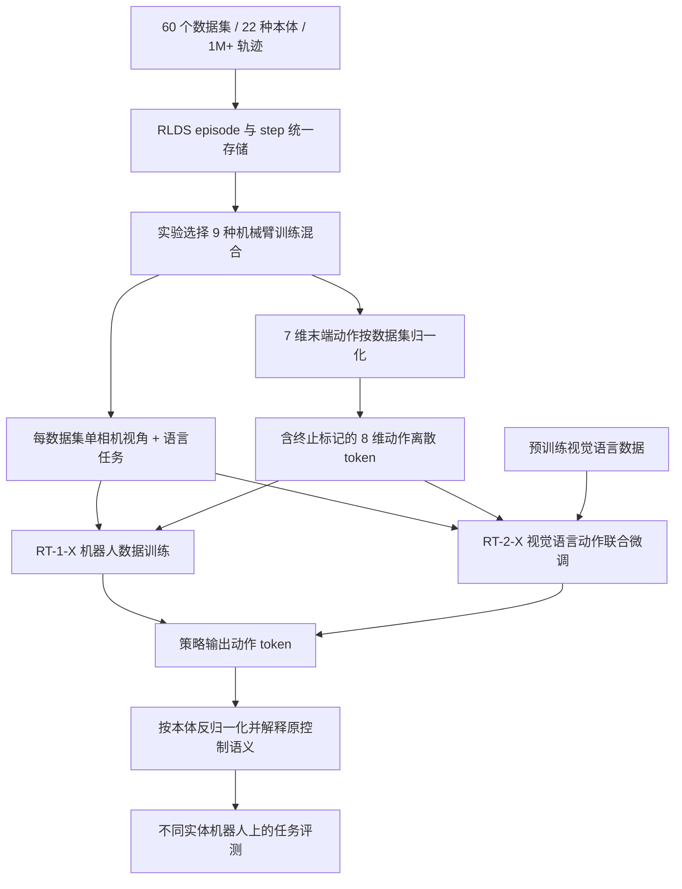
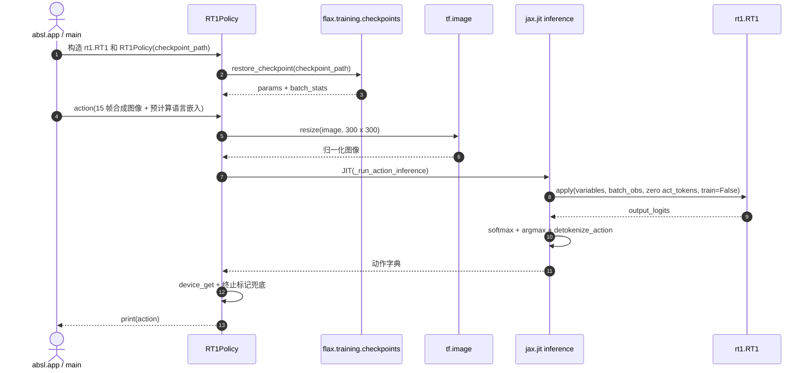

# Open X-Embodiment: Robotic Learning Datasets and RT-X Models（跨本体机器人学习数据集与 RT-X 模型）

**论文：** [arXiv:2310.08864v9](https://arxiv.org/abs/2310.08864v9)（2023-10-13 初稿，2025-05-14 修订） · **作者：** Open X-Embodiment Collaboration · **会议：** ICRA 2024。保留 [HMI 论文与项目总索引](https://github.com/RealXiaoze/humanoid-motion-intelligence/blob/main/%E8%AE%BA%E6%96%87%E4%B8%8E%E9%A1%B9%E7%9B%AE/README.md) **P055** 的策展对应，但本页所有技术与数值优先使用 v9 原文和官方源码。

## 一句话定义

**Open X-Embodiment（OXE）** 将多机构异构机器人操作示范整理为 RLDS 数据资源；**RT-1-X / RT-2-X** 则基于其中 **9 种机械臂训练混合**验证“从其他机器人学到经验能否改进当前机器人的操作策略”。

## 英文缩写速查

| 缩写 | 英文全称 | 简要说明 |
|------|----------|----------|
| OXE | Open X-Embodiment | 跨本体机器人演示数据集与协作计划 |
| RT-X | Robotics Transformer X | RT-1-X / RT-2-X 跨本体训练模型的统称 |
| RLDS | Reinforcement Learning Datasets | 以 episode 和 step 表示的公开数据存储格式 |
| VLA | Vision-Language-Action | 从图像和语言指令预测机器人动作的模型 |
| DoF | Degrees of Freedom | 这里主要指 7 维末端运动与夹爪动作接口 |
| VLM | Vision-Language Model | RT-2-X 借助的视觉语言预训练模型 |

## 为什么重要

传统机器人训练数据碎片化、单机器人样本稀少。OXE 提供共享数据基础设施与跨本体实验基准，回答 **“异构数据是否能帮助特定机器人提升成功率”**。论文实证是 **正迁移在一定条件下可发生**，而不是证明一个策略可以零样本控制任意形态机器人。可与 [跨本体迁移策略](../queries/cross-embodiment-transfer-strategy.md) 和 [Octo Model](../methods/octo-model.md) 对照。

## 核心信息

| 字段 | 论文 v9 / 官方来源核实内容 |
|------|-----------------------------|
| 英文 / 中文题名 | Open X-Embodiment: Robotic Learning Datasets and RT-X Models / 跨本体机器人学习数据集与 RT-X 模型 |
| 年份 / 版本 | arXiv 2023 初稿，v9 修订于 2025-05-14；ICRA 2024 |
| 机构 | 21 家机构合作（论文摘要）；项目页另记 34 个贡献数据的机器人研究实验室，不是同一统计口径 |
| 数据全集 | 60 个既有数据集、22 种机器人本体、100 万+ 真机轨迹；527 种技能、160,266 个任务 |
| 训练实验 | 从 **9 种机械臂**构建训练混合，不是 22 种全部进入 RT-X |
| 主要模型 | RT-1-X（约 35M）；RT-2-X（含 5B、55B 对照/消融） |
| 开放情况 | 公开 RLDS 数据访问/样例、RT-1-X checkpoint 和离线推理代码；**不能据此宣称 RT-2-X 训练权重、完整训练或真机部署代码开放** |
| 官方资料 | [论文 v9](https://arxiv.org/html/2310.08864v9) · [项目主页](https://robotics-transformer-x.github.io/) · [代码仓库](https://github.com/google-deepmind/open_x_embodiment) |

## 核心原理

### 数据集统一：只粗对齐观测与动作

- 原始示范按 **RLDS episode/step** 结构存储，支持不同相机、状态和动作模态；RT-X 实验为每个数据集选用 **一个标准视角的 RGB 图像**和任务文本。
- 将各数据集动作粗对齐为 **7 维末端量**：`x, y, z, roll, pitch, yaw, gripper`，或它们的变化率。按数据集归一化，再进行动作 token 离散化；另有 **episode termination** 维度，因此策略离散预测是 **8 个维度 × 每维 256 bins**。
- **没有统一每个数据集的控制坐标系和动作语义**：原值可能代表绝对位置、增量或速度；即使模型输出相同 token，不同机器人上也可能产生不同的物理运动。
- OXE 是**数据基础设施与策略学习**，不是显式跨本体动力学世界模型，也没有给出统一关节驱动/真机安全控制器。

### RT-1-X 与 RT-2-X：共同监督、不同容量

| 维度 | RT-1-X | RT-2-X |
|------|--------|--------|
| 网络 | EfficientNet/FiLM + TokenLearner + decoder-only Transformer | 基于 ViT/UL2 的 PaLI-X 式 VLM，将动作 token 作为文本 token |
| 数据 | 机器人训练混合（9 种机械臂） | 机器人混合 + 原 VLM 数据，论文使用约 1:1 co-fine-tuning |
| 训练目标 | 类别交叉熵、离散动作 token | 类别交叉熵、动作对应语言 token |
| 论文推理 | 本地，按机器人约 3–10 Hz | 云端经网络查询，按机器人约 3–10 Hz |
| 公开复现 | RT-1-X checkpoint、JAX/Python 推理示例 | 论文与实验描述；仓库未提供同级别的 RT-2-X 55B 完整训练/运行入口 |

### 流程总览（基于论文 III–V）

这是一张**论文训练与评测概念图**，并非官方完整训练代码调用图；动作执行层所需控制器不在论文发布的统一跨本体闭环实现范围内。

## 工程实践

**复现顺序（以官方仓库 README 为准）：**

1. 通过 [官方数据清单](https://docs.google.com/spreadsheets/d/1rPBD77tk60AEIGZrGSODwyyzs5FgCU9Uz3h-3_t2A9g/edit#gid=0) 核对数据集的下载、引用及许可；通过 [数据加载 Colab](https://colab.research.google.com/github/google-deepmind/open_x_embodiment/blob/main/colabs/Open_X_Embodiment_Datasets.ipynb) 查看 RLDS episode 与 batch。
2. 下载官方 **RT-1-X JAX checkpoint**（仓库 README 给出 `gsutil` 命令）；使用 `models/rt1_inference_example.py --checkpoint_path=...` 运行离线推理示例，具体依赖按官方代码环境安装。
3. 对比观测键（`image`、`natural_language_embedding`）、图像历史长度（15）、尺寸（300×300）、行动离散码/反归一化范围（示例 `world_vector_range=(-2.0, 2.0)`）。
4. 真机使用前必须独立验证各本体动作坐标系、单位、绝对/相对语义、频率及保护逻辑；**官方示例没有提供电机/机械臂驱动接口**。

## 源码运行时序图

源码锚点：[官方 `models/rt1_inference_example.py`](https://github.com/google-deepmind/open_x_embodiment/blob/9eeb68b989efbcf474e8fb9019e01d02b962a604/models/rt1_inference_example.py)，读取 `main`、`RT1Policy.__init__`、`action`、`_run_action_inference`。此图记录**可核验的官方离线推理入口**，不冒充 RT-2-X 训练或真机时序。

工程边界：官方示例用**全 1 的假观测**与已存在的权重文件，返回离散 token 解码动作。源码可能存在与 JAX 版本的兼容性问题，本次**未下载权重、未执行模型**，因此不作运行成功声明。技术核对记录在 [官方仓库归档](../../sources/repos/open-x-embodiment.md)。

## 实验与评测

论文 v9 累计 **3,600 次试验、6 种机器人**，须分别看小数据域、样本丰富域与 Google Robot 的跨本体新技能：

| 对比范围 | 论文实测 | 读法 |
|----------|----------|------|
| 5 个小数据域 | RT-1-X 在 **4/5** 优于原方法；平均成功率相对提升约 **50%** | 不能解释为所有机器人都提升 50% |
| 大数据域（Bridge） | IRIS：RT-1 为 **40%**，RT-1-X 为 **27%**；RAIL：RT-1 为 **30%**，RT-1-X 为 **27%** | 35M RT-1-X 在高数据量场景欠拟合 |
| 大数据域（Google Robot 6 skills） | RT-1 **92%**，RT-1-X **73%**，RT-2-X 55B **91%** | 高容量模型可缓解，但不是每组都超越单体基线 |
| 新技能（Google Robot，来自其他本体数据） | RT-2 55B **27.3%** → RT-2-X 55B **75.8%** | 约 **2.78 倍**，不是所有任务通用提升 |
| 移除 Bridge 数据（新技能） | RT-2-X 55B 由 **75.8%** 降为 **42.8%** | 支持 WidowX/Bridge 数据的跨本体迁移贡献 |
| 未见对象/背景/环境综合泛化 | RT-2 55B **62%**，RT-2-X 55B **61%** | **61/62 是两个模型的同一评测列**，不能写成“物体 61%，背景 62%” |
| 5B 新技能消融 | 2 帧历史 **44.4%** vs 无历史 **14.5%**；随机初始化 **0%** | 历史帧与 Web 预训练重要；指标限定在 Table II 的条件 |

论文 Table II 还显示：5B web-pretrained、无联合 Web 数据而仅做机器人微调的新技能分数 **48.7%**，略高于某组 co-fine-tuning 的 **44.4%**；不能机械断言所有联合微调都更优。

## 结论

**OXE 的主要价值是可复用的数据基础设施与对“跨机器人数据正迁移”的条件性实证，而非已经获得万能跨本体控制器。**

1. **分清 22 与 9：** 22 种本体属于公开数据全集，9 种机械臂属于论文的 RT-X 训练混合。
2. **按域选模型：** 小数据域 RT-1-X 往往有迁移收益，大数据域的 35M RT-1-X 可能容量不足。
3. **核对任务列：** 新技能 75.8% vs 27.3% 有约 2.78 倍差异，而普通综合泛化 61% vs 62% 基本持平。
4. **数据清单优先于模型名字：** 需要审查每个源数据集的本体、相机视角、动作语义与许可证。
5. **可复现≠可部署：** 官方公开 RT-1-X 离线推理与 checkpoint，但不包含可直接上真机的完整控制链。
6. **研究边界：** 论文没有验证对全新机器人本体零样本泛化，尚不能保证任何本体配对都正迁移。

## 局限与风险

- **动作/视觉域差异没有消失：** 保留不同参考系、相机位置和绝对/相对/速度语义；7 维末端接口不是关节级、力矩级或接触力控制的统一。
- **实验覆盖有限：** 仅围绕跨本体机械臂操作；不代表已验证灵巧手、双足人形与四足的通用闭环控制，也未测试新机器人 zero-shot 迁移。
- **数据、算力与许可：** RT-2-X 55B 规模不可从官方 RT-1-X 示例推断能复现；源数据集许可、checkpoint 条件需单独核查。
- **类别表述：** 在 HMI P055 中归入“世界模型、VLA 与 Agent”分类，但论文模型 **不是显式学习动力学的 world model**。

## 与其他工作对比

| 维度 | OXE / RT-X | [RT 系列](../methods/robotics-transformer-rt-series.md) | [Octo](../methods/octo-model.md) | [OpenVLA](paper-openvla.md) |
|------|-------------|---------------------------------------------|------------------------------------|----------------------------|
| 主要贡献 | 统一数据与跨本体正迁移实验 | RT-1 / RT-2 架构与单体训练基线 | 开源通用操作策略及适配接口 | 开源视觉语言动作策略 |
| 数据层关系 | 提供 60 份数据集的聚合资源，模型只用其中部分 | 作为基础架构与数据来源 | OXE 数据生态的下游使用者 | OXE 数据生态的下游使用者 |
| 具体区别 | 同动作 token 仍可能不同参考系/控制含义 | 以模型架构和控制建模为中心 | 侧重任务/本体适配 | 侧重通用 VLA 微调与部署 |

## 关联页面

- [Open X-Embodiment 概念](../concepts/open-x-embodiment.md)
- [跨本体迁移策略](../queries/cross-embodiment-transfer-strategy.md)
- [HMI 论文覆盖导读](../queries/hmi-papers-coverage.md)
- [Humanoid Motion Intelligence](./humanoid-motion-intelligence.md)
- [RT / RT-X 系列](../methods/robotics-transformer-rt-series.md)
- [Octo](../methods/octo-model.md)
- [OpenVLA](paper-openvla.md)

## 参考来源

- [一手论文 v9 全文核对记录](../../sources/papers/open-x-embodiment-arxiv-2310-08864-v9.md)
- [官方项目主页核对](../../sources/sites/open-x-embodiment.md)
- [官方仓库 README / RT-1-X 代码阅读](../../sources/repos/open-x-embodiment.md)
- [HMI P055 历史策展归档](../../sources/papers/hmi_p055_open-x-embodiment.md)
- [论文 v9 原文 HTML](https://arxiv.org/html/2310.08864v9)

## 推荐继续阅读

- [arXiv v9](https://arxiv.org/abs/2310.08864v9)
- [OXE 官方项目页](https://robotics-transformer-x.github.io/)
- [Google DeepMind：open_x_embodiment](https://github.com/google-deepmind/open_x_embodiment)
- [RLDS 数据格式](https://github.com/google-research/rlds#dataset-format)
