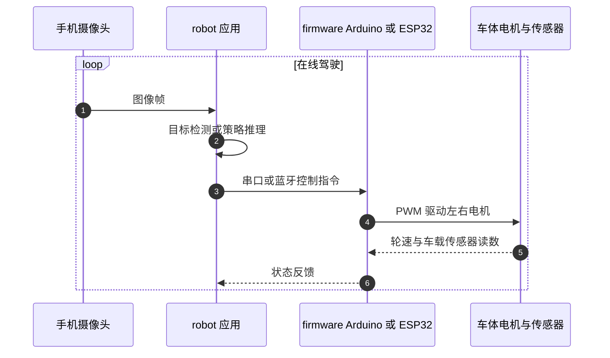

# OpenBot：把智能手机变成低成本移动机器人

**OpenBot**（*OpenBot: Turning Smartphones into Robots*，[arXiv:2008.10631](https://arxiv.org/abs/2008.10631)，ICRA 2021，Intel Labs）把普通 Android 手机作为轮式机器人的感知、计算与通信核心，并设计约 **$50**（不含手机）的四轮车体，验证手机端视觉跟人和室内自主导航。论文、车体资料、固件、手机应用与训练代码均可从[官方仓库](https://github.com/ob-f/OpenBot)获取，仓库采用 MIT License。

## 英文缩写速查

| 缩写 | 英文全称 | 简要说明 |
|------|----------|----------|
| CIL | Conditional Imitation Learning | 用高层驾驶指令条件化视觉驾驶策略 |
| SSD | Single Shot MultiBox Detector | 论文中用于检测跟随目标的单阶段目标检测器 |
| MCU | Microcontroller Unit | Arduino/ESP32 等低层执行与传感器接口控制器 |
| FPS | Frames Per Second | 视觉模型或策略每秒处理帧数 |
| PWM | Pulse-Width Modulation | MCU 调节直流电机驱动信号的方式 |

## 为什么重要

- **以消费电子替代专用计算机：** 手机自带摄像头、IMU、处理器与无线通信，降低入门成本，也便于更换升级。
- **软硬件复现入口完整：** 官方仓库把车体、固件、应用、控制器和策略训练放在一处，适合教学和小规模移动机器人实验。
- **把跨设备差异纳入评测：** 论文测量不同手机和不同车体上的导航表现，显示多设备训练能改善泛化，同时暴露出手机相机位置、帧率和车体执行偏差的重要性。

## 方法栈与系统结构

论文的基线车体用四个直流电机形成差速底盘，配合 L298N、电池、轮速传感器和 Arduino Nano。手机运行视觉模型或驾驶策略，经 USB 串口向 MCU 发送控制；MCU 负责低层 PWM 输出并将传感器数据返回手机。仓库支持多种硬件版本，包含 ESP32 等配置，复现时应按具体车体 README 选择固件设置。

### 两类手机端任务

1. **跟人：** SSD-MobileNet 检测 person 类目标，筛掉低于 50% 置信度的检测，跨帧保持目标并选择置信度最高者；以目标框中心相对图像中心的误差做视觉伺服。
2. **走廊导航：** 小型条件驾驶网络读取相机帧和高层转向指令，预测车辆控制。作者报告不到 30 分钟标注驾驶数据即可训练出有效策略，并在办公走廊的直行和路口转弯任务中评估。

### 运行时序

论文中的策略训练是离线流程：手柄驾驶并在手机端记录数据，`policy/` 将数据用于训练模型；部署时 `robot/` 应用加载策略并通过 `firmware/` 控制车体。

## 实验与评测

- **跟人：** 十部手机在受控室内往返路线测试，现代中端手机一般可达到约 10 FPS 或更高；低端 Nokia 2.2 的检测帧率为 4–5 FPS，跟随成功率为 0%。论文使用 MobileNetV1/V3、单 CPU 线程，GPU 或 NNAPI 可进一步改变推理速度。
- **导航基线比较（Xiaomi Mi9）：** 作者方法距离完成度 **94±5%**、成功率 **89±10%**、碰撞 **0**、速度 **47±2 FPS**、参数 **1.3M**；CIL 基线完成度和成功率相近（94±5%、89±10%），速度为 20±1 FPS、参数 10.7M。数据为三次试验均值及标准差。
- **跨手机：** 单手机训练策略在未见机型上表现下降；多手机训练总体提升跨品牌与摄像头泛化，但不同相机位置、视场和曝光仍会造成差异。
- **跨车体：** 多车体数据提升对廉价电机与装配差异的适应性。作者也指出该策略与差速驱动及具体车辆执行特性相关。

## 结论

**OpenBot 证明普通手机足以支撑一套低成本轮式机器人研究平台；它的主要贡献是可复现的系统集成与跨设备评测，论文结果仍限于特定车体和受控路线。**

1. **先复现硬件和手机通信链路：** 电机/轮速反馈与手机控制稳定后，再评估视觉策略。
2. **手机型号是实验变量：** 记录机型、相机安装位置、端侧 FPS 和温度，避免把推理能力差异误判成策略效果。
3. **用多车体数据降低执行偏差：** 廉价底盘存在左右偏航等差异，单车采集策略迁移到新底盘会掉点。
4. **对比模型时同时报速度和任务指标：** 参数更少、FPS 更高并不自动保证在不同手机上安全或鲁棒。
5. **导航结论有明确边界：** 主要实验为办公走廊及有限路口，不能视作开放道路自主驾驶安全验证。
6. **复现时核对当前仓库版本：** 项目仓库持续维护，现有硬件和软件配置可能超过论文所测版本。

## 工程实践

- 仓库给出 `body/` 车体资料、`firmware/` 微控制器固件、`robot/` 手机与 Linux 应用、`controller/` 遥控入口及 `policy/` 数据和训练代码。
- 训练路径是先用手机和手柄采集驾驶数据，再训练模型；部署路径是手机应用加载策略并向 MCU 发送控制。
- **开放状态：** 官方仓库公开上述软硬件实现，LICENSE 为 MIT。该许可仅说明仓库代码的授权条款；单独下载的第三方模型或组件仍需按各自许可核对。

## 局限与风险

- 论文展示的主要场景是室内办公环境与受控路线；真机碰撞和失败仍受场景、手机与车体配置影响。
- 单机型或单车体采集会产生数据偏差，跨设备表现不是自动保证。
- 低端手机的推理速度可能不足以实时控制，手机发热与相机安装位置也会影响运行。
- 策略围绕差速车辆驱动设计，不应直接套用到人形或其他运动学结构。

## 与其他工作对比：PhoneBot

[PhoneBot](./paper-phonebot-smartphone-humanoid.md) 延续“手机承担机器人感知与高层计算”的系统思路，但面向 13 DoF 双足人形，重点是步态和手机集成；OpenBot 面向四轮差速移动底盘，重点是跟人、走廊导航及跨手机/车体的策略泛化。两者可用于比较手机作为机器人边缘计算平台时，不同本体对控制接口和评测方式的要求。

## 关联页面

- [PhoneBot：复用智能手机的低成本人形平台](./paper-phonebot-smartphone-humanoid.md)
- [导航·SLAM·自主移动栈](../overview/navigation-slam-autonomy-stack.md)
- [视觉语言导航](../tasks/vision-language-navigation.md)
- [模仿学习](../methods/imitation-learning.md)
- [Sim2Real](../concepts/sim2real.md)

## 参考来源

- [OpenBot 论文归档](../../sources/papers/openbot_arxiv_2008_10631.md)
- [OpenBot 项目页归档](../../sources/sites/openbot-project.md)
- [OpenBot 官方仓库归档](../../sources/repos/openbot.md)
- [arXiv:2008.10631](https://arxiv.org/abs/2008.10631)

## 推荐继续阅读

- [OpenBot 官方仓库](https://github.com/ob-f/OpenBot)
- [OpenBot 项目页](https://www.openbot.org/)
- [PhoneBot 人形平台](./paper-phonebot-smartphone-humanoid.md)
- [wechat_githubstore_18_open_source_robot_projects.md](../../sources/blogs/wechat_githubstore_18_open_source_robot_projects.md)（GitHubStore 18 个开源项目清单收录；索引见 [机器人开源项目 18 例](../overview/robot-open-source-wechat-githubstore-18-projects.md)）
