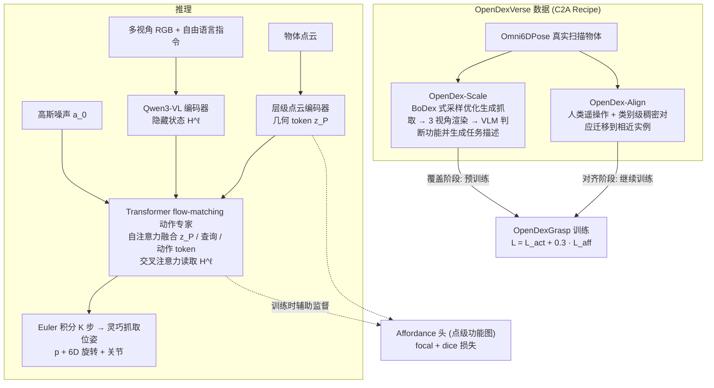

# OpenDexGrasp（arXiv:2609.18117）

**OpenDexGrasp**（*OpenDexGrasp: Open-vocabulary Task-Oriented Dexterous Grasping*，[arXiv:2609.18117](https://arxiv.org/abs/2609.18117)，[项目页](https://opendexgrasp.github.io/)）来自 [具身智能小站 11 篇盘点](../../sources/blogs/wechat_embodied_station_11_papers_constraint_control_2026-09-20.md)（2026-09-20）。

## 一句话定义

**自然语言功能意图 + 多视角 RGB + 点云几何 → 高 DoF 任务导向抓取；C2A 数据：1.24M 自动合成 + 27.42k 遥操作对齐；真机平均成功率 72.0%。**

## 英文缩写速查

| 缩写 | 英文全称 | 简要说明 |
|------|----------|----------|
| DoF | Degrees of Freedom | 灵巧手自由度 |
| VLM | Vision-Language Model | 开放词汇语义编码 |
| C2A | Coverage-to-Alignment | 先扩覆盖再遥操作对齐的数据配方 |
| SR | Success Rate | 抓取/任务成功率 |

## 为什么重要

- 同一物体「拿稳」与「拿得能用」不同；开放词汇任务导向灵巧抓取需语义–几何–动作统一表示。
- 开源结论：**待发布**（步骤 2.5，2026-09-20）。
- 与 [11 篇技术地图](../overview/constraint-control-11-papers-technology-map.md) 中同类工作可横向对照。

## 流程总览

图依据：论文 §4.1–4.2 / Fig. 2、§5.1–5.4 / Fig. 4

## 核心机制

| 项 | 内容 |
|----|------|
| **arXiv** | [2609.18117](https://arxiv.org/abs/2609.18117) |
| **开源** | **待发布** |
| **要点** | VLM 语义 token + 点云几何 → flow-matching action expert 直接生成功能抓取；affordance 作辅助监督非级联瓶颈。 |
| **文内指标** | Seen functional SR 68.07%；Unseen 62.96%；真机平均 72.0% vs DexGraspNet 2.0* 59.0%。 |

## 源码运行时序图

**不适用**（截至 2026-09-20 未发布可运行官方代码或待核实）。

## 实验与评测

- Seen functional SR 68.07%；Unseen 62.96%；真机平均 72.0% vs DexGraspNet 2.0* 59.0%。
- **读法：** 索引级摘要；逐项对照与 baseline 以原文 PDF 为准。

## 与其他工作对比

- 横向索引见 [11 篇技术地图](../overview/constraint-control-11-papers-technology-map.md)；与同 arXiv 节点不重复造页。

## 结论

**OpenDexGrasp 把 affordance 与抓取生成视为同一任务条件分布的两视图；部署前等官方代码。**

1. 开源边界：**待发布** — 以项目页实际链接为准（入库日 2026-09-20）。
2. 核心机制：VLM 语义 token + 点云几何 → flow-matching action expert 直接生成功能抓取；affordance 作辅助监督非级联瓶颈…
3. 部署前核对任务协议与硬件条件，勿直接横比公众号摘录数字。

## 关联页面

- [manipulation](../tasks/manipulation.md)
- [vla](../methods/vla.md)
- [contact-rich-manipulation](../concepts/contact-rich-manipulation.md)
- [paper-fierce](./paper-fierce.md)

## 参考来源

- [opendexgrasp_arxiv_2609_18117.md](../../sources/papers/opendexgrasp_arxiv_2609_18117.md)
- [wechat_embodied_station_11_papers_constraint_control_2026-09-20.md](../../sources/blogs/wechat_embodied_station_11_papers_constraint_control_2026-09-20.md)
- [arXiv:2609.18117](https://arxiv.org/abs/2609.18117)
- [arXiv PDF](https://arxiv.org/pdf/2609.18117)：已通读方法部分（实验与附录以略读为准）：§3 问题定义、§4 OpenDexVerse 与 C2A Recipe、§5 方法（5.1–5.4）、§6 实验设定

## 推荐继续阅读

- [arXiv PDF](https://arxiv.org/pdf/2609.18117)
- [项目页](https://opendexgrasp.github.io/)

