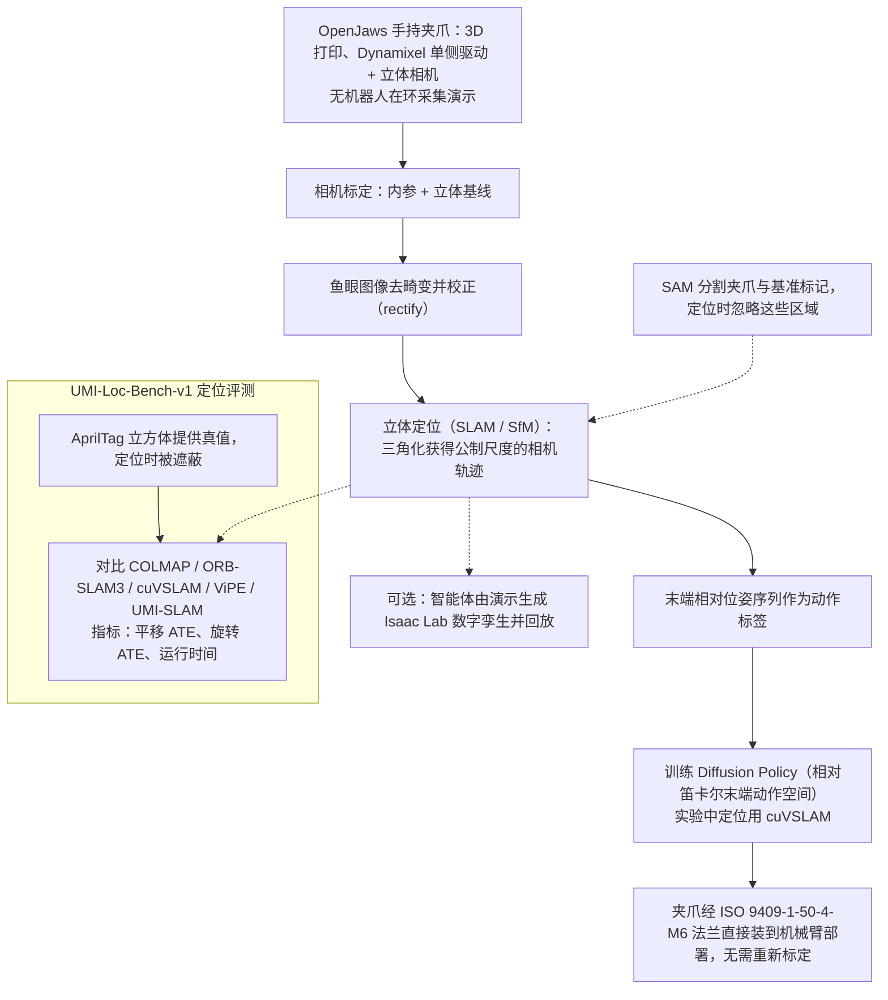

# OpenJaws（arXiv:2610.36598）

**OpenJaws**（*OpenJaws: An Open Hardware UMI Framework with Stereo Localization for Generalist Manipulation*，[arXiv:2610.36598](https://arxiv.org/abs/2610.36598)，[项目页](https://open-jaws.github.io/)）来自 [具身智能小站 2026-10-28 盘点](../../sources/blogs/wechat_embodied_station_59_papers_human_video_to_robot_experience_2026-10-28.md)，属「数据采集与示范迁移」组。

## 一句话定义

**用低成本双目相机恢复有尺度的手持轨迹，配合模块化夹爪减少采集到部署的接口变化。**

## 英文缩写速查

| 缩写 | 英文全称 | 简要说明 |
|------|----------|----------|
| OpenJaws | OpenJaws: An Open Hardware UMI Framework with Stereo Localization for Generalist Manipulation | 本文方法 / 基准的简称 |
| UMI | Universal Manipulation Interface | 手持通用操作采集接口 |

## 为什么重要

- 手持采集的瓶颈在定位精度。定位基准同时比较误差、覆盖率与耗时，提醒读者不要只看轨迹误差。
- 开源结论：**已开源**（步骤 2.5，2026-10-28）。公众号未给代码链接；项目页链接的 adithyamurali/OpenJaws 经 git ls-remote 可达（页面另含 soon 字样，可能指部分资源）。
- 同期同组工作见 [潜在动作、免渲染事件仿真与机器人评测：具身智能小站 10-28 期 59 篇阅读坐标](../overview/embodied-station-2026-10-28-59-papers-technology-map.md)。

## 流程总览

图依据：论文 §III-A / §III-B / §IV / §V-B / §V-D / Fig.1 / Fig.2

## 核心机制

| 项 | 内容 |
|----|------|
| **arXiv** | [2610.36598](https://arxiv.org/abs/2610.36598) |
| **开源** | **已开源** |
| **要点** | 用低成本双目相机恢复有尺度的手持轨迹，配合模块化夹爪减少采集到部署的接口变化。 |
| **文内指标** | 公众号转述：定位基准同时比较误差、覆盖率与耗时，提醒读者不要只看轨迹误差。 |

## 源码运行时序图

**不适用（已开源）** — 公众号未给代码链接；项目页链接的 adithyamurali/OpenJaws 经 git ls-remote 可达（页面另含 soon 字样，可能指部分资源）。 不编造运行脚本；代码公开后再补。

## 实验与评测

- 公众号转述：定位基准同时比较误差、覆盖率与耗时，提醒读者不要只看轨迹误差。
- **读法：** 本页为索引级摘要，依据公众号转述的官方摘要与仓库信息整理；逐项数字与 baseline 以原文 PDF 为准。

## 与其他工作对比

- 横向索引见 [潜在动作、免渲染事件仿真与机器人评测：具身智能小站 10-28 期 59 篇阅读坐标](../overview/embodied-station-2026-10-28-59-papers-technology-map.md)；同 arXiv 不重复造页。

## 结论

**手持采集的瓶颈在定位精度：定位基准同时比较误差、覆盖率与耗时，提醒读者不要只看轨迹误差。**

1. 开源边界：**已开源** — 公众号未给代码链接；项目页链接的 adithyamurali/OpenJaws 经 git ls-remote 可达（页面另含 soon 字样，可能指部分资源）。
2. 核心机制：用低成本双目相机恢复有尺度的手持轨迹，配合模块化夹爪减少采集到部署的接口变化。
3. 复现与选型前核对任务协议、硬件与基准口径，勿直接横比公众号摘录数字。

## 关联页面

- [embodied-data-collection-four-layers-taxonomy](../concepts/embodied-data-collection-four-layers-taxonomy.md)
- [teleoperation](../tasks/teleoperation.md)
- [imitation-learning](../methods/imitation-learning.md)
- [teleoperation](../tasks/teleoperation.md)
- [embodied-station-2026-10-28-59-papers-technology-map](../overview/embodied-station-2026-10-28-59-papers-technology-map.md)

## 参考来源

- [openjaws_arxiv_2610_36598.md](../../sources/papers/openjaws_arxiv_2610_36598.md)
- [wechat_embodied_station_59_papers_human_video_to_robot_experience_2026-10-28.md](../../sources/blogs/wechat_embodied_station_59_papers_human_video_to_robot_experience_2026-10-28.md)
- [arXiv:2610.36598](https://arxiv.org/abs/2610.36598)
- [arXiv PDF](https://arxiv.org/pdf/2610.36598)：已通读方法部分（实验与附录以略读为准）：§I 引言、§III OpenJaws（夹爪与立体定位）、§IV UMI-Loc-Bench-v1、§V 结果（含真机部署与 real-to-sim）

## 推荐继续阅读

- [arXiv PDF](https://arxiv.org/pdf/2610.36598)
- [项目页](https://open-jaws.github.io/)
