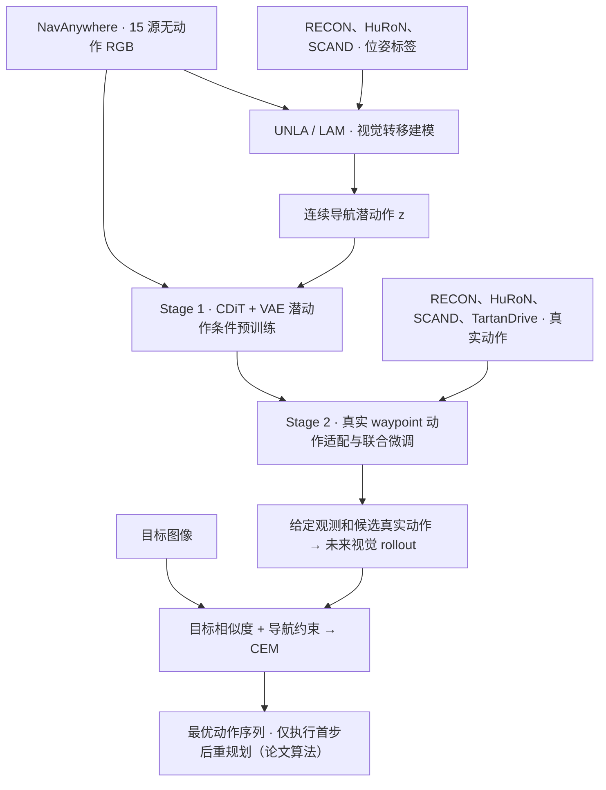
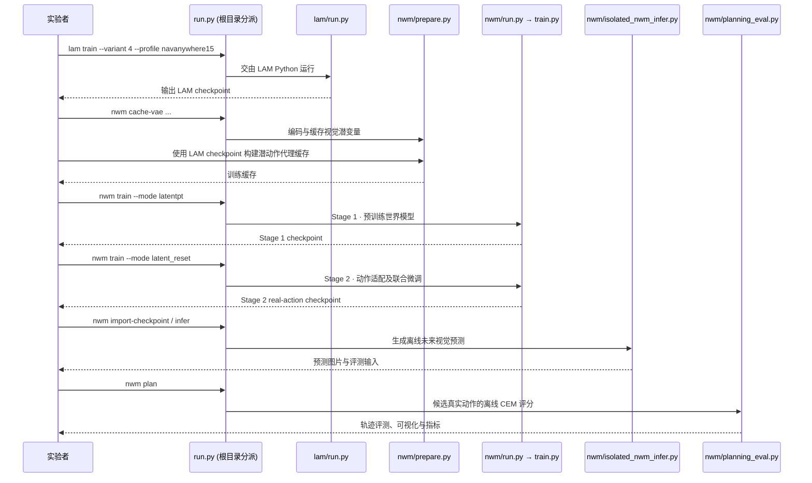

# OpenNWM：基于潜动作预训练的通用导航世界模型 / A Generalist Navigation World Model with Latent Action Pretraining

**论文：** Dujun Nie、Ruiqi Song 等，arXiv:2611.01844**v1**（2026-11-01）。[原文 v1](https://arxiv.org/html/2611.01844v1) · [项目页](https://openspace-lab.github.io/OpenNWM/) · [官方代码](https://github.com/OpenSpace-Lab/OpenNWM)。

## 一句话定义

**先把不同本体、不同场景的无动作视频转成有运动语义的潜动作监督，预训练可预测未来视觉状态的导航世界模型，再用真实 waypoint 位姿动作适配，支持目标图像条件下的候选动作规划。**

## 英文缩写速查

| 缩写 | 英文全称 | 简要说明 |
|---|---|---|
| OpenNWM | OpenNWM: A Generalist Navigation World Model with Latent Action Pretraining | 论文方法名；不自行推断名称缩写展开 |
| UNLA | Universal Navigation Latent Actions | 以视觉转移及少量物理监督学习的导航潜动作 |
| LAM | Latent Action Model | 从图像对提取潜动作的模型 |
| NWM | Navigation World Model | 给定观测与动作预测未来视觉状态 |
| CDiT | Conditional Diffusion Transformer | 论文世界模型使用的条件扩散 Transformer 骨干 |
| CEM | Cross-Entropy Method | 对真实 waypoint 候选序列迭代选择与拟合的规划方法 |
| ATE / RPE | Absolute Trajectory Error / Relative Pose Error | 离线规划轨迹的绝对/相对位姿误差 |

## 为什么重要

传统 NWM 依赖带物理动作标注的轨迹，而真实视频覆盖的场景、相机运动与载体更广。OpenNWM 用 UNLA 将无标注的视觉转移变成可训练条件，同时用部分有标注序列约束潜动作的**可控运动语义**，将“见过更多环境”连接到“按真实机器人动作预测未来”的能力。它首先是一个**动作条件的预测世界模型**，不是直接输出底盘速度的纯反应式 VLA。

## 核心原理与方法栈

### 数据与两阶段训练

1. **视频语义 → UNLA：** NavAnywhere 由 **15** 种来源组成，共 **70,756** 段序列、**17,496,570** 帧与 **1,188.65** 小时源视频（v1 Appendix A，Table 6）。这些样本按**无动作 RGB**使用。UNLA 另结合 RECON / HuRoN / SCAND 中的运动标注进行物理对齐。
2. **Stage 1：** 从前后帧估计潜动作，用它和时间间隔作为 CDiT 条件，在大规模无动作视觉序列上预测未来视觉潜状态。
3. **Stage 2：** 用 RECON、HuRoN/SACSoN、SCAND、TartanDrive 的位置与偏航构造真实动作，先训练动作适配器再联合微调，让世界模型能响应真实 waypoint 动作。
4. **规划：** 用后训练模型为真实动作候选生成未来画面，按目标视觉相似度及导航约束计算能量，用 CEM 优化；潜动作是**训练时桥梁**，不是规划时被搜索的控制变量。

### v1 原文公式（沿用论文编号）

**UNLA 视觉变分重建（Eq. 2）：**

$$
\mathcal L_{\mathrm{vis}}
=-\mathbb E_{q_\phi}[\log p_\psi(x_m\mid x_\tau,z_{\tau\rightarrow m})]
+\beta D_{\mathrm{KL}}\!\left(q_\phi(z_{\tau\rightarrow m}\mid x_\tau,x_m)\|p(z)\right).
$$

**有物理标注子集的运动对齐（Eq. 3–4）：**

$$
\mathcal L_{\mathrm{phy}}=-\mathbb E_{q_\phi}[\log p_\omega(\mathbf y_{\tau:m}\mid z_{\tau\rightarrow m})],
$$

$$
\mathcal{L}_{\mathrm{latent}}=\mathbb{E}_{(\mathbf{x},\mathbf{y})\sim\mathcal{D}}\left[\mathcal{L}_{\mathrm{vis}}\right]+\lambda_{\mathrm{phy}}\mathbb{E}_{(\mathbf{x},\mathbf{y})\sim\mathcal{D}_{\mathrm{phy}}}\left[\mathcal{L}_{\mathrm{phy}}\right].
$$

其中 q_phi 是从视觉转移推断的后验；p_omega 只对带物理位姿监督的数据启用。**只有视觉重建并不能保证潜变量对应机器人可控的运动**。

**条件构造与世界模型损失（Eq. 5、7）：**

$$
\xi_{\tau:m}^{(t)}=\psi_z(z_{\tau\rightarrow m})+\psi_k(k)+\psi_t(t),
\qquad
\mathcal L_{\mathrm{NWM}}=\mathbb E[\|s_m-\widehat s_m\|_2^2]+\lambda_{\mathrm{vlb}}\mathcal L_{\mathrm{vlb}}.
$$

条件输入包含潜动作、预测时间跨度与扩散 timestep；未来视觉状态使用条件扩散预测。

**真实动作规划能量与优化（Eq. 8–9）：**

$$
\mathcal E(\widehat{\mathbf s},\mathbf a;s^g,c)
=-\mathcal S_{\mathrm{goal}}(\widehat s_H,s^g)
+\mathcal C_{\mathrm{nav}}(\widehat{\mathbf s},\mathbf a,c),
$$

$$
\mathbf a^*
=\arg\min_{\mathbf a}\mathbb E_{\widehat{\mathbf s}\sim p_\theta(\cdot\mid\mathbf s_{0:\tau},\mathbf a)}
[\mathcal E(\widehat{\mathbf s},\mathbf a;s^g,c)].
$$

论文 `3.4：CEM 使用 H=8 步、每步 0.25 s、N=80 条候选、每条 M=3 次随机 rollout；代价由目标相似度和导航约束组成，**不是**直接让潜动作控制四足机器人。

## 工程实践

**官方资源状态（2026-11-16）：** [项目页](https://openspace-lab.github.io/OpenNWM/)与[仓库 README](https://github.com/OpenSpace-Lab/OpenNWM/blob/main/README.md)列出训练/评测代码、NavAnywhere 数据、LAM 与 Stage 1/2 checkpoint、Hugging Face/ModelScope 模型。代码需要 Linux、两套 Conda 环境（LAM、NWM）与 CUDA 12.4 兼容 GPU；公开数据压缩包约 **1.93 TB**（README 下载口径），且 **TartanDrive 需要另行下载**。许可证分属 NWM 派生代码及 DreamDojo LAM，需按子模块检查。

| 操作 | 官方入口 / 关键条件 |
|---|---|
| 潜动作训练 | `python run.py lam train --variant 4 --profile navanywhere15 …`，调用 `lam/run.py`、`lam/navigation_main.py` |
| 特征缓存 | `python run.py nwm cache-vae …` → `nwm/prepare.py`；LAM 代理缓存见 `nwm/README.md` |
| 世界模型预训练 | `python run.py nwm train --mode latentpt …` → `nwm/run.py`、`nwm/train.py` |
| 物理动作适配 | `python run.py nwm train --mode latent_reset …`，须 Stage 1 checkpoint 与真实动作训练数据 |
| 复现发布权重 | `run.py nwm import-checkpoint …`（Stage 2）→ `run.py nwm infer …` |
| 离线规划 | `run.py nwm plan …` → `nwm/planning_eval.py` |

**发布权重**（见 [模型入口](https://huggingface.co/LittleB0sS/OpenNWM)）：`lam-nav15-pixel-action-step60k.ckpt`、`opennwm-nav15-stage1-pretrain60k.pth.tar`、`opennwm-nav15-stage2-joint100k.pth.tar`。**预测与导航规划使用具备 real-action adapter 的 Stage 2 权重**，不能直接用 LAM/Stage 1 checkpoint 代替。

## 源码运行时序图

下图对应已核对的仓库根目录 `run.py`、`lam/run.py`、`nwm/run.py`、`nwm/prepare.py`、`nwm/train.py`、`nwm/isolated_nwm_infer.py`、`nwm/planning_eval.py`，区分训练与离线评测；并非未经核实的 Go2 在线控制流程。

## 实验与评测（仅 arXiv v1）

### Table 1：4 s 直接视觉预测

| 方法 | 参数 M | ID LPIPS↓ | ID DreamSim↓ | ID PSNR↑ | OOD Stanford PSNR↑ | OOD TUM PSNR↑ | OOD Rover PSNR↑ | OOD Office-Go2 PSNR↑ |
|---|---:|---:|---:|---:|---:|---:|---:|---:|
| NWM | 279 | 0.405 | 0.230 | 13.811 | 11.323 | 8.957 | 11.739 | 10.750 |
| NWM† (CDiT-XL + Ego4D) | 1,099 | 0.419 | 0.227 | 13.523 | 11.444 | 8.884 | 11.906 | **11.083** |
| RAE-NWM | 867 | 0.442 | 0.254 | 13.957 | 11.528 | 9.007 | 9.449 | 10.500 |
| **OpenNWM** | **280** | **0.368** | **0.196** | **14.299** | **11.591** | **9.135** | **12.574** | **11.047** |

**避免误读：** OpenNWM 在 Office-Go2 的 **PSNR 是第二名**，低于 NWM† 的 11.083；不能写成所有 OOD 数据集视觉预测均第一。

### Table 2：导航 ATE / RPE（越低越好）

| 方法 | RECON ATE/RPE | SCAND ATE/RPE | Office-Go2 (OOD) ATE/RPE |
|---|---|---|---|
| NWM | 1.13 / 0.35 | 1.01 / 0.28 | 3.03 / 0.68 |
| RAE-NWM | 1.36 / 0.37 | 1.14 / 0.28 | 3.01 / 0.67 |
| **OpenNWM** | **1.12 / 0.35** | **0.98 / 0.27** | **2.89 / 0.65** |

这里 Office-Go2 是**未见环境轨迹离线评测**，并非部署到 Go2 后的真实闭环成功率。RECON RPE 的 0.35 与 NWM 并列。

### Table 3–5：潜动作监督与消融

- v1 Table 3：UNLA 图像重建 **ID PSNR 21.071 / LPIPS 0.505**，**OOD Stanford PSNR 21.912 / LPIPS 0.472**。
- v1 Table 4：在消融专用缩小训练协议中，SCAND ATE **Time-only 1.045** → **Time + latent action 0.950**。
- v1 Table 5：同类消融中，SCAND ATE **Action-only 0.981** → **Pixel + Action 0.950**。消融 ATE 不与 Table 2 全量训练数字混写。

## 与其他工作对比

| 对象 | 对比要点 | 选型提示 |
|---|---|---|
| [NWM](https://github.com/facebookresearch/nwm) | 标注真实动作的世界模型，公开原始流程可作相同评测基线 | OpenNWM 以潜动作预训练扩展无标注视频使用范围 |
| RAE-NWM | 更大模型的视觉潜空间导航世界模型，v1 Table 1 参数为 867M | 只按相同数据及评测协议比较 |
| [NoMaD](./paper-notebook-nomad-goal-masked-diffusion-policies-for-navigat.md) | 目标条件扩散**策略**，直接生成动作 | 与预测未来后筛选动作的世界模型职责不同 |
| [NavWAM](./paper-navwam-goal-conditioned-visual-navigation-wam.md) | 导航世界–动作建模相关方向 | 需分别检验是否联合预测动作与未来观测，不能仅凭名称等同 |

## 结论

**这篇论文的可验证贡献是用“视频潜动作 + 少量真实位姿监督”改善世界模型的离线跨场景预测与导航轨迹误差；尚未证明 Go2 机载闭环可部署。**

1. **数据复用：** 15 来源、1,749.657 万帧为视觉预训练数据；真实动作的物理对齐是额外监督，不是从所有视频凭空恢复精确可执行动作。
2. **方法决策：** 视觉重建和物理运动损失同时使用；v1 Table 5 的 Pixel+Action 优于仅 Action。
3. **指标读法：** v1 Office-Go2 ATE **2.89**、RPE **0.65** 是离线规划误差；视觉 PSNR **11.047** 不是该集合最优。
4. **复现门槛：** 先核对数据与分割、LAM 缓存和 Stage 2 real-action 权重，再跑 `infer` / `plan`；避免拿 Stage 1 或 LAM checkpoint 做物理动作规划。
5. **上机门槛：** 需独立实现定位、障碍安全、跟踪器、SDK/ROS2 控制桥与超时停机，测量 Jetson 显存、p95 延迟后才能谈闭环频率。

## 局限与风险

- **研究结论的边界：** v1 主要是视觉预测、离线规划误差和消融；长期复杂动态交互、碰撞安全以及跨平台持续闭环仍需独立实验。
- **Go2 不是“已经部署”：** 官方 [GO2_DEPLOYMENT.md](https://github.com/OpenSpace-Lab/OpenNWM/blob/main/GO2_DEPLOYMENT.md) 明确为 **Go2 EDU + Jetson Deployment Plan**，写明尚未验证机载性能；截至 2026-11-16 仓库 README 的 Go2 闭环支持仍为 TODO，**没有 Go2 SDK/ROS2 执行节点**。
- **Go2 适配与论文主实验不同：** `nwm/conf/two_stage/go2_adapt.yaml` 提供 200 步 warmup / 800 步 joint 的工程初始配置，但需要**兼容真实动作全量 checkpoint** 和新增 Go2 实测数据；Go2 文档的阈值是工程目标，不能当论文实验数据。
- **部署性能未知：** 论文候选规划成本高，不能由 GPU 规格或离线时间推断 Jetson 实时吞吐。
- **源码许可证：** 代码涉及 NWM 与 DreamDojo 的不同上游许可，使用前按仓库 licenses 核对。

## 关联页面

- [导航纵深路线：Stage 5 导航世界模型](../../roadmap/depth-navigation.md)
- [视觉–语言导航任务](../tasks/vision-language-navigation.md)
- [生成式世界模型](../methods/generative-world-models.md)
- [导航世界–动作模型 NavWAM](./paper-navwam-goal-conditioned-visual-navigation-wam.md)
- [具身智能 11-04 论文地图](../overview/embodied-station-2026-11-04-57-papers-technology-map.md)

## 参考来源

- [论文 v1 核验归档](../../sources/papers/opennwm_arxiv_2611_01844.md)
- [官方代码与模型归档](../../sources/repos/opennwm.md)
- [项目主页归档](../../sources/sites/opennwm.md)
- [arXiv:2611.01844v1](https://arxiv.org/html/2611.01844v1)
- [Go2 EDU + Jetson 官方部署计划](https://github.com/OpenSpace-Lab/OpenNWM/blob/main/GO2_DEPLOYMENT.md)

## 推荐继续阅读

- [官方论文 PDF v1](https://arxiv.org/pdf/2611.01844v1)
- [OpenNWM 根目录 README、数据 / 模型 / 训练 / 评测](https://github.com/OpenSpace-Lab/OpenNWM/blob/main/README.md)
- [NWM 模块详细运行指南](https://github.com/OpenSpace-Lab/OpenNWM/blob/main/nwm/README.md)
