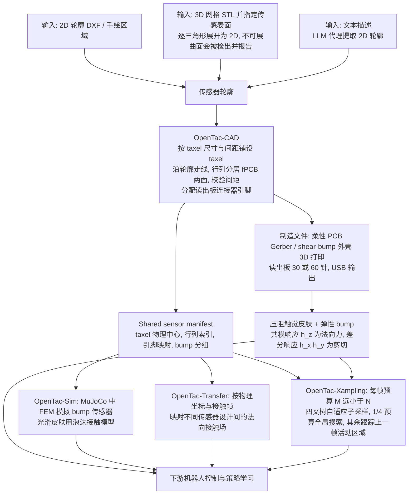

# OpenTac：可定制、可扩展、可迁移的三维触觉感知开放生态

**OpenTac**（*OpenTac: An Open Ecosystem for Customizable, Scalable, and Transferable 3D Tactile Sensing*，[arXiv:2610.31661](https://arxiv.org/abs/2610.31661)）收录于 senlanke「具身运控lab」10-19–10-23 前沿论文动态（Manipulation）。本页依据**周报条目 + arXiv 摘要页**整理，流程图依据论文方法部分（见参考来源），未逐页核对实验数字；指标与结论以论文为准。

## 一句话定义

**OpenTac：可定制、可扩展、可迁移的三维触觉感知开放生态——OpenTac 构建开放的三维触觉感知生态，重点支持传感器定制、规模化部署与跨设备迁移，并提供开源软硬件和演示资源。**

## 英文缩写速查

| 缩写 | 英文全称 | 简要说明 |
|------|----------|----------|
| VLA | Vision-Language-Action | 视觉–语言–动作模型 |
| IL | Imitation Learning | 模仿学习 |

## 为什么重要

- 周报所述待解决的问题：触觉传感器的硬件结构、输出格式和标定方法存在差异，增加了触觉操作策略的数据采集和跨平台迁移难度。

## 流程总览

图依据：论文 §3.1–3.5 / Fig.1 / Fig.3 / Fig.5

## 核心机制

| 项 | 内容 |
|----|------|
| **arXiv** | [2610.31661](https://arxiv.org/abs/2610.31661) · [PDF](https://arxiv.org/pdf/2610.31661) |
| **作者（arXiv）** | Ariel Slepyan, Geeta Chandra Raju Bethala, Jiafeng Gu, Anagha Rajendra Dangle, Yinzhe Zhou, Hongyuan Fu, Jade Sim, Tuhin Basu, Xinyi Yin, Md Faizal Karim, Gregory Hager, Homanga Bharadhwaj, Anand Bhattad, Krishna Murthy Jatavallabhula, Nitish V. Thakor |
| **机构（周报所述，未逐条核实）** | 待核实（作者：Ariel Slepyan、Gregory Hager、Homanga Bharadhwaj、Nitish V. Thakor 等）。 |
| **arXiv 评论栏** | 14 pages, 14 figures. Project website, open-source hardware and software, and demonstration videos: this https URL |
| **开源** | arXiv 摘要页/评论给出项目页或外链（https://opentac.github.io）；未发现代码仓库链接（2026-10-26） |
| **周报所述创新点** | OpenTac 构建开放的三维触觉感知生态，重点支持传感器定制、规模化部署与跨设备迁移，并提供开源软硬件和演示资源。 |

### arXiv 摘要节选（英文原文）

> We present OpenTac, a novel sensor and a full-stack ecosystem for tactile skins that are highly customizable, scalable, and readily deployed in downstream robot control and learning applications. Our core contribution is twofold.

## 源码运行时序图

**不适用**：arXiv 摘要页/评论给出项目页或外链（https://opentac.github.io）；未发现代码仓库链接，无可对齐的官方代码流程。

## 实验与评测

- 周报与摘要给出的数字/场景已写入上表「创新点」与摘要节选；其余实验细节、基线与成功率定义请回到论文正文。
- 读法：先对齐任务设定、传感器与成功定义（仿真/真机），再解读 headline 数字，勿跨论文直接比较。

## 与其他工作对比

| 维度 | 读法 |
|------|------|
| **同周对照** | 见 [Manipulation周报技术地图](../overview/senlanke-weekly-2026-10-19-23-manipulation-technology-map.md)，按方向浏览同期论文 |
| **开源状态** | arXiv 摘要页/评论给出项目页或外链（https://opentac.github.io）；未发现代码仓库链接 |

## 结论

**OpenTac：可定制、可扩展、可迁移的三维触觉感知开放生态。**

1. 本页是入库级摘要，复现前请核对论文正文、附录与代码仓库。
2. 指标须连同实验条件解读。
3. 关注 arXiv 版本更新与代码发布。

## 关联页面

- [senlanke-weekly-2026-10-19-23-manipulation-technology-map](../overview/senlanke-weekly-2026-10-19-23-manipulation-technology-map.md)
- [manipulation](../tasks/manipulation.md)
- [vla](../methods/vla.md)

## 参考来源

- [opentac-open-3d-tactile-sensing-ecosystem_arxiv_2610_31661.md](../../sources/papers/opentac-open-3d-tactile-sensing-ecosystem_arxiv_2610_31661.md)
- [wechat_senlanke_weekly_manipulation_2026-10-19_23.md](../../sources/blogs/wechat_senlanke_weekly_manipulation_2026-10-19_23.md)
- [arXiv:2610.31661](https://arxiv.org/abs/2610.31661)
- [arXiv PDF](https://arxiv.org/pdf/2610.31661)：已通读方法部分：摘要、§1 引言、§3 方法（3.1 传感器原理、3.2 OpenTac-CAD、3.3 Sim、3.4 Transfer、3.5 Xampling）；实验与附录未读

## 推荐继续阅读

- [arXiv PDF](https://arxiv.org/pdf/2610.31661)
