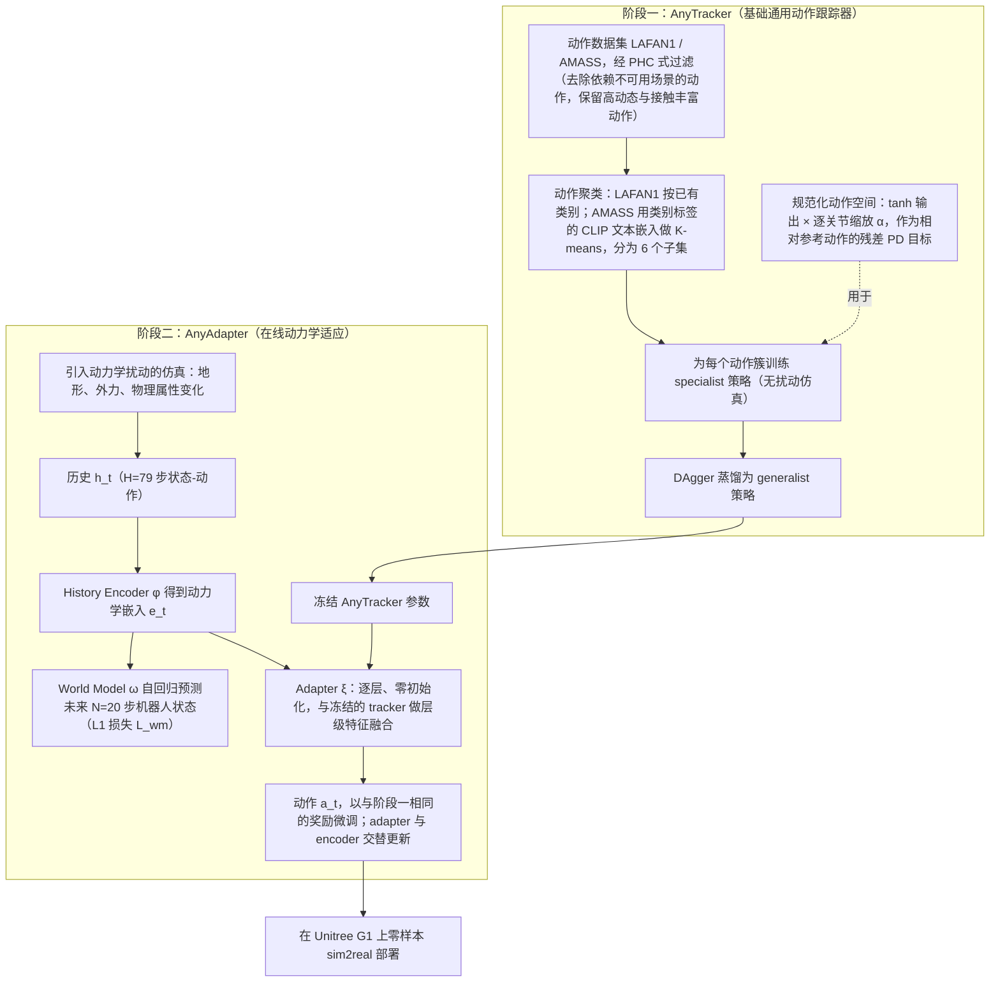
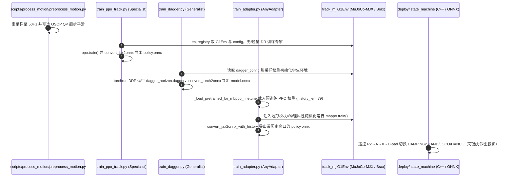

---

type: entity
tags: [paper, humanoid, rl, motion-control, body-system-stack, bfm, behavior-foundation-model, shanghai-pil, pku, tsinghua, galbot]
status: complete
updated: 2026-11-22
arxiv: "2509.13833"
venue: "2025 · arXiv"
code: https://github.com/GalaxyGeneralRobotics/OpenTrack
summary: "OpenTrack（Track Any Motions under Any Disturbances）：跟踪 + 抗扰一体；在 RL 身体系统栈属参考跟踪层，在 BFM 谱系属 Goal-conditioned 学习。"
related:
  - ../overview/humanoid-rl-motion-control-body-system-stack.md
  - ../overview/humanoid-amp-motion-prior-survey.md
  - ../overview/bfm-41-papers-technology-map.md
  - ../overview/bfm-category-02-goal-conditioned-learning.md
  - ../concepts/behavior-foundation-model.md
  - ../methods/any2track.md
sources:
  - ../../sources/papers/humanoid_rl_stack_13_track_any_motions_under_any_disturbances.md
  - ../../sources/papers/humanoid_rl_stack_42_catalog.md
  - ../../sources/papers/bfm_awesome_opentrack_arxiv_2509_13833.md
  - ../../sources/papers/bfm_awesome_41_catalog.md
  - ../../sources/blogs/wechat_embodied_ai_lab_humanoid_rl_motion_survey.md
  - ../../sources/blogs/wechat_embodied_ai_lab_bfm_41_papers_survey.md
  - ../../sources/repos/opentrack.md
original:
  - ../../sources/papers/bfm_awesome_opentrack_arxiv_2509_13833.md
  - ../../sources/repos/opentrack.md
---

# Track Any Motions under Any Disturbances

**Track Any Motions under Any Disturbances**（OpenTrack / Any2Track，arXiv:2509.13833）要求人形 motion tracker 在复杂地形、外力与模型误差等真实扰动下仍能跟踪任意动作。

> **方法深读：** [any2track](../methods/any2track.md) — 覆盖本文（Any2Track）与同族 RGMT 的技术页；论文实体以本页为 canonical，保留 survey 坐标与交叉引用。

## 一句话定义

Any2Track 的目标是 **track any motions under any disturbances**。它认为基础型 humanoid motion tracker 不应该只会在干净环境里跟动作，还要能在真实扰动下工作，包括复杂地形、外力、模型误差等。

## 英文缩写速查

| 缩写 | 英文全称 | 简要说明 |
|------|----------|----------|
| RL | Reinforcement Learning | 通过与环境交互最大化长期回报来学习策略的范式 |
| BFM | Behavior Foundation Model | 大规模行为数据预训练的可复用全身行为先验 |
| AMP | Adversarial Motion Prior | 用对抗判别约束状态转移接近专家运动分布的先验 |

## 为什么重要

- 在 [人形 RL 身体系统栈](../overview/humanoid-rl-motion-control-body-system-stack.md) 中属于 **02 参考跟踪 · 通用控制**（#13/42）。
- Any2Track 的目标是 **track any motions under any disturbances**。它认为基础型 humanoid motion tracker 不应该只会在干净环境里跟动作，还要能在真实扰动下工作，包括复杂地形、外力、模型误差等。
- 论文提出两阶段 RL 框架，把 dynamics adaptability 作为额外能力注入 motion tracking。它不是单纯追求更低 tracking error，而是让策略在不同真实条件下保持动作执行。
- 现在的 tracking 是：参考动作给定，但 **地面、外力、动力学、接触都可能变化**，我要在不摔的前提下尽量完成动作意图。

## 流程总览

图依据：论文 §III-A（AnyTracker）/ §III-B（AnyAdapter）与 Fig. 2。

## 核心信息

| 字段 | 内容 |
|------|------|
| 论文 | <https://arxiv.org/abs/2509.13833> |
| 项目页 | <https://zzk273.github.io/Any2Track/> |
| 代码 | <https://github.com/GalaxyGeneralRobotics/OpenTrack> |
| 机构 | 清华大学；北京大学；Galbot；上海期智研究院 |

### 在 42 篇 RL 运动控制身体系统栈中

| 字段 | 内容 |
|------|------|
| 编号 | 13/42 |
| 系统栈层 | 02 参考跟踪 · 通用控制 |
| 索引来源 | [具身智能研究室 · 42 篇 humanoid RL 运动控制长文](https://mp.weixin.qq.com/s/hz9JXtJeUPRfUGzfD-pZuA) |

### 在 BFM 41 篇技术地图中

| 字段 | 内容 |
|------|------|
| 编号 | 08/41 |
| 分组 | 02 Goal-conditioned 学习 |
| 索引来源 | [awesome-bfm-papers](https://github.com/friedrichyuan/awesome-bfm-papers) |

## 核心原理

Any2Track 把通用的**基础动作跟踪（AnyTracker）**与**在线动力学适应（AnyAdapter）**解耦为两阶段训练，防止直接加域随机化时策略退化为保守动作：

1. **阶段一 · AnyTracker（无扰动基础跟踪器）：** 在无动力学随机化的 MuJoCo 仿真中基于 **LAFAN1 + AMASS**（保留高动态与接触丰富动作，仅按 PHC 滤除依赖缺失环境交互的动作）训练通才跟踪器。核心包含两项设计：**（a）规范化动作空间（CAS）**，输出相对下一帧参考姿态 $\tilde{q}_{t+1}$ 的残差 PD 目标 $q_d = \tilde{q}_{t+1} + \alpha\tanh(\pi(a_t|s_t))$；**（b）分簇 Specialist-to-Generalist 蒸馏**，LAFAN1 按原类别、AMASS 按 HumanML3D 动词标签经 CLIP 文本嵌入做 K-Means（6 簇）训练专家策略，再用 **DAgger** 蒸馏为单一通才策略。
2. **阶段二 · AnyAdapter（历史感知动力学适应）：** 冻结 AnyTracker 参数，在仿真中注入 **地形起伏（Perlin 噪声）、外力推拉、物理属性改变（躯干质量/质心、关节摩擦/电枢惯量）** 三类扰动（论文 Table III）。由历史编码器 $\phi$ 从 $H=79$ 步状态–动作历史 $h_t$ 提取动力学嵌入 $e_t$，通过**自回归世界模型 $\omega$ 预测未来 $N=20$ 步状态**（$L_1$ 损失 $L_{wm}$）作为代理监督，再用**零初始化逐层适配器 $\xi$** 将 $e_t$ 融合进冻结骨干并交替微调。

## 源码运行时序图

入口：三阶段训练依次为 `python -m track_mj.learning.train.train_ppo_track`（专家 PPO）、`python -m track_mj.learning.train.train_dagger`（DAgger 通才蒸馏）、`python -m track_mj.learning.train.train_adapter`（AnyAdapter + 世界模型微调）；真机部署走 `deploy/` 下 C++ `unitree_sdk2` 状态机。

图依据：`GalaxyGeneralRobotics/OpenTrack@cb9b751` 的 `README.md`、`track_mj/learning/train/{train_ppo_track,train_dagger,train_adapter}.py` 与 `deploy/README_deployment.md`；仅通读源码，未在本地运行训练或真机。

## 结论

**Any2Track 把 motion tracking 的成功标准从「跟得准」改成「在扰动下仍跟得住」：dynamics adaptability 被当作与跟踪并列的能力显式注入，而不是靠鲁棒性调参兜底。**

- 关键机制是 **两阶段解耦架构**：AnyTracker 先在无扰动环境用规范化动作空间 + 分簇 DAgger 学足高动态动作，AnyAdapter 再冻结主干并用 79 步历史 + 20 步世界模型预测微调零初始化适配器。
- 仿真验证增益来源明确：Table IV 显示 AMASS+LAFAN1 SR 达 **89.23%**（高于 Exbody2 79.68%、OmniH2O 75.64%）；Table V 显示在线扰动下（地形 83.2%、外力 59.0%、物理变化 80.6%）全面领先 PPO/RMA/DWL/Dual History，且去掉 World Model 外力下 SR 骤降至 49.8%。
- Unitree G1 真机验证（Table VI，5 条轨迹均值）表明：复杂地形、外力绳索牵拉与 **5 kg** 负重下的 MPJPE 分别为 **18.34 / 19.17 / 23.24 mm**，较带域随机化的 PPO（37.21 / 39.84 / 37.52 mm）误差降低约 38%–52%。
- 适用边界是 **参考分布内与 G1 本体**：所谓「any motions」仍以给定参考动作分布为前提，且当前开源代码与部署框架聚焦 **29-DoF Unitree G1**；官方 OpenTrack 仓库已于 2026-05 补全 DAgger、AnyAdapter、40/40 LAFAN1 Generalist v2 权重及 C++ 部署入口。

## 实验与评测

- **仿真基准（Table IV，AMASS-test + LAFAN1 无扰动）：** AnyTracker SR **89.23%**、MPJPE **27.96 mm**、MPJVE **6.43 mm/frame**；优于 Exbody2（79.68% / 34.70 / 13.69）与 OmniH2O（75.64% / 36.12 / 12.24）。消融显示去 CAS 降至 84.92%，去蒸馏降至 83.32%。
- **在线扰动适应（Table V，LAFAN1）：** 无扰动 SR **89.8%**、地形 **83.2%**、外力 **59.0%**、物理属性变化 **80.6%**；全面超过 PPO+DR、RMA Stage 1/2、DWL、Dual History。消融去 Adapter 跌至 82.4%/57.6%（地形/外力），去 World Model 跌至 49.8%/70.4%（外力/物理变化）。
- **Unitree G1 真机（Table VI，5 轨迹均值）：** 无扰动 MPJPE **17.38 mm**（vs PPO 29.38 mm）、复杂地形 **18.34 mm**（vs 37.21 mm）、外力牵拉 **19.17 mm**（vs 39.84 mm）、5 kg 负重 **23.24 mm**（vs 37.52 mm）。

## 与其他工作对比

| 评测维度 / 对照对象 | Any2Track (OpenTrack) 表现 | 论文基线 / 同族方法对比 |
|------|------|------|
| **无扰动通用跟踪（Table IV，AMASS-test + LAFAN1）** | AnyTracker SR **89.23%**、MPJPE **27.96 mm**、MPJVE **6.43 mm/frame** | 显著优于复现的 **Exbody2**（`79.68%` / `34.70 mm` / `13.69 mm/frame`）与 **OmniH2O**（`75.64%` / `36.12 mm` / `12.24 mm/frame`） |
| **在线扰动适应（Table V，LAFAN1）** | 无扰动 **89.8%** / 地形 **83.2%** / 外力 **59.0%** / 物理变化 **80.6%** | 全面超过 **PPO+DR**（`87.4% / 73.0% / 50.0% / 73.6%`）、**RMA Stage 1/2**、**DWL** 与 **Dual History**；解耦两阶段避免直接加 DR 导致的保守退化 |
| **真机抗扰（Table VI，Unitree G1 5 轨迹）** | 无扰动 **17.38 mm** / 复杂地形 **18.34 mm** / 外力牵拉 **19.17 mm** / 5 kg 负重 **23.24 mm** | 较带域随机化的 **PPO+DR** 基线（`29.38 / 37.21 / 39.84 / 37.52 mm`）误差降低约 38%–52% |
| **方法架构定位（与 RGMT / [Extreme-RGMT](./paper-extreme-rgmt.md) 对照）** | 冻结 AnyTracker 主干 + $H=79$ 步历史编码器与 $N=20$ 步世界模型预测辅助，微调零初始化逐层 AnyAdapter | 同族 [any2track](../methods/any2track.md) 页将本文与 RGMT 归为自适应与时序建模两条补充路径；Extreme-RGMT 侧重 PACE/STAR 高动态持续学习，Any2Track 主打动力学扰动下的鲁棒跟踪且已开源全链代码与权重 |

## 工程实践

1. **环境与数据准备：** 使用 `uv sync -i https://pypi.org/simple` 安装依赖，配置 `.env` 后执行 `python track_mj/app/mj_playground_init.py` 初始化 MuJoCo Playground 资产；自定义 `.npz` 动作需用 `scripts/process_motion/preprocess_motion.py` 对齐至 50 Hz（可加 `--smooth_start_end True` 启用 OSQP 步态过渡）。
2. **训练与蒸馏路径：** 先跑 `train_ppo_track` 训练分簇专家，再通过 `train_dagger`（多卡用 `torchrun --use_ddp`）蒸馏通才策略，最后用 `train_adapter` 加载基础权重微调 AnyAdapter；官方亦已在 Google Drive 发布可直接评测的 8 个专家及 Generalist v1/v2（40/40 LAFAN1）权重。
3. **真机安全部署：** `deploy/` 提供基于 `unitree_sdk2` + `onnxruntime` 的 C++ 状态机（支持用 `sim_interface/main.py` 在本地 MuJoCo 环回预演）。推荐编译 `build_w_torque_projection.sh`（力矩限幅重投影）以对齐训练期力矩约束，防止 Sim2Real 过载。
4. **开源核查（2026-11-21）：** `GalaxyGeneralRobotics/OpenTrack@cb9b751` 已完整开源专家训练、DAgger 蒸馏、AnyAdapter 微调与 C++ 真机部署代码；预训练权重存放于外部 Google Drive。

## 局限与风险

1. **参考分布与场景交互边界：** Motion tracking 的泛化仍以参考动作分布为前提（依赖可行性过滤剔除楼梯等环境交互动作），换未见数据源或强环境接触任务仍可能失稳。
2. **历史窗延迟与观测噪声敏感：** AnyAdapter 依赖 `H=79` 步（50 Hz 下约 1.58 秒）历史状态–动作窗口推断动力学嵌入，极端高频冲击或 IMU/关节传感器严重漂移时可能滞后。
3. **本体与外部资产耦合：** 训练环境与 C++ 部署状态机均绑定 **29-DoF Unitree G1** 与 `unitree_sdk2` 接口；官方权重依赖外部 Google Drive 分发，换本体需重新 retarget 与训练。

## 关联页面

- 方法页：[any2track.md](../methods/any2track.md)
- RL 身体系统栈：[humanoid-rl-motion-control-body-system-stack.md](../overview/humanoid-rl-motion-control-body-system-stack.md)
- BFM 技术地图：[bfm-41-papers-technology-map.md](../overview/bfm-41-papers-technology-map.md)
- AMP 姊妹篇：[humanoid-amp-motion-prior-survey.md](../overview/humanoid-amp-motion-prior-survey.md)
- 同公司大尺度扩展：[Humanoid-GPT](./paper-humanoid-gpt.md)

## 参考来源

- [Track Any Motions under Any Disturbances 论文原文归档（arXiv:2509.13833）](../../sources/papers/bfm_awesome_opentrack_arxiv_2509_13833.md)
- [OpenTrack / Any2Track 源码归档](../../sources/repos/opentrack.md)（<https://github.com/GalaxyGeneralRobotics/OpenTrack>，commit `cb9b751`）
- [humanoid_rl_stack_13_track_any_motions_under_any_disturbances.md](../../sources/papers/humanoid_rl_stack_13_track_any_motions_under_any_disturbances.md) — 42 篇栈策展摘录
- [humanoid_rl_stack_42_catalog.md](../../sources/papers/humanoid_rl_stack_42_catalog.md) — 42 篇总表
- [bfm_awesome_41_catalog.md](../../sources/papers/bfm_awesome_41_catalog.md) — 41+10 总表
- [wechat_embodied_ai_lab_humanoid_rl_motion_survey.md](../../sources/blogs/wechat_embodied_ai_lab_humanoid_rl_motion_survey.md) — RL 运动控制微信公众号编译导读
- [wechat_embodied_ai_lab_bfm_41_papers_survey.md](../../sources/blogs/wechat_embodied_ai_lab_bfm_41_papers_survey.md) — BFM 41 篇微信公众号编译导读
- 原始抓取：[wechat_humanoid_rl_42_survey_2026-05-26.md](../../sources/raw/wechat_humanoid_rl_42_survey_2026-05-26.md)
- 论文：<https://arxiv.org/abs/2509.13833>

## 推荐继续阅读

- [42 篇 RL 运动控制（微信公众号）](https://mp.weixin.qq.com/s/hz9JXtJeUPRfUGzfD-pZuA)
- [awesome-bfm-papers](https://github.com/friedrichyuan/awesome-bfm-papers) — 完整列表与数据集表
- [A Survey of Behavior Foundation Model](https://arxiv.org/abs/2506.20487) — TPAMI 2025 综述
- [19 篇 AMP 运动先验姊妹篇](https://mp.weixin.qq.com/s/YZsm3855iP3TNTTt1aou7w)
