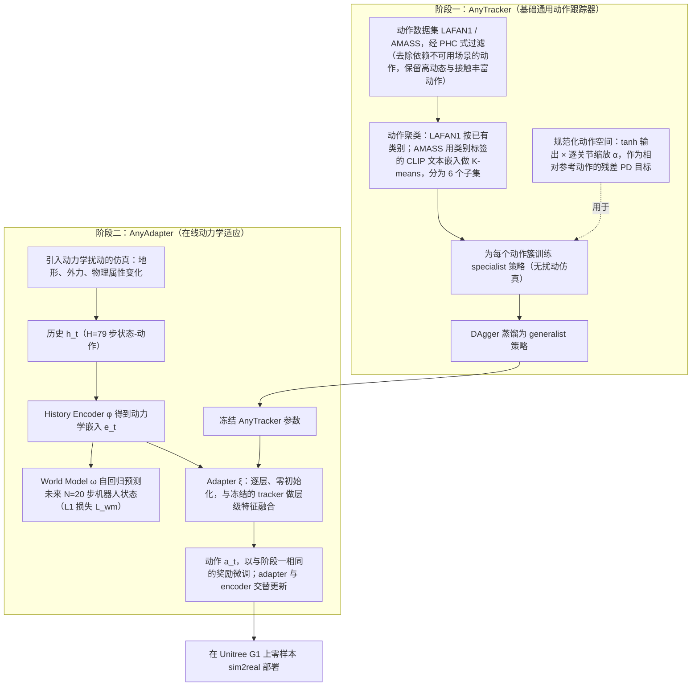

---

type: entity
tags: [paper, humanoid, rl, motion-control, body-system-stack, bfm, behavior-foundation-model, shanghai-pil, pku, tsinghua]
status: complete
updated: 2026-10-06
arxiv: "2509.13833"
venue: "2025 · arXiv"
code: https://github.com/GalaxyGeneralRobotics/OpenTrack
summary: "OpenTrack（Track Any Motions under Any Disturbances）：跟踪 + 抗扰一体；在 RL 身体系统栈属参考跟踪层，在 BFM 谱系属 Goal-conditioned 学习。"
related:
  - ../overview/humanoid-rl-motion-control-body-system-stack.md
  - ../overview/humanoid-amp-motion-prior-survey.md
  - ../overview/bfm-41-papers-technology-map.md
  - ../overview/bfm-category-02-goal-conditioned-learning.md
  - ../concepts/behavior-foundation-model.md
  - ../methods/any2track.md
sources:
  - ../../sources/papers/humanoid_rl_stack_13_track_any_motions_under_any_disturbances.md
  - ../../sources/papers/humanoid_rl_stack_42_catalog.md
  - ../../sources/papers/bfm_awesome_opentrack_arxiv_2509_13833.md
  - ../../sources/papers/bfm_awesome_41_catalog.md
  - ../../sources/blogs/wechat_embodied_ai_lab_humanoid_rl_motion_survey.md
  - ../../sources/blogs/wechat_embodied_ai_lab_bfm_41_papers_survey.md
  - ../../sources/repos/opentrack.md
---

# Track Any Motions under Any Disturbances

**Track Any Motions under Any Disturbances**（OpenTrack / Any2Track，arXiv:2509.13833）要求人形 motion tracker 在复杂地形、外力与模型误差等真实扰动下仍能跟踪任意动作。

> **方法深读：** [any2track](../methods/any2track.md) — 覆盖本文（Any2Track）与同族 RGMT 的技术页；论文实体以本页为 canonical，保留 survey 坐标与交叉引用。

## 一句话定义

Any2Track 的目标是 **track any motions under any disturbances**。它认为基础型 humanoid motion tracker 不应该只会在干净环境里跟动作，还要能在真实扰动下工作，包括复杂地形、外力、模型误差等。

## 英文缩写速查

| 缩写 | 英文全称 | 简要说明 |
|------|----------|----------|
| RL | Reinforcement Learning | 通过与环境交互最大化长期回报来学习策略的范式 |
| BFM | Behavior Foundation Model | 大规模行为数据预训练的可复用全身行为先验 |
| AMP | Adversarial Motion Prior | 用对抗判别约束状态转移接近专家运动分布的先验 |

## 为什么重要

- 在 [人形 RL 身体系统栈](../overview/humanoid-rl-motion-control-body-system-stack.md) 中属于 **02 参考跟踪 · 通用控制**（#13/42）。
- Any2Track 的目标是 **track any motions under any disturbances**。它认为基础型 humanoid motion tracker 不应该只会在干净环境里跟动作，还要能在真实扰动下工作，包括复杂地形、外力、模型误差等。
- 论文提出两阶段 RL 框架，把 dynamics adaptability 作为额外能力注入 motion tracking。它不是单纯追求更低 tracking error，而是让策略在不同真实条件下保持动作执行。
- 现在的 tracking 是：参考动作给定，但 **地面、外力、动力学、接触都可能变化**，我要在不摔的前提下尽量完成动作意图。

## 流程总览

图依据：论文 §III-A（AnyTracker）/ §III-B（AnyAdapter）与 Fig. 2。

## 核心信息

| 字段 | 内容 |
|------|------|
| 论文 | <https://arxiv.org/abs/2509.13833> |
| 项目页 | <https://zzk273.github.io/Any2Track/> |
| 代码 | <https://github.com/GalaxyGeneralRobotics/OpenTrack> |
| 机构 | 清华大学；北京大学；Galbot；上海期智研究院 |

### 在 42 篇 RL 运动控制身体系统栈中

| 字段 | 内容 |
|------|------|
| 编号 | 13/42 |
| 系统栈层 | 02 参考跟踪 · 通用控制 |
| 索引来源 | [具身智能研究室 · 42 篇 humanoid RL 运动控制长文](https://mp.weixin.qq.com/s/hz9JXtJeUPRfUGzfD-pZuA) |

### 在 BFM 41 篇技术地图中

| 字段 | 内容 |
|------|------|
| 编号 | 08/41 |
| 分组 | 02 Goal-conditioned 学习 |
| 索引来源 | [awesome-bfm-papers](https://github.com/friedrichyuan/awesome-bfm-papers) |

## 核心机制（归纳）

### 1）策展导读要点

Any2Track 的目标是 **track any motions under any disturbances**。它认为基础型 humanoid motion tracker 不应该只会在干净环境里跟动作，还要能在真实扰动下工作，包括复杂地形、外力、模型误差等。

### 2）策展导读要点

论文提出两阶段 RL 框架，把 dynamics adaptability 作为额外能力注入 motion tracking。它不是单纯追求更低 tracking error，而是让策略在不同真实条件下保持动作执行。

### 3）策展导读要点

现在的 tracking 是：参考动作给定，但 **地面、外力、动力学、接触都可能变化**，我要在不摔的前提下尽量完成动作意图。

### 4）策展导读要点

我的判断**motion tracking 要真正通用，就必须同时学会“跟动作”和“适应动力学扰动”。**

## 结论

**Any2Track 把 motion tracking 的成功标准从「跟得准」改成「在扰动下仍跟得住」：dynamics adaptability 被当作与跟踪并列的能力显式注入，而不是靠鲁棒性调参兜底。**

- 关键机制是 **两阶段 RL 框架**，把动力学适应作为额外能力注入 tracker；优化目标不是更低的 tracking error，而是在地面、外力、动力学、接触都可能变化时不摔且完成动作意图。
- 这直接改变 **评价口径**：只看跟踪误差会低估甚至误判这类方法，应看跨扰动条件下的动作完成度。
- 适用边界是 **参考分布内**：所谓「any motions」仍以给定参考动作分布为前提，换数据源或接触条件仍可能崩塌。
- 栈内定位清晰：42 篇 RL 运动控制栈中属 **02 参考跟踪 · 通用控制**（#13/42），BFM 41 篇地图中属 **02 Goal-conditioned 学习**（08/41）——它是跟踪 / 目标条件层的底座，不是上层任务或语义层。
- 工程侧有官方开源实现（OpenTrack 仓库），机构为清华 / 北大 / Galbot / 上海期智；量化 benchmark 与实机指标以原文与项目页为准。

## 常见误区

1. Motion tracking 论文的泛化常指 **参考分布内**；换数据源或接触条件仍可能崩塌。

## 实验与评测

- 本页在公众号/survey **策展编译**基础上补充机制归纳；**量化 benchmark、消融与实机指标以原文 PDF / 项目页为准**（链接见 [参考来源](#参考来源)）。
- 与同栈姊妹篇对照时，请回到对应 **技术地图 / 42 篇栈 / BFM 地图 / VLN 地图** 总览中的实验段落。

## 与其他页面的关系

- 方法页：[any2track.md](../methods/any2track.md)
- RL 身体系统栈：[humanoid-rl-motion-control-body-system-stack.md](../overview/humanoid-rl-motion-control-body-system-stack.md)
- BFM 技术地图：[bfm-41-papers-technology-map.md](../overview/bfm-41-papers-technology-map.md)
- AMP 姊妹篇：[humanoid-amp-motion-prior-survey.md](../overview/humanoid-amp-motion-prior-survey.md)

## 参考来源

- [OpenTrack / Any2Track 源码归档](../../sources/repos/opentrack.md)（<https://github.com/GalaxyGeneralRobotics/OpenTrack>）

- [humanoid_rl_stack_13_track_any_motions_under_any_disturbances.md](../../sources/papers/humanoid_rl_stack_13_track_any_motions_under_any_disturbances.md) — 42 篇栈策展摘录
- [humanoid_rl_stack_42_catalog.md](../../sources/papers/humanoid_rl_stack_42_catalog.md) — 42 篇总表
- [bfm_awesome_opentrack_arxiv_2509_13833.md](../../sources/papers/bfm_awesome_opentrack_arxiv_2509_13833.md) — awesome-bfm 策展摘录
- [bfm_awesome_41_catalog.md](../../sources/papers/bfm_awesome_41_catalog.md) — 41+10 总表
- [wechat_embodied_ai_lab_humanoid_rl_motion_survey.md](../../sources/blogs/wechat_embodied_ai_lab_humanoid_rl_motion_survey.md) — RL 运动控制微信公众号编译导读
- [wechat_embodied_ai_lab_bfm_41_papers_survey.md](../../sources/blogs/wechat_embodied_ai_lab_bfm_41_papers_survey.md) — BFM 41 篇微信公众号编译导读
- 原始抓取：[wechat_humanoid_rl_42_survey_2026-05-26.md](../../sources/raw/wechat_humanoid_rl_42_survey_2026-05-26.md)
- 论文：<https://arxiv.org/abs/2509.13833>
- [arXiv PDF](https://arxiv.org/pdf/2509.13833)：已通读方法部分（§III）；实验（§IV）与附录以略读为准：仅读实验设定。

## 推荐继续阅读

- [42 篇 RL 运动控制（微信公众号）](https://mp.weixin.qq.com/s/hz9JXtJeUPRfUGzfD-pZuA)
- [awesome-bfm-papers](https://github.com/friedrichyuan/awesome-bfm-papers) — 完整列表与数据集表
- [A Survey of Behavior Foundation Model](https://arxiv.org/abs/2506.20487) — TPAMI 2025 综述
- [19 篇 AMP 运动先验姊妹篇](https://mp.weixin.qq.com/s/YZsm3855iP3TNTTt1aou7w)
