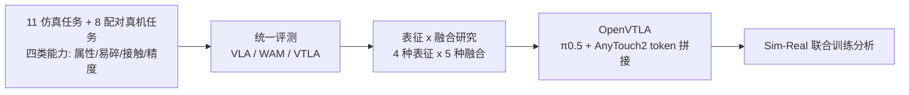

---

type: entity
project_id: openvitac
tags: [paper, manipulation, tactile, visuo-tactile, vla, benchmark, sim2real, fudan, nus, neoteai, hfut, china-unicom]
status: complete
updated: 2026-10-12
arxiv: "2610.10384"
project: https://fvl-repo.github.io/OpenViTac/
related:
  - ../overview/frontier-manipulation-2026-10-05-10-09.md
  - ../tasks/manipulation.md
  - ../concepts/tactile-sensing.md
  - ../concepts/visuo-tactile-fusion.md
  - ../concepts/sim2real.md
  - ../methods/vla.md
  - ./paper-anytouch2.md
  - ./paper-pi05-open-world-vla.md
  - ./paper-sa-2505-09577-vtla-vision-tactile-language-action-model-with-p.md
sources:
  - ../../sources/papers/openvitac_arxiv_2610_10384.md
  - ../../sources/sites/openvitac-project.md
  - ../../sources/blogs/frontier_manipulation_2026_10_05_10_09.md
summary: "OpenViTac 建立 11 仿真 + 8 配对真机任务的视觉触觉统一基准，系统比较 4 种触觉表征与 5 种融合方式，并给出 π0.5+AnyTouch2 的 OpenVTLA（仿真 68.7%、真机 54.6%）。"
---

# OpenViTac

**OpenViTac**（arXiv:2610.10384，复旦大学等）是一个让视觉触觉（VT）策略在**同一套仿真与真机任务**上可比的基准与框架：按四类依赖触觉的能力组织任务，横向评测 VLA / WAM / VTLA，并据此提出 **OpenVTLA**——在 π0.5 前面简单拼接 AnyTouch2 触觉 token。

## 英文缩写速查

| 缩写 | 英文全称 | 简要说明 |
|------|----------|----------|
| VTLA | Vision-Tactile-Language-Action | 在 VLA 上加入触觉输入的策略 |
| VLA | Vision-Language-Action | 视觉-语言-动作模型 |
| WAM | World Action Model | 联合预测未来与动作的世界-动作模型 |
| MMRV | Mean Maximum Rank Violation | 衡量仿真排序与真机排序一致性的指标（越低越好） |
| FiLM | Feature-wise Linear Modulation | 触觉融合策略之一：特征级调制 |

## 为什么重要

- **触觉评测此前各自为政：** 传感器、仿真器、机器人接口不同，结果难以对照；OpenViTac 在 Isaac Sim 5.1 / Isaac Lab 2.3 + TacEx 与真机上放同一批任务，其中 8 个任务仿真/真机一一配对。
- **仿真排名可预测真机排名：** 七种方法在八个共享任务上 Pearson r = 0.967、MMRV = 0.006（论文正文；项目页写 0.913）。
- **给出“简单就够”的设计结论：** 同一 π0.5 骨干下，token 级拼接优于调制、专家、精修、动作级条件。

## 流程总览

## 核心原理（方法）

### 1）基准设计
- **四个能力维度：** 属性感知（重量/硬度/粗糙度分类、粗糙度引导重抓、空罐选择）；易碎感知（抓薯片）；接触丰富（齿轮装配、拉抽屉）；精度（插 USB、插块 v1/v2）。共 11 个仿真任务、8 个配对真机任务。
- **硬件覆盖：** GelSight、Xense、NeoteAI 三类传感器，Franka Hand 与 Robotiq 两种夹爪（机械臂型号原文未指明）。
- **数据：** 仿真每种传感器配置 1,300 条回合（约 918K 帧）；真机 2,400 条示范（约 2.1M 帧）；每任务一个策略，常用 100 条回合（In-B v2 为 300）。

### 2）OpenVTLA
以 π0.5 为骨干，用 AnyTouch2 编码触觉历史为紧凑 token，投影到 VLM 隐层维度后前置于视觉 token；**不加任何新融合模块或触觉专家**。flow-matching 行为克隆，20k 步，全局 batch 64。

### 3）被评策略与对照
VLA：π0.5、StarVLA-Qwen3、InternVLA-A1.5、XVLA、Lingbot-VLA-2、Xiaomi-Robotics；WAM：FastWAM、Lingbot-VA、StarVLA-Cosmos；VTLA：FTP-1 与 OpenVTLA。表征：SigLIP、T3、Sparsh、AnyTouch2；融合：拼接、FiLM 调制、动作级条件、触觉驱动专家、触觉引导精修。

## 源码运行时序图

不适用：论文与项目页均未列出代码仓库，截至 2026-10-12 没有可对齐的目录和脚本。可确认的只有训练口径（20k 步、batch 64、每任务一策略），见上节。

## 工程实践

- 复现需自搭 Isaac Sim 5.1.0 + Isaac Lab 2.3.0 + TacEx 触觉仿真，并自备三类触觉传感器；真机数据集（2,400 条示范/配置）未公开。
- 触觉历史要保留：用当前帧重复替代历史，平均成功率 68.7% -> 58.4%。
- AnyTouch2 需用预训练权重：随机初始化降到 56.5%。
- 训练预算差异：多数 VLA/VTLA 20k 步 batch 64，InternVLA-A1.5 为 40k 步，XVLA 30k 步，WAM batch 8，Lingbot-VA 5k 步。
- **开源状态：** 项目页 fvl-repo.github.io/OpenViTac 只有概述、基准、OpenVTLA、结果与引用，无 GitHub/HF/数据链接，亦无发布承诺；视为未开源。

## 实验与评测

| 仿真平均 | % | 真机平均 | % |
|------|------|------|------|
| OpenVTLA | 68.7 | OpenVTLA | 54.6 |
| FTP-1 | 61.2 | FTP-1 | 51.9 |
| InternVLA-A1.5 | 51.5 | InternVLA-A1.5 | 43.1 |
| π0.5 | 48.6 | π0.5 | 41.0 |
| Xiaomi-Robotics | 40.0 | FastWAM | 29.0 |
| FastWAM | 37.4 | | |
| Lingbot-VA | 29.4 | | |

- 共享任务上 OpenVTLA 比 π0.5 高 13.6 点（仿真）与 13.5 点（真机）。
- 表征（同拼接接口）：AnyTouch2 68.7、Sparsh 64.7、SigLIP 59.5、T3 58.1。融合（四组平均）：拼接 68.7、专家 61.2（T3）、调制 56.5（Sparsh）、精修 50.4、动作级 48.6。
- Sim-Real 联合训练（100 条真机示范 + 0/250/500 条仿真，每设置 20 次）：In-USB π0.5 15/25/40%、OpenVTLA 20/30/40%；齿轮装配 π0.5 35/45/50%、OpenVTLA 50/50/60%；500 条仿真示范平均增益约 20 点（π0.5）与 15 点（OpenVTLA）；光照扰动下 OpenVTLA 为 30%（In-USB）/60%（GA）。
- 原文不一致：引言称最强 WAM 基线仿真 53.3%、真机 48.5%，表 2/3 中最佳 WAM 为 37.4% / 29.0%，引用 WAM 对比需回查。

## 结论

**OpenViTac 的价值是让触觉策略在仿真和真机上第一次可对表比较；OpenVTLA 证明在强 VLA 上直接前置预训练触觉 token 是当前最有效、最简单的融合方式。**

1. **选 AnyTouch2 类预训练触觉编码器：** 比 SigLIP / T3 高约 9-11 点（68.7 对 59.5 / 58.1）。
2. **融合越浅越好（此设定下）：** 拼接 68.7 > 专家 61.2 > 调制 56.5 > 精修 50.4 > 动作级 48.6。
3. **保留触觉历史：** 去掉历史掉 10 点以上。
4. **仿真可作真机排序的预筛：** r=0.967，但绝对数不可互换，真机仍低 14 点左右（68.7 vs 54.6）。
5. **联合训练有效但对强模型增益较小：** 500 条仿真示范使弱基线多涨约 5 点。
6. **谨慎引用：** 任务级统计为 20 次试验，且数据/代码未公开。

## 与其他工作对比

| 对照 | 差异读法 |
|------|----------|
| [AnyTouch2](./paper-anytouch2.md) | 本文把其作为最佳触觉表征嵌入 π0.5 |
| [VTLA（PolyTouch 等）](./paper-sa-2505-09577-vtla-vision-tactile-language-action-model-with-p.md) | 同属 VTLA 路线，OpenViTac 提供统一比较环境而非单模型 |
| [π0.5](./paper-pi05-open-world-vla.md) | OpenVTLA 的基座，也是无触觉对照（48.6 / 41.0） |
| [视觉触觉融合](../concepts/visuo-tactile-fusion.md) | 本文给出的融合方式排序可作该概念页的实证补充 |

## 局限与风险

- 论文自述：触觉渲染、传感器建模与标定导致仍有 Sim-Real 差距；未覆盖可变形物体、长程家务、灵巧手。
- 每任务单策略、每设置 20 次试验，统计功效有限；摘要/项目页/正文数字有差异。
- 无公开代码与数据，不能按“基准”直接使用。

## 关联页面

- [Manipulation 周报汇总（10.5-10.9）](../overview/frontier-manipulation-2026-10-05-10-09.md)
- [触觉感知概念](../concepts/tactile-sensing.md)
- [视觉触觉融合](../concepts/visuo-tactile-fusion.md)
- [VLA 方法页](../methods/vla.md)
- [具身大模型评测基准选型闭环](../queries/embodied-eval-benchmark-selection-loop.md) — 本页属③策略任务成功率层并兼顾④：仿真与配对真机任务同协议评测视触觉表征与融合方式

## 参考来源

- [OpenViTac 论文归档](../../sources/papers/openvitac_arxiv_2610_10384.md)
- [OpenViTac 项目页归档](../../sources/sites/openvitac-project.md)
- [Manipulation 周报来源](../../sources/blogs/frontier_manipulation_2026_10_05_10_09.md)
- 论文：<https://arxiv.org/abs/2610.10384>

## 推荐继续阅读

- [OpenViTac 项目页](https://fvl-repo.github.io/OpenViTac/)
- [arXiv HTML 全文](https://arxiv.org/html/2610.10384v1)
