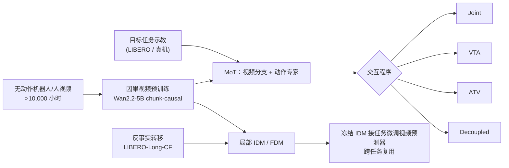
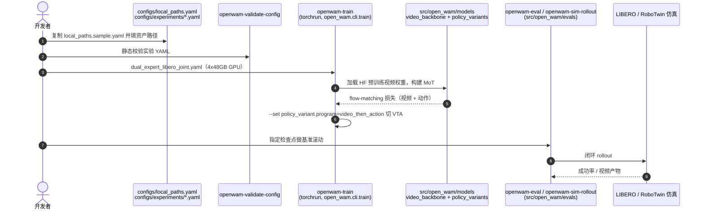

# OpenWAM（Stanford）：可组合世界–动作模型框架

## 一句话定义

**OpenWAM（Stanford 版）** 在同一个因果机器人视频底座（Wan2.2-5B 经 >10,000 小时机器人/人–物交互视频继续预训练）上，通过 Mixture-of-Transformers 接入动作专家，把「视频与动作如何交互」做成可切换的四种程序，并把正/逆动力学拆成可独立训练复用的局部模型，用来在受控条件下比较 WAM 设计。

> 同名提醒：NUS/清华等团队另有 [OpenWAM（arXiv:2609.07398，系统化 WAM 预训练）](./paper-openwam.md)，是不同论文、不同仓库（`OpenWAM-Official/OpenWAM`），本页指 Stanford 的 2610.07922。

## 英文缩写速查

| 缩写 | 英文全称 | 简要说明 |
|------|----------|----------|
| WAM | World-Action Model | 同时做未来视频预测与动作生成的模型 |
| MoT | Mixture-of-Transformers | 视频/动作各自保留归一化、投影、FFN，共享一次注意力 |
| VTA | Video-then-Action | 先生成视频再以完整视频轨迹条件生成动作 |
| ATV | Action-then-Video | 先生成动作再据此生成视频 |
| IDM | Inverse Dynamics Model | 由前后观测推断动作 p(A⁺\|O⁺,O⁰,q) |
| FDM | Forward Dynamics Model | 由动作预测未来观测 p(O⁺\|A⁺,O⁰,q) |
| CF | Counterfactual | 从示教状态出发执行替代动作得到的转移数据（LIBERO-Long-CF） |

## 为什么重要

- **受控比较：** 现有 WAM 常同时换骨干、动作网络、交互方式与推理流程，收益归因不清；本文固定底座，只换交互程序，LIBERO 上四种程序的差距（96.8–98.6）一目了然。
- **组件可复用：** 局部上下文的 IDM / FDM 不依赖语言与历史，可在任务间迁移；这是「世界模型与动作模型解绑」的具体做法。
- **示教之外的动力学学习：** 反事实转移让动力学模型见到失败/偏离轨迹，而不仅是成功示教。
- **开放：** 代码与预训练视频权重已公开，便于在同一底座上复现实验并替换交互程序。

## 核心信息

| 项 | 内容 |
|----|------|
| **机构** | 斯坦福大学（Stanford University）；作者含李飞飞、Jiajun Wu、Ehsan Adeli |
| **底座** | Wan2.2-5B → 因果机器人视频预训练（>10,000 小时，无动作标注） |
| **动作表示** | 末端位置 + 轴角旋转 + 夹爪；每 4 帧潜变量 chunk 对应 16 步动作块 |
| **真机** | 2×Franka Research 3 双臂，两个腕部相机 + 一个第三人称 RGB |
| **开源** | 代码（AGPL-3.0-only）与预训练视频权重已发布；策略/IDM 检查点与 LIBERO-Long-CF 数据待发布（截至 2026-10-12） |

## 核心原理

### 方法栈

| 模块 | 设计 | 作用 |
|------|------|------|
| 因果视频底座 | Wan2.2-5B + chunk-causal 注意力：未来 chunk 看当前与已有 chunk，不看后续；chunk 内联合去噪 | 提供可复用的机器人视频先验 |
| 视频语料 | UMI/MV-UMI、AgiBot World、RoboMIND、InternData-A1、RoboCOIN、FastUMI、Ego-Exo4D、Open X-Embodiment | 无动作标注的大规模预训练 |
| 动作专家 | 独立动作 Transformer，与视频分支经 MoT 连接；文本走独立 cross-attention，本体感觉按 chunk 条件输入 | 动作生成不污染视频参数 |
| 交互程序 A–D | Joint（双向注意力同时去噪）、VTA、ATV、Decoupled（无未来跨模态注意力） | 同底座比较交互方式 |
| 局部动力学程序 E/F | IDM：p(A⁺\|O⁺,O⁰,q_t)；FDM：p(O⁺\|A⁺,O⁰,q_t)，均无语言/历史 | 跨任务复用 |
| 损失 | 潜空间 flow matching（噪声–目标线性插值，MSE 回归速度，τ~U[0,1]），双目标相加 | 统一训练目标 |

顺序程序（VTA/ATV）训练时用真实轨迹 teacher forcing，推理时用第一遍生成的轨迹。

### 流程总览

## 方法

1. **因果适配是关键前置。** 对 LIBERO-Long 的 VTA，直接用原始 Wan2.2-5B 初始化得 68.4%，换成机器人视频因果预训练骨干后达 97.8%；论文明确这是「机器人视频预训练 + 因果适配」的合并效应，两者未单独拆开。
2. **交互程序可切换而不改骨干。** 四个程序共享参数结构，只改注意力掩码与条件顺序；仓库用 `policy_variant.program` 之类的配置项切换（如 `video_then_action`）。
3. **局部动力学。** 仅用「起始观测 + 本体状态 + 动作/未来观测」的局部上下文训练 IDM/FDM，去掉语言与历史，让它们不绑定任务。
4. **反事实数据。** 在 LIBERO-Long 示教状态上恢复仿真器状态，执行替代动作续接，得到 LIBERO-Long-CF（项目页称 32,000 个片段、十个任务）；同一初始状态的分支落在同一数据划分，避免泄漏；仿真器状态只用于采集，不输入模型；混合训练 η=0.6（60% 反事实）。
5. 训练算力（GPU/步数/批大小）位于论文附录 B.3，本次未读到，原文未核实。

## 实验与评测

- **LIBERO 四套件（Table 3，3 seeds）：** OpenWAM-VTA 均值 **98.6**（Object 99.4 / Goal 98.4 / Spatial 98.6 / Long 97.8）；Decoupled 98.0；Joint 97.6；ATV 96.8。对照（引用已发表数字）：LingBot-VA 98.5、Motus 97.7、Fast-WAM 97.6、OpenVLA-OFT 97.1、π0.5 96.9、π0 94.1、GR00T-N1 93.9。VTA 与 LingBot-VA 仅差 0.1，属同一量级。
- **因果适配消融：** LIBERO-Long VTA 68.4% → 97.8%。
- **真机双臂（Table 4）：** Toast Bread / 2×2 魔方还原末层 / Sort Cups，VTA 92.0/90.0/94.4（均值 92.1），Joint 90.0/94.0/91.7（均值 91.9）；ATV 与 Decoupled 未报告真机。
- **冻结 IDM 迁移到四个 LIBERO-90 任务（64/74/21/45）：** 局部 IDM 仅演示监督均值 21.5%，纯反事实 84.5%，混合 84.0%；完整上下文 IDM 为 44.5%（演示）/47.0%（混合）；任务微调 VTA 参考 93.0%，未适配的原始 VTA 10.5%。
- **源任务组合（LIBERO-Long）：** 完整 IDM 演示 97.8；局部 IDM 演示 25.8 / 纯反事实 90.6 / 混合 94.4。
- **FDM（2,560 个反事实未来）：** RGB MSE 14.35×10⁻³（演示）→ 9.40×10⁻³（纯反事实，−34.5%）/9.62×10⁻³（混合）；K=16 身份识别 21.1% → 71.3% / 67.7%。

## 源码运行时序图

官方仓库 [OpenWAM/OpenWAM](https://github.com/OpenWAM/OpenWAM)（归档见 [sources/repos/openwam_stanford.md](../../sources/repos/openwam_stanford.md)）提供 `openwam-*` 命令行入口，下图对齐 `src/open_wam/cli/`、`configs/experiments/` 与 `docs/running_experiments.md`：

最短路径是先跑无 GPU 的 `openwam-sanity`（合成数据，仅验证安装与合约，不复现论文结果），再按 `docs/running_experiments.md` 配路径后训练；策略检查点尚未发布，复现论文数字需自行训练。

## 工程实践

| 项 | 建议 |
|----|------|
| 复现入口 | `uv sync --frozen --group dev --extra train --extra eval`；参考配置 `dual_expert_libero_joint.yaml` |
| 选程序 | 追求 LIBERO 成功率先试 VTA；需要低延迟再比较 Decoupled（论文 98.0）；ATV 最低（96.8） |
| 复用动力学 | 局部 IDM/FDM + 反事实数据；配套数据集尚未公开，需用 `scripts/build_libero_fdm_counterfactual_demo_dataset.py` 自建（仓库脚本） |
| 许可 | 仓库为 AGPL-3.0-only，商用/闭源集成前须评估 |
| 开源核查（2026-10-12） | 项目页与仓库已核对：代码已开源、预训练视频权重已发布；策略/IDM 检查点、LIBERO-Long-CF 数据未发布 |

## 结论

**OpenWAM 的价值主要在「同底座可控比较」和「局部动力学可复用」，而非单点 SOTA：LIBERO 上各程序只差 1–2 个点，因果机器人视频适配（+29.4）才是最大的单项收益。**

1. **先做因果机器人视频适配** — 该步合并效应在 LIBERO-Long 上带来 68.4%→97.8%，远大于程序选择的差距。
2. **VTA 是 LIBERO 上默认选项** — 98.6 对 Joint 97.6、Decoupled 98.0、ATV 96.8，但差距小，应结合延迟与结构需求选择。
3. **局部 IDM 需要反事实数据** — 仅演示监督时迁移到新任务仅 21.5%，混入反事实后 84.0–84.5%。
4. **FDM 同理** — 反事实监督使局部 RGB MSE 降 34.5%，多分支身份识别（K=16）从 21.1% 到 71.3%。
5. **真机证据有限** — 仅 VTA / Joint 两个程序、3 个双臂任务，不足以推断四程序的真机排序。
6. **复现门槛** — 算力细节原文未核实，策略与 IDM 检查点、反事实数据待发布，当前主要可复用的是代码与视频预训练权重。

## 与其他工作对比

| 对照 | 差异读法 |
|------|----------|
| [OpenWAM（NUS 等，2609.07398）](./paper-openwam.md) | 同名不同论文：该工作做系统化 WAM 预训练研究并发布 46 个检查点；本文侧重共享因果底座上的交互程序与局部动力学组合 |
| [Fast-WAM](./paper-fast-wam.md) | Fast-WAM 在推理期跳过未来视频去噪换延迟（LIBERO 97.6）；OpenWAM 在底座层比较 Joint/VTA/ATV/解耦 |
| [Motus](./paper-sa-2512-13030-motus-a-unified-latent-action-world-model.md) | 统一潜在动作世界模型（表中 LIBERO 97.7）；OpenWAM 强调模块可替换 |
| [π0.5](./paper-pi05-open-world-vla.md) / [π0](./paper-pi0.md) | VLA 基线，LIBERO 96.9 / 94.1，不显式预测未来视频 |

## 局限与风险

- **论文自述：** 可组合性主要在仿真验证；目标任务实验适配了视频预测器，完整视频–动作模型零样本迁移未证明；单一多目标检查点未证明追平最强专用变体；FDM 仅局部短时程。
- **开源状态：** 代码与视频权重已公开；策略/IDM 检查点、LIBERO-Long-CF 数据与真机示教数据截至 2026-10-12 未见下载入口。
- **证据边界：** 因果预训练与因果适配的贡献未分离；真机仅三个任务。
- **Alpha 阶段软件 + AGPL：** 接口可能变动，许可有传染性。

## 关联页面

- [Manipulation 周报汇总（2026-10-05~10-09）](../overview/frontier-manipulation-2026-10-05-10-09.md)
- [World Action Models 概念](../concepts/world-action-models.md)
- [生成式世界模型](../methods/generative-world-models.md)
- [OpenWAM（NUS 等同名工作）](./paper-openwam.md)
- [Fast-WAM](./paper-fast-wam.md)
- [LIBERO 基准](./libero-benchmark.md)
- [操作任务](../tasks/manipulation.md)

## 参考来源

- [openwam_composable_arxiv_2610_07922.md](../../sources/papers/openwam_composable_arxiv_2610_07922.md) — 论文摘录
- [openwam-stanford.md](../../sources/sites/openwam-stanford.md) — 项目页与开源核查
- [openwam_stanford.md](../../sources/repos/openwam_stanford.md) — 仓库归档
- [Manipulation 周报来源](../../sources/blogs/frontier_manipulation_2026_10_05_10_09.md) — 线索来源（技术事实以论文为准）
- [arXiv:2610.07922](https://arxiv.org/abs/2610.07922)

## 推荐继续阅读

- [OpenWAM 项目页](https://openwam.stanford.edu)
- [OpenWAM GitHub](https://github.com/OpenWAM/OpenWAM)
- [OpenWAM 文档 Quickstart](https://openwam.github.io/OpenWAM/quickstart/)
- [预训练视频权重（Hugging Face）](https://huggingface.co/OpenWAM-Stanford/OpenWAM-Pretraining)
