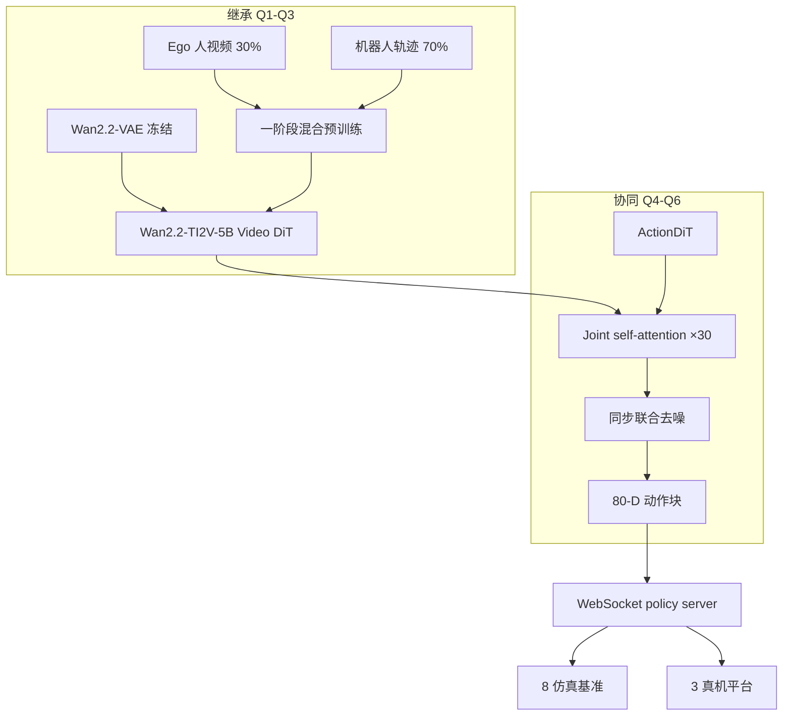
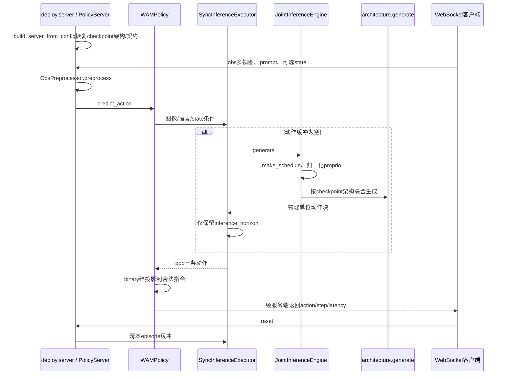

# OpenWAM：系统化世界–动作预训练的开源模块化栈

**OpenWAM**（*An Open, Modular Exploration Towards Systematic World–Action Model Pretraining*，[arXiv:2609.07398](https://arxiv.org/abs/2609.07398)）由 **新加坡国立大学（NUS）**、**清华大学（Tsinghua）**、**北京大学（PKU）**、**香港大学（HKU）**、**浙江大学（ZJU）**、**香港中文大学（CUHK）** 与 **上海交通大学（SJTU）** 等联合提出：把紧耦合的 WAM 实现拆成 **可组合实验程序**，经对照研究沉淀预训练原则，并发布 **OpenWAM-α** 预训练模型与完整工程栈。[项目页](https://openwam-official.github.io/) · [代码](https://github.com/OpenWAM-Official/OpenWAM) · [HF 权重](https://huggingface.co/OpenWAM) · [Foundation](https://huggingface.co/OpenWAM/OpenWAM-Alpha-Pretrain-Foundation-Model)

## 一句话定义

**WAM 预训练不该是黑箱单体——OpenWAM 用模块化 Infra 做六项对照实验，把「继承什么、如何协同、如何跨域缩放」写成可复现原则，再落到开源预训练模型与评测协议。**

## 英文缩写速查

| 缩写 | 英文全称 | 简要说明 |
|------|----------|----------|
| WAM | World–Action Model | 联合未来观测与动作的策略族 |
| DiT | Diffusion Transformer | 视频与动作去噪骨干 |
| VAE | Variational Autoencoder | Wan2.2 冻结视觉编码 |
| OOD | Out-of-Distribution | 具身预训练主要增益域 |
| HF | Hugging Face | 46 个公开检查点托管 |
| IDM | Inverse Dynamics Model | 仓库支持的 dual_system 变体 |

## 为什么重要

- **把设计空间从「论文附录」拉回「可实验变量」**：骨干、表征、架构、掩码、数据配方、去噪策略均可插拔，避免每项工作重搭单体栈。
- **给出可操作的预训练读法**：强生成骨干 + 紧凑潜空间、专用动作通路 + mutual 信息流 + 同步联合去噪、一阶段 ego+robot 共训——不是口号，而是 Q1–Q6 累积默认。
- **仿真到真机的一致头部**：8 个仿真基准与 3 个真机平台（含预训练未见的灵巧手 OOD）覆盖广泛且部分基准居前，但Plus与部分OOD仍有明显差距；RoboDojo 双臂 **37.6 / 24.4% SR** 相对次佳 π₀.₅ **22.9 / 12.8%** 拉开差距。
- **开源完整度罕见**：训练、WebSocket 部署、多基准客户端、Foundation 与 Study 检查点一并发布，并接入 [XPolicyLab](https://github.com/XPolicyLab/XPolicyLab)。

## 核心信息

| 项 | 内容 |
|----|------|
| **机构** | 新加坡国立大学（NUS）；清华大学（Tsinghua）；北京大学（PKU）；香港大学（HKU）；浙江大学（ZJU）；香港中文大学（CUHK）；上海交通大学（SJTU） |
| **三层栈** | **Infra**（模块 + 统一 train/deploy/eval）→ **Study**（Q1–Q6 对照）→ **OpenWAM-α**（规模化预训练） |
| **OpenWAM-α 骨干** | 冻结 Wan2.2-VAE + umT5；**Wan2.2-TI2V-5B** 视频 DiT + **ActionDiT**；30 层 joint self-attention；**mutual mask** |
| **预训练数据** | **518.5M 帧（≈6,369 h）**；机器人 **70%**（真机 **40%** + 仿真 **30%**）+ egocentric 人视频 **30%**；**80-D 统一动作空间** |
| **开源** | **已开源**：[OpenWAM-Official/OpenWAM](https://github.com/OpenWAM-Official/OpenWAM)；HF [`OpenWAM`](https://huggingface.co/OpenWAM)（**46** 检查点）；Foundation [`OpenWAM-Alpha-Pretrain-Foundation-Model`](https://huggingface.co/OpenWAM/OpenWAM-Alpha-Pretrain-Foundation-Model) |

## 核心原理

### OpenWAM-Study 三问与累积默认

| 阶段 | 问题 | _carry-forward 默认_ |
|------|------|----------------------|
| **继承** | 该继承什么世界知识？ | 足够强的视频生成骨干（**Wan2.2-TI2V-5B**）+ **紧凑潜空间**；表征编码器经压缩也可竞争重建式编码器 |
| **协同** | 世界与动作如何互相增益？ | **专用 ActionDiT**、**显式 world→action 可见性**、**同步联合去噪**（非级联两段推理） |
| **缩放** | 协同如何跨域扩展？ | 具身预训练主要扩 **OOD**；**一阶段 ego+robot 共训**；大规模上 **mutual visibility** 一致更优 |

### OpenWAM-α 架构要点

- **视频流**：Wan2.2-TI2V-5B 在潜空间对未来帧窗口去噪；3D RoPE 覆盖 (frame, H, W)。
- **动作流**：独立 ActionDiT（width 1024），1D RoPE 覆盖 chunk 索引；每步一个噪声动作 token。
- **耦合**：30 对层 **joint self-attention**，双残差宽度投影到共享 24-head 注意力空间。
- **可见性**：**mutual mask**——两流互读；干净首帧行 **不 attend** 噪声未来帧与动作。
- **推理**：训练覆盖联合噪声平面；推理走 **synchronized diagonal**（同步对角去噪）。

### 流程总览

## 源码运行时序图

对应[固定版本1dcaeea7](../../sources/repos/openwam.md)同步服务请求路径；静态核读，未加载GPU。README入口为`bash scripts/deploy.sh <ckpt_dir>`。

服务端一次响应是一条动作；同步缓冲补充会阻塞。框架另有async执行器，与视频/动作异步去噪是独立维度；论文所有成绩采用同步执行与同步去噪。

## 工程实践

| 项 | 建议 |
|----|------|
| 配置入口 | Hydra：`configs/model/dual_system.yaml` + `wan22_ti2v_5b` + `attention_mask_mode=mutual` |
| 资源 | 推荐 **8×80GB** 训练 Wan2.2-5B 级骨干；部署默认 `compile`，首帧编译较慢 |
| 检查点 | HF **46** 模型分 Foundation / Study / 下游微调；Foundation 见 [`OpenWAM-Alpha-Pretrain-Foundation-Model`](https://huggingface.co/OpenWAM/OpenWAM-Alpha-Pretrain-Foundation-Model)；`download_openwam_checkpoints.py` 自带完整 config |
| 评测契约 | 各 `benchmarks/<name>/` 经 WebSocket 连 policy server；RoboDojo 真机走 XPolicyLab |
| 对照阅读 | 与 [GlanceWAM](./paper-glancewam.md)（异步想象）、[Flex-π](./paper-flex-pi.md)（多流算力柔性）、[DiT4DiT](./paper-dit4dit-video-action-model.md)（双 DiT 联合）并读 |

## 实验与评测

以v1图13与表6–8/13–20为准，修正旧版摘录的坐标错位。

| 设定 | OpenWAM-α结果及口径 |
|------|---------------------|
| LIBERO / Plus | 99.3% / 69.2% SR；Plus明显低于π0.5 84.4与所引Qwen89.0 |
| RoboTwin2.0-Full | 93.60% SR；训练含clean与random |
| RoboTwin Clean2Random | clean89.4 / random48.7，均值69.0；只clean微调 |
| EBench | 49.4% SR / 64.7分 |
| RoboCasa365 / GR1 | 38.2% / 60.5% SR，两个不同基准 |
| RoboDojo仿真 / 真机 | 仿真11.92% SR/17.18分；真机24.4% SR/37.6分 |
| 单臂真机 | 6任务各100演示微调、各20测试，99/120=82.5% |
| 灵巧手 | 未见本体经微调再测ID/OOD，完成得分与最终SR分开 |

从零与预训练比较，OOD14.50→26.62是600小时消融配方，不能当作完整6369小时模型结果。不同视频骨干同时改变架构与预训练数据，曲线不是单独参数规模因果实验。

## 结论

OpenWAM提供可控制WAM设计变量的开放基座，Alpha在多项操作基准表现强，但Plus和部分OOD差距限制了普遍泛化结论。

1. 比较先固定Infra配置与数据配方，再改架构/表征，避免把多变量变动归因到单个模块。
2. 动作读取世界特征很关键；从零one-way与mutual接近，预训练后mutual略优，不能无条件泛化。
3. 压缩DINO/V-JEPA也具竞争力，像素重建不是唯一选择；视觉扰动是Alpha明确短板。
4. 使用Foundation先下游微调；新的灵巧手本体结果不是零样本迁移。
5. 170ms是5090动作块推理，论文同步执行；异步部署收益另需相同协议实测。
6. 当前四源机器人数据发布与完整五源论文预训练配方分开记录；RBA吞吐也须标注checkpointing差异。

## 与其他工作对比

| 对照 | 差异读法 |
|------|----------|
| [GlanceWAM](./paper-glancewam.md) | 单 DiT 内异步稀疏前瞻，优化 **控制环延迟**；OpenWAM 强调 **预训练设计空间与全栈开源** |
| [Flex-π](./paper-flex-pi.md) | 多流 Joint WAM + 推理时流掩码算力柔性；OpenWAM 默认 dual_system + 同步对角去噪 |
| [MotionWAM](./paper-motionwam-humanoid-loco-manipulation-wam.md) | 人形 loco-manip 实时 WAM；OpenWAM 聚焦 **操作多基准 + 统一 80-D 动作空间** |
| [WB-WAM](./paper-wb-wam.md) | 清华系 **72-D 身–手 video 预训练 + HumanoidArena**；真机五任务 WB-WAM **84.0%** vs OpenWAM **80.0%**（作者对照，非同训练栈） |
| π₀ / π₀.₅ / Fast-WAM / Being-H0.7 | 项目页同轴对比；OpenWAM-α在Full等ID任务强，Plus和RoboDojo仿真OOD仍弱于部分VLA |
| [Awesome-WAM 综述](../concepts/world-action-models.md) | 文献 taxonomy；OpenWAM 补 **工程化预训练对照与开源基座** |

## 局限与风险

- **完整预训练成本：** 附录128 H200约7天；8×80GB是README小规模训练建议，不能混为原始预训练成本。
- **数据及指标：** Plus相机/噪声扰动退化；跨论文模型配方不同，不能由排行榜断言WAM普遍优于VLA。Score与SR不能互换。

- **算力门槛**：Wan2.2-5B 级训练推荐 8×80GB；小团队应走 Foundation 微调而非全量预训练。
- **统一动作空间抽象成本**：80-D 槽位语义跨本体对齐需要读数据配方与 dataloader 契约，误配会静默掉点。
- **部分基准仍外部化**：RoboDojo 真机评测依赖 XPolicyLab；SimplerEnv / Calvin 标注 Planned。
- **Wan / Cosmos 许可与资产体积**：视频骨干与基准数据下载体积大，需按 `download_assets` 脚本分步准备。

## 关联页面

- [World Action Models](../concepts/world-action-models.md) — Joint WAM 文献坐标
- [Generative World Models](../methods/generative-world-models.md) — 视频 DiT 骨干与联合去噪
- [VLA](../methods/vla.md) — π 系与 WAM 基线对照轴
- [GlanceWAM](./paper-glancewam.md) — 异步想象另一条部署优化线
- [DiT4DiT](./paper-dit4dit-video-action-model.md) — 双 DiT 联合 VAM 先驱
- [开源可复现 9 篇地图](../overview/open-source-reproducibility-9-papers-technology-map.md) — 开源 WAM 选型语境

## 参考来源

- [openwam_arxiv_2609_07398](../../sources/papers/openwam_arxiv_2609_07398.md)
- [openwam 仓库](../../sources/repos/openwam.md)
- [OpenWAM 项目页](../../sources/sites/openwam-official.md)

## 推荐继续阅读

- [arXiv:2609.07398](https://arxiv.org/abs/2609.07398) · [HF 论文页](https://huggingface.co/papers/2609.07398)
- [项目页](https://openwam-official.github.io/)
- [GitHub 组织 / 主仓](https://github.com/OpenWAM-Official)
- [Hugging Face 模型与数据](https://huggingface.co/OpenWAM)
- [OpenWAM-α Foundation 权重](https://huggingface.co/OpenWAM/OpenWAM-Alpha-Pretrain-Foundation-Model)
