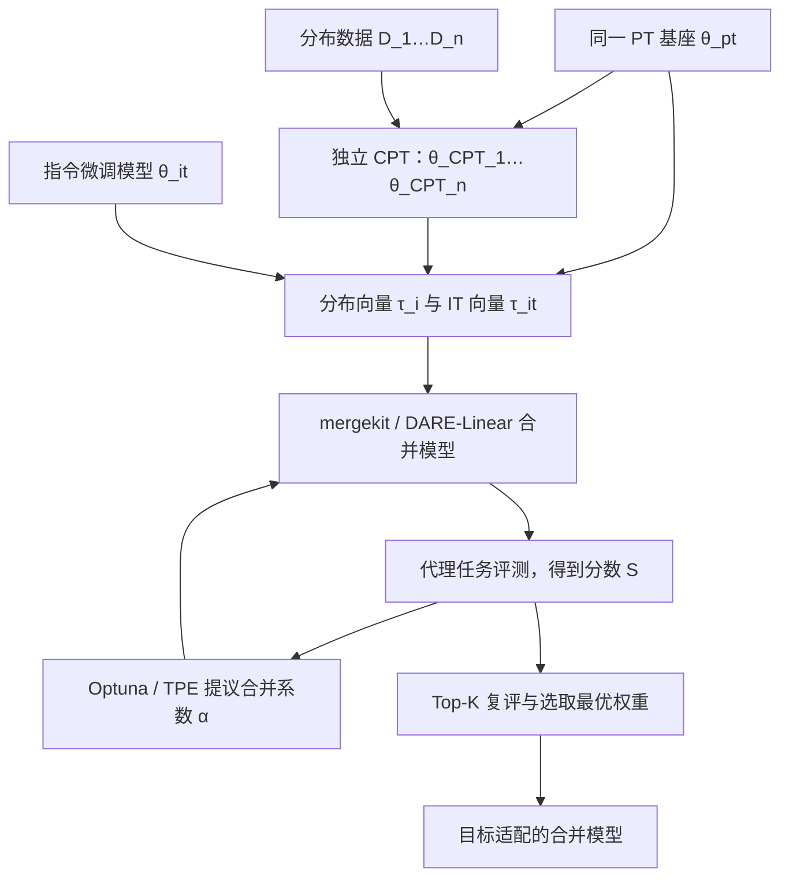
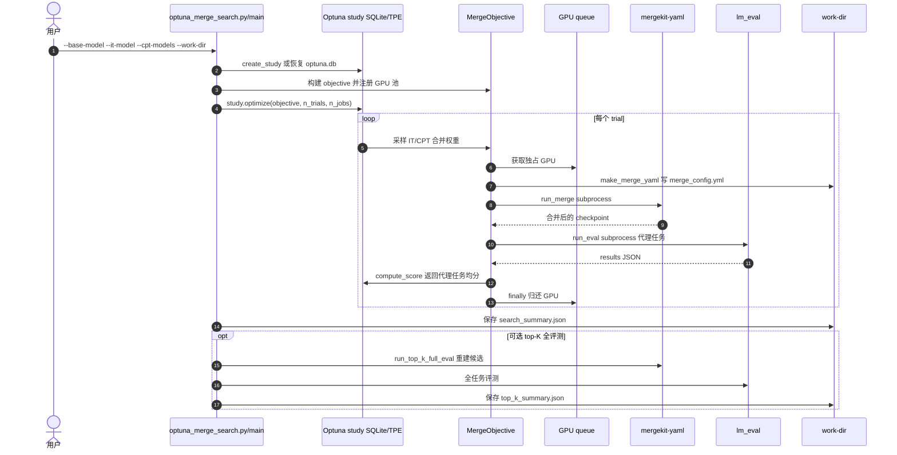

# OptiMer：最优分布向量合并优于持续预训练数据混合 / Optimal Distribution Vector Merging Is Better than Data Mixing for Continual Pre-Training

## 一句话定义

**OptiMer** 将大语言模型多领域持续预训练中「先猜数据混合比例再训练」改为「各数据源独立持续预训练一次，抽取参数差分向量，之后按评测目标优化合并权重」，以便重复利用 checkpoint、降低**配比搜索**成本。

## 英文缩写速查

| 缩写 | 英文全称 | 简要说明 |
|------|----------|----------|
| OptiMer | Optimal Distribution Vector Merging | 本文的最优分布向量合并框架 |
| CPT | Continual Pre-Training | 从同一预训练基座继续对特定数据源训练 |
| PT | Pre-Training | 提供所有参数差分的共同基准模型 |
| IT | Instruction-Tuned | 指令微调模型；其向量负责保留指令跟随能力 |
| TPE | Tree-structured Parzen Estimator | 为合并权重做贝叶斯黑盒搜索的采样器 |
| DARE | Drop And REscale | mergekit 使用的向量合并家族（论文默认 DARE-Linear） |

## 为什么重要

- **把不可逆训练前决策变为训练后选择：** 数据混合比例不理想时，传统 DataMix 需重新 CPT；OptiMer 在一组单分布模型上直接搜索权重。
- **同一向量池可服务多个目标：** 论文针对语言、数学、代码等目标分别重新优化，无须重新训练每个分布的 checkpoint。
- **与具身模型的知识联系：** [CapVector](./paper-capvector-capability-vectors-vla.md) 也研究参数空间能力差分，但 OptiMer 的**实验证据仅针对文本 LLM**，不能把论文成绩直接当作 VLA 预训练或机器人策略成功率的增益。

## 核心信息

| 字段 | 原始论文证据 |
|------|------|
| 作者 | Haiyue Song、Huy Hien Vu、Masao Utiyama |
| 机构 | 日本国立信息通信研究机构（National Institute of Information and Communications Technology，NICT） |
| 发表 | EMNLP 2026 Main，Oral，Outstanding Paper Award；[正式论文](https://aclanthology.org/2026.emnlp-main.1090/) |
| 模型 | Gemma 3 27B PT/IT；迁移验证 Gemma-SEA-LION-v4-27B |
| 数据 | 日语、中文、数学、代码等数据分布；单分布约 10 亿 token |
| 核心实现 | [Optuna + mergekit + lm-evaluation-harness](https://github.com/nict-astrec-att/optimer) |
| 开源程度 | **部分开源**：合并/评测入口已公开；独立 CPT 训练代码、原论文全部 checkpoint 不在该仓库 |

## 核心原理

### 分布向量及合并目标

从相同基座 \(\theta_{\mathrm{pt}}\) 出发，在每份数据分布 \(D_i\) 上分别完成 CPT，得到 \(\theta_{\mathrm{CPT}_i}\)。分布向量表示此分布造成的参数偏移：

\[
\tau_i = \theta_{\mathrm{CPT}_i}-\theta_{\mathrm{pt}},\qquad
\tau_{\mathrm{it}}=\theta_{\mathrm{it}}-\theta_{\mathrm{pt}}.
\]

合并模型为：

\[
\theta_{\mathrm{merge}}(\alpha)
=\theta_{\mathrm{pt}}
+\alpha_{\mathrm{it}}\tau_{\mathrm{it}}
+\sum_{i=1}^{n}\alpha_i\tau_i.
\]

\(\alpha_i\) 不是必须总和为 1 的概率分配；它们首先是参数差分的合并强度。论文进一步测试了**把最优向量权重转换为数据混合比例**后重新训练的效果，但这与“合并权重本身是混合比例”不是完全同一操作。

### 后验黑盒搜索（论文 §3，Algorithm 1）

用验证任务分数 \(S(\theta_{\mathrm{merge}},D_{\mathrm{dev}})\) 定义优化目标。因为通过运行任务评测才能得到分数，难以直接对合并系数求梯度，论文采用 Optuna 的 **TPE**：先采样候选，再用高分/低分权重分布引导后续候选；最终对最高分 top-K 组合做更完整的评测。

默认采用 mergekit 的 **DARE-Linear**，不合并 embedding、输出 head 与 rotary 等参数对应的差分，减少对基础 token 表示的扰动。指令微调向量的系数要共同优化，不是只调 CPT 权重。

## 流程总览

*图中循环表示试验—评测—搜索更新。上述 Mermaid 使用标准流程图；正文核对以正式论文 §3 为准。*

## 源码运行时序图

官方仓库公开了可执行入口 [optuna_merge_search.py](https://github.com/nict-astrec-att/optimer/blob/main/optuna_merge_search.py)，实际代码不包含上方独立 CPT 阶段；**以下只画已发布的合并搜索与评测运行时序**：

运行链取自 README、`main()`、`MergeObjective.__call__()`、`run_merge()`、`run_eval()` 与 `run_top_k_full_eval()`（详见 [源码归档](../../sources/repos/optimer_nict_astrec_att.md)）。脚本默认 `--n-trials 50`、`--proxy-limit 300`，**与论文实验的 100 trials、proxy 100 条/任务并不相同**，复现应显式设置。以上是源码静态分析，未在本次 ingest 环境执行代码。

## 工程实践

1. 保证 base PT、IT、所有 CPT checkpoint 同架构且参数兼容；提前准备 checkpoint 与任务评测环境。
2. 从 README 的 2-way 合并命令入手，`--cpt-models` 传两份模型路径，`--proxy-tasks` 选择与优化目标一致的基准。
3. 对照论文 §4.2 的条件明确配置：100 trials、TPE、\(\alpha_{\mathrm{it}}\in[0.3,1.0]\)、\(\alpha_i\in[0,1]\)；论文采用 8 GPU、代理评测前 100 样本、top-3 前 300 样本。
4. 检查 `work-dir` 中 Optuna 数据库、merge/eval 日志、`search_summary.json` 与 `top_k_summary.json`；防止只用小样本代理分数作最终质量结论。
5. 脚本调用代码生成类基准时启用 `--confirm_run_unsafe_code`；应在可信且隔离的评测环境中运行。对真实机器人策略应用需重新设计评测目标和安全门禁，论文**没有**提供上机验证。

## 实验与评测

论文的主实验在 Gemma 3 27B 上比较不同数据组合，以下均为**作者报告**，非本次复现：

| 数据组合 | 等比例 DataMix 平均分 | OptiMer 平均分 | 差异 |
|------|------:|------:|------:|
| 日语 + 数学 | 67.86 | 69.98 | +2.12 |
| 日语 + 代码 | 67.23 | 69.68 | +2.45 |
| 日语 + 中文 + 数学 | 63.71 | 70.37 | +6.66 |

- 论文 Figure 2：2/3/4 个数据源下，搜索耗时 DataMix 为 128.9/194.0/258.6h，OptiMer 为 8.5/5.6/10.1h；**排除了双方相同的初始 CPT 训练成本**。因此 15–35× 是配比搜索阶段而非训练总成本。
- 重新将 OptiMer 权重转成数据配比进行 DataMix 训练（Ja+Zh+Math）平均分 **63.71→68.66**，仍低于直接合并的 70.37。
- 分布向量与 IT 向量余弦约 **0.03**，不同 CPT 向量约 **0.29–0.31**；论文将较低干扰视为可合并的解释，不是一般性的数学保证。
- 在 SEA-LION 迁移实验中，日本榜单 **66.34→74.40**、综合平均 **54.37→70.19**（表 3，依其评测设置）。

## 结论

**OptiMer 证明了在论文所测的 27B 语言模型设置中，后验搜索模型差分向量权重是优于预先固定均匀数据配比的有效替代方案，但尚不能外推到机器人 VLA。**

1. **先把数据分布做成可复用资产：** 独立 CPT checkpoint 能为不同目标重新搜索，不需每个目标重跑 CPT。
2. **搜索指标应对应目标能力：** 论文使用代理任务得分，而非仅用验证 loss，且 top-K 要重评估。
3. **不要混淆“搜索省时”与“训练总成本”：** 15–35× 仅限搜索阶段，基础训练与显存存储仍需计算。
4. **保留 IT 差分并调其权重：** 论文 IT 与 CPT 差分近似正交，IT 权重对任务表现很敏感。
5. **机器人迁移须另做实证：** 在 VLA 上还需检验动作头兼容性、跨数据源干扰及成功率/安全指标。

## 与其他工作对比

| 方法 | 参数空间操作 | 论文证据边界 |
|------|------|------|
| DataMix | 训练前固定数据混合比、训练一个 CPT 模型 | 本文主要基线；错配时重新训练代价高 |
| Task Arithmetic / TIES / DARE-Linear | 对多个更新进行固定规则合并 | 未针对目标分数系统搜索连续权重 |
| DoReMi / RegMix | 从数据/代理模型估计训练前配比 | 本文未做 27B 同条件直接对比；不应宣称全面优于这些方法 |
| [CapVector](./paper-capvector-capability-vectors-vla.md) | 在 VLA 中抽取辅助训练能力差分，供下游使用 | 属于**机器人相关方法对照**；目标和训练流程与 OptiMer 不同 |
| [SLA](./paper-sla-spatial-language-action.md) | 机器人 VLA 的持续预训练与空间特征监督 | 并未使用或验证 OptiMer 数据配比搜索 |

## 局限与风险

- **规模与模型家族限制：** 作者只验证 Gemma 3 27B 与基于 Gemma 的 SEA-LION；Llama、Qwen、VLA、WAM、机器人控制性能尚无证据。
- **长训练差分可能不可线性叠加：** 更大 CPT 规模偏离基座、出现干扰时，可能需要迭代 train–merge；属于后续工作。
- **强配比基线缺失：** DoReMi、RegMix 等尚未做 27B 对照。
- **评测可比性：** 论文主要是 1-shot 协议；跨论文成绩不能不加区分直接比较。
- **开源边界：** 发布了给定 CPT 模型后的搜索脚本，不等于发布了全部预训练数据、训练代码和已训练权重；本次未运行 GPU 训练或复现 benchmark。

## 关联页面

- [CapVector：VLA 参数空间能力向量](./paper-capvector-capability-vectors-vla.md) — 理解差分向量在机器人模型上的另一种用法。
- [SLA：空间-语言-动作持续预训练](./paper-sla-spatial-language-action.md) — 对照机器人 VLA 的 CPT 目标，但不可混同评测结果。
- [VLA 方法总览](../methods/vla.md) — 将 OptiMer 的可迁移假设与当前机器人策略结构区别开来。

## 参考来源

- [OptiMer 原始论文全文及限制归档](../../sources/papers/optimer_arxiv_2603_28858.md)
- [OptiMer 官方项目页及开源核查](../../sources/sites/optimer_shyyhs_github_io.md)
- [OptiMer 官方源码静态审阅](../../sources/repos/optimer_nict_astrec_att.md)
- [EMNLP 2026 论文正式版](https://aclanthology.org/2026.emnlp-main.1090/)

## 推荐继续阅读

- [正式论文 PDF（含附录）](https://aclanthology.org/2026.emnlp-main.1090.pdf)
- [OptiMer 官方项目页](https://shyyhs.github.io/optimer/)
- [OptiMer 官方代码与使用方法](https://github.com/nict-astrec-att/optimer)
