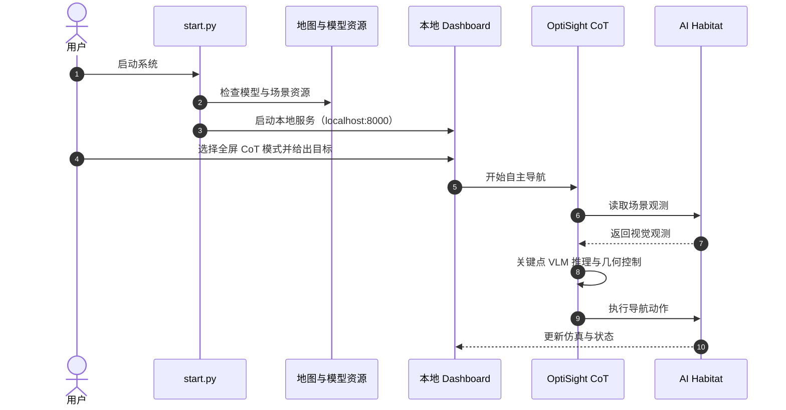

# OptiSight：语义推理与几何控制结合的具身导航

**OptiSight**（[arXiv:2608.23354](https://arxiv.org/abs/2608.23354)；IRI 技术报告 **IRI-TR-26-02**）是 CSIC-UPC 的室内具身导航框架：VLM 在关键决策点解释语义目标，Grounded-SAM 与相机投影几何将目标转为导航指令，连续运动交由确定性视觉伺服执行。

## 英文缩写速查

| 缩写 | 英文全称 | 简要说明 |
|------|----------|----------|
| VLM | Vision-Language Model | OptiSight 在关键决策点调用的视觉语言推理模块 |
| CoT | Chain-of-Thought | 论文用有限状态结构调度的逐步推理过程 |
| FSM | Finite-State Machine | 管理语义决策和导航阶段的有限状态架构 |
| SAM | Segment Anything Model | 与开放词汇检测组合的目标分割模型家族 |
| IRI | Institut de Robòtica i Informàtica Industrial | CSIC-UPC 的工业机器人与计算机视觉研究所 |

## 为什么重要

开放词汇指令要求机器人理解“去出口”一类语义目标，但大模型推理延迟和不稳定的连续动作输出不适合直接放在每个控制周期。OptiSight 展示一种分层接口：让学习模型回答“目标是什么、现在该如何解释观测”，再让几何方法负责“如何稳定地靠近目标”。这种边界适合显存有限、又需要可解释导航环节的仿真原型。

## 方法栈

### 语义决策与连续控制分工

论文描述的有限状态 Chain-of-Thought 架构将 VLM 调用放在关键决策点；低层连续导航期间使用确定性视觉伺服，减少反复运行大模型的计算开销。这个设计的关键不只是“混合模型”，而是把慢速语义判断和连续几何反馈放在不同的时间尺度。

### 开放词汇接地与投影控制

Grounded-SAM 定位开放词汇目标，之后通过相机投影几何从视觉观测计算导航命令。论文称该路线无需稠密建图。复现时需区分语义目标定位、图像到空间的几何转换、以及最终运动控制三个环节；可见的几何假设和相机标定会直接影响空间指令质量。

### 源码运行时序图

该运行路径根据作者 README 中的启动入口、界面模式和 AI Habitat 描述整理；README 未公开自动评测流程，故图中只概括在线导航交互。

## 评测与结果

论文摘要称，OptiSight 在 AI Habitat 中实现多种室内场景下的零样本导航，包括障碍规避与语义歧义场景，并以 8 GB 显存预算作为设计约束。摘要没有列出可独立横向比较的具体 SR/SPL 数值，因此这里不补写未核实的榜单数字。

复现时还需注意，作者代码仓库 README 说明论文中的 24 个场景各重复测试 10 次，汇总成功率由人工记录和统计；仓库没有自动评测脚本。手工评测结果不等同于可直接复跑的 benchmark。

## 与其他工作对比

- [Embodied-Navigator / TAMP-Nav](./paper-embodied-navigator-tamp-nav.md) 同样将视觉语言推理接入具身导航。TAMP-Nav 以 VLM 选择二维像素，再经深度投影交给 SLAM；OptiSight 的摘要强调 Grounded-SAM 开放词汇定位与确定性视觉伺服。两者的目标接口和低层执行器不同，指标不宜直接对照。
- 与统一端到端 VLA 路线相比，OptiSight 把语义推理和几何控制分模块，便于定位误差来源；代价是需要管理分割器、相机几何与仿真资源等独立依赖。

## 结论

**OptiSight 的核心取舍是只在语义决策处使用 VLM，把连续移动留给几何反馈控制。**

1. **适合先做仿真原型**：AI Habitat 和本地 dashboard 提供可观察的导航闭环，但报告验证不代表真实机器人部署效果。
2. **检查接地链路**：分别验证目标定位、投影几何与控制输出，避免把几何或标定误差误判为 VLM 推理错误。
3. **把“8 GB”视为配置报告**：论文摘要给出显存预算，复现仍需逐项核对当前仓库的模型版本、CUDA 环境与场景资源。
4. **评测前补齐自动化**：仓库没有自动统计脚本；要比较版本或模型，应记录场景、重复次数、成功判据并自动汇总。

## 局限与风险

- **仿真到现实边界**：摘要报告 AI Habitat 仿真结果，不能据此推断真实机器人上的定位、避障和控制鲁棒性。
- **几何依赖**：图像到导航命令依赖相机投影与场景几何假设；摘要未提供足以在此页复述的完整标定参数或误差分析。
- **复现资产**：仓库不包含地图和模型权重，必须另行下载；当前仓库的模型清单可能随版本变化。
- **评测可重复性**：结果汇总需要人工统计且无仓库内自动评测脚本，增加复现实验与回归比较成本。

## 关联页面

- [视觉–语言导航（VLN）](../tasks/vision-language-navigation.md) — 导航任务定义及相关范式
- [视觉伺服控制](../methods/visual-servoing.md) — 图像反馈驱动连续运动控制的基础方法
- [Embodied-Navigator / TAMP-Nav](./paper-embodied-navigator-tamp-nav.md) — 以像素目标、SLAM 与策略优化构建的 VLN 路线
- [机器人视觉感知栈选型闭环](../queries/robot-perception-stack-selection-loop.md) — 本页感知能力在机器人视觉感知栈中的位置与选型

## 参考来源

- [论文摘录](../../sources/papers/optisight_arxiv_2608_23354.md)
- [IRI 官方出版记录](../../sources/sites/optisight-iri-tr-26-02.md)
- [作者代码仓库归档](../../sources/repos/optisight-python-multimodal-cot.md)

## 推荐继续阅读

- [论文 arXiv 页面](https://arxiv.org/abs/2608.23354) — 查看完整论文与版本信息
- [IRI-TR-26-02 官方记录](https://www.iri.upc.edu/publications/show/3160) — 查看机构摘要和正式引用
- [作者代码仓库](https://github.com/avanalperen/OptiSight-Python-Multimodal-CoT-for-Visual-Reasoning) — 查看当前实现和运行要求
