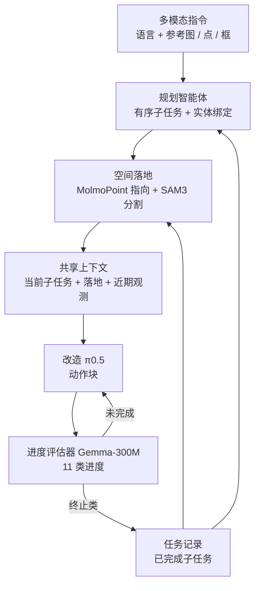

# Orchestra：让「心」构想、让「手」执行的长程多模态指令操作

**Orchestra 是一个 agent harness：任务智能体把多模态指令拆成有序子任务并落地对象，改造后的 π0.5 只负责当前子任务的动作生成，单独训练的进度评估器决定何时切换；配套 RMBench-Compose 测短轨迹训练后的长序列组合能力。**

论文 *Let the Mind Conceive, Let the Hand Achieve: Following Multimodal Instructions for Long-Horizon Robotic Manipulation*（[arXiv:2610.18352](https://arxiv.org/abs/2610.18352)，[代码](https://github.com/youpengwen/Orchestra)，[项目页](https://youpengwen.github.io/Orchestra)）。

## 英文缩写速查

| 缩写 | 英文全称 | 简要说明 |
|------|----------|----------|
| ASL | Average Success Length | 平均连续成功完成的子任务数，长程组合的主指标 |
| SSR | Subtask Success Rate | 子任务成功率 |
| RMBench | （论文使用的记忆依赖操作基准） | 九个记忆依赖任务，Orchestra 平均 68.22%；全称未核实 |
| VLA | Vision-Language-Action | 动作生成部分基于改造 π0.5，见 [VLA](../methods/vla.md) |

## 为什么重要

- 把「做什么、对谁、做到哪了」交给规划与评估模块，动作策略只需会原子子任务，降低对长序列数据的依赖。
- 消融给出明确排序：去任务编排伤害最大（ASL 7.350 → 1.502），其次视觉记忆（2.500），再次空间落地（5.814）。
- RMBench-Compose 单独度量「短训练、长组合」，与常规成功率互补。

## 核心信息

| 项 | 内容 |
|----|------|
| **机构** | 未核实：arXiv HTML 与项目页抓取内容均未列单位 |
| **规划 / 落地** | 规划智能体默认 DeepSeek-V4.1-Flash（可换 Qwen3.7-Plus）；落地用 MolmoPoint-8B + SAM3 |
| **策略 / 评估器** | 改造 π0.5（6 帧窗口、时间注意力）；Gemma-300M 预测 11 类子任务进度 |
| **平台** | RMBench、RMBench-Compose；四个真机任务（每任务 20 条指令） |
| **开源** | **部分开源**（2026-10-17 核查）：[youpengwen/Orchestra](https://github.com/youpengwen/Orchestra) 已含 `embodied_agent/`、`policy/modified_pi05/`、`scripts/` 等；项目页将 Hugging Face / arXiv 标 coming soon；安装与运行命令、许可证在抓取中未显示 |

## 核心原理

### 流程总览

- 子任务切换时重置视觉历史与落地，任务记录保留。
- 动作策略输入：子任务文本、空间提示（框 / 点 / 轮廓）、6 帧视觉窗口（stride 3）。

## 源码运行时序图

**不适用**：仓库已发布，但抓取的 README 未显示安装 / 运行命令，入口脚本无法辨识（`scripts/`、`pyproject.toml` 内容未读，2026-10-17 核查）。待入口确认后按 `embodied_agent/` 与 `policy/modified_pi05/` 补图。

## 与其他工作对比

| 维度 | Orchestra（本文） | [Harness VLA](./paper-harness-vla.md) | [BATON](./paper-baton-long-horizon-manipulation.md) | [行为树 + VLA 编排](../concepts/behavior-tree-vla-orchestration.md) |
|------|------|------|------|------|
| 编排器 | LLM 规划智能体 + 空间落地（MolmoPoint + SAM3） | 记忆增强 agentic planner | LLM 子任务规划 + 子任务探索 | 行为树 |
| 动作策略 | 改造 π0.5（6 帧窗口、时间注意力） | 冻结 VLA 作可重试接触原语 + 解析原语 | 冻结 VLA，不更新参数 | VLA 负责语言条件连续操作 chunk |
| 子任务切换依据 | 独立 Gemma-300M 进度评估器 | 本库页未述 | transition-aware 记忆 | BT 节点的执行结构 |
| 主评测 | RMBench、RMBench-Compose、4 个真机任务 | LIBERO-Pro、RoboCasa365、RoboTwin | RoboMemArena | 概念页，无统一评测 |

- **相对 Harness VLA：** Orchestra 论文把 HarnessVLA 列为基线（RMBench 68.22% 对 26.78%，RMBench-Compose ASL 7.35 对 2.986）；基线具体配置以 Orchestra 原文为准。
- **相对 BATON：** BATON 冻结 VLA、只在 agent 与记忆层适配；Orchestra 改造并训练 π0.5，同时外置进度判定。
- **相对行为树编排：** BT 方案的任务结构由行为树显式定义；Orchestra 的子任务序列由规划智能体从多模态指令生成，切换由学习型评估器决定。
- 各文基准不同，只有 Orchestra 原文中的 HarnessVLA 数字同口径。

## 工程实践

| 项 | 建议 |
|----|------|
| 复现 | 先读仓库 `scripts/` 与 `pyproject.toml` 确认入口；权重 / 数据 HF 页尚未上线 |
| 替换规划器 | 论文测试 DeepSeek 与 Qwen 两种，ASL 7.350 对 7.188，更换影响小，但仅测两种 |
| 进度判定 | 学习型评估器 ASL 7.350，接近状态型 oracle 的 7.374 |
| 评测口径 | 仿真使用参考落地（真值掩码），迁移到预测落地需重测 |
| 开源状态 | 仓库有演示与目录，复现边界待核实 |

## 实验与评测

- **RMBench 九任务：** Orchestra 68.22%，Mem-0 42.00%，HarnessVLA 26.78%；Press Button 97%，Observe and Pick Up 81%，Swap T 仅 10%，Put Back Block 81% 低于 Mem-0 的 90%。
- **RMBench-Compose：** π0.5 单独 ASL 0.932（SSR 47.36%）；Orchestra + π0.5 ASL 2.884；完整 Orchestra ASL 7.350（Atomic SR 95.2%，SSR 86.69%），为 HarnessVLA（2.986）的 2.46 倍。
- **消融 ASL：** 去编排 1.502，去视觉记忆 2.500，去落地 5.814。
- **真机四任务（各 20 条指令）：** ASL 2.20 → 2.75（+25.0%），SSR 72.77% → 82.09%。

## 结论

**Orchestra 的长程增益主要来自任务编排与进度判定的外置，而非更强的动作策略；增益依赖任务，且仿真使用了参考落地。**

1. **编排是第一位** — 去掉后 ASL 从 7.350 降到 1.502。
2. **落地仍有价值** — 去掉后 5.814，影响小于编排与记忆。
3. **任务差异大** — Swap T 仅 10%，Pick Up Object 原子 SR 81% 而 ASL 仅 2.11。
4. **真机提升温和** — ASL 2.20 → 2.75，每任务 20 条指令。
5. **聚合分数不拆责任** — 无法区分操作失败与任务管理失败。

## 局限与风险

- 作者自述：仿真依赖参考落地；聚合分数不分离失败来源；规划智能体仅测两种；评估器与 oracle 近似仅为聚合结果。
- 开源：HF 资源 coming soon；仓库入口、许可证未核实。
- 推测：外置 LLM 规划的延迟与成本会影响真机闭环频率，论文抓取内容未给出（未核实）。

## 关联页面

- [VLA](../methods/vla.md) — 动作生成骨干（π0.5）
- [行为树 + VLA 编排](../concepts/behavior-tree-vla-orchestration.md) — 同属任务编排与 VLA 解耦的思路
- [具身大模型评测基准选型闭环](../queries/embodied-eval-benchmark-selection-loop.md) — Orchestra 在 RMBench 等长程基准上报告成功率，读数前先按任务成功率层核对协议与 episode 数
- [SAM 3](../entities/paper-sam3.md) — 空间落地所用分割模型
- [操作任务](../tasks/manipulation.md)

## 参考来源

- [orchestra_arxiv_2610_18352.md](../../sources/papers/orchestra_arxiv_2610_18352.md) — 论文摘录与开源核查
- [orchestra-project.md](../../sources/sites/orchestra-project.md) — 项目页归档
- [orchestra.md](../../sources/repos/orchestra.md) — 官方仓库归档
- [arXiv:2610.18352](https://arxiv.org/abs/2610.18352)

## 推荐继续阅读

- [Orchestra 项目页](https://youpengwen.github.io/Orchestra)
- [Orchestra 代码仓库](https://github.com/youpengwen/Orchestra)
