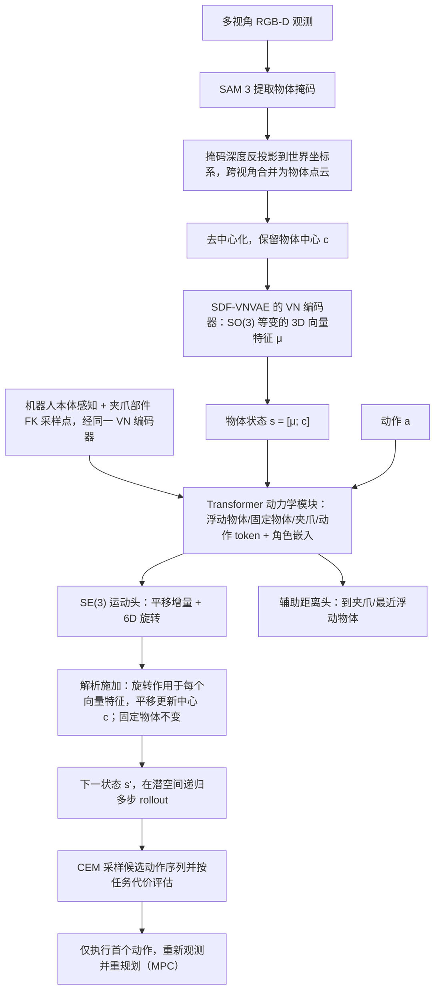

# ORD-WM（arXiv:2610.23156）

**ORD-WM**（*ORD-WM: Learning Object-Centric Rigid Dynamics for 3D World Modeling in Robotic Manipulation*，[arXiv:2610.23156](https://arxiv.org/abs/2610.23156)，[项目页](https://hitsz-wyy.github.io/ORD-WM/)）来自 [具身智能小站 2026-11-01 盘点](../../sources/blogs/wechat_embodied_station_56_papers_libero_dynamic_latency_eval_2026-11-01.md)，属「世界模型与在线适配」组。

## 一句话定义

**ORD-WM把物体形状编码为几何潜表示，再解析施加预测的刚体运动；仿真与真实闭环推动展示几何保持，目前不覆盖铰接物体、柔性形变和复杂高速动力学。**

## 英文缩写速查

| 缩写 | 英文全称 | 简要说明 |
|------|----------|----------|
| ORD-WM | ORD-WM: Learning Object-Centric Rigid Dynamics for 3D World Modeling in Robotic Manipulation | 本文方法 / 基准的简称 |
| 3D | 3D | 三维 |

## 为什么重要

- 世界模型预测位姿，保持刚体形状。
- 开源结论：**项目页未列 GitHub**（步骤 2.5，2026-11-01）。项目页 HTTP 200，未见 GitHub 链接或 coming soon 字样。
- 同期同组工作见 [动态评测、技能编译与环境潜变量适配：具身智能小站 11-01 期 56 篇阅读坐标](../overview/embodied-station-2026-11-01-56-papers-technology-map.md)。

## 流程总览

图依据：论文 §3.1–3.4 / Fig.1、Fig.2、Fig.3。

## 核心机制

| 项 | 内容 |
|----|------|
| **arXiv** | [2610.23156](https://arxiv.org/abs/2610.23156) |
| **开源** | **项目页未列 GitHub** |
| **要点** | ORD-WM把物体形状编码为几何潜表示，再解析施加预测的刚体运动；仿真与真实闭环推动展示几何保持，目前不覆盖铰接物体、柔性形变和复杂高速动力学。 |
| **文内指标** | 公众号未给具体数字，本页不引用。 |

## 源码运行时序图

**不适用（项目页未列 GitHub）** — 项目页 HTTP 200，未见 GitHub 链接或 coming soon 字样。 不编造运行脚本；代码公开后再补。

## 实验与评测

- 公众号未给具体数字，本页不引用。
- **读法：** 本页为索引级摘要，依据公众号转述的官方摘要与仓库信息整理；逐项数字与 baseline 以原文 PDF 为准。

## 与其他工作对比

- 横向索引见 [动态评测、技能编译与环境潜变量适配：具身智能小站 11-01 期 56 篇阅读坐标](../overview/embodied-station-2026-11-01-56-papers-technology-map.md)；同 arXiv 不重复造页。

## 结论

**世界模型预测位姿，保持刚体形状：ORD-WM把物体形状编码为几何潜表示，再解析施加预测的刚体运动；仿真与真实闭环推动展示几何保持，目前不覆盖铰接物体、柔性形变和复杂高速动力学。**

1. 开源边界：**项目页未列 GitHub** — 项目页 HTTP 200，未见 GitHub 链接或 coming soon 字样。
2. 核心机制：ORD-WM把物体形状编码为几何潜表示，再解析施加预测的刚体运动；仿真与真实闭环推动展示几何保持，目前不覆盖铰接物体、柔性形变和复杂高速动力学。
3. 复现与选型前核对任务协议、硬件与基准口径，勿直接横比公众号摘录数字。

## 关联页面

- [world-action-models](../concepts/world-action-models.md)
- [generative-world-models](../methods/generative-world-models.md)
- [vla](../methods/vla.md)
- [embodied-station-2026-11-01-56-papers-technology-map](../overview/embodied-station-2026-11-01-56-papers-technology-map.md)

## 参考来源

- [ord_wm_arxiv_2610_23156.md](../../sources/papers/ord_wm_arxiv_2610_23156.md)
- [wechat_embodied_station_56_papers_libero_dynamic_latency_eval_2026-11-01.md](../../sources/blogs/wechat_embodied_station_56_papers_libero_dynamic_latency_eval_2026-11-01.md)
- [arXiv:2610.23156](https://arxiv.org/abs/2610.23156)
- [arXiv PDF](https://arxiv.org/pdf/2610.23156)：已通读全文：对象中心观测、SDF-VNVAE、刚体动力学与 CEM-MPC（§3.1–3.4、§4）

## 推荐继续阅读

- [arXiv PDF](https://arxiv.org/pdf/2610.23156)
- [项目页](https://hitsz-wyy.github.io/ORD-WM/)
