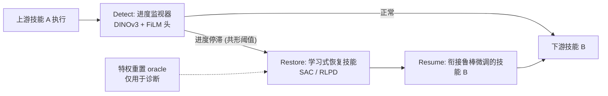
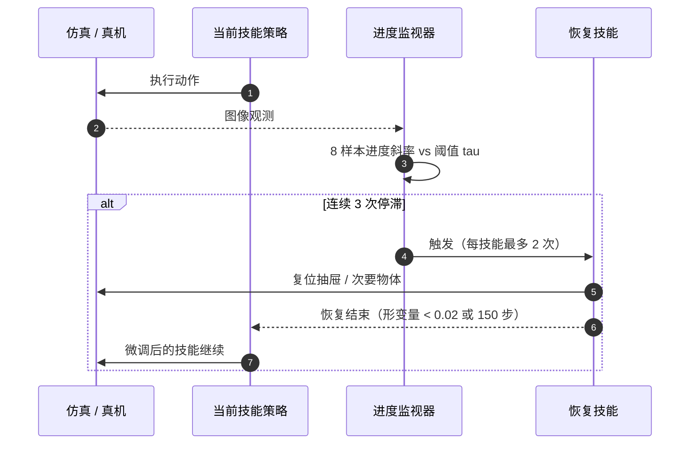

# Detect-Restore-Resume（OSS 技能衔接恢复）

**Diagnosing and Recovering from Observation-Space Shift at Long-Horizon Skill Seams**（arXiv:2610.10810，UNC Chapel Hill，Mingyu Ding 组）指出：串联多个独立训练技能时，失败集中在“衔接处”，原因是上一个技能把场景留在下游技能没见过的状态（观测空间偏移，OSS），主因是**场景残留状态**而非机器人自身关节；因此提出“检测停滞 -> 学习式恢复场景 -> 继续原技能”的 Detect-Restore-Resume。

## 英文缩写速查

| 缩写 | 英文全称 | 简要说明 |
|------|----------|----------|
| OSS | Observation-Space Shift | 上一技能结束时的观测/状态超出下游技能训练支撑集 |
| BOSS-44 | 论文自建基准（44 个 LIBERO-90 任务上的技能链） | 三技能链、两个衔接点，仿真评测 |
| L2 | 完整三技能链成功率 | 论文主指标；L0/L1 为首个/前两个技能成功率 |
| SAC / RLPD | Soft Actor-Critic / RL with Prior Data | 训练场景恢复技能的 RL 算法 |
| AUROC | Area Under ROC Curve | 评价停滞检测器区分能力 |
| FiLM | Feature-wise Linear Modulation | 监视器头的条件调制方式 |

## 为什么重要

- **改变了对失败的归因：** 特权重置实验显示，把机械臂关节恢复到规范值只把 L2 从 0.098 提到 0.132，而恢复抽屉与次要物体后可达 0.518；“让机器人回到熟悉姿态”不是主要杠杆。
- **给“重试”划了边界：** 简单重试预算只到 0.129；从 off-support 状态原地重试，Best-of-K（K=8）与 Diffusion Policy 在衔接点均为 0.00。
- **可组合：** 监视器、恢复技能和下游微调是三个独立组件，可以挂在现成的技能库上。

## 流程总览

## 核心原理（方法）

### 1）OSS 诊断
在 100 条灾难性链上，用特权 teleport 在告警点把不同场景分量重置为规范值，比较 L2：不恢复 0.098，仅臂 0.132，臂+抽屉 0.212，臂+次要物体 0.268，全部 0.518。抽屉与次要物体联合恢复的收益超过各自之和（超额 0.170，约 3.3 sigma），说明二者互补；被操作物体本身接近规范值。

### 2）Detect
冻结 DINOv3 ViT-B/16 编码 128x128 图像，约 1M 参数的 FiLM 条件 ResNet 头回归进度 logit，损失为绝对进度 BCE + 示范内排序损失 + 成功/停滞对比损失。触发规则：8 样本窗口内进度斜率停滞，统计量连续 3 次超过共形校准阈值 tau；工作点 0.95 TPR / 7% 误报，汇总 AUROC 0.903，6.1 ms/帧。

### 3）Restore
每个场景训练专门的恢复技能：S1/S2 用 SAC，S4 用示范增强的 RLPD。奖励 = 被扰动分量到目标的距离 + 扰动惩罚 + 成功奖励，回合最长 150 步；使用约 14k 失败状态重置库（S1 5.7k / S2 4.6k / S4 3.6k）。技能级成功率 1.00 / 0.93 / 0.78；仅相机学生策略（RGB + 16 维本体感知）相对教师 0.85 / 0.90。每个技能最多触发 2 次告警。

### 4）Resume
对每个下游技能，用恢复闭环收集的 581 条衔接示范与原示范混合做微调，按“衔接窗口损失 + 遗忘约束”选 checkpoint。

### 5）基准 BOSS-44
LIBERO-90 的 44 个厨房/客厅任务，robosuite + MuJoCo，7-DoF Panda、20 Hz OSC 增量控制；基础策略是每任务一个冻结的 BC-Transformer（agentview + 腕部 RGB + 16 维本体感知）。主分析取 10 条灾难性链（base L2 <= 0.30，涉及 13 个技能），每链 20 回合 x 5 种子。基础链 L0/L1/L2 = 0.885 / 0.343 / 0.076。

## 源码运行时序图

不适用：arXiv 页面与正文均未提供项目页或代码仓库，截至 2026-10-12 未发现公开实现，无法对齐真实目录与脚本。下图仅是论文描述的**推理时**闭环（非仓库结构）：

## 工程实践

- 复现需要自行搭建 BOSS-44（LIBERO-90 任务 + 链定义）、训练 BC-Transformer 基线与场景专属 SAC/RLPD 恢复技能；论文未发布代码，细节只能按上文推断。
- 监视器表现强依赖相机可观测性：真机用外部相机时 AUROC 仅 0.625 / 0.672（留一回合/留一链），与随机不可区分（Fisher p 约 0.12）；作者建议增加腕部与夹爪传感。
- **开源状态：** 无项目页、无仓库；截至 2026-10-12 未核实到任何公开代码或数据。

## 实验与评测

| 配置（10 条链，L2） | 成功率 |
|------|------|
| Base | 0.076 |
| Base + 重试预算 | 0.129 |
| 仅恢复 | 0.175 |
| 仅预防（衔接微调） | 0.114 |
| 恢复 + 预防（完整） | **0.265**（p=0.047） |
| 特权重置 oracle | 0.518 |

- 完整系统约 3.5x base、约 oracle 的 51%；逐场景 L2：S1 0.29、S2 0.34、S4 0.16；留出链顺序上由 0.066 升到 0.244。
- 衔接点基线：Best-of-K 0.00、Diffusion Policy 0.00、世界模型作生成器约等于 base、作监视器 AUROC < 0.5；端到端 RL（RecoveryChaining）0.45 对示范基线 0.52。
- 检测器对比（AUROC）：DINOv3-B 0.903、Wan-VAE 0.782（38 ms）、Robometer 0.746、GVL 0.718；用真值衔接时机 L2 为 0.226。
- 恢复适用边界：抽屉阻挡非抽屉技能时有效（ch3_2: 0 -> 0.27；ch3_3: 0.01 -> 0.29）；下游技能本身要操作抽屉时可能变差（ch3_8: 0.32 -> 0.21；ch3_12: 0.25 -> 0.10）。
- 真机（Franka + LoRA 微调 π0.5，3 条链共 9 个技能，每链 15 次）：终端放置尝试恢复数 基线 0/19，加恢复 3/21。

## 结论

**长程技能链的瓶颈是“上游留下的场景状态”，先恢复场景再继续，比原地重试更有效；但目前仅在仿真抽屉类衔接上证明，绝对成功率仍低。**

1. **先诊断再设计：** 用特权重置判断哪类状态残留真正致命，再决定恢复什么。
2. **恢复与预防互补：** 单独恢复 0.175、单独微调 0.114，联合 0.265；不要只选其一。
3. **监视器是真机瓶颈：** 外部相机检测与随机无异，加腕部/夹爪传感比换更大模型更关键。
4. **恢复可能伤害：** 下游技能自己要操作同一物体（如抽屉）时，恢复会降低成功率，需按任务类型判断是否触发。
5. **数据放大不等于有效：** 衔接示范放大 10 倍无增益，说明分布覆盖而非数量是问题（作者结论，仅一个种子）。
6. **别过度解读：** n=10 链、单基础策略种子、未做多重校正，真机增益为 3/21 级别。

## 与其他工作对比

| 对照 | 差异读法 |
|------|----------|
| [LIBERO-Recovery](./paper-libero-recover.md) | 同样关注失败恢复，但本文聚焦技能串联的衔接，并给出可学习的场景恢复与检测器 |
| [ManiUnit](./paper-maniunit.md) | ManiUnit 用基准度量“起始状态扰动”对单技能的伤害（关节扰动降约 56%）；本文给出一种在串联时纠偏的方法 |
| Best-of-K / [Diffusion Policy](../methods/diffusion-policy.md) | 在 off-support 衔接状态上重采样无效（0.00），说明问题不是策略随机性 |
| [π0.5](./paper-pi05-open-world-vla.md) 真机实验 | 作为被恢复/被监视的下游执行器，结论受外部相机限制 |

## 局限与风险

- 定量核心仅仿真；恢复只针对抽屉类衔接，自由物体阻挡类（物体恢复器 L2 约 0.10）基本无解；单基础策略、n=10 链。
- 原文个别表格数字疑似错位，引用逐链数字前需回查原文。
- 无公开代码，难独立验证；作者在致谢中说明撰写使用了 AI 助手（与结果无关，仅备注）。

## 关联页面

- [Manipulation 周报汇总（10.5-10.9）](../overview/frontier-manipulation-2026-10-05-10-09.md)
- [操作任务总览](../tasks/manipulation.md)
- [模仿学习](../methods/imitation-learning.md)
- [LIBERO 基准](./libero-benchmark.md)

## 参考来源

- [OSS 技能衔接恢复论文归档](../../sources/papers/oss_seam_recovery_arxiv_2610_10810.md)
- [Manipulation 周报来源](../../sources/blogs/frontier_manipulation_2026_10_05_10_09.md)
- 论文：<https://arxiv.org/abs/2610.10810>

## 推荐继续阅读

- [arXiv HTML 全文](https://arxiv.org/html/2610.10810v1)
- [LIBERO 基准（Liu et al.）](https://arxiv.org/abs/2306.03310)
