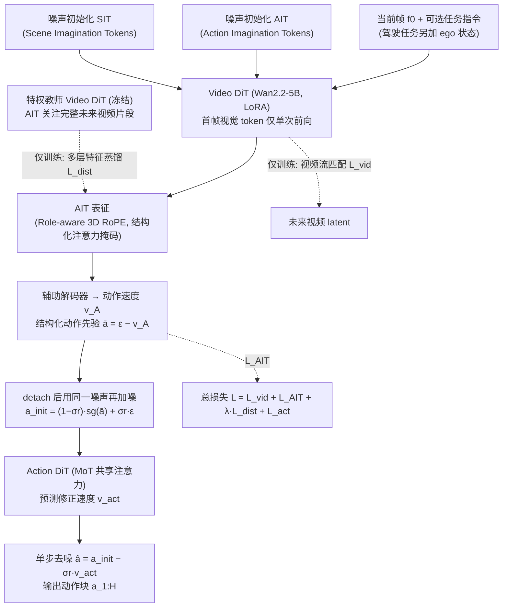

# OSWAM：具有单步动作生成能力的高效世界动作模型

**OSWAM**（*OSWAM: An Effective World Action Model with One-Step Action Generation*，[arXiv:2610.35850](https://arxiv.org/abs/2610.35850)）收录于 senlanke「具身运控lab」10-26–10-30 前沿论文动态（Manipulation）。本页依据**周报条目 + arXiv 摘要页**整理，流程图依据论文方法部分（见参考来源），未逐页核对实验数字；指标与结论以论文为准。

## 一句话定义

**OSWAM：具有单步动作生成能力的高效世界动作模型——引入 Imagination Tokens，为扩散过程提供结构化动作先验，并通过特权信息蒸馏学习未来条件信息。模型只需一步扩散即可生成动作，相比直接策略式 WAM 约加速 3 倍；在 RTX 5090 上编译推理延迟最低约 40 ms。**

## 英文缩写速查

| 缩写 | 英文全称 | 简要说明 |
|------|----------|----------|
| WAM | World Action Model | 世界–动作联合建模 |
| VLA | Vision-Language-Action | 视觉–语言–动作模型 |

## 为什么重要

- 周报所述待解决的问题：WAM 依赖多步去噪生成动作，推理延迟较高。直接减少去噪步数又容易损害动作质量。

## 流程总览

图依据：论文 §3.2–3.5 / Fig.3、Fig.4

## 核心机制

| 项 | 内容 |
|----|------|
| **arXiv** | [2610.35850](https://arxiv.org/abs/2610.35850) · [PDF](https://arxiv.org/pdf/2610.35850) |
| **作者（arXiv）** | Zhang, Guowen, Chen, Liyi, Hu, Xu, Wang, Pengfei, Chen, Jingfan, He, Chenhang, Zhang, Lei |
| **机构（周报所述，未逐条核实）** | 香港理工大学。 |
| **arXiv 评论栏** | （无） |
| **开源** | arXiv 摘要页与评论未见代码或项目页链接（仅核对 arXiv 摘要页，不代表未发布）（2026-11-02） |
| **周报所述创新点** | 引入 Imagination Tokens，为扩散过程提供结构化动作先验，并通过特权信息蒸馏学习未来条件信息。模型只需一步扩散即可生成动作，相比直接策略式 WAM 约加速 3 倍；在 RTX 5090 上编译推理延迟最低约 40 ms。 |

### arXiv 摘要节选（英文原文）

> Direct-policy World Action Models (WAM) have demonstrated the benefits of decoupling action generation from explicit future visual prediction for efficient inference in autonomous driving and embodied control. However, they still require tens of denoising steps to achieve competitive action quality, incurring substantial latency and hindering real-time deployment.

## 源码运行时序图

**不适用**：arXiv 摘要页与评论未见代码或项目页链接（仅核对 arXiv 摘要页，不代表未发布），无可对齐的官方代码流程。

## 实验与评测

- 周报与摘要给出的数字/场景已写入上表「创新点」与摘要节选；其余实验细节、基线与成功率定义请回到论文正文。
- 读法：先对齐任务设定、传感器与成功定义（仿真/真机），再解读 headline 数字，勿跨论文直接比较。

## 与其他工作对比

| 维度 | 读法 |
|------|------|
| **同周对照** | 见 [Manipulation周报技术地图](../overview/senlanke-weekly-2026-10-26-30-manipulation-technology-map.md)，按方向浏览同期论文 |
| **开源状态** | arXiv 摘要页与评论未见代码或项目页链接（仅核对 arXiv 摘要页，不代表未发布） |

## 结论

**OSWAM：具有单步动作生成能力的高效世界动作模型。**

1. 本页是入库级摘要，复现前请核对论文正文、附录与代码仓库。
2. 指标须连同实验条件解读。
3. 关注 arXiv 版本更新与代码发布。

## 关联页面

- [senlanke-weekly-2026-10-26-30-manipulation-technology-map](../overview/senlanke-weekly-2026-10-26-30-manipulation-technology-map.md)
- [manipulation](../tasks/manipulation.md)
- [vla](../methods/vla.md)

## 参考来源

- [oswam-one-step-action-generation_arxiv_2610_35850.md](../../sources/papers/oswam-one-step-action-generation_arxiv_2610_35850.md)
- [wechat_senlanke_weekly_manipulation_2026-10-26_30.md](../../sources/blogs/wechat_senlanke_weekly_manipulation_2026-10-26_30.md)
- [arXiv:2610.35850](https://arxiv.org/abs/2610.35850)
- [arXiv PDF](https://arxiv.org/pdf/2610.35850)：已通读方法部分（实验与附录以略读为准）：§3 方法（总体架构、Imagination Tokens、特权信息蒸馏、训练目标）与 §4.2 实现细节

## 推荐继续阅读

- [arXiv PDF](https://arxiv.org/pdf/2610.35850)
